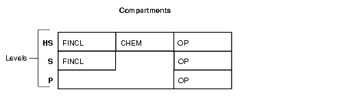
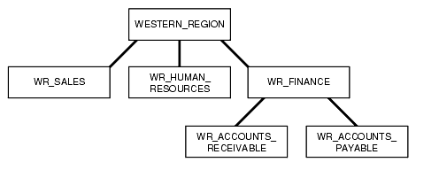

An Oracle Label Security policy is a named set of commands that implements Oracle Label Security.

- About Creating Oracle Label Security Policies
  When you create an Oracle Label Security policy, you must follow a set of general steps.
- Step 1: Create the Label Security Policy Container
  The Oracle Label Security policy container is a storage place for the policy settings.
- Step 2: Create Data Labels for the Label Security Policy
  After you create a policy container, you are ready to create data labels for each database table row.
- Step 3: Authorize Users for the Label Security Policy
  Before users can have access to data that is protected by an Oracle Label Security policy, they must be authorized.
- Step 4: Grant Privileges to Users and Trusted Stored Program Units
  You can grant privileges to users, such as `READ` so that users can read data protected an Oracle Label Security policy protects.
- Step 5: Apply the Policy to a Database Table or Schema
  After you create grant authorizations and privileges to an Oracle Label Security policy, you can apply it to a database table or schema.
- Step 6: Add Policy Labels to Table Rows
  You must add policy labels to table rows.
- Step 7: (Optional) Configure Auditing
  You can audit Oracle Label Security policies by using the `SA_USER_ADMIN` P/L SQL package.
- Using Enterprise Manager Cloud Control to Create an OLS Policy
  You can create Oracle Label Security policies in Oracle Enterprise Manager Cloud Control.

**Parent topic:** [Using Oracle Label Security Functionality](part2.md)

### 5.1 About Creating Oracle Label Security Policies

When you create an Oracle Label Security policy, you must follow a set of general steps.

1.  Create a policy container that defines the policy name, the name of a column that Oracle Label Security will add to the tables to be protected, whether to hide this column, whether to enable the policy, and default enforcement options for the policy.

    See Step 1: Create the Label Security Policy Container for more information.

2.  Define the following attributes for the label: level of sensitivity, and optionally, compartments and groups to further filter the label sensitivity. Once you have the attributes defined, create the label itself and then associate these attributes with the label.

    See Step 2: Create Data Labels for the Label Security Policy.

3.  Authorize users for the policy.

    See Step 3: Authorize Users for the Label Security Policy for more information.

4.  Grant privileges to these users or to trusted program units.

    See Step 4: Grant Privileges to Users and Trusted Stored Program Units for more information.

5.  Apply the policy to a database table. Alternatively, you can apply the policy to an entire schema.

    See Step 5: Apply the Policy to a Database Table or Schema for more information.

6.  Add the policy labels to the table rows. You must update the table that is being used for the policy.

    See Step 6: Add Policy Labels to Table Rows for more information.

7.  Optionally, configure audit settings for users.

    See Step 7: (Optional) Configure Auditing for more information.

**Parent topic:** Creating an Oracle Label Security Policy

### 5.2 Step 1: Create the Label Security Policy Container

The Oracle Label Security policy container is a storage place for the policy settings.

- About the Label Security Policy Container
  The Oracle Label Security policy container stores metadata that describes how the policy behaves.
- Creating a Label Policy Container
  You can use the `SA_SYSDBA.CREATE_POLICY` procedure to create an Oracle Label Security policy container.

**Parent topic:** Creating an Oracle Label Security Policy

#### 5.2.1 About the Label Security Policy Container

The Oracle Label Security policy container stores metadata that describes how the policy behaves.

This container defines the policy name, the name of a column that Oracle Label Security will add to the tables to be protected, whether to hide this column, and default enforcement options for the policy.

The column that you add to the tables that you want to protect will include data labels (which you create later on) that are assigned to specific rows in a the table, based on values in a specific column. The policy creation process creates a special role for the policy and grants this role to the user who creates the policy. The role name is in the format `policy``_DBA`. For example, for a policy named `EMP_OLS_POL`, the role name is `EMP_OLS_POL_DBA`. This role becomes effective only after a new user session begins.

You can create the policy container in Oracle Enterprise Manager Cloud Control, or use the `SA_SYSDBA.CREATE_POLICY` procedure.

**Parent topic:** Step 1: Create the Label Security Policy Container

#### 5.2.2 Creating a Label Policy Container

You can use the `SA_SYSDBA.CREATE_POLICY` procedure to create an Oracle Label Security policy container.

- To create the policy, run `SA_SYSDBA.CREATE_POLICY`, specifying the policy name, column name, and default options.

For example:

    BEGIN
     SA_SYSDBA.CREATE_POLICY (
      policy_name      => 'emp_ols_pol',
      column_name      => 'ols_col',
      default_options  => 'read_control, update_control');
    END;
    /

**Related Topics**

- [SA_SYSDBA.CREATE_POLICY](oracle-label-security-pl-sql-packages.md)

**Parent topic:** Step 1: Create the Label Security Policy Container

### 5.3 Step 2: Create Data Labels for the Label Security Policy

After you create a policy container, you are ready to create data labels for each database table row.

- About Data Labels
  A data label indicates the sensitivity of a database table row.
- About Policy Level Sensitivity Components
  A level is a ranking that denotes the sensitivity of the information it labels.
- Creating a Policy Level Component
  The `SA_COMPONENTS.CREATE_LEVEL` procedure creates a policy level component.
- About Policy Compartment Components
  Compartments identify areas that describe the sensitivity of the labeled data, providing a finer level of granularity within a level.
- Creating a Policy Compartment Component
  The `SA_COMPONENTS.CREATE_COMPARTMENT` procedure creates an Oracle Label Security compartment.
- About Policy Group Components
  Groups identify organizations owning or accessing the data, such as `EASTERN_REGION`, `WESTERN_REGION`, `WR_SALES`.
- Creating a Policy Data Label Group
  The `SA_COMPONENTS.CREATE_GROUP` procedure creates a data label group.
- About Associating the Policy Components with a Named Data Label
  After defining the data label components, you can create a data label itself by associating it with an existing level.
- Associating the Policy Components with a Named Data Label
  The `SA_LABEL_ADMIN.CREATE_LABEL` procedure creates a data label.

**Parent topic:** Creating an Oracle Label Security Policy

#### 5.3.1 About Data Labels

A data label indicates the sensitivity of a database table row.

Each label is a single attribute with multiple components that control the types of filtering to be used for user access.

Table 5-1 describes the different components of a data label.

Table 5-1 Sensitivity Data Label Components

| Component    | Description                                                                                    | Examples                                                    |
|:-------------|:-----------------------------------------------------------------------------------------------|:------------------------------------------------------------|
| Level        | A single specification of the sensitivity of labeled data within the ordered ranks established | `CONFIDENTIAL` (1), `SENSITIVE` (2), `HIGHLY_SENSITIVE` (3) |
| Compartments | Zero or more categories associated with the labeled data                                       | `FINANCIAL`, `STRATEGIC`, `NUCLEAR`                         |
| Groups       | Zero or more identifiers for organizations owning or accessing the data                        | `EASTERN_REGION`, `WESTERN_REGION`                          |

All data labels must contain a level component, but the compartment and group components are optional. Compartments and groups are a way of fine tuning access that users will have to the data. Valid characters for specifying all label components include alphanumeric characters, underscores, and spaces. (Leading and trailing spaces are ignored.) You must define the label components before you can create the data label itself.

You can use Cloud Control to create the label and its components for an existing policy. Alternatively, you can use the `SA_COMPONENTS` PL/SQL package to create the components, and the `SA_LABEL_ADMIN` package to create the data label.

**Related Topics**

- [SA_COMPONENTS Label Components PL/SQL Package](oracle-label-security-pl-sql-packages.md)

**Parent topic:** Step 2: Create Data Labels for the Label Security Policy

#### 5.3.2 About Policy Level Sensitivity Components

A level is a ranking that denotes the sensitivity of the information it labels.

The more sensitive the information, the higher its level. The less sensitive the information, the lower its level.

Every label must include one level. Oracle Label Security permits up to 10,000 levels in a policy. For each level, you must define a numeric form, a long character form, and the required short character form.

Table 5-2 shows examples of levels.

Table 5-2 Policy Level Example

| Numeric Form | Long Form          | Short Form |
|:-------------|:-------------------|:-----------|
| `40`         | `HIGHLY_SENSITIVE` | `HS`       |
| `30`         | `SENSITIVE`        | `S`        |
| `20`         | `CONFIDENTIAL`     | `C`        |
| `10`         | `PUBLIC`           | `P`        |

Table 5-2 explains the numeric form, long form, and short form for levels.

Table 5-3 Forms of Specifying Levels

| Form                            | Explanation                                                                                                                                                                                                                                                                                                                                                                                                                                                                                                                                                              |
|:--------------------------------|:-------------------------------------------------------------------------------------------------------------------------------------------------------------------------------------------------------------------------------------------------------------------------------------------------------------------------------------------------------------------------------------------------------------------------------------------------------------------------------------------------------------------------------------------------------------------------|
| Numeric form, also called "tag" | The numeric form of the level can range from 0 to 9999. Sensitivity is ranked by this numeric value, so you must assign higher numbers to levels that are more sensitive, and lower numbers to levels that are less sensitive. In Table 5-2, 40 (`HIGHLY_SENSITIVE`) is a higher level than 30, 20, and 10. Administrators should avoid using sequential numbers for the numeric form of levels. A good strategy is to use even increments (such as 50 or 100) between levels. You can then insert additional levels between two preexisting levels, at a later date. |
| Long form                       | The long form of the level name can contain up to 80 characters.                                                                                                                                                                                                                                                                                                                                                                                                                                                                                                         |
| Short form                      | The short form can contain up to 30 characters.                                                                                                                                                                                                                                                                                                                                                                                                                                                                                                                          |

Although you define both long and short names for the level (and for each of the other label components), only the short form of the name is displayed upon retrieval. When users manipulate the labels, they use only the short form of the component names.

Examples of levels can be names such as `TOP_SECRET`, `SECRET`, `CONFIDENTIAL`, and `UNCLASSIFIED` or `TRADE_SECRET`, `PROPRIETARY`, `COMPANY_CONFIDENTIAL`, `PUBLIC_DOMAIN`.

If you use only levels, a level 40 user (in this example) can access or alter any data row whose level is 40 or less.

**Parent topic:** Step 2: Create Data Labels for the Label Security Policy

#### 5.3.3 Creating a Policy Level Component

The `SA_COMPONENTS.CREATE_LEVEL` procedure creates a policy level component.

- To create the policy level component, run `SA_COMPONENTS.CREATE_LEVEL`, specifying the policy name and details about the component.

For example:

    BEGIN
     SA_COMPONENTS.CREATE_LEVEL (
       policy_name   => 'emp_ols_pol',
       level_num     => 40,
       short_name    => 'HS',
       long_name     => 'HIGHLY_SENSITIVE');
    END;
    /

**Related Topics**

- [SA_COMPONENTS.CREATE_LEVEL](oracle-label-security-pl-sql-packages.md)

**Parent topic:** Step 2: Create Data Labels for the Label Security Policy

#### 5.3.4 About Policy Compartment Components

Compartments identify areas that describe the sensitivity of the labeled data, providing a finer level of granularity within a level.

Compartments associate the data with one or more security areas. All data related to a particular project can be labeled with the same compartment.

Table 5-4 shows an example set of compartments.

Table 5-4 Policy Compartment Example

| Numeric Form | Long Form     | Short Form |
|:-------------|:--------------|:-----------|
| `85`         | `FINANCIAL`   | `FINCL`    |
| `65`         | `CHEMICAL`    | `CHEM`     |
| `45`         | `OPERATIONAL` | `OP`       |

Table 5-5 shows different ways to specify compartments.

Table 5-5 Forms of Specifying Compartments

| Form         | Explanation                                                                                                                                                                                                                                                                                                                                                                                                                                                                                                                                                                                                                                                                                                                                                                                                                                                            |
|:-------------|:-----------------------------------------------------------------------------------------------------------------------------------------------------------------------------------------------------------------------------------------------------------------------------------------------------------------------------------------------------------------------------------------------------------------------------------------------------------------------------------------------------------------------------------------------------------------------------------------------------------------------------------------------------------------------------------------------------------------------------------------------------------------------------------------------------------------------------------------------------------------------|
| Numeric form | The numeric form can range from 0 to 9999. It is unrelated to the numbers used for the levels. The numeric form of the compartment does not indicate greater or less sensitivity. Instead, it controls the display order of the short form compartment name in the label character string. For example, assume a label is created that has all three compartments listed in Table 5-4, and a level of `SENSITIVE`. When this label is displayed in string format, it looks like this: `S:OP,CHEM,FINCL` meaning `SENSITIVE`: `OPERATIONAL`, `CHEMICAL`, `FINANCIAL` The display order follows the order of the numbers assigned to the compartments: 45 is lower than 65, and 65 is lower than 85. By contrast, if the number assigned to the `FINCL` compartment were 5, the character string format of the label would look like this: `S:FINCL,OP,CHEM` |
| Long form    | The long form of the compartment name scan have up to 80 characters.                                                                                                                                                                                                                                                                                                                                                                                                                                                                                                                                                                                                                                                                                                                                                                                                   |
| Short form   | The short form can contain up to 30 characters.                                                                                                                                                                                                                                                                                                                                                                                                                                                                                                                                                                                                                                                                                                                                                                                                                        |

Compartments are optional. You can include up to 10,000 compartments for a label.

Not all labels must have compartments. For example, you can specify `HIGHLY_SENSITIVE` and `CONFIDENTIAL` levels with no compartments, and a `SENSITIVE` level that does contain compartments.

When you analyze the sensitivity of data, you may find that some compartments are only useful at specific levels.

The following figure shows how compartments can be used to categorize data.

Figure 5-1 Compartments in a Label

[Description of "Figure 5-1 Compartments in a Label"](img_text/olsag005.md)

Here, compartments `FINCL`, `CHEM`, and `OP` are used with the level `HIGHLY_SENSITIVE` (`HS`). The label `HIGHLY_SENSITIVE`:`FINCL`, `CHEM` indicates a level of 40 with the two named compartments. Compartment `FINCL` is not more sensitive than `CHEM`, nor is `CHEM` more sensitive than `FINCL`. Note also that some data in the protected table may not belong to any compartment.

If you specify compartments, then a user whose level would normally permit access to a row's data will nevertheless be prevented from such access unless the user's label also contains all the compartments appearing in that row's label. For example, user `hpreston`, who is granted access to the `HS` level, could be granted access only to `FINCL` and `CHEM` but not to `OP`.

**Parent topic:** Step 2: Create Data Labels for the Label Security Policy

#### 5.3.5 Creating a Policy Compartment Component

The `SA_COMPONENTS.CREATE_COMPARTMENT` procedure creates an Oracle Label Security compartment.

- To create the compartment, run the `SA_COMPONENTS.CREATE_COMPARTMENT` procedure to create a compartment, specifying the policy name and details about the compartment.

For example:

    BEGIN
      SA_COMPONENTS.CREATE_COMPARTMENT (
       policy_name     => 'emp_ols_pol',
       comp_num        => '85',
       short_name      => 'FINCL',
       long_name       => 'FINANCIAL');
    END;
    /

**Related Topics**

- [SA_COMPONENTS.CREATE_COMPARTMENT](oracle-label-security-pl-sql-packages.md)

**Parent topic:** Step 2: Create Data Labels for the Label Security Policy

#### 5.3.6 About Policy Group Components

Groups identify organizations owning or accessing the data, such as `EASTERN_REGION`, `WESTERN_REGION`, `WR_SALES`.

All data pertaining to a certain department can have that department's group in the label. Groups are useful for the controlled dissemination of data and for timely reaction to organizational change. When a company reorganizes, data access can change right along with the reorganization.

Groups are hierarchical. You can label data based upon your organizational infrastructure. A group can thus be associated with a parent group.

Figure 5-2 shows how you can define a set of groups corresponding to the following organizational hierarchy.

Figure 5-2 Group Example

[Description of "Figure 5-2 Group Example"](img_text/olsag009.md)

The `WESTERN_REGION` group includes three subgroups: `WR_SALES`, `WR_HUMAN_RESOURCES`, and `WR_FINANCE`. The `WR_FINANCE` subgroup is subdivided into `WR_ACCOUNTS_RECEIVABLE` and `WR_ACCOUNTS_PAYABLE`.

Table 5-6 shows how the organizational structure in this example can be expressed in the form of Oracle Label Security groups. The numeric form assigned to the groups affects display order only. You specify the hierarchy (that is, the parent and child relationships) separately. The first group listed, `WESTERN_REGION`, is the parent group of the remaining groups in the table.

Table 5-6 Group Example

| Numeric Form | Long Form                | Short Form | Parent Group |
|:-------------|:-------------------------|:-----------|:-------------|
| `1000`       | `WESTERN_REGION`         | `WR`       |              |
| `1100`       | `WR_SALES`               | `WR_SAL`   | `WR`         |
| `1200`       | `WR_HUMAN_RESOURCES`     | `WR_HR`    | `WR`         |
| `1300`       | `WR_FINANCE`             | `WR_FIN`   | `WR`         |
| `1310`       | `WR_ACCOUNTS_PAYABLE`    | `WR_AP`    | `WR_FIN`     |
| `1320`       | `WR_ACCOUNTS_RECEIVABLE` | `WR_AR`    | `WR_FIN`     |

Table 5-7 shows the forms that you must use when you specify groups.

Table 5-7 Forms of Specifying Groups

| Form         | Explanation                                                                                                                                                                                                                                                                                                                                                                                                                                                                                                                                                                                                                                                                                 |
|:-------------|:--------------------------------------------------------------------------------------------------------------------------------------------------------------------------------------------------------------------------------------------------------------------------------------------------------------------------------------------------------------------------------------------------------------------------------------------------------------------------------------------------------------------------------------------------------------------------------------------------------------------------------------------------------------------------------------------|
| Numeric form | The numeric form of the group can range from 0 to 9999, and it must be unique for each policy. The numeric form does not indicate any kind of ranking. It does not indicate a parent-child relationship, or greater or less sensitivity. It only controls the display order of the short form group name in the label character string. For example, assume that a label is created that has the level `SENSITIVE`, the compartment `CHEMICAL`, and the groups `WESTERN_REGION` and `WR_HUMAN_RESOURCES` as listed in Table 5-6. When displayed in string format, the label looks like this: `S:CHEM:WR,WR_HR` `WR` is displayed before `WR_HR` because 1000 comes before 1200. |
| Long form    | The long form of the group name can contain up to 80 characters.                                                                                                                                                                                                                                                                                                                                                                                                                                                                                                                                                                                                                            |
| Short form   | The short form can contain up to 30 characters.                                                                                                                                                                                                                                                                                                                                                                                                                                                                                                                                                                                                                                             |

Groups are optional. A label can contain up to 10,000 groups.

All labels do not need to have groups. When you analyze the sensitivity of data, you may find that some groups are only used at specific levels. For example, you can specify `HIGHLY_SENSITIVE` and `CONFIDENTIAL` labels with no groups, and a `SENSITIVE` label that does contain groups.

**Parent topic:** Step 2: Create Data Labels for the Label Security Policy

#### 5.3.7 Creating a Policy Data Label Group

The `SA_COMPONENTS.CREATE_GROUP` procedure creates a data label group.

- Run the `SA_COMPONENTS.CREATE_GROUP` procedure for each data label group that you need.

In the following example, the first `CREATE_GROUP` procedure creates the parent group, `WR`, and the second procedure associates a second group with the `WR` group by using the `parent_name` parameter.

    BEGIN
     SA_COMPONENTS.CREATE_GROUP (
      policy_name     => 'emp_ols_pol',
      group_num       => 1000,
      short_name      => 'WR',
      long_name       => 'WESTERN_REGION');
    END;
    /
    BEGIN
     SA_COMPONENTS.CREATE_GROUP (
      policy_name     => 'emp_ols_pol',
      group_num       => 1100,
      short_name      => 'WR_SAL',
      long_name       => 'WR_SALES',
      parent_name     => 'WR');
    END;
    /

**Related Topics**

- [SA_COMPONENTS.CREATE_GROUP](oracle-label-security-pl-sql-packages.md)

**Parent topic:** Step 2: Create Data Labels for the Label Security Policy

#### 5.3.8 About Associating the Policy Components with a Named Data Label

After defining the data label components, you can create a data label itself by associating it with an existing level.

Optionally, you can include compartments and groups in this association.

You can use Oracle Enterprise Manager Cloud Control or the `SA_LABEL_ADMIN.CREATE_LABEL` procedure. Character string representations of labels use the following syntax:

    level:compartment1,...,compartmentn:group1,...,groupn

The text string that specifies the label can have a maximum of 4,000 characters, including alphanumeric characters, spaces, and underscores. The label names are case-insensitive. You can enter them in uppercase, lowercase, or mixed case, but the string is stored in the data dictionary and displayed in uppercase. Separate each set of components with a colon. You do not need to enter trailing delimiters in this syntax.

For example, you can create valid labels such as these:

    SENSITIVE:FINANCIAL,CHEMICAL:EASTERN_REGION,WESTERN_REGION
    CONFIDENTIAL:FINANCIAL:VP_GRP
    SENSITIVE
    HIGHLY_SENSITIVE:FINANCIAL
    SENSITIVE::WESTERN_REGION

**Parent topic:** Step 2: Create Data Labels for the Label Security Policy

#### 5.3.9 Associating the Policy Components with a Named Data Label

The `SA_LABEL_ADMIN.CREATE_LABEL` procedure creates a data label.

- Run `SA_LABEL_ADMIN.CREATE_LABEL`, specifying the policy name and details about the policy components.

For example:

    BEGIN
     SA_LABEL_ADMIN.CREATE_LABEL  (
      policy_name     => 'emp_ols_pol',
      label_tag       => '1310',
      label_value     => 'S:FINCL,CHEM:ER,WR',
      data_label      => TRUE);
    END;
    /

In this example, the `label_value` setting is in the short form, which translates to the following long form:

    SENSITIVE:FINANCIAL,CHEMICAL:EASTERN_REGION,WESTERN_REGION

When you create a data label, two additional actions occur:

- The label is automatically designated as a valid data label. This functionality limits the labels that can be assigned to data. Oracle Label Security can also create valid data labels dynamically at run time, from those that are predefined in Oracle Internet Directory. Most users, however, prefer to create the labels manually in order to limit data label proliferation.

- A numeric label tag is associated with the text string representing the label. It is this label tag, rather than the text string, that is stored in the policy label column of the protected table.

  **Note:**

  For Oracle Label Security installations that do not use Oracle Internet Directory, dynamic creation of valid data labels uses the `TO_DATA_LABEL` function. Its usage should be tightly controlled.

**Related Topics**

- [Inserting Labels Using TO_DATA_LABEL](working-with-labeled-data.md)
- [SA_LABEL_ADMIN.CREATE_LABEL](oracle-label-security-pl-sql-packages.md)

**Parent topic:** Step 2: Create Data Labels for the Label Security Policy

### 5.4 Step 3: Authorize Users for the Label Security Policy

Before users can have access to data that is protected by an Oracle Label Security policy, they must be authorized.

- About Authorizing Users for Label Security Policies
  When you authorize users, you enable them to have access to row data based on how the data labels are defined.
- About Authorizing Levels
  You can explicitly set default, minimum, and mazimum authorization levels.
- Authorizing a Level
  The `SA_USER_ADMIN.SET_LEVELS` procedure authorizes users for policy levels components.
- About Authorizing Compartments
  After you authorize the user for a specific level, optionally you can specify compartments to be added to a session label.
- Authorizing a Compartment
  The `SA_USER_ADMIN.SET_COMPARTMENTS` procedure authorizes a user for the compartments component.
- About Authorizing Groups
  You can specify the list of groups that a user can place in session label.
- Authorizing a Group
  The `SA_USER_ADMIN.SET_GROUPS` procedure authorizes users for a policy group.

**Parent topic:** Creating an Oracle Label Security Policy

#### 5.4.1 About Authorizing Users for Label Security Policies

When you authorize users, you enable them to have access to row data based on how the data labels are defined.

First, you set the user's authorization for each level, compartment, and group that is associated with the label. You can find the currently granted privileges for a user by querying the DBA_SA_USER_PRIVS data dictionary view.

**Parent topic:** Step 3: Authorize Users for the Label Security Policy

#### 5.4.2 About Authorizing Levels

You can explicitly set default, minimum, and mazimum authorization levels.

Table 5-8 Authorized Levels Set by the Administrator

| Authorization          | Meaning                                                                                                                                                    |
|:-----------------------|:-----------------------------------------------------------------------------------------------------------------------------------------------------------|
| User Max Level         | The maximum ranking of sensitivity that a user can access during read and write operations                                                                 |
| User Min Level         | The minimum ranking of sensitivity that a user can access during write operations. The User Max Level must be equal to or greater than the User Min Level. |
| User Default Level     | The level that is assumed by default when connecting to Oracle Database                                                                                    |
| User Default Row Level | The level that is used by default when inserting data into Oracle Database                                                                                 |

For example, you might set the following level authorizations for user `hpreston`:

| Type    | Short Name | Long Name          | Description           |
|:--------|:-----------|:-------------------|:----------------------|
| Maximum | `HS`       | `HIGHLY_SENSITIVE` | User's highest level  |
| Minimum | `P`        | `PUBLIC`           | User's lowest level   |
| Default | `C`        | `CONFIDENTIAL`     | User's default level  |
| Row     | `C`        | `CONFIDENTIAL`     | Row level on `INSERT` |

**Parent topic:** Step 3: Authorize Users for the Label Security Policy

#### 5.4.3 Authorizing a Level

The `SA_USER_ADMIN.SET_LEVELS` procedure authorizes users for policy levels components.

Note that when you specify the levels, you must always use the short names, not the long names.

- Run `SA_USER_ADMIN.SET_LEVELS` to authorize the level, specifying the policy name, user name, and levels.

For example:

    BEGIN
     SA_USER_ADMIN.SET_LEVELS (
      policy_name   => 'ols_admin_pol',
      user_name     => 'hpreston',
      max_level     => 'HS',
      min_level     => 'P',
      def_level     => 'C',
      row_level     => 'C');
    END;
    /

**Related Topics**

- [SA_USER_ADMIN.SET_LEVELS](oracle-label-security-pl-sql-packages.md)

**Parent topic:** Step 3: Authorize Users for the Label Security Policy

#### 5.4.4 About Authorizing Compartments

After you authorize the user for a specific level, optionally you can specify compartments to be added to a session label.

Write access must be explicitly given for each compartment. A user cannot directly insert, update, or delete a row that contains a compartment that the user does not have authorization to write.

For example, you could set the following compartment authorizations for user `hpreston`:

| Short Name | Long Name     | WRITE | DEFAULT | ROW |
|:-----------|:--------------|:------|:--------|:----|
| `CHEM`     | `CHEMICAL`    | YES   | YES     | NO  |
| `FINCL`    | `FINANCIAL`   | YES   | YES     | NO  |
| `OP`       | `OPERATIONAL` | YES   | YES     | YES |

**Parent topic:** Step 3: Authorize Users for the Label Security Policy

#### 5.4.5 Authorizing a Compartment

The `SA_USER_ADMIN.SET_COMPARTMENTS` procedure authorizes a user for the compartments component.

When you specify the compartments, you must use their short names, not their long names.

- Run `SA_USER_ADMIN.SET_COMPARTMENTS` to authorize a user for a compartment, specifying the policy name, user name, and compartment details.

For example:

    BEGIN
     SA_USER_ADMIN.SET_COMPARTMENTS (
      policy_name   => 'ols_admin_pol',
      user_name     => 'hpreston',
      read_comps    => 'FINCL',
      write_comps   => 'FINCL',
      def_comps     => 'FINCL',
      row_comps     => 'FINCL');
    END;
    /

After you have run this procedure, you can authorize the user for additional compartments by running the `SA_USER_ADMIN.ADD_COMPARTMENTS` procedure.

**Related Topics**

- [SA_USER_ADMIN.SET_COMPARTMENTS](oracle-label-security-pl-sql-packages.md)
- [SA_USER_ADMIN.ADD_COMPARTMENTS](oracle-label-security-pl-sql-packages.md)

**Parent topic:** Step 3: Authorize Users for the Label Security Policy

#### 5.4.6 About Authorizing Groups

You can specify the list of groups that a user can place in session label.

Write access must be explicitly given for each group listed.

For example, you could set the following group authorizations:

| Short Name | Long Name                | WRITE | DEFAULT | ROW | Parent   |
|:-----------|:-------------------------|:------|:--------|:----|:---------|
| `WR_HR`    | `WR_HUMAN_RESOURCES`     | YES   | YES     | YES | `WR`     |
| `WR_AP`    | `WR_ACCOUNTS_PAYABLE`    | YES   | YES     | NO  | `WR_FIN` |
| `WR_AR`    | `WR_ACCOUNTS_RECEIVABLE` | YES   | YES     | NO  | `WR_FIN` |

**Parent topic:** Step 3: Authorize Users for the Label Security Policy

#### 5.4.7 Authorizing a Group

The `SA_USER_ADMIN.SET_GROUPS` procedure authorizes users for a policy group.

- Run `SA_USER_ADMIN.SET_GROUPS` to authorize the user, specifying the policy name, user name, and authorizations that you want. When you specify the groups, you must use the short name, not the long name.

For example:

    BEGIN
     SA_USER_ADMIN.SET_GROUPS (
      policy_name   => 'ols_admin_pol',
      user_name     => 'hpreston',
      read_groups   => 'WR_AP',
      write_groups  => 'WR_AP',
      def_groups    => 'WR_AP',
      row_groups    => 'WR_AP');
    END;
    /

**Related Topics**

- [SA_USER_ADMIN.SET_GROUPS](oracle-label-security-pl-sql-packages.md)

**Parent topic:** Step 3: Authorize Users for the Label Security Policy

### 5.5 Step 4: Grant Privileges to Users and Trusted Stored Program Units

You can grant privileges to users, such as `READ` so that users can read data protected an Oracle Label Security policy protects.

- About Granting Privileges to Users and Trusted Program Units for the Policy
  After you have authorized users for policy levels, compartments, and groups, you are ready to grant the user privileges.
- Granting Privileges to a User
  The `SA_USER_ADMIN.SET_USER_PRIVS` procedure grants users privileges.
- Granting Privileges to a Trusted Program Unit
  The `SA_USER_ADMIN.SET_PROG_PRIVS` procedure grants privileges to trusted program units.

**Parent topic:** Creating an Oracle Label Security Policy

#### 5.5.1 About Granting Privileges to Users and Trusted Program Units for the Policy

After you have authorized users for policy levels, compartments, and groups, you are ready to grant the user privileges.

Trusted program units are functions, procedures, or packages that are granted Oracle Label Security privileges. You create a trusted stored program unit in the same way that you create a standard procedure, function, or package, that is by using the `CREATE PROCEDURE`, `CREATE FUNCTION`, or `CREATE PACKAGE` and `CREATE PACKAGE BODY` statements. The program unit becomes trusted when you grant Oracle Label Security privileges to it.

Table 5-9 summarizes the privileges that can be granted to users or trusted stored program units.

Table 5-9 Oracle Label Security Privileges

| Security Privilege | Explanation                                                                                                                                                                             |
|:-------------------|:----------------------------------------------------------------------------------------------------------------------------------------------------------------------------------------|
| `READ`             | Allows read access to all data protected by the policy                                                                                                                                  |
| `FULL`             | Allows full read and write access to all data protected by the policy                                                                                                                   |
| `COMPACCESS`       | Allows a session access to data authorized by the row's compartments, independent of the row's groups                                                                                   |
| `PROFILE_ACCESS`   | Allows a session to change its labels and privileges to those of a different user                                                                                                       |
| `WRITEUP`          | Allows users to set or raise only the level, within a row label, up to the maximum level authorized for the user. (Active only if `LABEL_UPDATE` is active.)                            |
| `WRITEDOWN`        | Allows users to set or lower the level, within a row label, to any level equal to or greater than the minimum level authorized for the user. (Active only if `LABEL_UPDATE` is active.) |
| `WRITEACROSS`      | Allows a user to set or change groups and compartments of a row label, but does not allow changes to the level. (Active only if `LABEL_UPDATE` is active.)                              |

**Parent topic:** Step 4: Grant Privileges to Users and Trusted Stored Program Units

#### 5.5.2 Granting Privileges to a User

The `SA_USER_ADMIN.SET_USER_PRIVS` procedure grants users privileges.

- Run `SA_USER_ADMIN.SET_USER_PRIVS`, specifying the policy name, user name, and privileges that you want to grant.

For example:

    BEGIN
     SA_USER_ADMIN.SET_USER_PRIVS(
      policy_name   => 'ols_admin_pol',
      user_name     => 'hpreston',
      privileges    => 'WRITEDOWN');
    END;
    /

**Related Topics**

- [SA_USER_ADMIN.SET_USER_PRIVS](oracle-label-security-pl-sql-packages.md)

**Parent topic:** Step 4: Grant Privileges to Users and Trusted Stored Program Units

#### 5.5.3 Granting Privileges to a Trusted Program Unit

The `SA_USER_ADMIN.SET_PROG_PRIVS` procedure grants privileges to trusted program units.

- Run `SA_USER_ADMIN.SET_PROG_PRIVS` to grant the privileges, specifying the policy name, schema name, program unit name, and privileges that you want to grant.

For example:

    BEGIN
     SA_USER_ADMIN.SET_PROG_PRIVS (
      policy_name         => 'oe_ols_pol',
      schema_name         => 'oe',
      program_unit_name   => 'check_order_updates',
      privileges          => 'READ');
    END;
    /

**Related Topics**

- [SA_USER_ADMIN.SET_PROG_PRIVS](oracle-label-security-pl-sql-packages.md)

**Parent topic:** Step 4: Grant Privileges to Users and Trusted Stored Program Units

### 5.6 Step 5: Apply the Policy to a Database Table or Schema

After you create grant authorizations and privileges to an Oracle Label Security policy, you can apply it to a database table or schema.

- About Applying the Policy to a Database Table or Schema
  When you apply a policy to a table, the policy is automatically enabled.
- Applying a Policy to a Schema
  The `SA_POLICY_ADMIN.APPLY_TABLE_POLICY` procedure applies a policy to either a table within a schema or an entire schema .

**Parent topic:** Creating an Oracle Label Security Policy

#### 5.6.1 About Applying the Policy to a Database Table or Schema

When you apply a policy to a table, the policy is automatically enabled.

To disable a policy is to turn off its protections, although it is still applied to the table. To enable a policy is to turn on and enforce its protections for a particular table or schema.

To remove a policy is to take it entirely away from the table or schema. Note, however, that the policy label column and the labels remain in the table unless you explicitly drop them.

You can alter the default policy enforcement options for future tables that may be created in a schema. This does not, however, affect policy enforcement options on existing tables in the schema.

To change the enforcement options on an existing table, you must first remove the policy from the table, make the desired changes, and then reapply the policy to the table.

Be aware that you cannot enforce Oracle Label Security policies on external tables.

After you have created the policy components and configured user authorizations, privileges, and auditing for them, you can apply the policy to a database table or to an entire schema.

When you apply the policy to a database table, in addition to the policy name and target schema table, you must specify the following information:

- `table_options`: A comma-delimited list of policy enforcement options to be used for the table. If `NULL`, then the policy's default options are used.

- `label_function`: A string calling a function to return a label value to use as the default. For example, `my_label(:new.dept,:new.status)` computes the label based on the new values of the `DEPT` and `STATUS` columns in the row.

- `predicate`: An additional predicate to combine (using `AND` or `OR`) with the label-based predicate for `READ_CONTROL`

Note the following aspects of using Oracle Label Security policies with schemas:

- If you apply a policy to an empty schema, then every time you create a table within that schema, the policy is applied. Once the policy is applied to the schema, the default options you choose are applied to every table added.

- If you remove the policy from a table so that it is unprotected, and then run `SA_POLICY_ADMIN.ENABLE_SCHEMA_POLICY`, then the table will remain unprotected. If you wish to protect the table once again, then you must apply the policy to the table, or re-apply the policy to the schema.

If you apply a policy to a schema that already contains tables protected by the policy, then all future tables will have the new options that were specified when you applied the policy. The existing tables will retain the options they already had.

**Parent topic:** Step 5: Apply the Policy to a Database Table or Schema

#### 5.6.2 Applying a Policy to a Schema

The `SA_POLICY_ADMIN.APPLY_TABLE_POLICY` procedure applies a policy to either a table within a schema or an entire schema .

- Run `SA_POLICY_ADMIN.APPLY_TABLE_POLICY` to apply the policy to a schema, specifying the policy name, schema name, and necessary options.

The following example shows how to use the `SA_POLICY_ADMIN.APPLY_TABLE_POLICY` procedure to apply the `ols_admin_pol` policy to the `HR.EMPLOYEES` table.

    BEGIN
     SA_USER_ADMIN.APPLY_TABLE_POLICY (
      policy_name    => 'ols_admin_pol',
      schema_name    => 'hr',
      table_name     => 'employees',
      table_options  => 'READ_CONTROL,WRITE_CONTROL,CHECK_CONTROL',
      label_function => ''hr.gen_emp_label(:new.department_id,:new.salary',
      predicate      => NULL);
    END;
    /

This example shows how to use the `SA_POLICY_ADMIN.APPLY_SCHEMA_POLICY` procedure to apply a policy to an entire schema.

    BEGIN
     SA_USER_ADMIN.APPLY_SCHEMA_POLICY (
      policy_name      => 'ols_admin_pol',
      schema_name      => 'hr',
      default_options  => NULL);
    END;
    /

**Related Topics**

- [SA_POLICY_ADMIN.APPLY_TABLE_POLICY](oracle-label-security-pl-sql-packages.md)
- [SA_POLICY_ADMIN.APPLY_SCHEMA_POLICY](oracle-label-security-pl-sql-packages.md)

**Parent topic:** Step 5: Apply the Policy to a Database Table or Schema

### 5.7 Step 6: Add Policy Labels to Table Rows

You must add policy labels to table rows.

- About Adding Policy Labels to Table Rows
  After you have applied a policy to a table, you must add data labels to the rows in the table.
- Adding a Policy Label to a Table Row
  You must update the table to which you are adding a policy label.

**Parent topic:** Creating an Oracle Label Security Policy

#### 5.7.1 About Adding Policy Labels to Table Rows

After you have applied a policy to a table, you must add data labels to the rows in the table.

These labels are stored in the policy label column that you created earlier in the table. The user updating the table must have the `FULL` security privilege for the policy. This user is normally the owner of the table.

**Parent topic:** Step 6: Add Policy Labels to Table Rows

#### 5.7.2 Adding a Policy Label to a Table Row

You must update the table to which you are adding a policy label.

1.  To add data labels to a table, in SQL\*Plus, enter an `UPDATE` statement using the following syntax:
        UPDATE table_name
        SET ols_column = CHAR_TO_LABEL('ols_policy','data_label')
        WHERE UPPER(table_column) IN (column_data);

    For example, suppose `LABCSYS` has created a policy called `ACCESS_LOCATIONS` and wants to add the label `SENS` to the cities Beijing, Tokyo, and Singapore in the `HR.LOCATIONS` table. The policy label column is called `ROW_LABEL`. The `UPDATE` statement is as follows:

        UPDATE LOCATIONS
        SET ROW_LABEL = CHAR_TO_LABEL('ACCESS_LOCATIONS','SENS')
        WHERE UPPER(city) IN ('BEIJING', 'TOKYO', 'SINGAPORE');
2.  Run the following `SELECT` statement to ensure that the policy was added to the table:
        SELECT LABEL_TO_CHAR (ROW_LABEL) FROM LOCATIONS;

**Parent topic:** Step 6: Add Policy Labels to Table Rows

### 5.8 Step 7: (Optional) Configure Auditing

You can audit Oracle Label Security policies by using the `SA_USER_ADMIN` P/L SQL package.

- About Configuring Auditing
  After you authorize users for the policy and grant them privileges, you can configure auditing for each user and for the policy itself.
- Configuring Auditing
  The `SA_USER_ADMIN.AUDIT` procedure configures auditing for users in a non-unified auditing environment.

**Parent topic:** Creating an Oracle Label Security Policy

#### 5.8.1 About Configuring Auditing

After you authorize users for the policy and grant them privileges, you can configure auditing for each user and for the policy itself.

If unified auditing is not enabled, then use the procedures in this section to configure the auditing. If it is enabled, then you must create a unified audit policy, as described in [Oracle Database Security Guide](../dbseg/configuring-audit-policies.md).

Table 5-10 describes the available auditing options.

Table 5-10 Auditing Options for Oracle Label Security

| Option       | Description                                                                          |
|:-------------|:-------------------------------------------------------------------------------------|
| `APPLY`      | Audits application of specified Oracle Label Security policies to tables and schemas |
| `REMOVE`     | Audits removal of specified Oracle Label Security policies from tables and schemas   |
| `SET`        | Audits the setting of user authorizations, and user and program privileges           |
| `PRIVILEGES` | Audits use of all policy-specific privileges                                         |

**Parent topic:** Step 7: (Optional) Configure Auditing

#### 5.8.2 Configuring Auditing

The `SA_USER_ADMIN.AUDIT` procedure configures auditing for users in a non-unified auditing environment.

- Run `SA_USER_ADMIN.AUDIT` to configure user auditing, specifying the policy name, one or more users, and the appropriate audit options.

For example:

    BEGIN
     SA_USER_ADMIN.AUDIT(
      policy_name   => 'ols_admin_pol',
      users         => 'hpreston',
      audit_option  => 'REMOVE',
      audit_type    => 'BY ACCESS',
      success       => NULL);
    END;
    /

**Related Topics**

- [SA_AUDIT_ADMIN.AUDIT](oracle-label-security-pl-sql-packages.md)

**Parent topic:** Step 7: (Optional) Configure Auditing

### 5.9 Using Enterprise Manager Cloud Control to Create an OLS Policy

You can create Oracle Label Security policies in Oracle Enterprise Manager Cloud Control.

- Creating the Label Security Policy Container Using Cloud Control
  You can create the Oracle Label Security policy container in Cloud Control.
- Creating Policy Components Using Cloud Control
  After you create a container for the policy and set enforcement options for it, you can create components for the policy.
- Creating Data Labels for the Policy Using Cloud Control
  You can create data labels for an Oracle Label Security policy in Cloud Control.
- Authorizing, Granting Privileges, and Auditing Users for a Policy Using Cloud Control
  You can authorize, grant privileges to, and set up auditing for users for a policy during the user creation process.
- Granting Privileges to Trusted Program Units Using Cloud Control
  You can grant privileges to trusted program units in Cloud Control.
- Applying a Policy to a Database Table with Cloud Control
  You can apply an Oracle Label Security policy to a database table in Cloud Control.
- Applying Policy Labels to Table Rows Using Cloud Control
  You can apply Oracle Label Security policy labels to table rows in Cloud Control.
- Auditing Oracle Label Security Policies Using Cloud Control
  You can audit Oracle Label Security policies in Cloud Control, except if you are using unified auditing.

**Parent topic:** Creating an Oracle Label Security Policy

#### 5.9.1 Creating the Label Security Policy Container Using Cloud Control

You can create the Oracle Label Security policy container in Cloud Control.

1.  Log in to Cloud Control as the `SYSTEM` user.
2.  To navigate to your database, select Databases from the Targets menu.
3.  Click the database name in the list that appears.
    The database page appears.
4.  Under the Administration menu, select Security, Oracle Label Security. The Label Security Policies page appears.
    You may be required to log in to the database with appropriate credentials. You can use the `LBACSYS` account credentials.
5.  Click Create to start creating a new label security policy. The Create Label Security Policy page appears.
6.  Define the policy's name, label column, and the default policy enforcement options.
    - Name: Enter a name for the policy, for example, `ACCESS_LOCATIONS`.

    - Label Column: (Optional) Enter a name for the label column, for example, `OLS_COLUMN`. If you create an OLS policy without specifying the column name, the column name is auto-generated as `Pol_name``_COL`.Later on, when you apply the policy to a table, the label column is added to that table. By default, the data type of the policy label column is `NUMBER(10)`. You can also specify an existing table column of the `NUMBER(10)` data type as the label column.

    - Hide Label Column: Select to hide the column. When you first create the policy, you may want to disable Hide Label Column during the development phase of the policy. When the policy is satisfactory and ready for use by users, hide the column so that it is transparent to applications.

    - Enabled: Toggle to enable or disable the policy.

    - Default Policy Enforcement Options: The default policy enforcement options are used when the policy is applied. Ensure that these meet the needs of the application to which you are applying the policy.

      Select from the following options:

      - Apply No Policy Enforcements (NO_CONTROL)

      - Apply Policy Enforcements

        For all queries (READ_CONTROL)

        For Insert operations (INSERT_CONTROL)

        For Update Operations (UPDATE_CONTROL)

        Use session's default label for label column update (LABEL_DEFAULT)

        Operations that update the label column (LABEL_UPDATE)

        Update and Insert operations so that they are read accessible (CHECK_CONTROL)
7.  Click OK.
    The new policy appears in the Oracle Label Security Policies page.

**Parent topic:** Using Enterprise Manager Cloud Control to Create an OLS Policy

#### 5.9.2 Creating Policy Components Using Cloud Control

After you create a container for the policy and set enforcement options for it, you can create components for the policy.

1.  In the Oracle Label Security Policies page, select the policy you just created. Click Edit.
2.  In the Edit Label Security Policy page, select the Label Components tab.
3.  Click Add 5 Rows under Levels to add levels for the policy. Enter a Long Name, Short Name, and Numeric Tag for each level that you create. The numeric tag corresponds to the sensitivity of the level. To create more levels, you can click Add 5 Rows again. Use the same steps to create compartments and rows. For compartments and groups, the numeric tags do not correspond to sensitivity.
    At a minimum, you must create one level, such as `SECRET`. Creating compartments and groups is optional.

    The level numbers indicate the level of sensitivity for their corresponding labels. A greater number implies greater sensitivity. Select a numeric range that can be expanded later on, in case your security policy needs more levels. For example, if you have created levels `PUBLIC (7000)` and `SENSITIVE (8000)`, and you now want to create an intermediate level called `CONFIDENTIAL`, then you can assign the numeric value 7500 to this level.

    Compartments identify categories associated with data, providing a finer level of granularity within a level. For example, a single table might have data corresponding to different departments that you might like to separate using compartments. Compartments are optional.

    Groups identify organizations owning or accessing the data. Groups are useful for the controlled dissemination of data and for timely reaction to organizational change. Groups are optional.
4.  Click Apply.

**Parent topic:** Using Enterprise Manager Cloud Control to Create an OLS Policy

#### 5.9.3 Creating Data Labels for the Policy Using Cloud Control

You can create data labels for an Oracle Label Security policy in Cloud Control.

1.  In the Label Security Policies page, select the policy that needs to have labels linked to levels.
2.  In the Actions box, select Data Labels. Click Go.
    The Data Labels page appears.
3.  Click Add.
    The Create Data Label page appears.
4.  Enter the following information:
    - Numeric Tag: Enter a number that uniquely identifies the label. This number should be unique across all policies.

    - Level: Select a level from the list.
5.  You can optionally select Compartments to add to the label. To add compartments, click Add under Compartments. Select the compartments to be added to the label. Click Select to add the compartments.
6.  Optionally, to add groups, click Add under Groups. Select the groups to be added to the label. Click Select to add the groups.
7.  Click OK in the Create Data Label page.
    The data label appears in the Data Labels page.
8.  Repeat steps 3 to 7 to create more data labels.

Alternatively, you can use the `SA_LABEL_ADMIN` package to define label components for a policy.

**See Also:**

[SA_LABEL_ADMIN Label Management PL/SQL Package](oracle-label-security-pl-sql-packages.md)

**Parent topic:** Using Enterprise Manager Cloud Control to Create an OLS Policy

#### 5.9.4 Authorizing, Granting Privileges, and Auditing Users for a Policy Using Cloud Control

You can authorize, grant privileges to, and set up auditing for users for a policy during the user creation process.

1.  In the Label Security Policies page, select the policy that needs authorization.
2.  In the Actions box, select Authorization. Click Go.
    The Create User page appears.
3.  Add users as follows:
    - Under Database Users, click Add. In the Search and Select window, select users that you want and then click Select.

    - Under Non Database Users, click Add 5 Rows, and then add the user names of the non-database users that you want to add. Most application users are considered non-database users. A non-database user does not exist in the database. This can be any user name that meets the Oracle Database naming standards and can fit into the `VARCHAR2(30)` length field. However, be aware that Oracle Database does not automatically configure the associated security information for the non-database user when the application connects to the database. In this case, the application needs to call an Oracle Label Security function to assume the label authorizations of the specified user who is not a real database user.
4.  In the Create User page, select the user that you want to authorize. Click Next. If you have multiple users that need the same authorizations, then select all users who need the same authorizations. Click Next.
    The Privileges step appears.
5.  Next, you can assign privileges to the user you selected in the preceding step. Privileges allow a database user to bypass certain controls enforced by the policy. Select the privileges you want to grant. Click Next.
    If you do not want to assign any privileges to the user, then click Next without selecting any privileges.

    The Labels, Compartments, and Groups step appears.
6.  Next, to create the user label for the user: under Levels, use the flashlight icon to select data to enter for the following fields:
    - Maximum Level: Enter the highest level for read and write access for this user.

    - Minimum Level: Enter the lowest level for write access.

    - Default Level: Enter the default level when the user logs in.

      This value is equal to or greater than the minimum level and equal to or less than the maximum level.

    - Row Level: Enter the level given to the row when user writes to the table.
7.  Click Add under Compartments, to add compartments to the user label. Select the compartments to add. Click Select.
8.  For each compartment that you add, you can select the following properties:
    - Write: Allows the user to write to data that has the compartment as part of its label

    - Default: Adds the compartment to the user's default session label

    - Row: Adds the compartment to the data label when the user writes to the table
9.  Click Add under Groups, to add groups to the user label. Select the groups and click Select.
10. For each group that you add, you can select the following properties:
    - Write: Allows the user to write to data that has the group as part of its label

    - Default: Adds the group to the user's default session label

    - Row: Adds the group to the data label when the user writes to the table
11. Click Next.
    The Audit step appears.
12. Select from the following audit options:
    - Policy Applied:

      Audit On Success By audits successful application of the policy to a table or schema. Select `ACCESS` to audit by access or `SESSION` to audit by session.

      Audit On Failure By audits failed application of the policy to a table or schema. Select `ACCESS` to audit by access or `SESSION` to audit by session.

    - Policy Removed:

      Audit On Success By audits successful removal of the policy from a table or schema. Select `ACCESS` to audit by access or `SESSION` to audit by session.

      Audit On Failure By audits failed removal of the policy from a table or schema. Select `ACCESS` to audit by access or `SESSION` to audit by session.

    - Labels And Privileges Set:

      Audit On Success By audits successful setting of user authorizations and privileges. Select `ACCESS` to audit by access or `SESSION` to audit by session.

      Audit On Failure By audits failed setting of user authorizations and privileges. Select `ACCESS` to audit by access or `SESSION` to audit by session.

    - All Policy Specific Privileges:

      Audit On Success By audits successful use of policy privileges. Select `ACCESS` to audit by access or `SESSION` to audit by session.

      Audit On Failure By audits failed use of policy privileges. Select `ACCESS` to audit by access or `SESSION` to audit by session.
13. Click Next.
14. You can review the policy authorization settings. Click Finish to create the policy authorization. Alternatively, you can click Back to modify the authorization settings.

Alternatively, you can use the `SA_USER_ADMIN` package to authorize users.

**Parent topic:** Using Enterprise Manager Cloud Control to Create an OLS Policy

#### 5.9.5 Granting Privileges to Trusted Program Units Using Cloud Control

You can grant privileges to trusted program units in Cloud Control.

1.  In the Label Security Policies page, select the policy that needs authorization.
2.  In the Actions box, select Authorization. Click Go.
    The Authorization page appears.
3.  Click the Trusted Program Units tab.
4.  Click Add to add Oracle Label Security privileges for a procedure, function, or package.
    The Create Program Unit page appears.
5.  Enter the name of the procedure, function, or package, for which the privileges need to be granted, in the Program Unit field. You can also use the Search icon to search for the procedure, function, or package.
6.  Select one or more policy-specific privileges that need to be granted to the program unit. Click OK.
    The trusted program unit is added to the Authorizations page.

Alternatively, you can use the SA_USER_ADMIN package to authorize trusted program units.

**Related Topics**

- [Administering and Using Trusted Stored Program Units](administering-and-using-trusted-stored-program-units.md)

**Parent topic:** Using Enterprise Manager Cloud Control to Create an OLS Policy

#### 5.9.6 Applying a Policy to a Database Table with Cloud Control

You can apply an Oracle Label Security policy to a database table in Cloud Control.

1.  In the Label Security Policies page, select the policy that needs to be applied to a table.
2.  Select Apply from the Actions box. Click Go.
    The Apply page appears.
3.  Select the Tables tab to apply the policy to a table.
    Select the Schemas tab if you are applying the policy to a schema.The process is same as applying the policy to a table.
4.  Click Create.
    The Add Table page appears.
5.  Next to the Table box, click the flashlight icon.
6.  In the Search and Select window, enter the following information under Search:
    - Schema: Enter the name of the schema in which the table appears. Leaving this field empty displays tables in all schemas.

    - Name: Optionally, enter the name of the table. Leaving this box empty displays all the tables within the schema.

    To narrow the search by using wildcards, use the percent (%) sign. For example, enter `O%` to search for all tables beginning with the letter O.
7.  Select the table and click Select.
    The Add Table page appears.
8.  Enter the following information:
    - Policy Enforcement Options: Select enforcement options as needed. These options will apply to the table on top of the enforcement options that you selected when you created the policy in Step 1: Create the Label Security Policy Container.

      To make no change from those enforcement options, that is, to use the same enforcement options created earlier, select Use Default Policy Enforcement. To add more enforcement options, select from the other options listed.

    - Labeling Function: Optionally, specify a labeling function to automatically compute the label to be associated with a new or updated row. That function is always invoked thereafter to provide the data labels written under that policy, because active labeling functions take precedence over any alternative means of supplying a label.

    - Predicate: Optionally, specify an additional predicate to combine (using `AND` or `OR`) with the label-based predicate for `READ_CONTROL`.
9.  Click OK.

**Parent topic:** Using Enterprise Manager Cloud Control to Create an OLS Policy

#### 5.9.7 Applying Policy Labels to Table Rows Using Cloud Control

You can apply Oracle Label Security policy labels to table rows in Cloud Control.

1.  In the Label Security Policies page, select the policy, for example, `ACCESS_LOCATIONS`.
2.  Select Authorization from the Actions box. Click Go.
    The Authorization page appears.
3.  Click Add.
    The Create User page appears.
4.  Under Database Users, click Add.
    The Search and Select window appears.
5.  Select the check box corresponding to the user that owns the table. Click Select.
    The Create User page lists the user that was added.
6.  Click Next.
    The Privileges step appears.
7.  Select the appropriate privileges for the user, and then click Next.
    The Labels, Compartments, and Groups page appears.
8.  Click Next.
    The Audit step appears.
9.  Click Next.
    The Review step appears.
10. Click Finish.

**Parent topic:** Using Enterprise Manager Cloud Control to Create an OLS Policy

#### 5.9.8 Auditing Oracle Label Security Policies Using Cloud Control

You can audit Oracle Label Security policies in Cloud Control, except if you are using unified auditing.

1.  In the Label Security Policies page, select the policy that you need to configure.
2.  Click Edit.
    The Edit Label Security Policy Settings page appears.
3.  Click the Advanced tab. You can edit the audit settings under the Audit section.
4.  Select Include Label In Audit trail under Audit Labels, if you wish to include user session labels in the audit table.
5.  Select the Operation, to audit, under Audit Settings. You can choose from the following operations:
    - Policy Applied: Audits application of the policy to a table or schema.

    - Policy Removed: Audits removal of the policy from a table or schema.

    - Labels And Privileges Set: Audits setting of user authorizations and privileges.

    - All Policy Specific Privileges: Audits use of policy privileges.
6.  Click Add under Policy Applied to add users that will be audited for the Operation you selected in the preceding step.
    The Search and Select window appears.
7.  Select the users that you need to add. Click Select.
8.  Select values for Audit on Success By and Audit on Failure By, for each user that you added.
    For each user that you added, you can choose to audit successful and failed instances of the chosen operation. You can also choose to audit by access or session.
9.  Repeat steps 5 to 8 for each operation that you choose to audit.

**Related Topics**

- [Auditing Under Oracle Label Security](auditing-under-oracle-label-security.md)

**Parent topic:** Using Enterprise Manager Cloud Control to Create an OLS Policy
