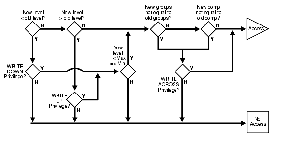

You can customize the enforcement of Oracle Label Security policies and implement labeling functions.

- Oracle Label Security Policy Enforcement Options
  Oracle Label Security provides a set of policy enforcement options.
- Labeling Functions
  Labeling functions can compute and return a label using resources such as context variables (for example, date or username) and data values.
- Inserting Labeled Data Using Policy Options and Labeling Functions
  It is important to understand how enforcement options and labeling functions affect the insertion of labeled data.
- Updating Labeled Data Using Policy Options and Labeling Functions
  Users must be authorized to change rows that are protected by Oracle Label Security.
- Deletion of Labeled Data Using Policy Options and Labeling Functions
  You can delete labeled data.
- SQL Predicates with an Oracle Label Security Policy
  You can use a SQL predicate to provide extensibility for selective enforcement of data access rules.

**Parent topic:** [Administering an Oracle Label Security Application](part3.md)

### 11.1 Oracle Label Security Policy Enforcement Options

Oracle Label Security provides a set of policy enforcement options.

- About Policy Enforcement Options
  Of all the enforcement controls that Oracle Label Security permits, the administrator must choose those that meet the needs of the given application.
- Levels of Policy Enforcement Options
  You can set policy, schema, and table levels of policy enforcement.
- Categories of Policy Enforcement Options
  Oracle Label Security enforces policies using three categories: label management options, access control options, and overriding options.
- Relationships of Policy Enforcement Options
  Oracle Label Security has a set of policy enforcement options.
- How the HIDE Policy Column Option Works
  You can specify the `HIDE` policy configuration option when you add an Oracle Label Security policy column to a table.
- How the Label Management Enforcement Options Work
  The three label enforcement options control the data label written when a row is inserted or updated.
- How the Access Control Enforcement Options Work
  Access control options limit the rows accessible for `SELECT`, `UPDATE`, `INSERT`, or `DELETE` operations to only those rows whose labels meet established policies.
- How the Overriding Enforcement Options Work
  Whereas `ALL_CONTROL` applies all of the label management and access control enforcement options, `NO_CONTROL` applies none of them.
- Guidelines for Using the Policy Enforcement Options
  You can customize policy enforcement for a schema or table through the Oracle Enterprise Manager.
- Exemptions from Oracle Label Security Policy Enforcement
  Oracle Label Security has several exceptions from OLS policy enforcement.
- Data Dictionary Views for Viewing Policy Options on Tables and Schemas
  Oracle Label Security provides data dictionary views that describe the policy enforcement options currently applied to tables and schemas.

**Parent topic:** Implementing Policy Enforcement Options and Labeling Functions

#### 11.1.1 About Policy Enforcement Options

Of all the enforcement controls that Oracle Label Security permits, the administrator must choose those that meet the needs of the given application.

This means identifying levels of data sensitivity to exposure, alteration, or misuse, as well as identifying which users have the need or the right to access or alter such data. The policy enforcement options enable administrators to fine-tune users' abilities to read or write data or labels.

**Parent topic:** Oracle Label Security Policy Enforcement Options

#### 11.1.2 Levels of Policy Enforcement Options

You can set policy, schema, and table levels of policy enforcement.

Table 11-1 lists the levels on which policy enforcement options can operate.

Table 11-1 When Policy Enforcement Options Take Effect

| Level at which option set | Options set at this level affect user operations ...             |
|:--------------------------|:-----------------------------------------------------------------|
| Policy lvel               | ... only when the policy has been applied to the table or schema |
| Schema lvel               | ... whenever a user acts in this schema                          |
| Table lvel                | ... whenever a user acts in this table                           |

When you apply a policy to a table or schema, you can specify the enforcement options that are to constrain use of that table or schema. If you do not specify enforcement options at that time, then the default enforcement options you specified when you created that policy are used automatically.

These options customize your policy enforcement to meet your security requirements as to `READ` access, `WRITE` access, and label changes. You can also specify whether the label column should be displayed or hidden. You can choose to enforce some or all of the policy options for any protected table by specifying only those you want.

Optionally, you can assign each table a labeling function, which determines the label of any row inserted or updated in that table. You can also specify, optionally, a SQL predicate for a table, to control which rows are accessible to users, based on their labels.

When Oracle Label Security policy enforcement options are applied, they control which rows are accessible to view or to insert, update, or delete.

**Related Topics**

- Labeling Functions
- SQL Predicates with an Oracle Label Security Policy

**Parent topic:** Oracle Label Security Policy Enforcement Options

#### 11.1.3 Categories of Policy Enforcement Options

Oracle Label Security enforces policies using three categories: label management options, access control options, and overriding options.

Table 11-2 lists the categories of policy enforcement options.

- Label management options ensure that data labels written for inserted or updated rows do not violate policies set for such labels

- Access control options ensure that only rows whose labels meet established policies are accessible for `SELECT`, `UPDATE`, `INSERT`, or `DELETE` operations.

- Overriding options can suspend or apply all other enforcement options.

Table 11-2 Policy Enforcement Options

| Type of Enforcement                               | Option           | Description                                                                                                                                                                                                                                                |
|:--------------------------------------------------|:-----------------|:-----------------------------------------------------------------------------------------------------------------------------------------------------------------------------------------------------------------------------------------------------------|
| How the Label Management Enforcement Options Work | `LABEL_DEFAULT`  | Uses the session's default row label value unless the user explicitly specifies a label on `INSERT`.                                                                                                                                                       |
| \-                                                | `LABEL_UPDATE`   | Applies policy enforcement to `UPDATE` operations that set or change the value of a label attached to a row. The `WRITEUP`, `WRITEDOWN`, and `WRITEACROSS` privileges are enforced only if the `LABEL_UPDATE` option is active.                            |
| \-                                                | `CHECK_CONTROL`  | Applies `READ_CONTROL` policy enforcement to `INSERT` and `UPDATE` statements to assure that the new row label is read-accessible.                                                                                                                         |
| How the Access Control Enforcement Options Work   | `READ_CONTROL`   | Applies policy enforcement to all queries. Only authorized rows are accessible for `SELECT`, `UPDATE`, and `DELETE` operations. See INSERT_CONTROL, UPDATE_CONTROL, and DELETE_CONTROL.                                                                    |
| \-                                                | `WRITE_CONTROL`  | Determines the ability to `INSERT`, `UPDATE`, and `DELETE` data in a row. If this option is active, it enforces `INSERT_CONTROL`, `UPDATE_CONTROL`, and `DELETE_CONTROL`.                                                                                  |
| \-                                                | `INSERT_CONTROL` | Applies policy enforcement to `INSERT` operations, according to the algorithm for write access described in the figure in [How Oracle Label Security Algorithm for Read Access Works](access-controls-and-privileges.md).                                  |
| \-                                                | `DELETE_CONTROL` | Applies policy enforcement to `DELETE` operations, according to the algorithm for write access described in the figure in [How Oracle Label Security Algorithm for Read Access Works](access-controls-and-privileges.md).                                  |
| \-                                                | `UPDATE_CONTROL` | Applies policy enforcement to `UPDATE` operations on the data columns within a row, according to the algorithm for write access described in the figure in [How Oracle Label Security Algorithm for Read Access Works](access-controls-and-privileges.md). |
| How the Overriding Enforcement Options Work       | `ALL_CONTROL`    | Applies all enforcement options.                                                                                                                                                                                                                           |
| \-                                                | `NO_CONTROL`     | Applies no enforcement options. A labeling function or a SQL predicate can nonetheless be applied.                                                                                                                                                         |

Remember that even when Oracle Label Security is applicable to a table, some DML operations may not be covered by the policies being applied. The policy enforcement options set by the administrator determine both the SQL processing behavior and what an authorized user can actually see in response to a query on a protected table. Except where noted, this chapter assumes that `ALL_CONTROL` is active, meaning that all enforcement options are in effect. If users attempt to perform an operation for which they are not authorized, then an error message is raised and the SQL statement fails.

Understanding the relationships among these policy enforcement options, and what SQL statements they control, is essential to their effective use in designing and implementing your Oracle Label Security policies.

**Related Topics**

- [Implementation of Inverse Groups with INVERSE_GROUP Enforcement](releasability-using-inverse-groups.md)

**Parent topic:** Oracle Label Security Policy Enforcement Options

#### 11.1.4 Relationships of Policy Enforcement Options

Oracle Label Security has a set of policy enforcement options.

Table 11-3 describes the relationships between policy enforcement options.

Table 11-3 What Policy Enforcement Options Control

| Specifying This Option in a Policy                                                       | Controls These SQL Operations    | Using These Criteria and with These Effects                                                                                                                                                                                                                      |
|:-----------------------------------------------------------------------------------------|:---------------------------------|:-----------------------------------------------------------------------------------------------------------------------------------------------------------------------------------------------------------------------------------------------------------------|
| `READ_CONTROL`                                                                           | `SELECT`, `UPDATE`, and `DELETE` | Only authorized rows (\*) are accessible.                                                                                                                                                                                                                        |
| `WRITE_CONTROL`                                                                          | `INSERT`, `UPDATE`, and `DELETE` | \(a\) Only authorized rows (\*\*) are accessible (b) Data labels writable unless `LABEL_UPDATE` is active.                                                                                                                                                    |
| `WRITE_CONTROL` (necessary for `INSERT_CONTROL`, `UPDATE_CONTROL`, and `DELETE_CONTROL`) | \-                               | \-                                                                                                                                                                                                                                                               |
| `INSERT_CONTROL`                                                                         | `INSERT`                         | \-                                                                                                                                                                                                                                                               |
| `UPDATE_CONTROL`                                                                         | `UPDATE`                         | \-                                                                                                                                                                                                                                                               |
| `DELETE_CONTROL`                                                                         | `DELETE`                         | \-                                                                                                                                                                                                                                                               |
| `CHECK_CONTROL`                                                                          | \-                               | Applies `READ_CONTROL` policy enforcement to `INSERT` and `UPDATE` statements to assure that the new row label is read-accessible.                                                                                                                               |
| How the Access Control Enforcement Options Work                                          | \-                               | Applies policy enforcement to all queries. Only authorized rows are accessible for operations.                                                                                                                                                                   |
| `INSERT_CONTROL`                                                                         | `INSERT_CONTROL`                 | Applies policy enforcement to `INSERT` operations, according to the algorithm for write access described in the figure in [How Oracle Label Security Auditing Is Enabled or Disabled](auditing-under-oracle-label-security.md).                                  |
| `DELETE_CONTROL`                                                                         | `DELETE_CONTROL`                 | Applies policy enforcement to `DELETE` operations, according to the algorithm for write access described in the figure in [How Oracle Label Security Auditing Is Enabled or Disabled](auditing-under-oracle-label-security.md).                                  |
| `UPDATE_CONTROL`                                                                         | `UPDATE_CONTROL`                 | Applies policy enforcement to `UPDATE` operations on the data columns within a row, according to the algorithm for write access described in the figure in [How Oracle Label Security Auditing Is Enabled or Disabled](auditing-under-oracle-label-security.md). |
| How the Overriding Enforcement Options Work                                              | `ALL_CONTROL`                    | Applies all enforcement options.                                                                                                                                                                                                                                 |
| `NO_CONTROL`                                                                             | `NO_CONTROL`                     | Applies no enforcement options. A labeling function or a SQL predicate can nonetheless be applied.                                                                                                                                                               |

(\*) A row is authorized for `READ` access if the following three criteria are all met:(user-minimum-level) \< = (data-row-level) \< = (session-level)(any-data-group) is a child of (any-user-group-or-childgroup) (every-data-compartment) is also in (the user's compartments). Refer to the figure in [How Oracle Label Security Algorithm for Read Access Works](access-controls-and-privileges.md)

(\*\*) A row is authorized for READ access if the following three criteria are all met:(user-minimum-level) \< = (data-row-level) \< = (session-level)(any-data-group) is a child of (any-user-group-or-childgroup) (every-data-compartment) is also in (the user's compartments). Refer to the figure in [How Oracle Label Security Algorithm for Read Access Works](access-controls-and-privileges.md).

**Parent topic:** Oracle Label Security Policy Enforcement Options

#### 11.1.5 How the HIDE Policy Column Option Works

You can specify the `HIDE` policy configuration option when you add an Oracle Label Security policy column to a table.

This prevents display of the column containing the policy's labels.

Once the policy has been applied, the hidden (or not hidden) status of the column cannot be changed unless the policy is removed with the `DROP_COLUMN` parameter set to `TRUE`. Then, the policy can be reapplied with a new hidden status.

`INSERT` statements doing all-column inserts do not require the values for hidden label columns.

`SELECT` statements do not automatically return the values of hidden label columns. Such values must be explicitly retrieved.

A `DESCRIBE` on a table may or may not display the label column. If the administrator sets the `HIDE` option, then the label column will not be displayed. If `HIDE` is not specified for a policy, then the label column is displayed in response to a `SELECT`.

**Related Topics**

- [SA_POLICY_ADMIN.APPLY_TABLE_POLICY](oracle-label-security-pl-sql-packages.md)
- [Retrieving All Columns from a Table When the Policy Label Column Is Hidden](working-with-labeled-data.md)

**Parent topic:** Oracle Label Security Policy Enforcement Options

#### 11.1.6 How the Label Management Enforcement Options Work

The three label enforcement options control the data label written when a row is inserted or updated.

- About the Label Management Enforcement Options
  When a policy specifies the options and is applied to a table or schema, these options apply to special situations.
- LABEL_DEFAULT: Using the Session's Default Row Label
  A user can update a row without specifying a label value, because the updated row uses its original label.
- LABEL_UPDATE: Changing Data Labels
  A user updating a row can normally change its label to any label within his authorized label range.
- CHECK_CONTROL: Checking Data Labels
  If an inserted or updated row gets its label from a labeling function, the label could be outside the user’s authorizations.

**Parent topic:** Oracle Label Security Policy Enforcement Options

##### 11.1.6.1 About the Label Management Enforcement Options

When a policy specifies the options and is applied to a table or schema, these options apply to special situations.

A user inserting a row can specify any data label within the range of the user's label authorizations. If the user does not specify a label for the row being written, `LABEL_DEFAULT` can do so. Updates can be restricted by `LABEL_UPDATE`. Inserts or updates that use a labeling function need `CHECK`\_`CONTROL` to prevent assigning a data label outside the user's authorizations. Such a label would prevent the user from accessing the row just written, and could enable the user to make data available inappropriately.

Any labeling function in force on a table overrides these options. Such a function can be named in the call that applies the policy to the table. If the administrator named such a function when applying a policy, but then disables or removes that policy, then that function is no longer applied.

**Related Topics**

- [SA_SYSDBA.DISABLE_POLICY](oracle-label-security-pl-sql-packages.md)

**Parent topic:** How the Label Management Enforcement Options Work

##### 11.1.6.2 LABEL_DEFAULT: Using the Session's Default Row Label

A user can update a row without specifying a label value, because the updated row uses its original label.

However, to insert a new row, the user must supply a valid label unless a labeling function is in force or `LABEL_DEFAULT` applies for the table. `LABEL_DEFAULT` causes the user's session default row label to be used as the new row label.

If neither `LABEL_DEFAULT` nor a labeling function is in force and the user attempts to `INSERT` a row, then an error occurs.

Note that any labeling function in force on a table overrides the `LABEL_DEFAULT` option.

**Parent topic:** How the Label Management Enforcement Options Work

##### 11.1.6.3 LABEL_UPDATE: Changing Data Labels

A user updating a row can normally change its label to any label within his authorized label range.

However, if `LABEL_UPDATE` applies, then to modify a label, the user must have one or more of these privileges: `WRITEUP`, `WRITEDOWN`, and `WRITEACROSS`.

The `LABEL_UPDATE` option uses an Oracle after-row trigger which is called only on an update operation affecting the label. Note that any labeling function in force on a table overrides the `LABEL_UPDATE` option.

**Related Topics**

- [Special Row Label Privileges](access-controls-and-privileges.md)

**Parent topic:** How the Label Management Enforcement Options Work

##### 11.1.6.4 CHECK_CONTROL: Checking Data Labels

If an inserted or updated row gets its label from a labeling function, the label could be outside the user’s authorizations.

This prevents this user from being able to read or update the row. To prevent this problem, use the `CHECK_CONTROL` setting to allow `READ_CONTROL` to apply to the new label. This ensures that this user will be authorized to read the inserted or updated row after the operation. If not, then the insert or update operation is canceled and has no effect.

In other words, if `CHECK_CONTROL` is included as an option in a policy being enforced on a row, then the user modifying that row must still be able to access it after the operation. `CHECK_CONTROL` prevents a user or a labeling function from modifying a row's label to include a level, group, or compartment that the modifying user would be prevented from accessing.

Note that `CHECK_CONTROL` overrides any labeling function in force on a table.

**Parent topic:** How the Label Management Enforcement Options Work

#### 11.1.7 How the Access Control Enforcement Options Work

Access control options limit the rows accessible for `SELECT`, `UPDATE`, `INSERT`, or `DELETE` operations to only those rows whose labels meet established policies.

- READ_CONTROL: Reading Data
  `READ_CONTROL` limits the set of records accessible to a session for `SELECT`, `UPDATE` and `DELETE` operations.
- WRITE_CONTROL: Writing Data
  When an Oracle Label Security policy specifying the `WRITE_CONTROL` option is applied to a table, triggers are generated and the algorithm is enforced.
- INSERT_CONTROL, UPDATE_CONTROL, and DELETE_CONTROL
  The `INSERT_CONTROL`, `UPDATE_CONTROL`, and `DELETE_CONTROL` options control policy enforcement during the corresponding operations on the data columns in a row.

**Parent topic:** Oracle Label Security Policy Enforcement Options

##### 11.1.7.1 READ_CONTROL: Reading Data

`READ_CONTROL` limits the set of records accessible to a session for `SELECT`, `UPDATE` and `DELETE` operations.

If `READ_CONTROL` is not active, then even rows in the table protected by the policy are accessible to all users.

`READ_CONTROL` uses Oracle virtual private database (VPD) technology to enforce the read access mediation algorithm illustrated in [Figure 3-6](access-controls-and-privileges.md).

**Parent topic:** How the Access Control Enforcement Options Work

##### 11.1.7.2 WRITE_CONTROL: Writing Data

When an Oracle Label Security policy specifying the `WRITE_CONTROL` option is applied to a table, triggers are generated and the algorithm is enforced.

`WRITE_CONTROL` uses Oracle after-row triggers to enforce the write access mediation algorithm illustrated in [Figure 3-7](access-controls-and-privileges.md).

**Note:**

The protection implementation for `WRITE_CONTROL` is the same for all write operations, but you need not apply all write options across the board. You can apply `WRITE_CONTROL` selectively for `INSERT`, `UPDATE`, and `DELETE` operations by using the corresponding policy enforcement option (`INSERT_CONTROL`, `UPDATE_CONTROL`, and `DELETE_CONTROL`) instead of `WRITE_CONTROL`.

If `WRITE_CONTROL` is on but `LABEL_UPDATE` is not specified, then the user can change both data and labels. If you want to control updating the row labels, then specify the `LABEL_UPDATE` option in addition to `WRITE_CONTROL` when creating your policies.

**Parent topic:** How the Access Control Enforcement Options Work

##### 11.1.7.3 INSERT_CONTROL, UPDATE_CONTROL, and DELETE_CONTROL

The `INSERT_CONTROL`, `UPDATE_CONTROL`, and `DELETE_CONTROL` options control policy enforcement during the corresponding operations on the data columns in a row.

These options apply according to the algorithm for write access described in [Figure 3-7](access-controls-and-privileges.md).

Specifying `WRITE_CONTROL` limits all `INSERT`, `UPDATE`, and `DELETE` operations. However,

- Specifying `INSERT_CONTROL` limits insertions but not updates or deletes.

- Specifying `UPDATE_CONTROL` limits updates but not insertions or deletes.

- Specifying `DELETE_CONTROL` limits deletes but not insertions or updates.

**Related Topics**

- Inserting Labeled Data Using Policy Options and Labeling Functions
- Updating Labeled Data Using Policy Options and Labeling Functions
- Deletion of Labeled Data Using Policy Options and Labeling Functions

**Parent topic:** How the Access Control Enforcement Options Work

#### 11.1.8 How the Overriding Enforcement Options Work

Whereas `ALL_CONTROL` applies all of the label management and access control enforcement options, `NO_CONTROL` applies none of them.

In either case, labeling functions and SQL predicates can be applied. Note that the `ALL_CONTROL` option can be used only on the command line. If you apply a policy with `NO_CONTROL` specified, then a policy label column is added to the table, but the label values are `NULL`. Because no access controls are operating on the table, you can proceed to enter labels as desired. You can then set the policy enforcement options as you want. `NO_CONTROL` can be a useful option if you have a labeling function in force to label the data correctly, but want to let all users access all the data.

**Parent topic:** Oracle Label Security Policy Enforcement Options

#### 11.1.9 Guidelines for Using the Policy Enforcement Options

You can customize policy enforcement for a schema or table through the Oracle Enterprise Manager.

This functionality is described in [Creating an Oracle Label Security Policy](creating-an-oracle-label-security-policy.md) or you can use the `SA_POLICY_ADMIN` package as described in [SA_POLICY_ADMIN Policy Administration PL/SQL Package](oracle-label-security-pl-sql-packages.md).

This section documents the supported keywords.

Note that when you create a policy, you can specify a string of default options to be used whenever the policy is applied without schema or table options being specified.

If a policy is first applied to a table, and then also applied to the schema containing that table, then the options on the table are not affected by the schema policy. The options of the policy originally applied to the table remain in force.

In general, administrators use the `LABEL_DEFAULT` policy option, causing data written by a user to be labeled with that user's row label. Alternatively, a labeling function can be used to label the data. If neither of these two choices is used, then a label must be specified in every `INSERT` statement. (Updates retain the row's original label.)

The following table suggests that certain combinations of policy enforcement options are useful when implementing an Oracle Label Security policy. As the table indicates, you might typically enforce `READ_CONTROL` and `WRITE_CONTROL`, choosing from among several possible combinations for setting the data label on writes.

Table 11-4 Suggested Policy Enforcement Option Combinations

| Options                                            | Access Enforcement                                                                                                                                                                                                                            |
|:---------------------------------------------------|:----------------------------------------------------------------------------------------------------------------------------------------------------------------------------------------------------------------------------------------------|
| `READ_CONTROL`, `WRITE_CONTROL`, `LABEL_DEFAULT`   | Read and write access based on session label. Default label provided; users can insert/update both data and labels.                                                                                                                           |
| `READ_CONTROL`, `WRITE_CONTROL`, Labeling Function | Read and write access based on session label. Users can set/change only row data; all row labels are set explicitly by the labeling function. Add `CHECK_CONTROL` to restrict new labels (on insert or update) to visible range of labels. |
| `READ_CONTROL`, `WRITE_CONTROL`, `LABEL_UPDATE`    | Read and write access based on session label. Users cannot change labels without privileges. Add `CHECK_CONTROL` to restrict new labels (on insert or update) to visible range.                                                            |

**Related Topics**

- [Authorized Levels](access-controls-and-privileges.md)

**Parent topic:** Oracle Label Security Policy Enforcement Options

#### 11.1.10 Exemptions from Oracle Label Security Policy Enforcement

Oracle Label Security has several exceptions from OLS policy enforcement.

These exemptions are as follows:

- Oracle Label Security is not enforced during `DIRECT` path export.

- By design, Oracle Label Security policies cannot be applied to objects in schema `SYS`. As a consequence, the `SYS` user, and users making a DBA-privileged connection to the database (such as `CONNECT AS SYSDBA`) do not have Oracle Label Security policies applied to their actions. DBAs need to be able to administer the database. It would make no sense, for example, to export part of a table due to an Oracle Label Security policy being applied. The database user `SYS` is thus always exempt from Oracle Label Security enforcement, regardless of the export mode, application, or utility used to extract data from the database.

- Similarly, database users granted the `EXEMPT` `ACCESS` `POLICY` privilege, either directly or through a database role, are exempted from some Oracle Label Security policy enforcement controls such as `READ_CONTROL` and `CHECK_CONTROL`, regardless of the export mode, application or utility used to access the database or update its data. The following policy enforcement options remain in effect even when `EXEMPT` `ACCESS` `POLICY` is granted:

  - `INSERT_CONTROL`, `UPDATE_CONTROL`, `DELETE_CONTROL`, `WRITE_CONTROL`, `LABEL_UPDATE`, and `LABEL_DEFAULT`.

  - If the Oracle Label Security policy specifies the `ALL_CONTROL` option, then all enforcement controls are applied except `READ_CONTROL` and `CHECK_CONTROL`.

  `EXEMPT` `ACCESS` `POLICY` is a very powerful privilege and should be carefully managed.

  Note that this privilege does not affect the enforcement of standard Oracle Database object privileges such as `SELECT`, `INSERT`, `UPDATE`, and `DELETE`. These privileges are enforced even if a user has been granted the `EXEMPT` `ACCESS` `POLICY` privilege.

**Related Topics**

- Categories of Policy Enforcement Options

**Parent topic:** Oracle Label Security Policy Enforcement Options

#### 11.1.11 Data Dictionary Views for Viewing Policy Options on Tables and Schemas

Oracle Label Security provides data dictionary views that describe the policy enforcement options currently applied to tables and schemas.

- `DBA_SA_TABLE_POLICIES`

- `DBA_SA_SCHEMA_POLICIES`

**Parent topic:** Oracle Label Security Policy Enforcement Options

### 11.2 Labeling Functions

Labeling functions can compute and return a label using resources such as context variables (for example, date or username) and data values.

- Labeling Data Rows under Oracle Label Security
  There are three ways to label data that is being inserted or updated.
- How Labeling Functions in Oracle Label Security Policies Works
  Labeling functions enable you to consider, in your rules for assigning labels, information drawn from the application context.
- Creating a Labeling Function for a Policy
  You can use the `CREATE OR REPLACE FUNCTION` SQL statement to create a labeling function.
- Specifying a Labeling Function in a Policy
  You can use the `SA_POLICY_ADMIN` package to specify a labeling function.

**Parent topic:** Implementing Policy Enforcement Options and Labeling Functions

#### 11.2.1 Labeling Data Rows under Oracle Label Security

There are three ways to label data that is being inserted or updated.

- You can explicitly specify a label in every `INSERT` or `UPDATE` to the table.

- You can set the `LABEL_DEFAULT` option, which causes the session's row label to be used if an explicit row label is not included in the `INSERT` or `UPDATE` statement.

- You can create a labeling function, automatically calls on every `INSERT` or `UPDATE` statement and independently of any user's authorization.

The recommended approach is to write a labeling function to implement your rules for labeling data. If you specify a labeling function, then Oracle Label Security embeds a call to that function in `INSERT` and `UPDATE` triggers to compute a label.

For example, you could create a labeling function named `my_label` to use the contents of `COL1` and `COL2` of the new row to compute and return the appropriate label for the row. Then, you could insert, into your `INSERT` or `UPDATE` statements, the following reference:

    my_label(:new.col1,:new.col2)

If you do not specify a labeling function, then specify the `LABEL_DEFAULT` option. Otherwise, you must explicitly specify a label on every `INSERT` or `UPDATE` statement.

**Parent topic:** Labeling Functions

#### 11.2.2 How Labeling Functions in Oracle Label Security Policies Works

Labeling functions enable you to consider, in your rules for assigning labels, information drawn from the application context.

For example, you can use as a labeling consideration the IP address to which the user is attached. There are many opportunities to use `SYS_CONTEXT` in this way.

**Note:**

If the SQL statement is invalid, then an error will occur when you apply the labeling function to the table or policy. You should thoroughly test a labeling function before using it with tables.

Labeling functions override the `LABEL_DEFAULT` and `LABEL_UPDATE` options.

A labeling function is called in the context of a before-row trigger. This enables you to pass in the old and new values of the data record, as well as the old and new labels.

You can construct a labeling function to permit an explicit label to be passed in by the user.

All labeling functions must have return types of the `LBACSYS.LBAC_LABEL` data type. The `TO_LBAC_DATA_LABEL` function can be used to convert a label in character string format to a data type of `LBACSYS.LBAC_LABEL`. Note that `LBACSYS` must have the `EXECUTE` privilege on your labeling function. The owner of the labeling function must have the `EXECUTE` privilege on the `TO_LBAC_DATA_LABEL` function, with the `GRANT` option.

**Note:**

`LBACSYS` is a unique schema providing opaque types for Oracle Label Security.

**Related Topics**

- [Performing DBA Functions Under Oracle Label Security](performing-dba-functions-under-oracle-label-security.md)

**Parent topic:** Labeling Functions

#### 11.2.3 Creating a Labeling Function for a Policy

You can use the `CREATE OR REPLACE FUNCTION` SQL statement to create a labeling function.

- To use the `CREATE OR REPLACE FUNCTION` statement to create a labeling function for a policy, set the return value to `LBACSYS.LBAC_LABEL`.

For example:

    CREATE OR REPLACE FUNCTION sa_demo.gen_emp_label
               (Job varchar2,
                Deptno number,
                Total_sal number)
           Return LBACSYS.LBAC_LABEL
         as
           i_label varchar2(80);
         Begin
           /************* Determine Class Level *************/
           if total_sal > 2000 then
           i_label := 'L3:';
           elsif total_sal > 1000 then
           i_label := 'L2:';
           else
           i_label := 'L1:';
           end if;

           /************* Determine Compartment *************/
           IF Job in ('MANAGER','PRESIDENT') then
           i_label := i_label||'M:';
           else
           i_label := i_label||'E:';
           end if;
           /************* Determine Groups *************/
           i_label := i_label||'D'||to_char(deptno);
           return TO_LBAC_DATA_LABEL('human_resources',i_label);
         End;
         /

**Note:**

When Oracle Label Security is configured to work directly with Oracle Internet Directory, dynamic label generation is disabled, because labels are managed centrally in Oracle Internet Directory, using `olsadmintool` commands. So, if the label function generates a data label using a string value that is not already established in Oracle Internet Directory, then an error message results.

**Related Topics**

- [Command-line Tools for Label Security Using Oracle Internet Directory](command-line-tools-for-label-security-using-oracle-internet-directory.md)

**Parent topic:** Labeling Functions

#### 11.2.4 Specifying a Labeling Function in a Policy

You can use the `SA_POLICY_ADMIN` package to specify a labeling function.

- Use `SA_POLICY_ADMIN.REMOVE_TABLE_POLICY` and `SA_POLICY_ADMIN.APPLY_TABLE_POLICY` to specify the labeling function.

For example:

    SA_POLICY_ADMIN.REMOVE_TABLE_POLICY('human_resources','sa_demo','emp');

    SA_POLICY_ADMIN.APPLY_TABLE_POLICY(
      POLICY_NAME     => 'human_resources',
      SCHEMA_NAME     => 'sa_demo',
      TABLE_NAME      => 'emp',
      TABLE_OPTIONS   => 'READ_CONTROL,WRITE_CONTROL,CHECK_CONTROL',
      LABEL_FUNCTION  => 'sa_demo.gen_emp_label(:new.job,:new.deptno,:new.sal)',
      PREDICATE       => NULL);

**Parent topic:** Labeling Functions

### 11.3 Inserting Labeled Data Using Policy Options and Labeling Functions

It is important to understand how enforcement options and labeling functions affect the insertion of labeled data.

- Outcome of Insert or Updates Operations on Data Based on Authorizations
  When you attempt to insert or update data based on your authorizations, the outcome depends upon what policy enforcement controls are active.
- Label Insertions When a Labeling Function Is Specified
  A labeling function takes precedence over labels entered by the user.
- Child Row Insertions in Tables with Declarative Referential Integrity
  If declarative referential integrity protects a parent table, then the parent row must be visible before a child row can be inserted.

**Parent topic:** Implementing Policy Enforcement Options and Labeling Functions

#### 11.3.1 Outcome of Insert or Updates Operations on Data Based on Authorizations

When you attempt to insert or update data based on your authorizations, the outcome depends upon what policy enforcement controls are active.

- If `INSERT_CONTROL` is active, then rows you insert can only have labels within your write authorizations. If you attempt to update data that you can read, but for which you do not have write authorization, an error is raised. For example, if you can read compartments A and B, but you can only write to compartment A, then if you attempt to insert data with compartment B, then the statement will fail.

- If `INSERT_CONTROL` is not active, then you can use any valid label on rows you insert.

- If the `CHECK_CONTROL` option is active, then rows you insert can only have labels you are authorized to read, even if the labels are generated by a labeling function.

**Parent topic:** Inserting Labeled Data Using Policy Options and Labeling Functions

#### 11.3.2 Label Insertions When a Labeling Function Is Specified

A labeling function takes precedence over labels entered by the user.

If the administrator has set up an automatic labeling function, then no data label a user enters will have effect (unless the labeling function itself makes use of the user's proposed label). New row labels are always determined by an active labeling function, if present.

Note that a labeling function can set the label of a row being inserted to a value outside the range that the user writing that row can see. If such a function is in use, then the user can potentially insert a row but not be authorized to see that row. You can prevent this situation by specifying the `CHECK_CONTROL` option in the policy. If this option is active, then the new data label is checked against the user's read authorization, and if the user cannot read it, then the insert operation is not performed.

**Parent topic:** Inserting Labeled Data Using Policy Options and Labeling Functions

#### 11.3.3 Child Row Insertions in Tables with Declarative Referential Integrity

If declarative referential integrity protects a parent table, then the parent row must be visible before a child row can be inserted.

The user must be able to see the parent row for the insert operation to succeed, that is, the user must have read access to the parent row.

If `READ_CONTROL` is active on the parent table, then the user's read authorization must be sufficient to authorize a `SELECT` operation on the parent row. For example, a user who cannot read department 20 cannot insert child rows for department 20. Note that all records will be visible if the user has `FULL` or `READ` privileges on the table or schema.

**Parent topic:** Inserting Labeled Data Using Policy Options and Labeling Functions

### 11.4 Updating Labeled Data Using Policy Options and Labeling Functions

Users must be authorized to change rows that are protected by Oracle Label Security.

- Updating Labels Using CHAR_TO_LABEL
  To change a row label from `SENSITIVE` to `CONFIDENTIAL`, you can change the label by using the `CHAR_TO_LABEL` function.
- Evaluation of Enforcement Control Options and UPDATE
  When you attempt to update data based on your authorizations, the outcome depends on which enforcement controls are active.
- Updates to Labels When a Labeling Function Is Specified
  A labeling function takes precedence over labels entered by the user.
- Updates to Child Rows in Tables with Declarative Referential Integrity Enabled
  If a child row is in a table with a referential integrity constraint, then the parent row must be visible for the update to succeed.

**Parent topic:** Implementing Policy Enforcement Options and Labeling Functions

#### 11.4.1 Updating Labels Using CHAR_TO_LABEL

To change a row label from `SENSITIVE` to `CONFIDENTIAL`, you can change the label by using the `CHAR_TO_LABEL` function.

- To change a row label, use the `UPDATE` SQL statement.

For example:

    UPDATE emp
    SET hr_label = char_to_label ('HR', 'CONFIDENTIAL')
    WHERE ename = 'ESTANTON';

**Parent topic:** Updating Labeled Data Using Policy Options and Labeling Functions

#### 11.4.2 Evaluation of Enforcement Control Options and UPDATE

When you attempt to update data based on your authorizations, the outcome depends on which enforcement controls are active.

- If `UPDATE_CONTROL` is active, then you can only update rows whose labels fall within your write authorizations. If you attempt to update data that you can read, but for which you do not have write authorization, then an error is raised. Assume, for example, that you can read compartments A and B, but you can only write to compartment A. In this case, if you attempt to update data with compartment B, then the statement will fail.

- If `UPDATE_CONTROL` is not active, then you can update all rows to which you have read access.

- If `LABEL_UPDATE` is active, then you must have the appropriate privilege (`WRITEUP`, `WRITEDOWN`, or `WRITEACROSS`) to change a label by raising or lowering its sensitivity level, or altering its groups or compartments.

- If `LABEL_UPDATE` is not active but `UPDATE_CONTROL` is active, then you can update a label to any new label value within your write authorization.

- If `CHECK_CONTROL` is active, then you can only write labels you are authorized to read.

The following figure illustrates the label evaluation process for `LABEL_UPDATE`.

Figure 11-1 Label Evaluation Process for LABEL_UPDATE

[Description of "Figure 11-1 Label Evaluation Process for LABEL_UPDATE"](img_text/olsag031.md)

**Parent topic:** Updating Labeled Data Using Policy Options and Labeling Functions

#### 11.4.3 Updates to Labels When a Labeling Function Is Specified

A labeling function takes precedence over labels entered by the user.

If the administrator has set up an automatic labeling function, then no label a user enters will have effect (unless the labeling function itself makes use of the user's proposed label). New row labels are always determined by an active labeling function, if present.

Note that the security administrator can establish a labeling function that sets the label of a row being updated to a value outside the range that you can see. If this is the case, then you can update a row, but not be authorized to see the row. If the `CHECK_CONTROL` option is on, then you will not be able to perform such an update. The `CHECK_CONTROL` option verifies your read authorization on the new label.

**Parent topic:** Updating Labeled Data Using Policy Options and Labeling Functions

#### 11.4.4 Updates to Child Rows in Tables with Declarative Referential Integrity Enabled

If a child row is in a table with a referential integrity constraint, then the parent row must be visible for the update to succeed.

That is, this user must be able to see the parent row.

If the parent table has `READ_CONTROL` on, then the user's read authorization must be sufficient to authorize a `SELECT` on the parent row.

For example, a user who cannot read department 20 in a parent table cannot update an employee's department to department 20 in a child table. (If the user has `FULL` or `READ` privilege, then all records will be visible.)

**See Also:**

[Oracle Database Development Guide](../adfns/data-integrity.md)

**Parent topic:** Updating Labeled Data Using Policy Options and Labeling Functions

### 11.5 Deletion of Labeled Data Using Policy Options and Labeling Functions

You can delete labeled data.

Note the following:

- If `DELETE_CONTROL` is active, then you can delete only rows within your write authorization.

- If `DELETE_CONTROL` is not active, then you can delete only rows that you can read.

- With `DELETE_CONTROL` active, and declarative referential integrity defined with cascading deletes, you must have write authorization on all the rows to be deleted, or the statement will fail.

You cannot delete a parent row if there are any child rows attached to it, regardless of your write authorization. To delete such a parent row, you must first delete each of the child rows. If `DELETE_CONTROL` is active on any of the child rows, then you must have write authorization to delete the child rows.

Consider, for example, a situation in which the user is `UNCLASSIFIED` and there are three rows as follows:

| Row         | Table  | Sensitivity    |
|:------------|:-------|:---------------|
| Parent row: | `DEPT` | `UNCLASSIFIED` |
| Child row:  | `EMP`  | `UNCLASSIFIED` |
| Child row:  | `EMP`  | `UNCLASSIFIED` |

In this case, the `UNCLASSIFIED` user cannot delete the parent row.

`DELETE_CONTROL` has no effect when `DELETERESTRICT` is active. `DELETERESTRICT` is always enforced. In some cases (depending on the user's authorizations and the data's labels) it may look as though a row has no child rows, when it actually does have children but the user cannot see them. Even if a user cannot see child rows, he still cannot delete the parent row.

**Parent topic:** Implementing Policy Enforcement Options and Labeling Functions

### 11.6 SQL Predicates with an Oracle Label Security Policy

You can use a SQL predicate to provide extensibility for selective enforcement of data access rules.

- Modifications to an Oracle Label Security Policy with a SQL Predicate
  A SQL predicate is a condition, optionally preceded by `AND` or `OR`.
- How Multiple SQL Predicates Affect Oracle Label Security Policies
  Predicates can be appended to other predicates.

**Parent topic:** Implementing Policy Enforcement Options and Labeling Functions

#### 11.6.1 Modifications to an Oracle Label Security Policy with a SQL Predicate

A SQL predicate is a condition, optionally preceded by `AND` or `OR`.

The SQL predicate can be appended for `READ_CONTROL` access mediation. The following predicate, for example, adds an application-specific test based on `COL1` to determine if the session has access to the row.

    AND my_function(col1)=1

The combined result of the policy and the user-specified predicate limits the rows that a user can read. So, this combination affects the labels and data that `CHECK_CONTROL` will permit a user to change. An `OR` clause, for example, increases the number of rows a user can read.

A SQL predicate can be useful if you want to avoid performing label-based filtering. In certain situations, a SQL predicate can easily implement row-level security on tables. Used instead of `READ_CONTROL`, a SQL predicate will filter the data for `SELECT`, `UPDATE`, and `DELETE` operations.

Similarly, in a typical, Web-enabled human resources application, a user might have to be a manager to access rows in the employee table. In such cases, the user's user label would have to dominate the label on the employee's row. A SQL predicate like the following could be added, so that an employee could bypass label-based filtering if he wanted to view his own record in the employee table. (An `OR` is used so that either the label policy will apply, or this statement will apply.)

    OR SYS_CONTEXT ('USERENV', 'SESSION_USER') = employee_name

This predicate enables you to have additional access controls so that each employee can access his or her own record.

You can use such a predicate in conjunction with `READ_CONTROLs` or as a standalone predicate even if `READ_CONTROL` is not implemented.

**Note:**

Verify that the predicate accomplishes your security goals before you implement it in an application.

If a syntax error occurs in a predicate under Oracle Label Security, then an error will not arise when you try to apply the policy to a table. Rather, a predicate error message will arise when you first attempt to reference the table.

**Parent topic:** SQL Predicates with an Oracle Label Security Policy

#### 11.6.2 How Multiple SQL Predicates Affect Oracle Label Security Policies

Predicates can be appended to other predicates.

A predicate applied to a table with an Oracle Label Security policy is appended to other predicates that are applied by other Oracle Label Security policies, or by Oracle Database fine-grained access control or Oracle Virtual Private Database policies. The predicates are `AND`ed together.

Consider the following predicates applied to the `EMP` table in the `SCOTT` schema:

- A predicate generated by an Oracle VPD policy, such as `deptno=10`

- A label-based predicate generated by an Oracle Label Security policy, such as `label=100`, with a user-specified predicate such as

      OR SYS_CONTEXT ('USERENV', 'SESSION_USER') = ename

<!-- -->

Correct: These predicates would be `AND`ed together as follows:

    WHERE deptno=10 AND (label=100 OR SYS_CONTEXT ('USERENV', 'SESSION_USER') = ename)

Incorrect: The predicates would not be combined in the following way:

    WHERE deptno=10 AND label=100 OR SYS_CONTEXT ('USERENV', 'SESSION_USER') = ename

**Parent topic:** SQL Predicates with an Oracle Label Security Policy
