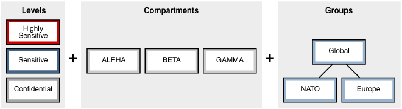
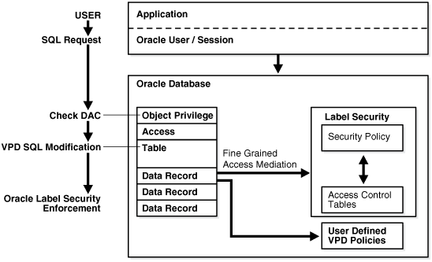
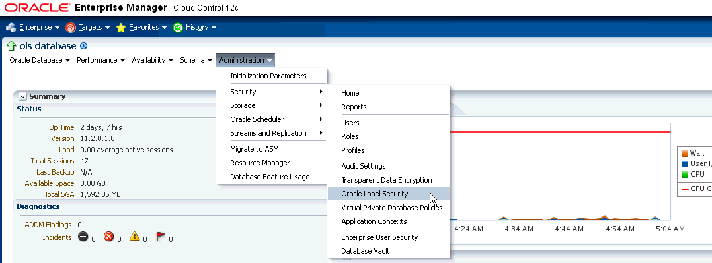

Oracle Label Security provides fine-grained access to individual table rows.

- About Oracle Label Security
  Oracle Label Security controls the display of individual table rows using labels that are assigned to specific individual table rows and application users.
- Benefits of Oracle Label Security
  Oracle Label Security provides several benefits for controlling row level management.
- Who Has Privileges to Use Oracle Label Security?
  When you register Oracle Label Security with a database, the registration process creates an administrative user named `LBACSYS`, who has the `LBAC_DBA` role.
- Duties of Oracle Label Security Administrators
  Oracle Label Security administrators have a set of package- and role-based privileges.
- Components of Oracle Label Security
  An Oracle Label Security policy has a standard set of components.
- Oracle Label Security Architecture
  The Oracle Label Security works with Oracle Database authentication to perform row level security.
- Oracle Label Security Administrative Interfaces
  You can perform Oracle Label Security development and administrative tasks using either of two interfaces.
- Oracle Label Security Demonstration File
  The `olsdemo.sql` file provides a demonstration on using Oracle Label Security.
- How Oracle Label Security Works with Other Oracle Products
  You can integrate Oracle Label Security with Oracle Internet Directory (OID) and in a multitenant environment.

**Parent topic:** [Getting Started with Oracle Label Security](part1.md)

### 1.1 About Oracle Label Security

Oracle Label Security controls the display of individual table rows using labels that are assigned to specific individual table rows and application users.

Oracle Label Security works by comparing the row label with a user's label authorizations to enable you to easily restrict sensitive information to only authorized users. This way, users with different authorization levels (for example, managers and sales representatives) can have access to specific rows of data in a table. You can apply Oracle Label Security policies to one or more application tables. The design of Oracle Label Security is similar to Oracle Virtual Private Database (VPD). However, unlike VPD, Oracle Label Security provides the access mediation functions, data dictionary tables, and policy-based architecture out of the box, eliminating customized coding and providing a consistent label based access control model that can be used by multiple applications.

Oracle Label Security is based on multi-level security (MLS) requirements that are found in government and defense organizations.

Oracle Label Security software is installed by default, but not automatically enabled. You can enable Oracle Label Security in either SQL\*Plus or by using the Oracle Database Configuration Assistant (DBCA). The default administrator for Oracle Label Security is the user `LBACSYS`. To manage Oracle Label Security, you can use either a set of PL/SQL packages and standalone functions at the command-line level or Oracle Enterprise Manager Cloud Control. To find information about Oracle Label Security policies, you can query `ALL_SA_*`, `DBA_SA_*`, or `USER_SA_*` data dictionary views.

**Parent topic:** Introduction to Oracle Label Security

### 1.2 Benefits of Oracle Label Security

Oracle Label Security provides several benefits for controlling row level management.

- It enables row level data classification and provides out-of-the-box access mediation based on the data classification and the user label authorization or security clearance.

- It enables you to assign label authorizations or security clearances to both database users and application users.

- It provides both APIs and a graphical user interface for defining and storing data classification labels and user label authorizations.

- It integrates with Oracle Database Vault and Oracle Advanced Security Data Redaction, enabling security clearances to be use in both Database Vault command rules and Data Redaction policy definitions.

**Parent topic:** Introduction to Oracle Label Security

### 1.3 Who Has Privileges to Use Oracle Label Security?

When you register Oracle Label Security with a database, the registration process creates an administrative user named `LBACSYS`, who has the `LBAC_DBA` role.

You can grant this role to any database user who will be responsible for managing Oracle Label Security policies. In addition, you can grant Oracle Label Security administrators the `EXECUTE` privilege for the Oracle Label Security packages, and privileges to manage individual Oracle Label Security policies.

As with other Oracle administrative user accounts, Oracle strongly recommends that you maintain two accounts for the `LBAC_DBA`. One account, the primary named user account, will be used on a day-to-day basis and the other account will be used as a backup account in case the password of the primary account is lost and must be reset.

**Parent topic:** Introduction to Oracle Label Security

### 1.4 Duties of Oracle Label Security Administrators

Oracle Label Security administrators have a set of package- and role-based privileges.

These privileges are:

- Package-specific privileges: Most of the Oracle Label Security PL/SQL packages, except for the public `SA_SESSION` and `SA_UTL` packages, require the `EXECUTE` privilege. The other packages are `SA_AUDIT_ADMIN`, `SA_COMPONENTS`, `SA_LABEL_ADMIN`, `SA_POLICY_ADMIN`, `SA_SYSDBA`, and `SA_USER_ADMIN`.

- Role-based privileges: The Oracle Label Security-specific roles are:

  - The `policy``_DBA` role, which is created and granted to the user when he or she creates a policy. For example, for a policy named `ols_hr_pol`, the role created is named `ols_hr_pol_DBA`. This role adds a layer of granularity for access control for your site's Oracle Label Security policies.

  - The `LBAC_DBA` role, which provides the `EXECUTE` privilege for the `SA_SYSDBA` package. This role is owned by the `LBACSYS` user account. The `SA_SYSDBA` package enables the user to create, alter, enable, disable, and drop Oracle Label Security policies.

You can use the Oracle Label Security package `EXECUTE` privilege grants along with grants of the `policy``_DBA` role to achieve additional separation of duty. The packages are categorized based on different tasks. For example, you could grant the `EXECUTE` privilege on the `SA_COMPONENTS` and `SA_LABEL_ADMIN` packages to one user or role to manage label definitions, and then grant `EXECUTE` on `SA_USER_ADMIN` to a different user or role to manage user labels and privileges. Both of these users or roles must also be granted the `policy``_DBA` role for the policies for which they are responsible. In this way, different users can be responsible for the management of different aspects of the policies for which they are responsible. For example, user `psmith` could be responsible for the label definitions of the `ols_hr_pol` policy, and user `tjones` could be responsible for the label definitions of the `ols_oe_pol` policy. However, user `psmith` cannot modify label definitions for the `ols_oe_pol` policy, nor can `tjones` modify the `ols_hr_pol` policy label definitions.

**Related Topics**

- Oracle Label Security Packages

**Parent topic:** Introduction to Oracle Label Security

### 1.5 Components of Oracle Label Security

An Oracle Label Security policy has a standard set of components.

These components are as follows:

- Labels. Labels for data and users, along with authorizations for users and program units, govern access to specified protected objects. Labels are composed of the following:

  - Levels. Levels indicate the type of sensitivity that you want to assign to the row (for example, `SENSITIVE` or `HIGHLY SENSITIVE`). Levels are mandatory.

  - Compartments. (Optional) Data can have the same level (for example, Public, Confidential and Secret), but can belong to different projects inside a company (for example, ACME Merger and IT Security). Compartments represent the projects in this example that help define more precise access controls. They are most often used in government environments.

  - Groups. (Optional) Groups identify organizations owning or accessing the data (for example, UK, US, Asia, Europe). Groups are used both in commercial and government environments, and frequently used in place of compartments due to their flexibility.

- Policy. A policy is a name associated with these labels, rules, authorizations, and protected tables.

For example, assume that a user has the `SELECT` privilege on an application table. As illustrated in Figure 1-1, when the user executes a `SELECT` statement, Oracle Label Security evaluates each row selected to determine whether the user can access using the privileges and labels assigned to the user and the label on the row. You can configure Oracle Label Security to perform security checks on `UPDATE`, `DELETE`, and `INSERT` statements as well.

Figure 1-1 Oracle Label Security Label-Based Security

[Description of "Figure 1-1 Oracle Label Security Label-Based Security"](img_text/olsag040.md)

**Parent topic:** Introduction to Oracle Label Security

### 1.6 Oracle Label Security Architecture

The Oracle Label Security works with Oracle Database authentication to perform row level security.

Figure 1-2 shows how data is accessed under Oracle Label Security and the sequence of label security checks.

Figure 1-2 Oracle Label Security Architecture

[Description of "Figure 1-2 Oracle Label Security Architecture"](img_text/olsag004.md)

In this scenario, the following actions take place:

1.  An application user in an Oracle Database session sends a SQL request to query a table.

2.  Oracle Database checks the user's data access control (DAC) privileges for performing a `SELECT` statement on the table.

3.  If the user does have the appropriate privileges, then Oracle Database checks if there are any Oracle Virtual Private Database (VPD) policies attached to the table.

4.  Oracle Database then checks if there are any Oracle Label Security policies that are assigned to the table.

5.  Oracle Label Security then compares the labels that are assigned to individual rows with the users' label authorizations, allowing or denying access. The session label is based on label authorizations that are assigned to the user.

**Parent topic:** Introduction to Oracle Label Security

### 1.7 Oracle Label Security Administrative Interfaces

You can perform Oracle Label Security development and administrative tasks using either of two interfaces.

- Oracle Label Security Packages
  Oracle Label Security packages provide a direct, command-line interface for ease of administration.
- Oracle Enterprise Manager Cloud Control
  The Oracle Enterprise Manager Cloud Control Web interface can be used to administer Oracle Label Security.

**Parent topic:** Introduction to Oracle Label Security

#### 1.7.1 Oracle Label Security Packages

Oracle Label Security packages provide a direct, command-line interface for ease of administration.

Table 1-1 lists the available Oracle Label Security administrative packages.

Table 1-1 Oracle Label Security Administrative Packages

| Package           | Purpose                                                                                                                                                                                                                                                                                                  |
|:------------------|:---------------------------------------------------------------------------------------------------------------------------------------------------------------------------------------------------------------------------------------------------------------------------------------------------------|
| `SA_SYSDBA`       | To create, alter, and drop Oracle Label Security policies See [SA_SYSDBA Policy Management PL/SQL Package](oracle-label-security-pl-sql-packages.md)                                                                                                                                                  |
| `SA_COMPONENTS`   | To define the levels, compartments, and groups for the policy See [SA_COMPONENTS Label Components PL/SQL Package](oracle-label-security-pl-sql-packages.md)                                                                                                                                           |
| `SA_LABEL_ADMIN`  | To perform standard label policy administrative functions, such as creating labels See [SA_LABEL_ADMIN Label Management PL/SQL Package](oracle-label-security-pl-sql-packages.md)                                                                                                                     |
| `SA_POLICY_ADMIN` | To apply policies to schemas and tables See [SA_POLICY_ADMIN Policy Administration PL/SQL Package](oracle-label-security-pl-sql-packages.md)                                                                                                                                                          |
| `SA_USER_ADMIN`   | To manage user authorizations for levels, compartments, and groups, as well as program unit privileges. Also to administer user privileges. See [SA_USER_ADMIN.SET_USER_PRIVS](oracle-label-security-pl-sql-packages.md) and [SA_USER_ADMIN.SET_PROG_PRIVS](oracle-label-security-pl-sql-packages.md) |
| `SA_AUDIT_ADMIN`  | To set options to audit administrative tasks and use of privileges See [SA_AUDIT_ADMIN Oracle Label Security Auditing PL/SQL Package](oracle-label-security-pl-sql-packages.md)                                                                                                                       |
| `SA_SESSION`      | To change labels during a session within the authorizations set by the administrator See [SA_SESSION Session Management PL/SQL Package](oracle-label-security-pl-sql-packages.md)                                                                                                                     |
| `SA_UTL`          | A set of utility functions designed for use within PL/SQL programs to return information about the current values of the session security attributes, as numeric label values See [SA_UTL PL/SQL Utility Functions and Procedures](oracle-label-security-pl-sql-packages.md)                          |

**Parent topic:** Oracle Label Security Administrative Interfaces

#### 1.7.2 Oracle Enterprise Manager Cloud Control

The Oracle Enterprise Manager Cloud Control Web interface can be used to administer Oracle Label Security.

Figure 1-3 illustrates the Oracle Enterprise Manager interface.

Figure 1-3 Using Enterprise Manager to Configure Oracle Label Security Policies

[Description of "Figure 1-3 Using Enterprise Manager to Configure Oracle Label Security Policies"](img_text/ols_config.md)

**Related Topics**

- [Logging in to Cloud Control or SQL\*Plus for Oracle Label Security](getting-started-with-oracle-label-security.md)
- [Registering and Logging in to Oracle Label Security](getting-started-with-oracle-label-security.md)

**Parent topic:** Oracle Label Security Administrative Interfaces

### 1.8 Oracle Label Security Demonstration File

The `olsdemo.sql` file provides a demonstration on using Oracle Label Security.

This file show to create and develop an Oracle Label Security policy using the supplied packages. You can install this script from the `ORACLE_HOME/rdbms/demo` directory.

**Parent topic:** Introduction to Oracle Label Security

### 1.9 How Oracle Label Security Works with Other Oracle Products

You can integrate Oracle Label Security with Oracle Internet Directory (OID) and in a multitenant environment.

- Oracle Label Security Integration with Oracle Internet Directory
  Sites that integrate their use of Oracle Label Security with Oracle Internet Directory gain significant efficiencies of label security operation and administration.
- Oracle Label Security Integration in a Multitenant Environment
  You can use Oracle Label Security in a multitenant environment.

**Parent topic:** Introduction to Oracle Label Security

#### 1.9.1 Oracle Label Security Integration with Oracle Internet Directory

Sites that integrate their use of Oracle Label Security with Oracle Internet Directory gain significant efficiencies of label security operation and administration.

You can create and manage directly policies and user authorization profiles in the directory by means of the command-line tools for Oracle Label Security using Oracle Internet Directory. These tools enable changes to be automatically propagated to the associated directories.

**Related Topics**

- [Command-line Tools for Label Security Using Oracle Internet Directory](command-line-tools-for-label-security-using-oracle-internet-directory.md)
- [Oracle Label Security Using Oracle Internet Directory](oracle-label-security-using-oracle-internet-directory.md)

**Parent topic:** How Oracle Label Security Works with Other Oracle Products

#### 1.9.2 Oracle Label Security Integration in a Multitenant Environment

You can use Oracle Label Security in a multitenant environment.

In a multitenant environment, pluggable databases (PDBs) can be plugged in and out of a multitenant container database (CDB) or an application container.

Note the following:

- Each PDB has its own Oracle Label Security metadata, such as policies, labels, and user authorizations. The `LBACSYS` schema is a common user schema.

- Before you plug a PDB into a CDB, if the database does not have Oracle Label Security installed, then ensure that you have run the `$ORACLE_HOME/rdbms/admin/catols.sql` script on the database to install the label-based framework, data dictionary, data types, and packages. This script creates the `LBACSYS` account.

- Because Oracle Label Security policies are scoped to individual PDBs, you can create individual policies for each PDB. A policy defined for a PDB can be enforced on the local tables and schema objects contained in the PDB.

- In a single CDB, there can be multiple PDBs, each configured with Oracle Label Security.

- You cannot create Oracle Label Security policies in the CDB root or the application root.

- You cannot enforce a local Oracle Label Security policy on a common CDB object or a common application object.

- You cannot assign Oracle Label Security policy labels and privileges to common users and application common users in a pluggable database.

- You cannot assign Oracle Label Security privileges to common procedures or functions and application common procedures or functions in a pluggable database.

- If you are configuring Oracle Label Security with Oracle Internet Directory, then be aware that the same configuration must be used throughout with all PDBs contained in the CDB. You can determine if your database is configured for Oracle Internet Directory by querying the `DBA_OLS_STATUS` data dictionary view as follows from within any PDB:

      SELECT STATUS FROM DBA_OLS_STATUS WHERE NAME = 'OLS_DIRECTORY_STATUS';

  If it returns `TRUE`, then Oracle Label Security is Internet Directory-enabled. Otherwise, it returns `FALSE`.

**Related Topics**

- [Oracle Database Security Guide](../dbseg/configuring-privilege-and-role-authorization.md)

**Parent topic:** How Oracle Label Security Works with Other Oracle Products
