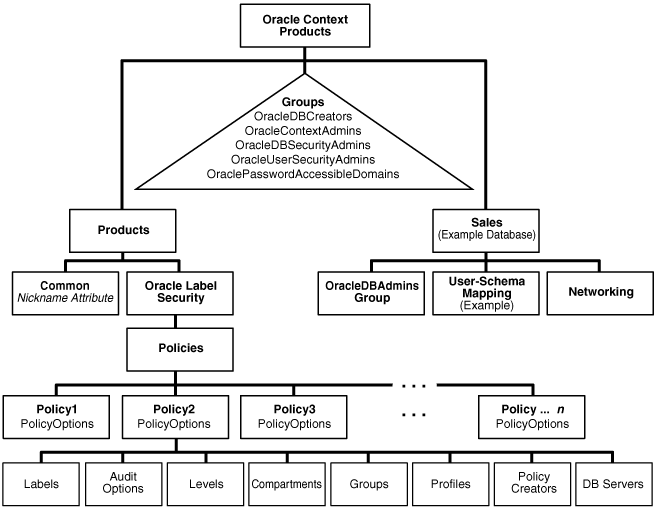
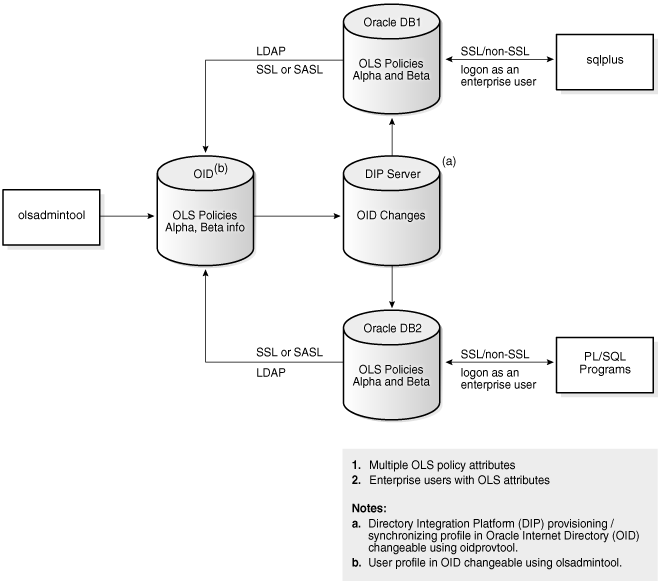

You can use Oracle Label Security with Oracle Internet Directory.

- About Label Management on Oracle Internet Directory
  Managing Oracle Label Security metadata in a centralized LDAP repository provides many benefits.
- Configuring Oracle Internet Directory-Enabled Label Security
  You can configure Oracle Internet Directory-enabled Oracle Label Security.
- Oracle Label Security Profiles
  A user profile is a set of user authorizations and privileges.
- Integrated Capabilities When Label Security Uses the Directory
  The integration of Oracle Label Security and Oracle Internet Directory enables the several capabilities.
- Oracle Label Security Policy Attributes in Oracle Internet Directory
  In Oracle Internet Directory, Oracle-related metadata is stored under `cn=OracleContext`.
- Subscription of Policies in Directory-Enabled Label Security
  In an Oracle Internet Directory-enabled Oracle Label Security, you must subscribe a policy before it can be applied (by `SA_POLICY_ADMIN.APPLY_TABLE_POLICY` or `SA_POLICY_ADMIN.APPLY_SCHEMA_POLICY`).
- Restrictions on New Data Label Creation
  When Oracle Label Security is used with Oracle Internet Directory, data labels must be pre-defined in the directory.
- Administrator Duties for Oracle Internet Directory and Oracle Label Security
  Administrators listed within a policy are those individuals authorized to do the olicy-specific administrative tasks.
- Bootstrapping Databases
  After you register a new database with Oracle Internet Directory, you can install Oracle Internet Directory enabled Oracle Label Security on that database.
- Synchronizing the Database and Oracle Internet Directory
  After you have installed and configured Oracle Internet Directory with Oracle Label Security, you should synchronize the database with OID and OLS.
- Security Roles and Permitted Actions
  Oracle Label Security permits specific tasks and access levels for Oracle Internet Directory, including restrictions on directory-enabled OLS policy creators.
- Superseded PL/SQL Statements When OID Is Enabled with OLS
  When Oracle Internet Directory is enabled with Oracle Label Security, there are several procedures that are superseded.
- Oracle Label Security Procedures for Policy Administrators
  Several procedures in the `SA_POLICY_ADMIN` PL/SQL package are allowed to be run only by policy administrators (enterprise users defined in Oracle Internet Directory).

**Parent topic:** [Using Oracle Label Security Functionality](part2.md)

### 7.1 About Label Management on Oracle Internet Directory

Managing Oracle Label Security metadata in a centralized LDAP repository provides many benefits.

- You can easily provision policies and user label authorizations, and distribute them throughout the enterprise.

- When employees are terminated, you can revoke their label authorizations in one place and the change automatically propagates throughout the enterprise.

Previous releases of Oracle Label Security relied on the Oracle Database as the central repository for policy and user label authorizations. This leveraged the scalability and high availability of the Oracle Database, but not the identity management infrastructure, which includes the Oracle Internet Directory (OID). Integrating your installation of Oracle Label Security with Oracle Internet Directory allows label authorizations as part of your standard provisioning process.

These advantages apply also to directory-stored information about policies, user labels, and privileges that Oracle Label Security assigns to users. These labels and privileges are specific to the installation policies defining access control on tables and schemas. If a site is not using Oracle Internet Directory, then such information is stored locally in the database.

The following Oracle Label Security information is stored in the directory:

- Policy information, specifically policy name, column name, policy enforcement options, and audit options

- User profiles identifying their labels and privileges

- Policy label components: levels, compartments, and groups

- Policy data labels

Database-specific metadata, such as the following, is not stored in the directory:

- Lists of schemas or tables, with associated policy information

- Program units, with associated policy privileges

Note the following important aspects of integrating an Oracle Label Security installation with Oracle Internet Directory (OID):

**Note:**

Oracle will continue to support both the database and directory-based (OID) architectures for Oracle Label Security. However, a single database environment cannot host both architectures. Administrators must decide whether to use the centralized LDAP administration model or the database-centric model.

**Note:**

You can manage Oracle Label Security policies directly in the directory using the Oracle Label Security administration tool (`olsadmintool`).

You can also use the graphical user interface provided by Oracle Enterprise Manager to manage Oracle Label Security. The Oracle Enterprise Manager help contains detailed documentation.

For sites that use Oracle Internet Directory, databases retrieve Oracle Label Security policy information from the directory. Administrators use the `olsadmintool` policy administration tool or the Enterprise Manager graphical user interface to operate directly on the directory to insert, alter, or remove metadata as needed. Because enterprise users can log in to multiple databases using the credentials stored in Oracle Internet Directory, it is logical to store their Oracle Label Security policy authorizations and privileges there as well. An administrator can then modify these authorizations and privileges by updating such metadata in the directory.

For distributed databases, centralized policy management removes the need for replicating policies, because the appropriate policy information is available in the directory. Changes are effective without further effort, synchronized with policy information in the databases by means of the Directory Integration Platform.

Figure 7-1 illustrates the structure of metadata storage in Oracle Internet Directory.

Figure 7-1 Diagram of Oracle Label Security Metadata Storage in Oracle Internet Directory

[Description of "Figure 7-1 Diagram of Oracle Label Security Metadata Storage in Oracle Internet Directory"](img_text/olsag038.md)

Figure 7-2 illustrates how different policies stored in Oracle Internet Directory apply to the databases accessed by different enterprise users. Directory entries corresponding to the user and the accessed database determine the policy to be applied.

Figure 7-2 Oracle Label Security Policies Applied through Oracle Internet Directory

[Description of "Figure 7-2 Oracle Label Security Policies Applied through Oracle Internet Directory"](img_text/olsag037.md)

In this figure, the directory has information about two Oracle Label Security policies, Alpha, applying to database DB1, and Beta, applying to database DB2 Although both policies are known to each database, only the appropriate one is applied in each case. In addition, enterprise users who are to access rows protected by Oracle Label Security are listed in profiles within the Oracle Label Security attributes in Oracle Internet Directory.

As Figure 7-2 shows, the connections between different databases and the directory are established over either Transport Layer Security (TLS) (listed as SSL in the diagram) or SASL. The database always binds to the directory as a known identity using password-based authentication. Links between databases and their clients (such as a SQL\*Plus session, any PL/SQL programs, and so on) can use either TLS or non-TLS connections. The example of Figure 7-2 assumes that users are logged on through password authentication. The choice of connection type depends on the enterprise user model.

The Oracle Label Security policy administration tool operates directly on metadata in Oracle Internet Directory. Changes in the directory are then propagated to the Oracle Directory Integration and Provisioning server, which is configured to send changes to the databases at specific time intervals.

The databases update the policy information in Oracle Internet Directory only when policies are being applied to tables or schemas. These updates ensure that policies that are in use will not be dropped from the directory.

**See Also:**

[Oracle Database Enterprise User Security Administrator's Guide](../dbimi/introducing-enterprise-user-security.md) for more information on enterprise domains, user models and authentication activities

**Parent topic:** Oracle Label Security Using Oracle Internet Directory

### 7.2 Configuring Oracle Internet Directory-Enabled Label Security

You can configure Oracle Internet Directory-enabled Oracle Label Security.

- About Configuring Oracle Internet Directory-Enabled Label Security
  You can configure a database for Oracle Internet Directory-enabled Label Security after database creation or during custom database creation.
- Granting Permissions for Configuring OID-Enabled Oracle Label Security
  Users who perform Oracle Internet Directory-enabled Oracle Label Security using the Database Configuration Assistant (DBCA) must have additional privileges.
- Registering a Database and Configuring OID-Enabled Oracle Label Security
  The registration and configuration process entails configuring an Oracle home for the directory, performing the configuration, and setting a password and connect data.
- Unregisteration of a Database with OID-Enabled Oracle Label Security
  To unregister a database with Oracle Internet Directory-enabled Oracle Label Security, you can use DBCA.

**Parent topic:** Oracle Label Security Using Oracle Internet Directory

#### 7.2.1 About Configuring Oracle Internet Directory-Enabled Label Security

You can configure a database for Oracle Internet Directory-enabled Label Security after database creation or during custom database creation.

Oracle Internet Directory-enabled label security relies on the Enterprise User security feature.

**See Also:**

- [Oracle Database Enterprise User Security Administrator's Guide](../dbimi/enterprise-user-security-configuration-tasks-and-troubleshooting.md) for prerequisites and steps to configure a database for directory usage

- [Oracle Database Enterprise User Security Administrator's Guide](../dbimi/configuration-and-administration-tools-overview.md) for information about Database Configuration Assistant (DBCA).

**Parent topic:** Configuring Oracle Internet Directory-Enabled Label Security

#### 7.2.2 Granting Permissions for Configuring OID-Enabled Oracle Label Security

Users who perform Oracle Internet Directory-enabled Oracle Label Security using the Database Configuration Assistant (DBCA) must have additional privileges.

The following steps describe what permissions are needed, and how to grant them:

1.  Use Enterprise Manager to add the user to the `OracleDBCreators` group.
    [Oracle Database Enterprise User Security Administrator's Guide](../dbimi/administering-enterprise-user-security.md) describes how to add a user to an administrative group.
2.  Add the user to the Provisioning Admins group.
    This is necessary because DBCA creates a `DIP` provisioning profile for Oracle Label Security. Use `ldapmodify` command with the following `.ldif` file to add a user to the Provisioning Admins group:

        dn: cn=Provisioning Admins,cn=changelog subscriber, cn=oracle internet directory
        changetype: modify
        add: uniquemember
        uniquemember: DN of the user who is to be added
3.  Add the user to the `policyCreators` group using the `olsadmintool` command line tool.
    DBCA bootstraps the database with the Oracle Label Security policy information from Oracle Internet Directory, and only `policyCreators` can perform this bootstrap.
4.  If the database is already registered with the Oracle Internet Directory using DBCA, use Enterprise Manager to add the user to the `OracleDBAdmins` group of that database.

Note that the permissions specified earlier are also needed by the administrator who unregisters the database that has Oracle Internet Directory enabled Oracle Label Security configuration.

**Parent topic:** Configuring Oracle Internet Directory-Enabled Label Security

#### 7.2.3 Registering a Database and Configuring OID-Enabled Oracle Label Security

The registration and configuration process entails configuring an Oracle home for the directory, performing the configuration, and setting a password and connect data.

- Step 1: Configure Your Oracle Home for Directory Usage
  First, you must configure your Oracle home directory so that you can use Oracle Internet Directory.
- Step 2: Configure Oracle Internet Directory for Oracle Label Security
  Next, you are ready to configure Oracle Internet Directory for Oracle Label security.
- Step 2 Alternate: Configuring Database for OID-Enabled Oracle Label Security
  Registering the database and configuring Oracle Label Security can be done in one invocation of DBCA.
- Step 3: Set the DIP Password and Connect Data
  The `DIP` user manages Oracle Internet Directory.

**Parent topic:** Configuring Oracle Internet Directory-Enabled Label Security

##### 7.2.3.1 Step 1: Configure Your Oracle Home for Directory Usage

First, you must configure your Oracle home directory so that you can use Oracle Internet Directory.

- Follow the instructions in [Oracle Database Enterprise User Security Administrator's Guide](../dbimi/getting-started-with-enterprise-user-security.md) to configure your Oracle home for directory usage.

**Parent topic:** Registering a Database and Configuring OID-Enabled Oracle Label Security

##### 7.2.3.2 Step 2: Configure Oracle Internet Directory for Oracle Label Security

Next, you are ready to configure Oracle Internet Directory for Oracle Label security.

1.  Register your database in the directory using Database Configuration Assistant (DBCA).

    See [Oracle Database Enterprise User Security Administrator's Guide](../dbimi/getting-started-with-enterprise-user-security.md) .

2.  After your database is registered in the directory, configure Label Security:

    1.  Start DBCA, select Configure database options in a database, and click Next.

    2.  Select a database and click Next.

    3.  Regarding the option of unregistering the database or keeping it registered, select Keep the database registered.

    4.  If the database is registered with Oracle Internet Directory, the Database options screen shows a customize button beside the Label Security check box. Select the Label Security option and click Customize.

    5.  This customize dialog has two configuration options, for standalone Oracle Label Security or for Oracle Internet Directory-enabled Oracle Label Security. Click OID-enabled Label security configuration and enter the Oracle Internet Directory credentials of an appropriate administrator. Click Ok.

    6.  Continue with the remaining DBCA steps and click Finish when it appears.

        **Note:**

        You can configure a standalone Oracle Label Security on a database that is registered with Oracle Internet Directory. Select the standalone option in step e.

When configuring for Oracle Internet Directory-enabled Oracle Label Security, DBCA does the following actions in addition to registering the database:

1.  Creates a provisioning profile for propagating Label Security policy changes to the database.

2.  Installs the required packages on the database side for Oracle Internet Directory-enabled Oracle Label Security.

3.  Bootstraps the database with all the existing Label Security policy information in the Oracle Internet Directory.

**Related Topics**

- Bootstrapping Databases

**Parent topic:** Registering a Database and Configuring OID-Enabled Oracle Label Security

##### 7.2.3.3 Step 2 Alternate: Configuring Database for OID-Enabled Oracle Label Security

Registering the database and configuring Oracle Label Security can be done in one invocation of DBCA.

1.  Start DBCA.
2.  Select Configure database options in a database and click Next.
3.  Select a database and click Next.
4.  Click Register the database.
5.  Enter the Oracle Internet Directory credentials of an appropriate administrator, and the corresponding password for the database wallet that will be created.
6.  Enter an optional Custom Database Name for the database.
    The ability to specify a custom database name is new in Oracle Database 12c. By default, the database CN (first part of the DN or the distinguished name) in the directory is the `DB_UNIQUE_NAME`. You can change this to a custom value.
7.  The Database options screen shows a Customize button beside the Label Security check box. Select the Label Security option and click Customize.
    The Customize dialog box is displayed, showing two configuration options, for standalone Oracle Label Security or for Oracle Internet Directory-enabled Oracle Label Security.
8.  Click OID-enabled Label Security Configuration.
9.  Continue with the remaining DBCA steps and click Finish.

**Parent topic:** Registering a Database and Configuring OID-Enabled Oracle Label Security

##### 7.2.3.4 Step 3: Set the DIP Password and Connect Data

The `DIP` user manages Oracle Internet Directory.

After you configure this user’s password, you must update the interface connect information in the `DIP` provisioning profile.

1.  Use the command line tool `oidprovtool` to set the password for the `DIP` user and update the interface connect information in the `DIP` provisioning profile for that database with the new password.
2.  Upon creation, the `DIP` profile uses a schedule value of 3600 seconds by default, meaning that Oracle Label Security changes are propagated to the database every hour. You can use `oidprovtool` to change this value if deployment considerations require that.

Once the database is configured for Oracle Internet Directory-enabled Oracle Label Security, further considerations regarding enterprise user security may apply.

**See Also:**

- Oracle Directory Integration and Provisioning (DIP) Provisioning Profiles

- [Oracle Database Enterprise User Security Administrator's Guide](../dbimi/introducing-enterprise-user-security.md) for further concepts, tools, steps, and procedures

**Parent topic:** Registering a Database and Configuring OID-Enabled Oracle Label Security

#### 7.2.4 Unregisteration of a Database with OID-Enabled Oracle Label Security

To unregister a database with Oracle Internet Directory-enabled Oracle Label Security, you can use DBCA.

DBCA does the following in this process:

1.  Deletes the `DIP` provisioning profile for the database created for Oracle Label Security.

2.  Installs the required packages for standalone Oracle Label Security, so that after unregistering, Oracle Internet Directory enabled Oracle Label Security becomes standalone Oracle Label Security.

    **Note:**

    - Specific instructions for database unregistration appear in the [Oracle Database Enterprise User Security Administrator's Guide](../dbimi/enterprise-user-security-configuration-tasks-and-troubleshooting.md). No special steps are required when Oracle Internet Directory-enabled Oracle Label Security is configured.

    - If a database has standalone Oracle Label Security, it cannot be converted to Oracle Internet Directory-enabled Oracle Label Security. You need to drop Oracle Label Security from the database and then use DBCA again to configure Oracle Internet Directory-enabled Oracle Label Security.

**Parent topic:** Configuring Oracle Internet Directory-Enabled Label Security

### 7.3 Oracle Label Security Profiles

A user profile is a set of user authorizations and privileges.

Profiles are maintained as part of each Oracle Label Security policy stored in the Directory.If a user is added to a profile, then the authorizations and privileges defined in that profile for that particular policy are acquired by the user, which include the following attributes:

- Five label authorizations:

  - maximum read label

  - maximum write label

  - minimum write label

  - default read label

  - default row label

- Privileges

- The list of enterprise users to whom these authorizations apply

An enterprise user can belong to only one profile, or none.

**See Also:**

- Oracle Label Security Policy Attributes in Oracle Internet Directory

- [Oracle Database Enterprise User Security Administrator's Guide](../dbimi/getting-started-with-enterprise-user-security.md) for more information on creating and managing enterprise users

- Oracle Enterprise Manager help for information on creating and administering Oracle Label Security profiles and policies

**Parent topic:** Oracle Label Security Using Oracle Internet Directory

### 7.4 Integrated Capabilities When Label Security Uses the Directory

The integration of Oracle Label Security and Oracle Internet Directory enables the several capabilities.

- User/administrator actions

  - Storing multiple Oracle Label Security policies in Oracle Internet Directory

  - Managing Oracle Label Security policies and options in the directory, including

    - creating or dropping a policy

    - changing policy options

    - changing audit settings

  - Creating label components for any Oracle Label Security policies by

    - creating or removing levels, compartments, or groups

    - assigning numeric values to levels, compartments, or groups

    - changing long names of levels, compartments, or groups

    - creating children groups

  - Managing enterprise users configured as users of any Oracle Label Security policies, including

    - assigning or removing enterprise users to/from profiles within policies

    - assigning policy-specific privileges to enterprise users, or removing them

    - changing policy label authorizations assigned to enterprise users

  - Managing all user/administrator actions and capabilities by means of an integrated set of command line tools that monitor and manage Oracle Label Security policies in Oracle Internet Directory.

- Automatic results of Oracle Label Security

  - Limiting database policy usage to directory-defined policies only (no local policies defined or applied)

  - Synchronizing changes to policies in the directory with the databases using Oracle Label Security (to apply after enterprise users reconnect)

  - After changes are propagated by the Directory Integration Platform, having immediate access to enterprise users' Oracle Label Security attributes when these users log on to any database using Oracle Label Security, assuming they are configured within any Oracle Label Security policies. These attributes include users' label authorizations and users' privileges.

**Parent topic:** Oracle Label Security Using Oracle Internet Directory

### 7.5 Oracle Label Security Policy Attributes in Oracle Internet Directory

In Oracle Internet Directory, Oracle-related metadata is stored under `cn=OracleContext`.

Within Label Security, each policy holds the information and parameters shown in Figure 7-1:

When Oracle Label Security is used without Oracle Internet Directory, it supports automatic creation of data labels by means of a label function. However, when Oracle Label Security is used with Oracle Internet Directory, such functions can create labels only using data labels that are already defined in the directory.

Table 7-1 Contents of Each Policy

| Type of Entry       | Contents                                                                                                                                                                                                                                     | Meaning/Sample Usage/References                                                                                                                                                                                                                                                                                                                                                                                        |
|:--------------------|:---------------------------------------------------------------------------------------------------------------------------------------------------------------------------------------------------------------------------------------------|:-----------------------------------------------------------------------------------------------------------------------------------------------------------------------------------------------------------------------------------------------------------------------------------------------------------------------------------------------------------------------------------------------------------------------|
| Policy Name         | The name assigned to this policy at its creation                                                                                                                                                                                             | Used in `olsadmintool` commands such as `olsadmintool` `createpolicy` (refer to [Command-line Tools for Label Security Using Oracle Internet Directory](command-line-tools-for-label-security-using-oracle-internet-directory.md)`)`                                                                                                                                                                                   |
| Column Name         | The name of the column that will hold the label values relevant to this policy                                                                                                                                                               | Column is added to database. Refer to [How Policy Label Column and Label Tags Work](working-with-labeled-data.md) [Inserting Labeled Data](working-with-labeled-data.md) [How the HIDE Policy Column Option Works](implementing-policy-enforcement-options-and-labeling-functions.md) [Oracle Label Security Tables and Views](oracle-label-security-reference.md). Used in `olsadmintool createpolicy` |
| Enforcement Options | Any combination of the following entries: `LABEL_DEFAULT,LABEL_UPDATE, CHECK_CONTROL,READ_CONTROL, WRITE_CONTROL,INSERT_CONTROL, DELETE_CONTROL,UPDATE_CONTROL, ALL_CONTROL, or NO_CONTROL`                                               | Refer to the discussions in [Implementing Policy Enforcement Options and Labeling Functions](implementing-policy-enforcement-options-and-labeling-functions.md) and [Oracle Label Security Tables and Views](oracle-label-security-reference.md). Used in `olsadmintool createpolicy` and `olsadmintool alterpolicy`                                                                                          |
| Options             | Enabled:`TRUE or FALSE`, Type: `ACCESS or SESSION`, Success:` SUCCESSFUL,UNSUCCESSFUL, or BOTH`.                                                                                                                                             | Used in `olsadmintool audit`                                                                                                                                                                                                                                                                                                                                                                                        |
| Levels              | Name and number for each level                                                                                                                                                                                                               | Used in `olsadmintool create/alter/droplevel`                                                                                                                                                                                                                                                                                                                                                                          |
| Compartments        | Name and number for each compartment                                                                                                                                                                                                         | Used in `olsadmintool create/alter/drop compartment`                                                                                                                                                                                                                                                                                                                                                                   |
| Groups              | Name, number, and parent for each group                                                                                                                                                                                                      | Used in `olsadmintool create/alter/dropgroup`                                                                                                                                                                                                                                                                                                                                                                          |
| Profiles            | Maximum and default read labels, maximum and minimum write labels, default row label, list of users, and a set of privileges from this list: `READ,` `FULL,` `WRITEUP,` `WRITEDOWN, WRITEACROSS,` `PROFILE_ACCESS,` `or COMPACCESS` | Policies can have one or more profiles, each of which can be assigned to many users. Profiles reduce the need to set up label authorizations for individual users. All users with the same set of labels and privileges are grouped in a single profile. Each profile represents a different set of labels, privileges, and users. Each profile in a policy is unique.                                              |
| Data Labels         | Full name and number for each valid data label                                                                                                                                                                                               | Refer to Restrictions on New Data Label Creation.                                                                                                                                                                                                                                                                                                                                                                      |
| Administrators      | Name of each administrator authorized to modify the parameters within this policy.                                                                                                                                                           | Policy administrators can modify parameters within a policy. They are not necessarily also policy creators, who have the right to create or remove policies or policy administrators. Refer to Security Roles and Permitted Actions.                                                                                                                                                                                   |

**Parent topic:** Oracle Label Security Using Oracle Internet Directory

### 7.6 Subscription of Policies in Directory-Enabled Label Security

In an Oracle Internet Directory-enabled Oracle Label Security, you must subscribe a policy before it can be applied (by `SA_POLICY_ADMIN.APPLY_TABLE_POLICY` or `SA_POLICY_ADMIN.APPLY_SCHEMA_POLICY`).

In a standalone Oracle Label Security installation, the `SA_POLICY_ADMIN.APPLY_TABLE_POLICY` or `SA_POLICY_ADMIN.APPLY_SCHEMA_POLICY` functions can be used directly without the need to subscribe.

**Related Topics**

- [SA_POLICY_ADMIN Policy Administration PL/SQL Package](oracle-label-security-pl-sql-packages.md)
- [Step 5: Apply the Policy to a Database Table or Schema](creating-an-oracle-label-security-policy.md)

**Parent topic:** Oracle Label Security Using Oracle Internet Directory

### 7.7 Restrictions on New Data Label Creation

When Oracle Label Security is used with Oracle Internet Directory, data labels must be pre-defined in the directory.

They cannot be created dynamically by a label function, as is possible when label security is not integrated with the directory.

**Parent topic:** Oracle Label Security Using Oracle Internet Directory

### 7.8 Administrator Duties for Oracle Internet Directory and Oracle Label Security

Administrators listed within a policy are those individuals authorized to do the olicy-specific administrative tasks.

- Modify existing policy options and audit settings.

- Enable or disable auditing for a policy.

- Create or remove levels, compartments, groups or children groups.

- Modify full/long names for levels, compartment, or groups.

- Define or modify enterprise user settings, in this policy, for:

  - Privileges

  - Maximum or minimum levels

  - Read, write, or row access for levels, compartments, or groups

  - Label profiles

- Remove enterprise users from a policy.

There is a higher level of administrators, called policy creators, who can create and remove Oracle Label Security policies and the policy administrators named within them.

**Parent topic:** Oracle Label Security Using Oracle Internet Directory

### 7.9 Bootstrapping Databases

After you register a new database with Oracle Internet Directory, you can install Oracle Internet Directory enabled Oracle Label Security on that database.

This installation process automatically creates a Directory Integration Platform (DIP) provisioning profile enabling policy information to be periodically refreshed in the future by downloading it to the database.

When configuring the database for Oracle Internet Directory enabled Oracle Label Security, Database Configuration Asssitant (DBCA) puts all the policy information in Oracle Internet Directory into a newly registered database and populates the information in the database. This process is called bootstrapping.

- To bootstrap the database, run the bootstrap utility script at `$ORACLE_HOME/bin/olsoidsync` by using the following parameters:

      olsoidsync --dbconnectstring "database_connect_string_in_host:port:sid_format"
      --dbuser database_user [-c] [-r]
      [-b admin_context] -h OID_host [-p port] -D bind_DN

      Enter Database password: database_user_password
      Enter bind password: bind_password

For example:

    olsoidsync --dbconnectstring sales_srvr:1521:ora101 --dbuser lbacsys -c
    -b "ou=Americas,o=ExampleCorp,c=US" -h sales_srvr -D cn=policycreator
    Enter Database password: database_user_password
    Enter bind password: bind_password

You must provide the database TNS name, the database user name, the database user's password, the administrative context (if any), the Oracle Internet Directory host name, the bind DN and bind password, and optionally the Oracle Internet Directory port number. The `c` and `r` parameters are optional. `c` drops all the existing policies in the database and refreshes it with policy information from Oracle Internet Directory, and `r` drops all the policy metadata (without dropping the policies themselves) and refreshes the policies with new metadata from Oracle Internet Directory.

**Related Topics**

- Oracle Directory Integration and Provisioning (DIP) Provisioning Profiles
- [olsoidsync Command Reference](command-line-tools-for-label-security-using-oracle-internet-directory.md)

**Parent topic:** Oracle Label Security Using Oracle Internet Directory

### 7.10 Synchronizing the Database and Oracle Internet Directory

After you have installed and configured Oracle Internet Directory with Oracle Label Security, you should synchronize the database with OID and OLS.

- About Synchronizing the Database and Oracle Internet Directory
  The Directory Integration Platform Oracle Directory Provisioning Service synchronizes Oracle Label Security metadata in the OID directory with the databases.
- Oracle Directory Integration and Provisioning (DIP) Provisioning Profiles
  The DIP server synchronizes policy changes in the directory with the connected databases, using a separate DIP provisioning profile created for each database.
- Modifying a Provisioning Profile
  The `oidprovtool` `modify` command changes the password for the `interface_connect_info` connect string.
- Changing the Database Connection Information for a Provisioning Profile
  You can change the database connection information in the `DIP` profile.
- Configuring OID-Enabled Oracle Label Security with Oracle Data Guard
  To configure Oracle Directory-Enabled Oracle Label Security to work with Oracle Data Guard, first you configure the primary database, then the secondary database.

**Parent topic:** Oracle Label Security Using Oracle Internet Directory

#### 7.10.1 About Synchronizing the Database and Oracle Internet Directory

The Directory Integration Platform Oracle Directory Provisioning Service synchronizes Oracle Label Security metadata in the OID directory with the databases.

Changes to the label security data in the directory are conveyed by the provisioning integration service in the form of provisioning events. A software agent receives these events and generates appropriate SQL or PL/SQL statements to update the database. After these statements are processed, Oracle Label Security data dictionaries are updated to match the changes already made in the directory.

Oracle Label Security subscribes itself to the Provisioning Integration Service automatically during installation. The provisioning service stores the information associated with each database in the form of a provisioning profile. The software agent uses the identity of the user `DIP`, which is created as for Oracle Label Security, to connect to the database, when synchronizing the changes in Oracle Internet Directory with the database.

If the password for the user `DIP` is changed, then you must update this password in the provisioning profile of the provisioning integration service.

**Parent topic:** Synchronizing the Database and Oracle Internet Directory

#### 7.10.2 Oracle Directory Integration and Provisioning (DIP) Provisioning Profiles

The DIP server synchronizes policy changes in the directory with the connected databases, using a separate DIP provisioning profile created for each database.

This profile is created automatically as part of the installation process for Oracle Internet Directory-enabled Oracle Label Security. The administrator can use the provisioning tool `oidprovtool` to modify the password for a database profile, using the script `$ORACLE_HOME``/bin/oidprovtoo`l. Each such profile contains the following information:

Table 7-2 Elements in a DIP Provisioning Profile

| Element                                                                                                                                                                          | Name for This Element When Invoking oidprovtool |
|:---------------------------------------------------------------------------------------------------------------------------------------------------------------------------------|:------------------------------------------------|
| The LDAP host name                                                                                                                                                               | `ldap_host`                                     |
| The LDAP port number                                                                                                                                                             | `ldap_port`                                     |
| The user DN and password to bind to Oracle Internet Directory to retrieve policy information                                                                                     | `ldap_user` `ldap_user_password`             |
| The database DN                                                                                                                                                                  | `application_dn`                                |
| The organization DN, that is, the administrative context in which changes are being made                                                                                         | `organization_dn`                               |
| The callback function to be invoked, that is, `LBACSYS.OLS_DIP_NTFY`                                                                                                             | `interface_name`                                |
| The database connect information, which is the host name of the database, the port number used to connect to the database, the database SID, the database user name and password | `interface_connect_info`                        |
| Event subscriptions, including all `MODIFY`, `ADD` and `DELETE` events under `cn=LabelSecurity` in Oracle Internet Directory                                                     | `operation`                                     |
| The time interval between synchronizations                                                                                                                                       | `schedule`                                      |

Here is an example of using `oidprovtool`, followed by an explanation of the parameters in this example:

    oidprovtool operation=modify ldap_host=yippee ldap_port=389
    ldap_user=cn=defense_admin ldap_user_password=Easy2rem
    application_dn="cn=db1,cn=OracleContext,ou=Americas,o=Oracle,c=US"
    organization_dn="ou=Americas,o=Oracle,c=US" interface_name=LBACSYS.OLS_DIP_NTFY
    interface_type=PLSQL interface_connect_info=yippee:1521:db1:dip:newdip schedule=60
    event_subscription= "ENTRY:cn=LabelSecurity,cn=Products,cn=OracleContext,
    ou=Americas,o=Oracle,c=US:ADD(*)" event_subscription=
    "ENTRY:cn=LabelSecurity,cn=Products, cn=OracleContext,ou=Americas,
    o=Oracle,c=US:MODIFY(*)" event_subscription="ENTRY:cn=LabelSecurity,cn=Products,
    cn=OracleContext, ou=Americas,o=Oracle,c=US:DELETE"

This sample `oidprovtool` command creates and enables a new DIP provisioning profile with the following attributes:

- Oracle Internet Directory in host `yippee` using port 389

- Oracle Internet Directory user bind DN: `cn=defense_admin` with password Easy2rem

- Database DN: `cn=db1`, `cn=OracleContext`, `ou=Americas`, `o=Oracle`, `c=US`

- Organization DN (administrative context): `ou=Americas`, `o=Oracle`, `c=US`

- Database on host yippee, listening on port 1521

- Oracle SID: `db1`

- Database user: `dip` with new password `newdip`

- Interval to synchronize directory with connected databases: 60 seconds

- All the `ADD`, `MODIFY` and `DELETE` events under `cn=LabelSecurity` to be sent to DIP

To start the DIP server, use `$ORACLE_HOME``/bin/oidctl.` For example:

    oidctl server=odisrv connect=db2 config=0 instance=0 start

This command will start the DIP server by connecting to `db2` (the Oracle Internet Directory database) with `config` set to `0` and instance number `0`.

**Parent topic:** Synchronizing the Database and Oracle Internet Directory

#### 7.10.3 Modifying a Provisioning Profile

The `oidprovtool` `modify` command changes the password for the `interface_connect_info` connect string.

Before you change the password, you must temporarily disable the profile. After changing the password, you then reenable the profile.

1.  Disable the profile by using the`oidprovtool` .
    The syntax is as follows:

        oidprovtool operation=disable ldap_host=host ldap_port=port ldap_user_dn=ldap_user_dn  ldap_user_password=password application_dn=app_dn  organization_dn=org_dn

    For example:

        oidprovtool operation=disable ldap_host=yippee ldap_port=389

        ldap_user=cn=defense_admin ldap_user_password=password
        application_dn="cn=db1,cn=OracleContext,ou=Americas,o=Oracle,c=US"
        organization_dn="ou=Americas,o=Oracle,c=US"
2.  Modify the password and connection information by using the following syntax:
        oidprovtool operation=modify  ldap_host=ldap_host ldap_port=port

        ldap_user_dn=ldap_user_dn  ldap_user_password=password application_dn=app_dn
        organization_dn=org_dn interface_connect_info=new_connect_info

    For example:

        oidprovtool operation=modify ldap_host=yippee ldap_port=389

        ldap_user=cn=defense_admin ldap_user_password=Easy2rem
        application_dn="cn=db1,cn=OracleContext,ou=Americas,o=Oracle,c=US"
        organization_dn="ou=Americas,o=Oracle,c=US"
        interface_connect_info=yippee:1521:db1:dip:NewestDIPpassword
3.  Reenable the profile by using the following syntax:
        oidprovtool operation=enable ldap_host=host ldap_port=port ldap_user_dn=ldap_user_dn ldap_user_password=password application_dn=app_dn organization_dn=org_dn

    For example

        oidprovtool operation=enable ldap_host=yippee ldap_port=389

        ldap_user=cn=defense_admin ldap_user_password=password
        application_dn="cn=db1,cn=OracleContext,ou=Americas,o=Oracle,c=US"
        organization_dn="ou=Americas,o=Oracle,c=US"

**Parent topic:** Synchronizing the Database and Oracle Internet Directory

#### 7.10.4 Changing the Database Connection Information for a Provisioning Profile

You can change the database connection information in the `DIP` profile.

1.  Disable the provisioning profile.
    This step temporarily stops the propagation of label security changes in the directory to the database, but no data is lost. Once the profile is enabled, any label security changes that happened in the directory since the profile was disabled are synchronized with the database.
2.  Update the database connection information in the profile.
3.  Enable the profile.
    **Note:**

    The database character set must be compatible with Oracle Internet Directory for Oracle Internet Directory-enabled Oracle Label Security to work correctly. Only then can there be successful synchronization of the Label Security metadata in Oracle Internet Directory with the Database.

    **See Also:**

    - [Oracle Database Globalization Support Guide](../nlspg/overview-of-globalization-support.md) for more information about character sets and Globalization Support parameters

    - Modifying a Provisioning Profile

**Parent topic:** Synchronizing the Database and Oracle Internet Directory

#### 7.10.5 Configuring OID-Enabled Oracle Label Security with Oracle Data Guard

To configure Oracle Directory-Enabled Oracle Label Security to work with Oracle Data Guard, first you configure the primary database, then the secondary database.

- Step 1: Set Up Directory-Enabled Oracle Label Security with Data Guard
  You must set up the directory-enabled Oracle Label Security with Oracle Data Guard.
- Step 2: After the Switchover, Update the OID Provisioning Profile
  Once you complete the switchover operation, you must update the Oracle Internet Directory provisioning profile.

**Parent topic:** Synchronizing the Database and Oracle Internet Directory

##### 7.10.5.1 Step 1: Set Up Directory-Enabled Oracle Label Security with Data Guard

You must set up the directory-enabled Oracle Label Security with Oracle Data Guard.

1.  Configure Oracle Data Guard for your database.

    See [Oracle Data Guard Broker](../dgbkr/oracle-data-guard-broker-installation-requirements.md) for information about installing Oracle Data Guard.

2.  Register Oracle Label Security in Oracle Internet Directory on the primary database.

    See Registering a Database and Configuring OID-Enabled Oracle Label Security for more information.

3.  Verify the that the policies have been propagated to the primary database.

    1.  Create the Oracle Label Security policies in an Oracle Internet Directory using the `olsadmintool` utility or in Oracle Enterprise Manager Cloud Control.

        See [Command-line Tools for Label Security Using Oracle Internet Directory](command-line-tools-for-label-security-using-oracle-internet-directory.md) for more information about using the `olsadmintool` utility.

    2.  Connect to the primary database as user `LBACSYS`.

    3.  Query the `DBA_SA_POLICIES` data dictionary view to confirm that the policies were propagated to the primary database.

            SELECT POLICY_NAME FROM DBA_SA_POLICIES;

4.  Connect to the standby database as user `LBACSYS` and then perform the `SELECT POLICY_NAME FROM DBA_SA_POLICIES;` query to ensure that the policies that were propagated on the primary database are on the standby database, though the redo log apply process.

5.  Copy the `ewallet.p12`, `sqlnet.ora`, and `ldap.ora` files from the primary database to the standby database after the OLS-OID registration is complete.

    This step is useful in case of failover and the primary database is not accessible. By default, these files are in the following locations:

    - `ewallet.p12`, the wallet file, is in either the `$ORACLE_BASE/admin/``Oracle_SID``/wallet` directory or the `$ORACLE_HOME/admin/``Oracle_SID``/wallet` directory.

    - `sqlnet.ora` is in the `$ORACLE_HOME/dbs` directory. (Back up this file before copying it to the standby database.)

    - `ldap.ora` is in the `$ORACLE_HOME/dbs` directory.

6.  Go to the directory where you copied the `ewallet.p12` file.

7.  Create SSO wallet file (`cwallet.sso`) associated to PKCS#12 wallet (`ewallet.p12`) by using the following syntax:

        orapki wallet create -wallet wallet_location -auto_login [-pwd password]

**Parent topic:** Configuring OID-Enabled Oracle Label Security with Oracle Data Guard

##### 7.10.5.2 Step 2: After the Switchover, Update the OID Provisioning Profile

Once you complete the switchover operation, you must update the Oracle Internet Directory provisioning profile.

In this step, after you have you have performed the switchover and completed steps 5, 6, and 7 under Step 1: Set Up Directory-Enabled Oracle Label Security with Data Guard, you are ready to update the provisioning profile in Oracle Internet Directory with the connection information of the new primary database.

If you do not complete the following procedure, then the policies will continue to be propagated to the new standby database, and the old primary database will fail with an `ORA-16000 database open for read-only access` error. After you have updated the provisioning profile with the new primary database connection information, then policy propagation takes place in the new primary database. In addition, these policies are propagated to the new standby through the redo apply process.

1.  On either the primary or the standby computer, run the following `oidprovtool` utility command for the new primary database.
        oidprovtool operation=modify \
        ldap_host=OID_Server_hostname ldap_port=OID_Server_Port \
        ldap_user_dn="cn=orcladmin"  \ application_dn="LDAP_distinguised_name_of_application" \

    The `application_dn` setting can be derived from `dn=``dbname`, `cn=oraclecontext`, `default_admin_context`. The `ldap.ora` file lists the `default_admin_context` setting.
2.  When prompted, enter the LDAP user password.
        Please enter the LDAP password:
3.  When prompted, enter the interface connection information in the following format:
        host:port:service_name:dip:password

    `DIP` is the Oracle Directory Integration and Provisioning (DIP) account that is installed with Oracle Label Security. This account is created automatically as part of the installation process for Oracle Internet Directory-enabled Oracle Label Security.

    To specify no interface connection information, omit any settings and press Return.
4.  After you complete the provisioning profile, then restart the `DIP` server.

**Parent topic:** Configuring OID-Enabled Oracle Label Security with Oracle Data Guard

### 7.11 Security Roles and Permitted Actions

Oracle Label Security permits specific tasks and access levels for Oracle Internet Directory, including restrictions on directory-enabled OLS policy creators.

- Permitted Tasks and Access Levels for Oracle Internet Directory
  To manage Oracle Label Security policies in Oracle Internet Directory, certain entities are given access control rights in the directory.
- Restriction on Policy Creators for Directory-Enabled Oracle Label Security
  A member of the Policy Creators group can only create, browse, and delete Oracle Label Security policies.

**Parent topic:** Oracle Label Security Using Oracle Internet Directory

#### 7.11.1 Permitted Tasks and Access Levels for Oracle Internet Directory

To manage Oracle Label Security policies in Oracle Internet Directory, certain entities are given access control rights in the directory.

The access control mechanisms are provided by Oracle Internet Directory.

Table 7-3 describes, in abstract terms, these entities and the tasks they are enabled to perform.

Table 7-3 Tasks That Certain Entities Can Perform

| Entity                | Tasks This Entity Can Perform                                                                                                                                                                                                                                                                                                                                                                                                                                                                                                                        |
|:----------------------|:-----------------------------------------------------------------------------------------------------------------------------------------------------------------------------------------------------------------------------------------------------------------------------------------------------------------------------------------------------------------------------------------------------------------------------------------------------------------------------------------------------------------------------------------------------|
| Policy creators       | Create new (or delete existing) policies, create new (or remove existing) policy administrators.                                                                                                                                                                                                                                                                                                                                                                                                                                                     |
| Policy administrators | For Policies: modify existing policy options and audit settings, enable or disable auditing for a policy. For Label components: create, modify, or remove levels, compartments and groups, such as by changing their full or long names or (for groups) by creating or deleting their children groups. For enterprise users: remove enterprise users from a policy, modify enterprise users' maximum or minimum levels, their read, write, and row access for compartments or groups, their privileges for a policy, and their label profiles. |

Table 7-4 lists the specific access level operations permitted or disallowed for policy creators, policy administrators, and label security users.

Table 7-4 Access Levels Allowed by Users in OID

| Entries                         | Policy Creators            | Policy Administrators | Databases  |
|:--------------------------------|:---------------------------|:----------------------|:-----------|
| `cn=Policies`                   | can modify                 | no access             | no access  |
| `cn=Admins`, `cn=Policy1`       | can modify                 | no access             | no access  |
| `uniqueMember`: `cn=Policy1`    | can browse                 | can browse            | can modify |
| `cn=PolicyCreators`             | no accessFoot 1 | no access             | no access  |
| `cn=Levels`, `cn=Policy1`       | can browse and delete      | can modify            | no access  |
| `cn=Compartments`, `cn=Policy1` | can browse and delete      | can modify            | no access  |
| `cn=Groups`, `cn=Policy1`       | can browse and delete      | can modify            | no access  |
| cn=AuditOptions,cn=Policy1      | can browse and delete      | can modify            | no access  |
| cn=Profiles,cn=Policy1          | can browse and delete      | can modify            | no access  |
| cn=Labels,cn=Policy1            | can browse and delete      | can modify            | no access  |
| cn=DBServers                    | no accessFoot 2 | no access             | no access  |

Footnote 1

The group cn=OracleContextAdmins is the owner of the group cn=PolicyCreators, so members in cn=OracleContextAdmins can modify cn=PolicyCreators.

Footnote 2

The group cn=OracleDBCreators is the owner of the group cn=DBServers, so members in cn=OracleDBCreators can modify cn=DBServers.

**Parent topic:** Security Roles and Permitted Actions

#### 7.11.2 Restriction on Policy Creators for Directory-Enabled Oracle Label Security

A member of the Policy Creators group can only create, browse, and delete Oracle Label Security policies.

This user cannot perform policy administrative tasks, such as creating label components and adding users, even if explicitly added to the Policy Admins group of that policy. In short, a policy creator cannot be the administrator of any policy.

**Parent topic:** Security Roles and Permitted Actions

### 7.12 Superseded PL/SQL Statements When OID Is Enabled with OLS

When Oracle Internet Directory is enabled with Oracle Label Security, there are several procedures that are superseded.

Only user `LBACSYS` is allowed to run these procedures.

For some of the procedures listed in the table, the functionality they provided is replaced by the `olsadmintool` command named in the second column (and explained in [Oracle Label Security Tables and Views](oracle-label-security-reference.md)).

Table 7-5 Procedures Superseded by olsadmintool When Using Oracle Internet Directory

| Disabled Procedure                    | Replaced by olsadmintool Command                                                                                   |
|:--------------------------------------|:-------------------------------------------------------------------------------------------------------------------|
| `SA_SYSDBA.CREATE_POLICY`             | `olsadmintool createpolicy`                                                                                        |
| `SA_SYSDBA.ALTER_POLICY`              | `olsadmintool alterpolicy`                                                                                         |
| `SA_SYSDBA.DROP_POLICY`               | `olsadmintool droppolicy`                                                                                          |
| `SA_COMPONENTS.CREATE_LEVEL`          | `olsadmintool createlevel`                                                                                         |
| `SA_COMPONENTS.ALTER_LEVEL`           | `olsadmintool alterlevel`                                                                                          |
| `SA_COMPONENTS.DROP_LEVEL`            | `olsadmintool droplevel`                                                                                           |
| `SA_COMPONENTS.CREATE_COMPARTMENT`    | `olsadmintool createcompartment`                                                                                   |
| `SA_COMPONENTS.ALTER_COMPARTMENT`     | `olsadmintool altercompartment`                                                                                    |
| `SA_COMPONENTS.DROP_COMPARTMENT`      | `olsadmintool dropcompartment`                                                                                     |
| `SA_COMPONENTS.CREATE_GROUP`          | `olsadmintool creategroup`                                                                                         |
| `SA_COMPONENTS.ALTER_GROUP`           | `olsadmintool altergroup`                                                                                          |
| `SA_COMPONENTS.ALTER_GROUP_PARENT`    | `olsadmintool altergroup`                                                                                          |
| `SA_COMPONENTS.DROP_GROUP`            | `olsadmintool dropgroup`                                                                                           |
| `SA_USER_ADMIN.SET_LEVELS`            | None                                                                                                               |
| `SA_USER_ADMIN.SET_COMPARTMENTS`      | None                                                                                                               |
| `SA_USER_ADMIN.SET_GROUPS`            | None                                                                                                               |
| `SA_USER_ADMIN.ADD_COMPARTMENTS`      | None                                                                                                               |
| `SA_USER_ADMIN.ALTER_COMPARTMENTS`    | None                                                                                                               |
| `SA_USER_ADMIN.DROP_COMPARTMENTS`     | None                                                                                                               |
| `SA_USER_ADMIN.DROP_ALL_COMPARTMENTS` | None                                                                                                               |
| `SA_USER_ADMIN.ADD_GROUPS`            | None                                                                                                               |
| `SA_USER_ADMIN.ALTER_GROUPS`          | None                                                                                                               |
| `SA_USER_ADMIN.DROP_GROUPS`           | None                                                                                                               |
| `SA_USER_ADMIN.DROP_ALL_GROUPS`       | None                                                                                                               |
| `SA_USER_ADMIN.SET_USER_LABELS`       | `olsadmintool` `createprofile;` `olsadmintool` `adduser;` `olsadmintool` `dropprofile;` `olsadmintool` `dropuser;` |
| `SA_USER_ADMIN.SET_DEFAULT_LABEL`     | None                                                                                                               |
| `SA_USER_ADMIN.SET_ROW_LABEL`         | None                                                                                                               |
| `SA_USER_ADMIN.DROP_USER_ACCESS`      | `olsadmintool dropuser`                                                                                            |
| `SA_USER_ADMIN.SET_USER_PRIVS`        | `olsadmintool` `createprofile;` `olsadmintool` `adduser; ``olsadmintool` `dropprofile;` `olsadmintool` `dropuser;` |
| `SA_AUDIT_ADMIN.AUDIT`                | `olsadmintool` `audit`                                                                                             |
| `SA_AUDIT_ADMIN.NOAUDIT`              | `olsadmintool` `noaudit`                                                                                           |
| `SA_AUDIT_ADMIN.AUDIT_LABEL`          | None                                                                                                               |
| `SA_AUDIT_ADMIN.NOAUDIT_LABEL`        | None                                                                                                               |

**Parent topic:** Oracle Label Security Using Oracle Internet Directory

### 7.13 Oracle Label Security Procedures for Policy Administrators

Several procedures in the `SA_POLICY_ADMIN` PL/SQL package are allowed to be run only by policy administrators (enterprise users defined in Oracle Internet Directory).

These procedures are as follows:

- `SA_POLICY_ADMIN.APPLY_SCHEMA_POLICY`

- `SA_POLICY_ADMIN.APPLY_TABLE_POLICY`

- `SA_POLICY_ADMIN.DISABLE_SCHEMA_POLICY`

- `SA_POLICY_ADMIN.DISABLE_TABLE_POLICY`

- `SA_POLICY_ADMIN.ENABLE_SCHEMA_POLICY`

- `SA_POLICY_ADMIN.ENABLE_TABLE_POLICY`

- `SA_POLICY_ADMIN.GRANT_PROG_PRIVS`

- `SA_POLICY_ADMIN.POLICY_SUBSCRIBE`

- `SA_POLICY_ADMIN.POLICY_UNSUBSCRIBE`

- `SA_POLICY_ADMIN.REMOVE_SCHEMA_POLICY`

- `SA_POLICY_ADMIN.REMOVE_TABLE_POLICY`

- `SA_POLICY_ADMIN.SET_PROG_PRIVS`

- `SA_POLICY_ADMIN.REVOKE_PROG_PRIVS`

**Parent topic:** Oracle Label Security Using Oracle Internet Directory
