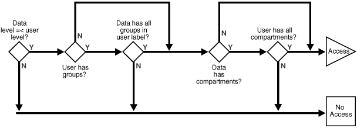
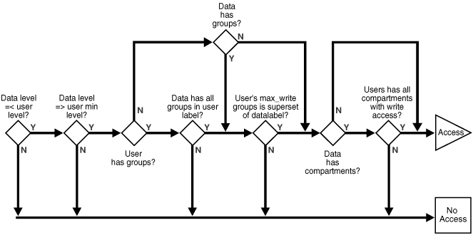
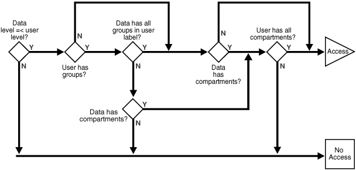

Oracle Label Security can implement the releasability using inverse groups.

- About Inverse Groups and Releasability
  Inverse groups indicate releasability of information.
- Comparison of Standard Groups and Inverse Groups
  Groups in Oracle Label Security identify organizations that own or access data.
- How Inverse Groups Work
  Inverse groups are implemented in a special way and are organized to suit the needs of Oracle Label Security.
- Algorithm for Read Access with Inverse Groups
  You should understand how the algorithm for read access with inverse groups works.
- Algorithm for Write Access with Inverse Groups
  You should understand the algorithm for write access with inverse groups.
- Algorithms for COMPACCESS Privilege with Inverse Groups
  Oracle provides algorithms for read and write access with inverse groups, for users who have `COMPACCESS` privilege.
- Session Labels and Inverse Groups
  Inverse groups affect session labels and row labels.
- Changes in Behavior of Procedures with Inverse Groups
  The `INVERSE_GROUP` option affects algorithms that determine the read and write access of the user to labeled data.
- Dominance Rules for Labels with Inverse Groups
  You should understand how dominance rules work for Oracle labels and inverse groups.

**Parent topic:** [Administering an Oracle Label Security Application](part3.md)

### 16.1 About Inverse Groups and Releasability

Inverse groups indicate releasability of information.

They are used to mark the dissemination of data. When you add an inverse group to a data label, the data becomes less classified.

For example, a user with inverse groups UK and US cannot access data that only has inverse group UK. Adding US to that data makes it accessible to all users with the inverse groups UK and US.

When you assign releasabilities to a user, you mark the communication channel to the user. For data to flow across the communication channel, the data releasabilities must dominate the releasabilities assigned to the user. In other words, releasabilities assigned to a data record must contain all the releasabilities assigned to a user.

The advantage of releasabilities lies in their power to broadly disseminate information. Releasing data to the entire marketing organization becomes as simple as adding the Marketing releasability to the data record.

**Parent topic:** Releasability Using Inverse Groups

### 16.2 Comparison of Standard Groups and Inverse Groups

Groups in Oracle Label Security identify organizations that own or access data.

Like standard groups, inverse groups control the dissemination of information. However, the behavior of inverse groups differs from Oracle Label Security standard group behavior. By default, all policies created in Oracle Label Security use the standard group behavior.

The term, releasabilities is sometimes used to refer to the behavior provided by inverse groups. When you include inverse groups in a data label, the effect is similar to assigning label compartment authorizations to a user. When Oracle Label Security evaluates whether a user can view a row of data assigned to a label with inverse groups, it checks to see whether the data, not the user, has the appropriate group authorizations. It checks whether the data has all the inverse groups assigned to the user. With standard groups, by contrast, Oracle Label Security checks to see whether a user is authorized for at least one of the groups assigned to a row of data.

Consider a policy that contains three standard groups such as, Eastern, Western, and Southern. User1's label authorizations include the groups Eastern and Western. Assuming that User1 has been assigned the appropriate level and compartment authorizations in the policy, then:

- With standard Oracle Label Security groups, User1 can view all data records that have the group Eastern, or the group Western, or both Eastern and Western.

- With inverse groups, User1 can only view data records that have, at a minimum, all the groups assigned to the user, that is, both Eastern and Western. User1 cannot view records that have only the Eastern group, only the Western group, or that have no groups at all.

Table 16-1 shows all the rows that User1 can potentially access, given the type of group that is used in the policy.

Table 16-1 Access to Standard Groups and Inverse Groups

| If row label contains groups:    | User1 access with standard groups? | User1 access with inverse groups? |
|:---------------------------------|:-----------------------------------|:----------------------------------|
| None                             | Y                                  | N                                 |
| `Eastern`                        | Y                                  | N                                 |
| `Western`                        | Y                                  | N                                 |
| `Southern`                       | N                                  | N                                 |
| `Eastern`, `Western`             | Y                                  | Y                                 |
| `Eastern`, `Southern`            | Y                                  | N                                 |
| `Western`, `Southern`            | Y                                  | N                                 |
| `Eastern`, `Western`, `Southern` | Y                                  | Y                                 |

Standard groups indicate ownership of information. In this way, all data pertaining to a certain department can have that department's group in the label. When you add a group to a data label, the data becomes more classified. For example, a user with no groups can access data that has no groups in its label. If you add the group US to the data label, the user can no longer access the data.

**See Also:**

[Group Components](understanding-data-labels-and-user-labels.md)

**Parent topic:** Releasability Using Inverse Groups

### 16.3 How Inverse Groups Work

Inverse groups are implemented in a special way and are organized to suit the needs of Oracle Label Security.

- Implementation of Inverse Groups with INVERSE_GROUP Enforcement
  When creating an Oracle Label Security policy, you can specify whether the policy can use inverse group functionality to implement releasability.
- Inverse Groups and Label Components
  An Oracle Label Security policy created with the inverse group option uses the same policy label components as standard groups.
- Computed Labels with Inverse Groups
  Inverse groups affect computed label values.
- Inverse Groups and Hierarchical Structure
  Standard groups in Oracle Label Security are hierarchical, so that a group can be associated with a parent group.
- Inverse Groups and User Privileges
  With inverse groups implemented, the meaning of user privileges remains the same.

**Parent topic:** Releasability Using Inverse Groups

#### 16.3.1 Implementation of Inverse Groups with INVERSE_GROUP Enforcement

When creating an Oracle Label Security policy, you can specify whether the policy can use inverse group functionality to implement releasability.

To do this, you must specify `INVERSE_GROUP` as one of the `default_options` in the `CREATE_POLICY` statement.

The `INVERSE_GROUP` option can be set only at policy creation time. Once a policy is created, this option cannot be changed.

The `INVERSE_GROUP` option is thus policywide. It cannot be turned on or off when the policy is applied to a table or schema. If you attempt to do so, using the procedure `APPLY_TABLE_POLICY` or `APPLY_SCHEMA_POLICY`, then an error will be generated.

While other policy enforcement options can be dropped from a policy, the `INVERSE_GROUP` policy configuration option cannot be dropped once it is set. To remove the option, you must drop and then re-create the policy.

You can give individual users authorization for one or more inverse groups.

**Parent topic:** How Inverse Groups Work

#### 16.3.2 Inverse Groups and Label Components

An Oracle Label Security policy created with the inverse group option uses the same policy label components as standard groups.

These components include levels, compartments, and groups.

With inverse groups, however, the user's read groups and write groups have a different meaning and role in data access.

Consider the following policy example, with three levels, one compartment, and three groups:

Table 16-2 Policy Example

| Policy Component | Abbreviation |
|:-----------------|:-------------|
| Levels:          | \-           |
| `UNCLASSIFIED`   | `UN`         |
| `CONFIDENTIAL`   | `CON`        |
| `SECRET`         | `SE`         |
| Compartments:    | \-           |
| `FINANCIAL`      | `FIN`        |
| Groups:          | \-           |
| `EASTERN`        | `EAS`        |
| `WESTERN`        | `WES`        |
| `SOUTHERN`       | `SOU`        |

Two user labels have been assigned, `CON:FIN` and `SE:FIN:EAS`,`WES`

Two data labels have been assigned, `CON:FIN:EAS` and `SE:FIN:EAS`

User access to the data differs, depending on the type of group being used:

- If the policy uses standard groups, then:

  The user with the label `CON:FIN` cannot read `CON:FIN:EAS` data.

  The user with the label `SE:FIN:EAS`,`WES` can read `SE:FIN:EAS` data.

- If the policy has the `INVERSE` `GROUPS` policy enforcement option, then:

  The user with the label `CON: FIN` can read `CON:FIN:EAS` data.

  The user with the label `SE:FIN:EAS`,`WES` cannot read` SE:FIN:EAS` data.

**Parent topic:** How Inverse Groups Work

#### 16.3.3 Computed Labels with Inverse Groups

Inverse groups affect computed label values.

- Computed Session Labels with Inverse Groups
  After the administrator assigns label authorizations to a user, Oracle Label Security automatically computes a number of labels.
- Inverse Groups and Computed Max Read Groups and Max Write Groups
  Oracle Label Security provides different inverse groups to handle read and write operations.

**Parent topic:** How Inverse Groups Work

##### 16.3.3.1 Computed Session Labels with Inverse Groups

After the administrator assigns label authorizations to a user, Oracle Label Security automatically computes a number of labels.

With inverse groups, these labels are as follows:

Table 16-3 Computed Session Labels with Inverse Groups

| Computed Label      | Definition                                                                                                                                                                                                                                                                                        |
|:--------------------|:--------------------------------------------------------------------------------------------------------------------------------------------------------------------------------------------------------------------------------------------------------------------------------------------------|
| Max Read Label      | The user's maximum level combined with his or her authorized compartments and the minimum set of inverse groups that should be in the user label (session label)                                                                                                                                  |
| Max Write Label     | The user's maximum level combined with the compartments for which the user has been granted write access. Contains the maximum authorized inverse groups that can be set in any label. The user has write authorizations on all these inverse groups.                                             |
| Min Write Label     | The user's minimum level.                                                                                                                                                                                                                                                                         |
| Default Read Label  | The default level, combined with compartments and inverse groups that have been designated as default for the user.                                                                                                                                                                               |
| Default Write Label | A subset of the default read label, containing the compartments and inverse groups for which the user has been granted write access. However the inverse groups component has no significance as it is the Max Write Groups that is always used for write access.                                 |
| Default Row Label   | The combination of components between the user's minimum write label and the maximum write label, which has been designated as the default for the data label for inserted data. The Inverse groups should be a superset of inverse groups in the default label and a subset of Max Write Groups. |

**Related Topics**

- [Computed Session Labels](access-controls-and-privileges.md)

**Parent topic:** Computed Labels with Inverse Groups

##### 16.3.3.2 Inverse Groups and Computed Max Read Groups and Max Write Groups

Oracle Label Security provides different inverse groups to handle read and write operations.

From the computed values in Table 16-3, two sets of groups are identified for label evaluation of read and write access.

Table 16-4 Sets of Groups for Evaluating Read and Write Access

| Sets of Groups   | Meaning                                                                                                                                                                                                                                                                                                                 |
|:-----------------|:------------------------------------------------------------------------------------------------------------------------------------------------------------------------------------------------------------------------------------------------------------------------------------------------------------------------|
| Max Read Groups  | Max Read Groups are the groups contained in the Max Read Label, identifying the minimum set of inverse groups that can be set in any user label.                                                                                                                                                                        |
| Max Write Groups | Max Write Groups are the groups contained in the Max Write Label, identifying the maximum authorized inverse groups that can be set in any user label. This set of groups is checked at the time of write access, and also when setting session labels. Note that Max Write Groups is a superset of Max Read Groups. |

As shown in Table 16-5, for standard groups you can have `READ` `ONLY` and `READ`/`WRITE` authorizations; for inverse groups you can have `WRITE` `ONLY` and `READ`/`WRITE` authorizations.

Table 16-5 Read and Write Authorizations for Standard Groups and Inverse Groups

| Type of Group   | READ ONLY                                                            | READ/WRITE                                                       | WRITE ONLY                                                           |
|:----------------|:---------------------------------------------------------------------|:-----------------------------------------------------------------|:---------------------------------------------------------------------|
| Standard Groups | The group is present only in Max Read Label, not in Max Write Label. | The group is present in both Max Read Label and Max Write Label. | Not supported                                                        |
| Inverse Groups  | Not supported                                                        | The group is present in both Max Read Label and Max Write Label. | The group is present only in Max Write Label, not in Max Read Label. |

Although Max Read Groups identifies the set of groups contained in the Max Read Label, this value represents the minimum set of inverse groups that can be set. For example:

Max Read Groups: `S:C1:G1`,`G2`

Max Write Groups: `S:C1:G1`,`G2`,`G3`,`G4`,`G5`

Here, the user can read data that contains at least the two groups listed in Max Read Groups.

Note that in standard groups, there can never be a situation in which there are more groups in the Max Write Label than in the Max Read Label.

**Parent topic:** Computed Labels with Inverse Groups

#### 16.3.4 Inverse Groups and Hierarchical Structure

Standard groups in Oracle Label Security are hierarchical, so that a group can be associated with a parent group.

For example, the `EASTERN` region can be the parent of two subordinate groups: `EAS_SALES`, and `EAS_HR`.

In a policy with standard groups, if the user label has the parent group, then it can access all data of the subordinate groups.

With inverse groups, parent-child relationships are not supported.

**Parent topic:** How Inverse Groups Work

#### 16.3.5 Inverse Groups and User Privileges

With inverse groups implemented, the meaning of user privileges remains the same.

When the user has no special privileges, then the read algorithm and the write algorithm are different for standard groups and inverse groups. The differences are described later, in Algorithm for Read Access with Inverse Groups and Algorithm for Write Access with Inverse Groups.

The effect of inverse groups on the COMPACCESS privilege is described later, in Algorithms for COMPACCESS Privilege with Inverse Groups.

Inverse groups have no impact upon the following user privileges:

- `PROFILE_ACCESS`

- `WRITEUP`

- `WRITEDOWN`

- `WRITEACROSS`

**Parent topic:** How Inverse Groups Work

### 16.4 Algorithm for Read Access with Inverse Groups

You should understand how the algorithm for read access with inverse groups works.

To read data in a table with the `INVERSE` `GROUP` option in effect, the label evaluation process proceeds from levels to groups to compartments, as illustrated in Figure 16-1. (Note that the current session label is the label being evaluated.)

1.  The user's level must be greater than or equal to the level of data.

2.  The user's label must include all the compartments assigned to the data

3.  The groups in the data label must be a superset of the groups in the user label.

If the user's label passes these tests, then the user can access the data. If not, the user is denied access. Note that if the data label is null or invalid, then the user is denied access.

**Note:**

This flow diagram is true only when the user has no special privileges.

Figure 16-1 Read Access Label Evaluation with Inverse Groups

[Description of "Figure 16-1 Read Access Label Evaluation with Inverse Groups"](img_text/olsag033.md)

**Related Topics**

- [How Oracle Label Security Algorithm for Read Access Works](access-controls-and-privileges.md)

**Parent topic:** Releasability Using Inverse Groups

### 16.5 Algorithm for Write Access with Inverse Groups

You should understand the algorithm for write access with inverse groups.

To write data in a table with the `INVERSE` `GROUP` option, the label evaluation process proceeds from levels to groups to compartments, as illustrated in Figure 16-2. (Note that the current session label is the label being evaluated.)

1.  The level in the data label must be greater than or equal to the user's minimum level, and less than or equal to the user's session level.

2.  One of the following conditions must be met:

    The groups in the data label must be a superset of the groups in the user label.

    or

    The user has `READ` access privilege on the policy.

3.  The user's Max Write Groups must be a superset of the data label groups.

4.  The user label must have write access on all of the compartments in the data label.

Note that if the data label is null or invalid, then the user is denied access.

**Note:**

This flow diagram is true only when the user has no special privileges.

Figure 16-2 Write Access Label Evaluation with Inverse Groups

[Description of "Figure 16-2 Write Access Label Evaluation with Inverse Groups"](img_text/olsag035.md)

**See Also:**

[How the Oracle Label Security Algorithm for Write Access Works](access-controls-and-privileges.md)

**Parent topic:** Releasability Using Inverse Groups

### 16.6 Algorithms for COMPACCESS Privilege with Inverse Groups

Oracle provides algorithms for read and write access with inverse groups, for users who have `COMPACCESS` privilege.

The `COMPACCESS` privilege allows a user to access data based on the row's compartments, independent of the row's groups.

- When compartments exist and access to them is authorized, then the group authorization is bypassed.

- If a row has no compartments, then access is determined by the inverse group authorizations.

Figure 16-3 and Figure 16-4 show the label evaluation process for read access and write access for a user with the `COMPACCESS` privilege. If the data label is null or invalid, then the user is denied access.

(Note that the current session label is the label being evaluated.)

Figure 16-3 Read Access Label Evaluation: COMPACCESS Privilege and Inverse Groups

[Description of "Figure 16-3 Read Access Label Evaluation: COMPACCESS Privilege and Inverse Groups"](img_text/olsag034.md)

Figure 16-4 Write Access Label Evaluation: COMPACCESS Privilege and Inverse Groups

[Description of "Figure 16-4 Write Access Label Evaluation: COMPACCESS Privilege and Inverse Groups"](img_text/olsag035.md)

**Parent topic:** Releasability Using Inverse Groups

### 16.7 Session Labels and Inverse Groups

Inverse groups affect session labels and row labels.

- Initial Session and Row Labels for Standard or Inverse Groups
  Oracle provides initial session and row labels for standard and inverse groups.
- Setting Current Session or Row Labels for Standard or Inverse Groups
  You can set the current session or row labels for standard or inverse groups.
- Examples of Session Labels and Inverse Groups
  Oracle provides examples of using inverse groups.

**Parent topic:** Releasability Using Inverse Groups

#### 16.7.1 Initial Session and Row Labels for Standard or Inverse Groups

Oracle provides initial session and row labels for standard and inverse groups.

- About the Initial Session and Row Labels for Standard or Inverse Groups
  The use of inverse groups affects the behavior of Oracle Label Security procedures that determine the session label.
- Standard Groups: Rules for Changing Initial Session/Row Labels
  A user's default session label can be changed using `SA_USER_ADMIN.SET_DEFAULT_LABEL`.
- Inverse Groups: Rules for Changing Initial Session/Row Labels
  The default session label can include groups in the authorized list if the new write label dominates the current default row label.

**Parent topic:** Session Labels and Inverse Groups

##### 16.7.1.1 About the Initial Session and Row Labels for Standard or Inverse Groups

The use of inverse groups affects the behavior of Oracle Label Security procedures that determine the session label.

The `SA_USER_ADMIN.SET_DEFAULT_LABEL` and `SA_USER_ADMIN.SET_ROW_LABEL` procedures set the user's initial session label and row label, respectively, to the one specified.

**Parent topic:** Initial Session and Row Labels for Standard or Inverse Groups

##### 16.7.1.2 Standard Groups: Rules for Changing Initial Session/Row Labels

A user's default session label can be changed using `SA_USER_ADMIN.SET_DEFAULT_LABEL`.

In the case of standard groups, the default session label can be set to include any groups in the authorized list, as long as the current default row label will still be dominated by the new write label. That is, the row label will have the same or fewer standard groups than the new write label.

The same rule applies for `SA_USER_ADMIN.SET_ROW_LABEL`.

**Parent topic:** Initial Session and Row Labels for Standard or Inverse Groups

##### 16.7.1.3 Inverse Groups: Rules for Changing Initial Session/Row Labels

The default session label can include groups in the authorized list if the new write label dominates the current default row label.

That is, the row label will have the same or more inverse groups than the new write label. The same rule applies for `SA_USER_ADMIN.SET_ROW_LABEL`.

**Related Topics**

- [SA_USER_ADMIN.SET_DEFAULT_LABEL](oracle-label-security-pl-sql-packages.md)
- [SA_USER_ADMIN.SET_ROW_LABEL](oracle-label-security-pl-sql-packages.md)
- Dominance Rules for Labels with Inverse Groups

**Parent topic:** Initial Session and Row Labels for Standard or Inverse Groups

#### 16.7.2 Setting Current Session or Row Labels for Standard or Inverse Groups

You can set the current session or row labels for standard or inverse groups.

- About Setting Current Session or Row Labels for Standard or Inverse Groups
  The use of inverse groups affects the behavior of the `SA_SESSION.SET_LABEL` and `SA_SESSION.SET_ROW_LABEL` procedures.
- Standard Groups: Rules for Changing Current Session/Row Labels
  With standard groups, the `SA_SESSION.SET_LABEL` procedure can set the session label to include groups in the user's authorized group list.
- Inverse Groups: Rules for Changing Current Session/Row Labels
  With inverse groups, the addition of groups to the session label decreases a user's ability to access sensitive data with fewer groups.

**Parent topic:** Session Labels and Inverse Groups

##### 16.7.2.1 About Setting Current Session or Row Labels for Standard or Inverse Groups

The use of inverse groups affects the behavior of the `SA_SESSION.SET_LABEL` and `SA_SESSION.SET_ROW_LABEL` procedures.

These procedures can be used to set the user's current session label and row label, respectively.

**Parent topic:** Setting Current Session or Row Labels for Standard or Inverse Groups

##### 16.7.2.2 Standard Groups: Rules for Changing Current Session/Row Labels

With standard groups, the `SA_SESSION.SET_LABEL` procedure can set the session label to include groups in the user's authorized group list.

Subgroups of authorized groups are implicitly included in the authorized list.

Note that if you change the session label, then this may affect the value of the session's row label.

Use the `SET_ROW_LABEL` procedure to set the row label value for the current database session. The compartments and groups in the label must be a subset of compartments and groups in the session label to which the user has write access.

**Parent topic:** Setting Current Session or Row Labels for Standard or Inverse Groups

##### 16.7.2.3 Inverse Groups: Rules for Changing Current Session/Row Labels

With inverse groups, the addition of groups to the session label decreases a user's ability to access sensitive data with fewer groups.

The removal of groups enables the user to access more sensitive information. So, the user should be allowed to add groups to the session label, as long as Max Read Groups is a subset of the groups in the session label, and Max Write Groups is a superset of groups in the session label. The same restriction applies when a user removes groups from the session label.

Note that there are no subgroups of authorized groups when using inverse groups. This is because parent groups are not allowed in policies using inverse groups.

Use the `SET_ROW_LABEL` procedure to set the row label value for the current database session. The compartments in the label must be a subset of compartments in the session label to which the user has write access.

The user is allowed to add inverse groups to the row label, as long as the session label inverse groups are a subset of the row label inverse groups, and Max Write Groups is a superset of inverse groups in the row label.

For example:

- If the user has the inverse groups UK and US as his Max Read Groups, and `UK`,`US`,`CAN` as his Max Write Groups. The user can set his session label to `C:ALPHA:UK`,`US`,`CAN` but not to `C:ALPHA:UK`.

- If the user has the inverse group `UK` as his Max Read Groups, and `UK`,`CAN` as his Max Write Groups.assigned to him. The user can set the session label to `C:ALPHA:UK`,`CAN` but cannot change it to either `C:ALPHA` or` C:ALPHA:UK`,`US`,`CAN`.

**Related Topics**

- [SA_SESSION.SET_LABEL](oracle-label-security-pl-sql-packages.md)
- [SA_SESSION.SET_ROW_LABEL](oracle-label-security-pl-sql-packages.md)

**Parent topic:** Setting Current Session or Row Labels for Standard or Inverse Groups

#### 16.7.3 Examples of Session Labels and Inverse Groups

Oracle provides examples of using inverse groups.

- Example: Simple Inverse Groups
  You can create a simple policy that implements inverse groups with a set of special labels.
- Example: Complex Inverse Groups
  You can create a more complex policy that implements inverse groups with a set of special labels.

**Parent topic:** Session Labels and Inverse Groups

##### 16.7.3.1 Example: Simple Inverse Groups

You can create a simple policy that implements inverse groups with a set of special labels.

Table 16-6 Labels for Inverse Groups Example 1

| Name                                         | Definition                |
|:---------------------------------------------|:--------------------------|
| Max Read Label                               | `SE:ALPHA`,`BETA:G1`,`G2` |
| Max Write Label                              | `SE:ALPHA:G1`,`G2`,`G3`   |
| Default Read Label                           | `SE:ALPHA`,`BETA:G1`,`G2` |
| Default Write Label                          | `SE:ALPHA:G1`,`G2`        |
| Default Row Label                            | `SE:ALPHA:G1`,`G2`        |
| From which the following values are derived: | \-                        |
| Max Read Groups                              | `G1`,`G2`                 |
| Max Write Groups                             | `G`1,`G2`,`G3`            |

The following conclusions can be drawn:

- `User01` can update data with label `SE:ALPHA:G1`,`G2` as well as data with label `SE:ALPHA:G1`,`G2`,`G3`. `User1` cannot, however, update label` SE:ALPHA:G1`.

  If standard groups were being used, rather than inverse groups, then `User1` could update data with label `SE:ALPHA:G1`.

- Data that `User01` inserts has the label `SE:ALPHA:G1`,`G2`. (This is the same as with standard groups.)

- If `User01` leaves the default label as is, and sets the row label to `SE:ALPHA:G1`,`G2`,`G3`, then `user1` will insert `SE:ALPHA:G1`,`G2`,`G3` in new rows of data that is written. (In standard groups, User1 can never set more groups in the row label than in the default label.)

**Parent topic:** Examples of Session Labels and Inverse Groups

##### 16.7.3.2 Example: Complex Inverse Groups

You can create a more complex policy that implements inverse groups with a set of special labels.

Table 16-7 Labels for Inverse Groups Example 2

| Name                                         | Definition               |
|:---------------------------------------------|:-------------------------|
| Max Read Label                               | `C:ALPHA:`               |
| Max Write Label                              | `C:ALPHA:G``1`,`G2`,`G3` |
| Default Read Label                           | `C:ALPHA`:               |
| Default Write Label                          | `C:ALPHA:`               |
| Default Row Label                            | `C:ALPHA`:               |
| From which the following values are derived: | \-                       |
| Max Read Groups                              | (an empty set)           |
| Max Write Groups                             | `G1`,`G2`,`G3`           |

The following conclusions can be drawn:

- `User01` can update any data with level C, compartment `ALPHA`, and any combination of groups `G1`, `G2`, `G3`, or no groups. `User01` inserts the label `C:ALPHA:` in new data that `User01` writes.

- `User02`, who has Max Read Groups of `G1`,`G2` or `G1`,`G3`, and so on, will not be able to view the data written by `User01`. This is because `User01`'s Default Row Label contains no groups.

- `User01` can choose to set inverse groups in the row label, as long as the inverse groups in the session label dominates the row label (that is, `User01`'s session label contains the same or fewer groups than contained in the row label).

  This is true because the row label must have at least the groups in the session label, and can at most have the Maximum Write Groups. If the session label is `G1`, then you can set the groups in the row label from `G1` to the Max Write Groups (`G1`,`G2`,`G3`).

- If `User01` sets his session label and row label to `C:ALPHA:G1`:`G2`:`G3`, then his data becomes accessible to anyone who has any combination of `G1`,`G2`,`G3` in his Max Read Groups.

**Parent topic:** Examples of Session Labels and Inverse Groups

### 16.8 Changes in Behavior of Procedures with Inverse Groups

The `INVERSE_GROUP` option affects algorithms that determine the read and write access of the user to labeled data.

- SA_SYSDBA.CREATE_POLICY with Inverse Groups
  The `SA_SYSDBA.CREATE_POLICY` procedure creates the policy, defines an optional policy-specific column name, and specifies policy options.
- SA_SYSDBA.ALTER_POLICY with Inverse Groups
  The `SA_SYSDBA.ALTER_POLICY` procedure changes a policy's default enforcement options, except for the `INVERSE_GROUP` option.
- SA_USER_ADMIN.ADD_GROUPS with Inverse Groups
  The `SA_USER_ADMIN.ADD_GROUPS` procedure adds groups to a user, indicating whether the groups are authorized for write as well as read.
- SA_USER_ADMIN.ALTER_GROUPS with Inverse Groups
  The `SA_USER_ADMIN.ALTER_GROUPS` procedure changes the write access, default label indicator, and row label indicator for each group.
- SA_USER_ADMIN.SET_GROUPS with Inverse Groups
  The `SA_USER_ADMIN.SET_GROUPS` procedure assigns groups to a user and identifies default values for the user's session label and row label.
- SA_USER_ADMIN.SET_USER_LABELS with Inverse Groups
  The `SA_USER_ADMIN.SET_USER_LABELS` procedure sets the user's levels, compartments, and groups using a set of labels, instead of the individual components.
- SA_USER_ADMIN.SET_DEFAULT_LABEL with Inverse Groups
  The `SA_USER_ADMIN.SET_DEFAULT_LABEL` procedure sets the user's initial session label.
- SA_USER_ADMIN.SET_ROW_LABEL with Inverse Groups
  The `SA_USER_ADMIN.SET_ROW_LABEL` procedure sets the user's initial row label.
- SA_COMPONENTS.CREATE_GROUP with Inverse Groups
  The `SA_COMPONETS.CREATE_GROUP` procedure create a group, including its short name and long name, and optionally a parent group.
- SA_COMPONENTS.ALTER_GROUP_PARENT with Inverse Groups
  The `SA_COMPONENTS.ALTER_GROUP_PARENT` function is disabled for policies with the inverse group option.
- SA_SESSION.SET_LABEL with Inverse Groups
  The `SA_SESION.SET_LABEL` procedure sets the label of the current database session.
- SA_SESSION.SET_ROW_LABEL with Inverse Groups
  The `SET_ROW_LABEL` procedure sets the default row label value for the current database session.
- LEAST_UBOUND with Inverse Groups
  The `LEAST_UBOUND` (LUBD) function returns a character string label that is the least upper bound of `label1` and `label2`.
- GREATEST_LBOUND with Inverse Groups
  The `GREATEST_LBOUND` (GLBD) function determines the lowest label of the data that can be involved in an operation, given two different labels.

**Parent topic:** Releasability Using Inverse Groups

#### 16.8.1 SA_SYSDBA.CREATE_POLICY with Inverse Groups

The `SA_SYSDBA.CREATE_POLICY` procedure creates the policy, defines an optional policy-specific column name, and specifies policy options.

With inverse group support the, user has one more policy enforcement option, `INVERSE_GROUP`. For example:

    PROCEDURE CREATE_POLICY (
     HR IN VARCHAR2,
     SA_LABEL IN VARCHAR2 DEFAULT NULL,
     INVERSE_GROUP IN VARCHAR2 DEFAULT NULL);

**Related Topics**

- [SA_SYSDBA.CREATE_POLICY](oracle-label-security-pl-sql-packages.md)

**Parent topic:** Changes in Behavior of Procedures with Inverse Groups

#### 16.8.2 SA_SYSDBA.ALTER_POLICY with Inverse Groups

The `SA_SYSDBA.ALTER_POLICY` procedure changes a policy's default enforcement options, except for the `INVERSE_GROUP` option.

Once a policy is configured for inverse groups, it cannot be changed. You can also change the column names associated with an OLS policy.

**Related Topics**

- [SA_SYSDBA.ALTER_POLICY](oracle-label-security-pl-sql-packages.md)

**Parent topic:** Changes in Behavior of Procedures with Inverse Groups

#### 16.8.3 SA_USER_ADMIN.ADD_GROUPS with Inverse Groups

The `SA_USER_ADMIN.ADD_GROUPS` procedure adds groups to a user, indicating whether the groups are authorized for write as well as read.

The type of access authorized depends on the `access_mode` parameter.

Table 16-8 Access Authorized by Values of access_mode Parameter

| Access_Mode Parameter | Meaning                                                                                                                                                                                                                                                                                       |
|:----------------------|:----------------------------------------------------------------------------------------------------------------------------------------------------------------------------------------------------------------------------------------------------------------------------------------------|
| `READ_WRITE`          | Indicates that write is authorized. (That is, the group is contained in both Max Read Groups and Max Write Groups.)                                                                                                                                                                           |
| `WRITE_ONLY`          | Indicates that the group is contained in Max Write Groups and not in Max Read Groups                                                                                                                                                                                                          |
| `access_mode`         | If `access_mode` is set to `READ_WRITE`, then the group is added to both Max Read Groups and Max Write Groups. If `access_mode` is set to `SA_UTL.WRITE_ONLY`, then the group is added only to the Max Write Groups. If `access_mode` is `NULL`, then it is set to `SA_UTL.READ_WRITE`. |
| `in_def`              | Specifies whether these groups should be in the default groups (`Y`/`N`). If `in_def` is `NULL`, then it will be set to `Y` or `N` as follows: If access mode is `READ_WRITE`, `in_def` is set to `Y`. If access mode is `WRITE_ONLY`, `in_def` is set to `N`.                       |
| `in_row`              | Specifies whether these groups should be in the row label (`Y`/`N`), using the identical criteria as for `in_def`. However, if `in_def` is `Y`, then `in_row` must also be `Y`.                                                                                                            |

Note that if `in_def` is `Y` in a row, then `in_row` must also be set to `Y`, but not the other way round.

The same is the case with the `in_row` field.

**See Also:**

- Syntax for [SA_USER_ADMIN.ADD_GROUPS](oracle-label-security-pl-sql-packages.md)

- Inverse Groups and Computed Max Read Groups and Max Write Groups

**Parent topic:** Changes in Behavior of Procedures with Inverse Groups

#### 16.8.4 SA_USER_ADMIN.ALTER_GROUPS with Inverse Groups

The `SA_USER_ADMIN.ALTER_GROUPS` procedure changes the write access, default label indicator, and row label indicator for each group.

The behavior of inverse groups is the same as described in the case of `ADD_GROUPS`.

**See Also:**

Syntax for [SA_USER_ADMIN.ALTER_GROUPS](oracle-label-security-pl-sql-packages.md)

**Parent topic:** Changes in Behavior of Procedures with Inverse Groups

#### 16.8.5 SA_USER_ADMIN.SET_GROUPS with Inverse Groups

The `SA_USER_ADMIN.SET_GROUPS` procedure assigns groups to a user and identifies default values for the user's session label and row label.

Inverse groups are handled differently than standard groups, as follows:

Table 16-9 Assigning Groups to a User

| Group Set Name | Meaning                                                                                                                                                                                                                                                      |
|:---------------|:-------------------------------------------------------------------------------------------------------------------------------------------------------------------------------------------------------------------------------------------------------------|
| `read_groups`  | A comma-delimited list of groups that would be Max Read Groups                                                                                                                                                                                               |
| `write_groups` | A comma-delimited list of groups that would be Max Write Groups. It must be a superset of `read_groups`. If `write_groups` is `NULL`, then they are set to `read_groups`.                                                                                 |
| def_groups     | Specifies the default groups. It should at least have `read_groups`, and `write_groups` should be a superset of `def_groups`. If `def_groups` is `NULL`, then they are set to the `read_groups`.                                                          |
| `row_groups`   | Specifies the row groups. It should at least have the `def_groups` and should be a subset of max write groups. If `row_groups` is `NULL`, then they are set to the `def_groups`, because for inverse groups, all `def_groups` are also in `write_groups`. |

**See Also:**

Syntax for [SA_USER_ADMIN.SET_GROUPS](oracle-label-security-pl-sql-packages.md)

**Parent topic:** Changes in Behavior of Procedures with Inverse Groups

#### 16.8.6 SA_USER_ADMIN.SET_USER_LABELS with Inverse Groups

The `SA_USER_ADMIN.SET_USER_LABELS` procedure sets the user's levels, compartments, and groups using a set of labels, instead of the individual components.

Inverse groups are handled differently than standard groups, as follows:

Table 16-10 Inverse Group Label Definitions

| Name              | Definition                                                                                                                                                                                                                                                                                                                                                                                                                                                                                                                                 |
|:------------------|:-------------------------------------------------------------------------------------------------------------------------------------------------------------------------------------------------------------------------------------------------------------------------------------------------------------------------------------------------------------------------------------------------------------------------------------------------------------------------------------------------------------------------------------------|
| `max_read_label`  | Specifies the label string to be used to initialize the user's maximum authorized read label. Composed of the user's maximum level, compartments authorized for read access, and if inverse groups, minimum set of groups that can be set in any label.(Max Read Groups)                                                                                                                                                                                                                                                                   |
| `max_write_label` | Specifies the label string to be used to initialize the user's maximum authorized write label. Composed of the user's maximum level, compartments authorized for write access, and if inverse groups, the maximum authorized groups that can be set in any label (Max Write Groups). All the inverse groups in this have write authorization also. It should be a superset of groups in `max_read_label`. If `max_write_label` is not specified, then it is set to `max_read_label`.                                                       |
| `def_label`       | Specifies the label string to be used to initialize the user's session label, including level, compartments, and groups (a subset of `max_read_label`). If `default_label` is not specified, then it is set to `max_read_label`. For inverse groups, component it should at least have the groups in `max_read_label`, and groups in `max_write_label` should be a superset of the groups in the `def_label`.                                                                                                                              |
| `row_label`       | Specifies the label string to be used to initialize the program's row label. Includes levels, compartments, and groups: subsets of `max_write_label` and `def_label`. If `row_label` is not specified, then it is set to `def_label`, with only the compartments and groups authorized for write access. The inverse groups component is set to the same as that in `def_label` if the `row_label` is not specified. The inverse groups in row label should at least be those in default label and should be a subset of Max Write Groups. |

**See Also:**

Syntax for [SA_USER_ADMIN.SET_USER_LABELS](oracle-label-security-pl-sql-packages.md)

**Parent topic:** Changes in Behavior of Procedures with Inverse Groups

#### 16.8.7 SA_USER_ADMIN.SET_DEFAULT_LABEL with Inverse Groups

The `SA_USER_ADMIN.SET_DEFAULT_LABEL` procedure sets the user's initial session label.

All the rules mentioned for setting inverse groups component of session label mentioned in Session Labels and Inverse Groups are applicable here.

**See Also:**

Syntax for [SA_USER_ADMIN.SET_DEFAULT_LABEL](oracle-label-security-pl-sql-packages.md)

**Parent topic:** Changes in Behavior of Procedures with Inverse Groups

#### 16.8.8 SA_USER_ADMIN.SET_ROW_LABEL with Inverse Groups

The `SA_USER_ADMIN.SET_ROW_LABEL` procedure sets the user's initial row label.

When specifying the `row_label`, the inverse groups component must contain at least all the inverse groups in `def_label` and should be a subset of Max Write Groups.

**See Also:**

- Syntax for [SA_USER_ADMIN.SET_ROW_LABEL](oracle-label-security-pl-sql-packages.md)

- Initial Session and Row Labels for Standard or Inverse Groups

**Parent topic:** Changes in Behavior of Procedures with Inverse Groups

#### 16.8.9 SA_COMPONENTS.CREATE_GROUP with Inverse Groups

The `SA_COMPONETS.CREATE_GROUP` procedure create a group, including its short name and long name, and optionally a parent group.

With inverse groups, the `parent_name` field should always be `NULL`. If the user specifies a value for this field, then an error message is displayed, indicating that the group hierarchy is disabled.

**See Also:**

Syntax for [SA_COMPONENTS.CREATE_GROUP](oracle-label-security-pl-sql-packages.md)

**Parent topic:** Changes in Behavior of Procedures with Inverse Groups

#### 16.8.10 SA_COMPONENTS.ALTER_GROUP_PARENT with Inverse Groups

The `SA_COMPONENTS.ALTER_GROUP_PARENT` function is disabled for policies with the inverse group option.

An error message is displayed if the user calls this function.

**See Also:**

Syntax for [SA_COMPONENTS.ALTER_GROUP](oracle-label-security-pl-sql-packages.md)

**Parent topic:** Changes in Behavior of Procedures with Inverse Groups

#### 16.8.11 SA_SESSION.SET_LABEL with Inverse Groups

The `SA_SESION.SET_LABEL` procedure sets the label of the current database session.

For the current user, this procedure follows the same rules for setting the session label as does the `SA_USER_ADMIN.SET_USER_LABEL` function.

**See Also:**

- Syntax for [SA_SESSION.SET_LABEL](oracle-label-security-pl-sql-packages.md).

- Setting Current Session or Row Labels for Standard or Inverse Groups

**Parent topic:** Changes in Behavior of Procedures with Inverse Groups

#### 16.8.12  SA_SESSION.SET_ROW_LABEL with Inverse Groups

The `SET_ROW_LABEL` procedure sets the default row label value for the current database session.

For the current user, this procedure follows the same rules for setting the row label as does the `sa_user_admin.set_row_label` function.

**See Also:**

- Syntax for [SA_SESSION.SET_ROW_LABEL](oracle-label-security-pl-sql-packages.md)

- Initial Session and Row Labels for Standard or Inverse Groups

**Parent topic:** Changes in Behavior of Procedures with Inverse Groups

#### 16.8.13 LEAST_UBOUND with Inverse Groups

The `LEAST_UBOUND` (LUBD) function returns a character string label that is the least upper bound of `label1` and `label2`.

With standard groups, the least upper bound is the highest level, the union of the compartments in the labels, and the union of the groups in the labels.

With inverse groups, the least upper bound is the highest level, the union of the compartments in the labels, and the intersection of the inverse groups in the labels.

For example, with inverse groups, the least upper bound of `HIGHLY_SENSITIVE`:`ALPHA:G1`,`G2` and `SENSITIVE:BETA:G1` is `HIGHLY_SENSITIVE:ALPHA`,`BETA:G1`.

**Parent topic:** Changes in Behavior of Procedures with Inverse Groups

#### 16.8.14 GREATEST_LBOUND with Inverse Groups

The `GREATEST_LBOUND` (GLBD) function determines the lowest label of the data that can be involved in an operation, given two different labels.

This function returns a character string label that is the greatest lower bound of `label1` and `label2`.

With standard groups, the greatest lower bound is the lowest level, and the intersection of the compartments in the labels and the groups in the labels.

With inverse groups, the greatest lower bound is the lowest level, and the intersection of the compartments in the labels and the union of inverse groups in the labels.

For example, with inverse groups the greatest lower bound of `HIGHLY_SENSITIVE:ALPHA:G1`,`G3` and `SENSITIVE::G1` is `SENSITIVE:G1`,`G3`

**Related Topics**

- [Determination of the Upper and Lower Bounds of Labels](working-with-labeled-data.md)

**Parent topic:** Changes in Behavior of Procedures with Inverse Groups

### 16.9 Dominance Rules for Labels with Inverse Groups

You should understand how dominance rules work for Oracle labels and inverse groups.

Dominance rules for Oracle Label Security with standard groups can be summarized as follows:

A user label dominates a data label if:

- User level is greater than or equal to the data level

- User compartments are a superset of the data compartments

- User groups intersects (have at least one group from) the data groups

Dominance rules for Oracle Label Security with inverse groups can be summarized as follows:

A user label dominates a data label if:

- User level is greater than or equal to the data level

- User compartments are a superset of the data compartments

- Data groups are a superset of user groups

**Related Topics**

- [About Dominant and Dominated Labels](advanced-topics-in-oracle-label-security.md)

**Parent topic:** Releasability Using Inverse Groups
