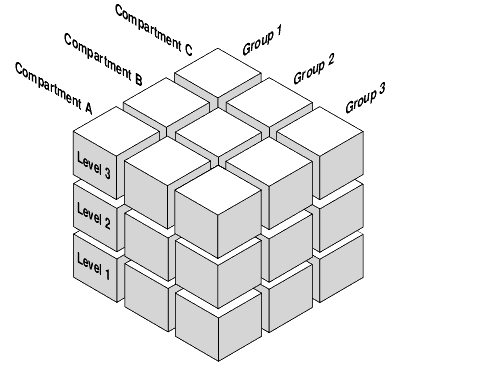
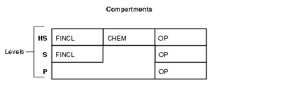
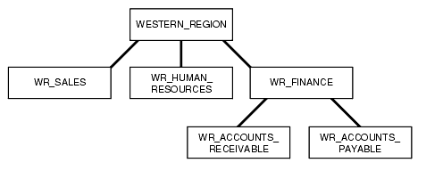
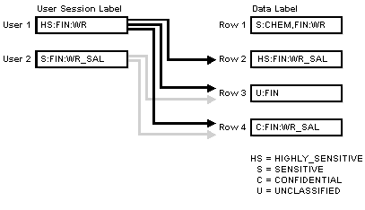
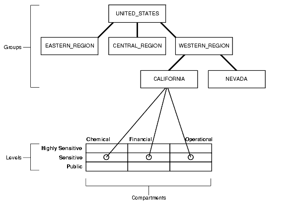

You should understand fundamental concepts of data labels and user labels.

- About Label-Based Security
  Label-based security provides a flexible way of controlling access to sensitive data.
- About User Label and Privilege Management
  To manage user labels and privileges, you must have the `EXECUTE` privilege for the `SA_USER_ADMIN` package and be granted the `policy``_DBA` role.
- Label Components
  You should understand the elements that are used in labels.
- Label Syntax and Type
  After label components are defined, you can create data labels by combining particular sets of level, compartments, and groups.
- How Data Labels and User Labels Work Together
  A user can access data only within the range of his or her own label authorizations.
- Administration of Labels
  Oracle Label Security provides administrative interfaces to define and manage the labels used in a database.

**Parent topic:** [Getting Started with Oracle Label Security](part1.md)

### 2.1 About Label-Based Security

Label-based security provides a flexible way of controlling access to sensitive data.

Oracle Label Security controls data access based on the identity and label of the user, and the sensitivity and label of the data. Label security adds protections beyond the discretionary access controls that determine the operations users can perform upon data in an object, such as a table or view.

Table 2-1 shows the three dimensions with which an Oracle Label Security policy controls access to data.

Table 2-1 Oracle Label Security Data Dimensions

| Data Dimension    | Explanation                                                                                                                                                                                                                                                                                                    |
|:------------------|:---------------------------------------------------------------------------------------------------------------------------------------------------------------------------------------------------------------------------------------------------------------------------------------------------------------|
| Data Labels       | A data row label indicates the level and nature of the row's sensitivity and specifies the additional criteria that a user must meet to gain access to that row.                                                                                                                                               |
| User Labels       | A user label specifies that user's sensitivity level plus any compartments and groups that constrain the user's access to labeled data. Each user is assigned a range of levels, compartments, and groups, and each session can operate within that authorized range to access labeled data within that range. |
| Policy Privileges | Users can be given specific rights (privileges) to perform special operations or to access data beyond their label authorizations.                                                                                                                                                                             |

Note that the discussion here concerns access to data. The particular type of access, such as reading or writing the data, is covered in [Access Controls and Privileges](access-controls-and-privileges.md).

When an Oracle Label Security policy is applied to a database table, a column is added to the table to contain each row's label. The administrator can choose to display or hide this column.

**Parent topic:** Understanding Data Labels and User Labels

### 2.2 About User Label and Privilege Management

To manage user labels and privileges, you must have the `EXECUTE` privilege for the `SA_USER_ADMIN` package and be granted the `policy``_DBA` role.

The `SA_USER_ADMIN` package provides the procedures and functions to manage the Oracle Label Security user security attributes. It contains several procedures to manage user labels by component: that is, specifying user levels, compartments, and groups. For convenience, there are additional procedures that accept character string representations of full labels, rather than components. Note that the level, compartment, and group parameters use the short name defined for each component.

All of the label and privilege information is stored in Oracle Label Security data dictionary tables. When a user connects to the database, his session labels are established based on the information stored in the Oracle Label Security data dictionary.

Note that a user can be authorized under multiple policies.

**Related Topics**

- [SA_USER_ADMIN PL/SQL Package](oracle-label-security-pl-sql-packages.md)
- [SA_USER_ADMIN.SET_USER_PRIVS](oracle-label-security-pl-sql-packages.md)
- [Duties of Oracle Label Security Administrators](introduction-to-oracle-label-security.md)

**Parent topic:** Understanding Data Labels and User Labels

### 2.3 Label Components

You should understand the elements that are used in labels.

- Label Component Definitions and Valid Characters
  A sensitivity label is a single attribute with multiple components.
- Level Sensitivity Components
  A level is a ranking that denotes the sensitivity of the information it labels.
- Compartment Components
  Compartments identify areas that describe the sensitivity of the labeled data, providing a finer level of granularity within a level.
- Group Components
  Groups identify organizations owning or accessing the data, such as `EASTERN_REGION`, `WESTERN_REGION`, `WR_SALES`.
- Industry Examples of Levels, Compartments, and Groups
  Oracle Label Security levels, compartments, groups are designed to be implemented in various industries.

**Parent topic:** Understanding Data Labels and User Labels

#### 2.3.1 Label Component Definitions and Valid Characters

A sensitivity label is a single attribute with multiple components.

All data labels must contain a level component, but the compartment and group components are optional. An administrator must define the label components before creating labels.

Although the administrator defines both long and short names for the label components, only the short form of the name is displayed upon retrieval. When users manipulate the labels, they use only the short form of the component names. Examples of short forms are illustrated in the Examples column of the following table.

Table 2-2 Sensitivity Label Components

| Component    | Description                                                                                    | Examples                                                    |
|:-------------|:-----------------------------------------------------------------------------------------------|:------------------------------------------------------------|
| Level        | A single specification of the sensitivity of labeled data within the ordered ranks established | `CONFIDENTIAL` (1), `SENSITIVE` (2), `HIGHLY_SENSITIVE` (3) |
| Compartments | Zero or more categories associated with the labeled data                                       | `FINANCIAL`, `STRATEGIC`, `NUCLEAR`                         |
| Groups       | Zero or more identifiers for organizations owning or accessing the data                        | `EASTERN_REGION`, `WESTERN_REGION`                          |

Valid characters for specifying all label components include alphanumeric characters, underscores, and spaces. (Leading and trailing spaces are ignored.)

The following figure illustrates the three dimensions in which data can be logically classified, using levels, compartments, and groups.

Figure 2-1 Data Categorization with Levels, Compartments, and Groups

[Description of "Figure 2-1 Data Categorization with Levels, Compartments, and Groups"](img_text/olsag006.md)

**Parent topic:** Label Components

#### 2.3.2 Level Sensitivity Components

A level is a ranking that denotes the sensitivity of the information it labels.

The more sensitive the information, the higher its level. The less sensitive the information, the lower its level.

Every label must include one level. Oracle Label Security permits defining up to 10,000 levels in a policy. For each level, the Oracle Label Security administrator defines a numeric form, a long character form, and the required short character form.

Table 2-2 shows examples of levels.

Table 2-3 Level Example

| Numeric Form | Long Form          | Short Form |
|:-------------|:-------------------|:-----------|
| `40`         | `HIGHLY_SENSITIVE` | `HS`       |
| `30`         | `SENSITIVE`        | `S`        |
| `20`         | `CONFIDENTIAL`     | `C`        |
| `10`         | `PUBLIC`           | `P`        |

Table 2-4 shows different ways of specifying levels.

Table 2-4 Forms of Specifying Levels

| Form                            | Explanation                                                                                                                                                                                                                                                                                                                                                                                                                                                                                                                                                              |
|:--------------------------------|:-------------------------------------------------------------------------------------------------------------------------------------------------------------------------------------------------------------------------------------------------------------------------------------------------------------------------------------------------------------------------------------------------------------------------------------------------------------------------------------------------------------------------------------------------------------------------|
| Numeric form, also called "tag" | The numeric form of the level can range from 0 to 9999. Sensitivity is ranked by this numeric value, so you must assign higher numbers to levels that are more sensitive, and lower numbers to levels that are less sensitive. In Table 2-3, 40 (`HIGHLY_SENSITIVE`) is a higher level than 30, 20, and 10. Administrators should avoid using sequential numbers for the numeric form of levels. A good strategy is to use even increments (such as 50 or 100) between levels. You can then insert additional levels between two preexisting levels, at a later date. |
| Long form                       | The long form of the level name can contain up to 80 characters.                                                                                                                                                                                                                                                                                                                                                                                                                                                                                                         |
| Short form                      | The short form can contain up to 30 characters.                                                                                                                                                                                                                                                                                                                                                                                                                                                                                                                          |

Although the administrator defines both long and short names for the level (and for each of the other label components), only the short form of the name is displayed upon retrieval of the records when the Oracle Label Security policy is in effect. When users manipulate the labels, they use only the short form of the component names.

Other sets of levels that users commonly define include `TOP_SECRET`, `SECRET`, `CONFIDENTIAL`, and `UNCLASSIFIED` or `TRADE_SECRET`, `PROPRIETARY`, `COMPANY_CONFIDENTIAL`, `PUBLIC_DOMAIN`.

If only levels are used, a level 40 user (in this example) can access or alter any data row whose level is 40 or less.

**Note:**

All levels and labels (including `TOP_SECRET`, `SECRET`, `CONFIDENTIAL`, and so on) in this guide, are used as illustrations only.

**Parent topic:** Label Components

#### 2.3.3 Compartment Components

Compartments identify areas that describe the sensitivity of the labeled data, providing a finer level of granularity within a level.

Compartments associate the data with one or more security areas. All data related to a particular project can be labeled with the same compartment.

Table 2-5 shows examples of compartments.

Table 2-5 Compartment Example

| Numeric Form | Long Form     | Short Form |
|:-------------|:--------------|:-----------|
| `85`         | `FINANCIAL`   | `FINCL`    |
| `65`         | `CHEMICAL`    | `CHEM`     |
| `45`         | `OPERATIONAL` | `OP`       |

Table 2-6 shows different ways of specifying compartments.

Table 2-6 Forms of Specifying Compartments

| Form         | Explanation                                                                                                                                                                                                                                                                                                                                                                                                                                                                                                                                                                                                                                                                                                                                                                                                                                                                                            |
|:-------------|:-------------------------------------------------------------------------------------------------------------------------------------------------------------------------------------------------------------------------------------------------------------------------------------------------------------------------------------------------------------------------------------------------------------------------------------------------------------------------------------------------------------------------------------------------------------------------------------------------------------------------------------------------------------------------------------------------------------------------------------------------------------------------------------------------------------------------------------------------------------------------------------------------------|
| Numeric form | The numeric form can range from 0 to 9999. It is unrelated to the numbers used for the levels. The numeric form of the compartment does not indicate greater or less sensitivity. Instead, it controls the display order of the short form compartment name in the label character string. For example, assume a label is created that has all three compartments listed in Table 2-5, and a level of `SENSITIVE`, whose short form is `S`. When this label is displayed in string format, it looks like the following, meaning `SENSITIVE`: `OPERATIONAL`, `CHEMICAL`, `FINANCIAL`: `S:OP,CHEM,FINCL` The display order follows the order of the numbers assigned to the compartments: 45 is lower than 65, and 65 is lower than 85. By contrast, if the number assigned to the `FINCL` compartment were 5, the character string format of the label would look like this: `S:FINCL,OP,CHEM` |
| Long form    | The long form of the compartment name scan have up to 80 characters.                                                                                                                                                                                                                                                                                                                                                                                                                                                                                                                                                                                                                                                                                                                                                                                                                                   |
| Short form   | The short form can contain up to 30 characters.                                                                                                                                                                                                                                                                                                                                                                                                                                                                                                                                                                                                                                                                                                                                                                                                                                                        |

Compartments are optional. A label can contain zero or more compartments. Oracle Label Security permits defining up to 10,000 compartments.

Not all labels need to have compartments. For example, you can specify `HIGHLY_SENSITIVE` and `CONFIDENTIAL` levels with no compartments, and a `SENSITIVE` level that does contain compartments.

When you analyze the sensitivity of data, you may find that some compartments are only useful at specific levels.

The following figure shows how compartments can be used to categorize data.

Figure 2-2 Label Matrix

[Description of "Figure 2-2 Label Matrix"](img_text/olsag005.md)

Here, compartments `FINCL`, `CHEM`, and `OP` are used with the level `HIGHLY_SENSITIVE` (40). The label `HIGHLY_SENSITIVE`:`FINCL`, `CHEM` indicates a level of 40 with the two named compartments. Compartment `FINCL` is not more sensitive than `CHEM`, nor is `CHEM` more sensitive than `FINCL`. Note also that some data in the protected table may not belong to any compartment.

If compartments are specified, then a user whose level would normally permit access to a row's data will nevertheless be prevented from such access unless the user's label also contains all the compartments appearing in that row's label.

**Parent topic:** Label Components

#### 2.3.4 Group Components

Groups identify organizations owning or accessing the data, such as `EASTERN_REGION`, `WESTERN_REGION`, `WR_SALES`.

All data pertaining to a certain department can have that department's group in the label. Groups are useful for the controlled dissemination of data and for timely reaction to organizational change. When a company reorganizes, data access can change right along with the reorganization.

Groups are hierarchical. You can label data based upon your organizational infrastructure. A group can thus be associated with a parent group.

Figure 2-3 shows how you can define a set of groups corresponding to the following organizational hierarchy.

Figure 2-3 Group Example

[Description of "Figure 2-3 Group Example"](img_text/olsag009.md)

The `WESTERN_REGION` group includes three subgroups: `WR_SALES`, `WR_HUMAN_RESOURCES`, and `WR_FINANCE`. The `WR_FINANCE` subgroup is subdivided into `WR_ACCOUNTS_RECEIVABLE` and `WR_ACCOUNTS_PAYABLE`.

Table 2-7 shows how the organizational structure in this example can be expressed in the form of Oracle Label Security groups. Notice that the numeric form assigned to the groups affects display order only. The administrator specifies the hierarchy (that is, the parent/child relationships) separately.

Table 2-7 Group Example

| Numeric Form | Long Form                | Short Form | Parent Group |
|:-------------|:-------------------------|:-----------|:-------------|
| `1000`       | `WESTERN_REGION`         | `WR`       |              |
| `1100`       | `WR_SALES`               | `WR_SAL`   | `WR`         |
| `1200`       | `WR_HUMAN_RESOURCES`     | `WR_HR`    | `WR`         |
| `1300`       | `WR_FINANCE`             | `WR_FIN`   | `WR`         |
| `1310`       | `WR_ACCOUNTS_PAYABLE`    | `WR_AP`    | `WR_FIN`     |
| `1320`       | `WR_ACCOUNTS_RECEIVABLE` | `WR_AR`    | `WR_FIN`     |

Table 2-8 shows different ways of specifying groups.

Table 2-8 Forms of Specifying Groups

| Form         | Explanation                                                                                                                                                                                                                                                                                                                                                                                                                                                                                                                                                                                                                                                                                 |
|:-------------|:--------------------------------------------------------------------------------------------------------------------------------------------------------------------------------------------------------------------------------------------------------------------------------------------------------------------------------------------------------------------------------------------------------------------------------------------------------------------------------------------------------------------------------------------------------------------------------------------------------------------------------------------------------------------------------------------|
| Numeric form | The numeric form of the group can range from 0 to 9999, and it must be unique for each policy. The numeric form does not indicate any kind of ranking. It does not indicate a parent-child relationship, or greater or less sensitivity. It only controls the display order of the short form group name in the label character string. For example, assume that a label is created that has the level `SENSITIVE`, the compartment `CHEMICAL`, and the groups `WESTERN_REGION` and `WR_HUMAN_RESOURCES` as listed in Table 2-7. When displayed in string format, the label looks like this: `S:CHEM:WR,WR_HR` `WR` is displayed before `WR_HR` because 1000 comes before 1200. |
| Long form    | The long form of the group name can contain up to 80 characters.                                                                                                                                                                                                                                                                                                                                                                                                                                                                                                                                                                                                                            |
| Short form   | The short form can contain up to 30 characters.                                                                                                                                                                                                                                                                                                                                                                                                                                                                                                                                                                                                                                             |

Groups are optional; a label can contain zero or more groups. Oracle Label Security permits defining up to 10,000 groups.

All labels need not have groups. When you analyze the sensitivity of data, you may find that some groups are only used at specific levels. For example, you can specify `HIGHLY_SENSITIVE` and `CONFIDENTIAL` labels with no groups, and a `SENSITIVE` label that does contain groups.

**Related Topics**

- [Releasability Using Inverse Groups](releasability-using-inverse-groups.md)

**Parent topic:** Label Components

#### 2.3.5 Industry Examples of Levels, Compartments, and Groups

Oracle Label Security levels, compartments, groups are designed to be implemented in various industries.

Table 2-9 illustrates the flexibility of Oracle Label Security levels, compartments, and groups, by listing typical ways in which they can be implemented in various industries.

Table 2-9 Typical Levels, Compartments, and Groups, by Industry

| Industry             | Levels                                                                | Compartments                                                                    | Groups                                                            |
|:---------------------|:----------------------------------------------------------------------|:--------------------------------------------------------------------------------|:------------------------------------------------------------------|
| Business to Business | `TRADE_SECRET` `PROPRIETARY` `COMPANY_CONFIDENTIAL` `PUBLIC` | `MARKETING` `FINANCIAL` `SALES` `PERSONNEL`                            | `AJAX_CORP` `BILTWELL_CO` `ACME_INC` `ERSATZ_LTD`        |
| Financial Services   | `ACQUISITIONS` `CORPORATE` `CLIENT` `OPERATIONS`             | `INSURANCE` `EQUITIES` `TRUSTS` `COMMERCIAL_LOANS` `CONSUMER_LOANS` | `CLIENT` `TRUSTEE` `BENEFICIARY` `MANAGEMENT` `STAFF` |
| Judicial             | `NATIONAL_SECURITY` `SENSITIVE` `PUBLIC`                        | `CIVIL` `CRIMINAL`                                                           | `ADMINISTRATION` `DEFENSE` `PROSECUTION` `COURT`         |
| Health Care          | `PRIMARY_PHYSICIAN` `PATIENT_CONFIDENTIAL` `PATIENT_RELEASE`    | `PHARMACEUTICAL` `INFECTIOUS_DISEASES`                                       | `CDC` `RESEARCH` `NURSING_STAFF` `HOSPITAL_STAFF`        |
| Defense              | `TOP_SECRET` `SECRET` `CONFIDENTIAL` `UNCLASSIFIED`          | `ALPHA` `DELTA` `SIGMA`                                                   | `UK` `NATO` `SPAIN`                                         |

**Parent topic:** Label Components

### 2.4 Label Syntax and Type

After label components are defined, you can create data labels by combining particular sets of level, compartments, and groups.

You can use the Oracle Enterprise Manager graphical user interface or a command line procedure. Character string representations of labels use the following syntax:

`LEVEL``:``COMPARTMENT1``,...,``COMPARTMENTn``:``GROUP1``,...,``GROUPn`

The text string specifying the label can have a maximum of 4,000 characters, including alphanumeric characters, spaces, and underscores. The labels are case-insensitive. You can enter them in uppercase, lowercase, or mixed case, but the string is stored in the data dictionary and displayed in uppercase. A colon is used as the delimiter between components. It is not necessary to enter trailing delimiters in this syntax.

For example, you can create valid labels such as these:

    SENSITIVE:FINANCIAL,CHEMICAL:EASTERN_REGION,WESTERN_REGION
    CONFIDENTIAL:FINANCIAL:VP_GRP
    SENSITIVE
    HIGHLY_SENSITIVE:FINANCIAL
    SENSITIVE::WESTERN_REGION

When a valid data label is created, two additional things occur:

- The label is automatically designated as a valid data label. This functionality limits the labels that can be assigned to data. Oracle Label Security can also create valid data labels dynamically at run time, from those that are predefined in Oracle Internet Directory. Most users, however, prefer to create the labels manually in order to limit data label proliferation.

- A numeric label tag is associated with the text string representing the label. It is this label tag, rather than the text string, that is stored in the policy label column of the protected table.

  **Note:**

  For Oracle Label Security installations that do not use Oracle Internet Directory, dynamic creation of valid data labels uses the `TO_DATA_LABEL` function. Its usage should be tightly controlled.

**Related Topics**

- [Inserting Labels Using TO_DATA_LABEL](working-with-labeled-data.md)
- [How Policy Label Column and Label Tags Work](working-with-labeled-data.md)
- [Label Tags](working-with-labeled-data.md)

**Parent topic:** Understanding Data Labels and User Labels

### 2.5 How Data Labels and User Labels Work Together

A user can access data only within the range of his or her own label authorizations.

A user has the following:

- Maximum and minimum levels

- A set of authorized compartments

- A set of authorized groups (and, implicitly, authorization for any subgroups)

For example, suppose you have the following levels:

- `HIGHLY_SENSITIVE`, with the numeric form 40
- `SENSITIVE`, with the numeric form 30
- `CONFIDENTIAL`, with the numeric form 20
- `PUBLIC`, with the numeric form 10

If a user is assigned a maximum level of `SENSITIVE`, then the user potentially has access to `SENSITIVE`, `CONFIDENTIAL`, and `PUBLIC` data. The user has no access to `HIGHLY_SENSITIVE` data because this level is too high.

Figure 2-4 shows how data labels and user labels work together to provide access control in Oracle Label Security. While data labels are discrete, user labels are inclusive. Depending upon authorized compartments and groups, a user can potentially access data corresponding to all levels within his or her range.

Figure 2-4 Example: Data Labels and User Labels

[Description of "Figure 2-4 Example: Data Labels and User Labels"](img_text/olsag007new.md)

As shown in the figure, User 1 can access the rows 2, 3, and 4 because her maximum level is `HS`. She has access to the `FIN` compartment, and her access to group `WR` hierarchically includes group `WR_SAL`. She cannot access row 1 because she does not have the `CHEM` compartment. (A user must have authorization for all compartments in a row's data label to be able to access that row.)

User 2 can access rows 3 and 4. His maximum level is `S`, which is less than `HS` in row 2. Although he has access to the `FIN` compartment, he only has authorization for group `WR_SAL`. So, he cannot access row 1.

Figure 2-5 shows how data pertaining to an organizational hierarchy fits into data levels and compartments.

Figure 2-5 How Label Components Interrelate

[Description of "Figure 2-5 How Label Components Interrelate"](img_text/olsag010.md)

For example, the `UNITED_STATES` group includes three subgroups: `EASTERN_REGION`, `CENTRAL_REGION`, and `WESTERN_REGION`. The `WESTERN_REGION` subgroup is further subdivided into `CALIFORNIA` and `NEVADA`. For each group and subgroup, there may be data belonging to some of the valid compartments and levels within the database. So, there may be `SENSITIVE` data that is `FINANCIAL`, within the `CALIFORNIA` subgroup.

Note that data is generally labeled with a single group whereas users' labels form a hierarchy. If users have a particular group, then that group may implicitly include child groups. This way a user associated with the `UNITED_STATES` group has access to all data, but a user associated with `CALIFORNIA` would have access to data pertaining to only that subgroup.

**Parent topic:** Understanding Data Labels and User Labels

### 2.6 Administration of Labels

Oracle Label Security provides administrative interfaces to define and manage the labels used in a database.

You define labels in Oracle Database using Oracle Label Security PL/SQL packages or by using Oracle Enterprise Manager. Initially, an administrator must define the levels, compartments, and groups that compose the labels, and then, the user can define the set of valid data labels for the contents of the database.

An administrator can apply a policy to individual tables in the database or to entire application schemas. Finally, the administrator assigns to each database user the label components (and privileges, if needed) required for the user's job function.

**Parent topic:** Understanding Data Labels and User Labels
