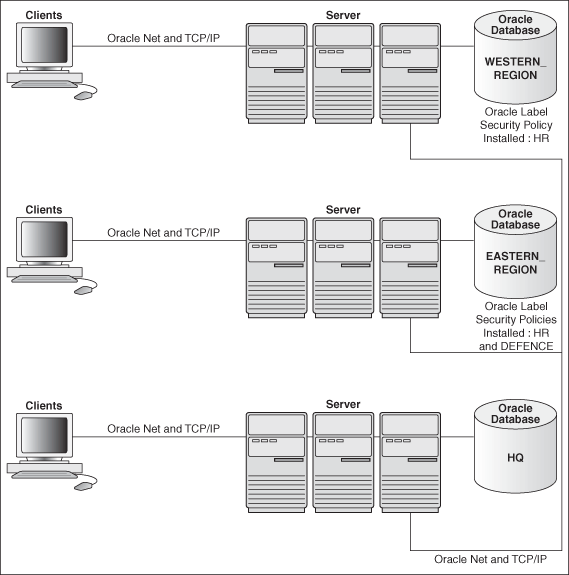
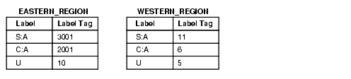
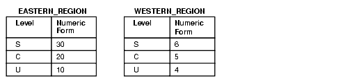
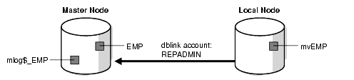

You should understand the special considerations for using Oracle Label Security in a distributed configuration.

- About the Oracle Label Security Distributed Configuration
  In a network configuration that supports distributed databases, multiple Oracle Database (or other) servers can run on the same or different operating systems.
- How Connections to a Remote Database Under Oracle Label Security Work
  Distributed databases act in the standard way with Oracle Label Security: the local user ends up connected as a particular remote user.
- Session Labels and Row Labels in Remote Sessions
  When connecting remotely, you can directly control the session label and row label in effect when you establish the connection.
- Labels in a Distributed Environment
  You should use the same label component definitions and label tags on any database that is to be protected by the policy.
- Oracle Label Security Policies in a Distributed Environment
  Oracle Label Security supports all standard Oracle Database distributed configurations.
- Replication with Oracle Label Security
  You should understand how to use the replication option with tables protected by Oracle Label Security policies.

**Parent topic:** [Administering an Oracle Label Security Application](part3.md)

### 14.1 About the Oracle Label Security Distributed Configuration

In a network configuration that supports distributed databases, multiple Oracle Database (or other) servers can run on the same or different operating systems.

Each cooperative server in a distributed system communicates with other clients and servers over a network.

Figure 14-1 illustrates a distributed database that includes clients and servers with and without Oracle Label Security. As described in this chapter, if you establish database links from the `WESTERN_REGION` database to the `EASTERN_REGION` database, then you can access data if your user ID on `EASTERN_REGION` is authorized to see it, even if locally (on `WESTERN_REGION`) you do not have this access.

Figure 14-1 Using Oracle Label Security with a Distributed Database

[Description of "Figure 14-1 Using Oracle Label Security with a Distributed Database"](img_text/olsag019.md)

**Parent topic:** Using Oracle Label Security with a Distributed Database

### 14.2 How Connections to a Remote Database Under Oracle Label Security Work

Distributed databases act in the standard way with Oracle Label Security: the local user ends up connected as a particular remote user.

Oracle Label Security protects the labeled data, whether you connect locally or remotely. If the remote user has the proper labels, then you can access the data. If not, then you cannot access the data.

The database link sets up the connection to the remote database and identifies the user who will be associated with the remote session. Your Oracle Label Security authorizations on the remote database are based on those of the remote user identified in the database link.

For example, local user `JANE` might connect as remote user `AUSTEN`, in the database referenced by the connect string `sales`, as follows:

    CREATE DATABASE LINK sales
      CONNECT TO austen IDENTIFIED BY pride
      USING 'sales'

When `JANE` connects, her authorizations are based on the labels and privileges of remote user `AUSTEN`, because `AUSTEN` is the user identified in the database link. When `JANE` makes the first reference to the remote database, the remote session is actually established. For example, the remote session would be created if JANE enters:

    SELECT * FROM emp@sales

You need not be an Oracle Label Security policy user in the local database. If you connect as a policy user on the remote database, you can access protected data.

**Parent topic:** Using Oracle Label Security with a Distributed Database

### 14.3 Session Labels and Row Labels in Remote Sessions

When connecting remotely, you can directly control the session label and row label in effect when you establish the connection.

When you connect, Oracle Label Security passes these values (for all policies) over to the remote database. Notice that:

- The local session label and row label are used as the default for the remote session, if they are valid for the remote user.

- The remote session is constrained by the minimum and maximum authorizations of the remote user.

- Although the local user's session labels are passed to the remote database, the local user's privileges are not passed. The privileges for the remote session are those associated with the remote user.

Consider a local user, `Diana`, with a maximum level of `HS`, and a session level of `S`. On the remote database, the remote user identified in the database link has a maximum level of `S`.

- If Diana's session label is `S` when the database link is established, then the `S` label is passed over. This is a valid label. Diana can connect and read `SENSITIVE` data.

- If Diana's session label is `HS` when the database link is established, then the `HS` level is passed across, but it is not valid for the remote user. Diana will pick up the remote user's default label (`S`).

Be aware of the label at which you are running the first time you connect to the remote database. The first time you reference a database link, your local session labels are sent across to the remote system when a connection is made. Later, you can change the label, but to do so, you must run the `SA_SESSION`.`SET_LABEL` procedure on the remote database.

Diana can connect at level `HS`, set the label to `S`, and then perform a remote access. Connection is implicitly made when the database link is established. Her default label is S on the remote database.

On the local database, Diana can set her session label to her maximum level of `HS`, but if the label of the remote user is set to `S`, then she can only retrieve `S` data from the remote database. If she performs a distributed query, then she will get `HS` data from the local database, and `S` data from the remote database.

**Parent topic:** Using Oracle Label Security with a Distributed Database

### 14.4 Labels in a Distributed Environment

You should use the same label component definitions and label tags on any database that is to be protected by the policy.

- Label Tags in a Distributed Environment
  In a distributed environment, you may choose to use the same label tags across multiple databases.
- Numeric Form of Label Components in a Distributed Environment
  In a distributed environment, the same relative ranking of the numeric form of the level component ensures that the labels are properly sorted.

**Parent topic:** Using Oracle Label Security with a Distributed Database

#### 14.4.1 Label Tags in a Distributed Environment

In a distributed environment, you may choose to use the same label tags across multiple databases.

However, if you choose not to use the same tags across multiple databases, then you should retrieve the character form of the label when performing remote operations. This will ensure that the labels are consistent.

In the following example, the character string representation of the label string is the same. However, the label tag does not match. If the retrieved label tag has a value of `11` on the `WESTERN_REGION` database but a tag of `2001` on the `EASTERN_REGION` database, then the tags have no meaning. Serious consequences can result.

Figure 14-2 Label Tags in a Distributed Database

[Description of "Figure 14-2 Label Tags in a Distributed Database"](img_text/olsag020.md)

When retrieving labels from a remote system, you should return the character string representation (rather than the numeric label tag), unless you are using the same numeric labels on both databases.

If you allow Oracle Label Security to automatically generate labels on different databases, then the label tags will not be identical. Character strings will have meaning, but the numeric values will not, unless you have predefined labels with the same label tags on both instances.

To avoid the complexities of label tags, you can convert labels to strings on retrieval (using `LABEL_TO_CHAR`) and use `CHAR_TO_LABEL` when you store labels. Operations will succeed as long as the component names are the same.

**Parent topic:** Labels in a Distributed Environment

#### 14.4.2 Numeric Form of Label Components in a Distributed Environment

In a distributed environment, the same relative ranking of the numeric form of the level component ensures that the labels are properly sorted.

In the following example, the levels in the two databases are effectively the same. Although the numeric form is different, the relative ranking of the levels numeric form is the same. As long as the relative order of the components is the same, the labels are perceived as identical.

Figure 14-3 Label Components in a Distributed Database

[Description of "Figure 14-3 Label Components in a Distributed Database"](img_text/olsag021.md)

**Parent topic:** Labels in a Distributed Environment

### 14.5 Oracle Label Security Policies in a Distributed Environment

Oracle Label Security supports all standard Oracle Database distributed configurations.

Whether or not you can access protected data depends on the policies installed in each distributed database.

Be sure to take into account the relationships between databases in a distributed environment:

- If the same application runs on two databases and you want them to have the same protection, then you must apply the same Oracle Label Security policy to both the local and the remote databases.

- If the local and remote databases have a policy in common, then your local session label and row label will override the default labels for the remote user.

- If the remote database has a different policy than the local database, then the remote policy can restrict access to the data independent of your local policies. On the other hand, when you make a connection as a remote user who has authorization on the remote policy, you can access any data to which the remote user has access to, regardless of your local authorizations.

If the remote database has no policy applied to it, you can access its data just as you would with a standard distributed database.

Consider a situation in which three databases exist, with different Oracle Label Security policies in force:

- Database 1 has Policy A and Policy B
- Database 2 has Policy A
- Database 3 had Policy C

Users authorized for Policy A can obtain protected data from Database 1 and Database 2. If the remote user is authorized for Policy C, then this user can obtain data from Database 3 as well.

**Parent topic:** Using Oracle Label Security with a Distributed Database

### 14.6 Replication with Oracle Label Security

You should understand how to use the replication option with tables protected by Oracle Label Security policies.

- About Replication Under Oracle Label Security
  You can replicate data in Oracle Label Security.
- Contents of a Materialized View
  Oracle Label Security can create materialized views.
- Requirements for Creating Materialized Views Under Oracle Label Security
  The requirements for creating a materialized view depend on the type of materialized view you are creating.
- How to Refresh Materialized Views
  If the contents or definition of a master table changes, then you should refresh the materialized view.

**Parent topic:** Using Oracle Label Security with a Distributed Database

#### 14.6.1 About Replication Under Oracle Label Security

You can replicate data in Oracle Label Security.

- Replication Functionality Supported by Oracle Label Security
  Oracle Label Security supports replication using read-only materialized views (snapshots).
- Row-Level Security Restriction on Replication Under Oracle Label Security
  An Oracle Label Security policy applies Row Level Security (RLS) to a table if `READ_CONTROL` is specified as one of the policy options.

**Parent topic:** Replication with Oracle Label Security

##### 14.6.1.1 Replication Functionality Supported by Oracle Label Security

Oracle Label Security supports replication using read-only materialized views (snapshots).

Oracle Database uses materialized views for replicating data. A materialized view is a local copy of a local or remote master table that reflects a recent state of the master table.

As illustrated in the following figure, a master table is a table you wish to replicate, on a node that you designate as the master node. Using a `dblink` account, you can create a materialized view of the table in a different database. (This can also be done in the same database, and on the same system.) You can select rows from the remote master table, and copy them into the local materialized view. Here, `mvEMP` represents the materialized view of table `EMP`, and `mlog$_EMP` represents the materialized view log.

Figure 14-4 Use of Materialized Views for Replication

[Description of "Figure 14-4 Use of Materialized Views for Replication"](img_text/olsag018.md)

In a distributed environment, a materialized view alleviates query traffic over the network and increases data availability when a node is not available.

**Parent topic:** About Replication Under Oracle Label Security

##### 14.6.1.2 Row-Level Security Restriction on Replication Under Oracle Label Security

An Oracle Label Security policy applies Row Level Security (RLS) to a table if `READ_CONTROL` is specified as one of the policy options.

Problems occur if both of the following conditions are true:

- The Oracle Label Security policy is applied to any table relevant to replication (such as the master table, materialized view, or materialized view log), and

- The policy returns a predicate in the `WHERE` clause of `SELECT` statements.

To avoid the additional predicate (and therefore avoid this problem), the users involved in a replication environment should be given the necessary Oracle Label Security privileges. To be specific, the designated users in the database link (such as `REPADMIN` and the materialized view owner) must have the `READ` or the `FULL` privilege. As a result, the queries used to perform the replication will not be modified by RLS.

**Parent topic:** About Replication Under Oracle Label Security

#### 14.6.2 Contents of a Materialized View

Oracle Label Security can create materialized views.

- How Materialized View Contents Are Determined
  Oracle Label Security performs a set steps when creating materialized views.
- Complete Materialized Views
  Oracle Label Security supports complete materialized views.
- Partial Materialized Views
  A partial materialized view is created when you specify a `WHERE` clause in the materialized view definition.

**Parent topic:** Replication with Oracle Label Security

##### 14.6.2.1 How Materialized View Contents Are Determined

Oracle Label Security performs a set steps when creating materialized views.

The following steps determine the contents of the view:

1.  It reads the definition of the master table in the remote database.

2.  It reads the rows in the master table that meet the conditions defined in the materialized view definition.

3.  It writes these rows to the materialized view in the local database.

Because Oracle Label Security writes only those rows to which you have write access in the local database, the contents of the materialized view vary according to:

- The policy options in effect

- The privileges you have defined in the local database

- The session label

**Parent topic:** Contents of a Materialized View

##### 14.6.2.2 Complete Materialized Views

Oracle Label Security supports complete materialized views.

If you read all of the rows in the master table and have write access in the local database to each label in the materialized view, then the result is a complete materialized view of the master table. To ensure that the materialized view is complete, you should have read access to all of the data in the master table and write access in the local database to all labels at which data is stored in the master table.

**Note:**

Never revoke privileges that you granted when you created the materialized view. If you do, then you may not be able to perform a replication refresh.

**Parent topic:** Contents of a Materialized View

##### 14.6.2.3 Partial Materialized Views

A partial materialized view is created when you specify a `WHERE` clause in the materialized view definition.

A partial materialized view is a convenient way to pass subsets of data to a remote database.

To create a partial materialized view, a user must have write access to all the rows being replicated. You can find the currently granted privileges for a user by querying the DBA_SA_USER_PRIVS data dictionary view.

**Parent topic:** Contents of a Materialized View

#### 14.6.3 Requirements for Creating Materialized Views Under Oracle Label Security

The requirements for creating a materialized view depend on the type of materialized view you are creating.

- Requirements for a Replication Administrator
  Requirements for a replication administrator, typically using a `REPADMIN` account, vary depending on the configuration.
- Requirements for the Owner of the Materialized View
  The privileges that belong to the owner of the materialized view are used during the refresh of the materialized view.
- Requirements for Creating Partial Multilevel Materialized Views
  A partial materialized view can include only some of the rows in a remote master table that is protected by Oracle Label Security.
- Requirements for Creating Complete Multilevel Materialized Views
  A complete materialized view can include every row in a remote master table that is protected by Oracle Label Security.

**Parent topic:** Replication with Oracle Label Security

##### 14.6.3.1 Requirements for a Replication Administrator

Requirements for a replication administrator, typically using a `REPADMIN` account, vary depending on the configuration.

In general, however, it should meet the following requirements:

- It must have the `FULL` Oracle Label Security privilege (mandatory for all configurations).

- It must have the `SELECT` privilege on the master table.

- It must be the account that establishes the database link from the remote node to the database containing the master table.

**Parent topic:** Requirements for Creating Materialized Views Under Oracle Label Security

##### 14.6.3.2 Requirements for the Owner of the Materialized View

The privileges that belong to the owner of the materialized view are used during the refresh of the materialized view.

If these privileges are not sufficient, then there are two options:

- The materialized view can be created in the `REPADMIN` account, or

- Additional privileges must be granted to the owner of the materialized view.

Consider, for example, the following materialized view created by user SCOTT:

    CREATE MATERIALIZED VIEW mvemp as
    SELECT *
    FROM EMP@link_to_master
    WHERE label_to_char(sa_label) = 'HS';

Here, `SCOTT` should have permission to insert records at the `HS` level in the local database. If Oracle Label Security policies are applied on the materialized view, then `SCOTT` must have the `FULL` privilege to avoid the RLS restriction.

Different configurations can be set up depending on whether Oracle Label Security policies are applied on the materialized view, what privileges are granted to the owner of the materialized view, and so on. If Oracle Label Security policies are applied to the materialized view, but `SCOTT` should not be granted the `FULL` privilege, then the `REPADMIN` account must be used to create the materialized view. `SCOTT` can then be granted the `SELECT` privilege on that table.

If no policies are applied to the materialized view, then the view can be created in `SCOTT`'s schema without any additional privileges. In this case, the materialized view should be created in such a way that a `WHERE` condition limits the records to those which `SCOTT` can read.

Finally, if `SCOTT` can be granted the `FULL` privilege, then the materialized view can be created in `SCOTT`'s schema, and Oracle Label Security policies can also be applied on the materialized view.

Note that the master table can have Oracle Label Security policies containing any set of policy options. If `SCOTT` has the `FULL` or the `READ` privilege, he can select all rows, regardless of policy options.

**Parent topic:** Requirements for Creating Materialized Views Under Oracle Label Security

##### 14.6.3.3 Requirements for Creating Partial Multilevel Materialized Views

A partial materialized view can include only some of the rows in a remote master table that is protected by Oracle Label Security.

If the partial materialized view is used in a table that Oracle Label Security protects, then you should ensure that you have sufficient privileges to `WRITE` in the local database at every label retrieved by your query. You can find your currently granted privileges by querying the `ALL_SA_USER_PRIVS` data dictionary view.

**Parent topic:** Requirements for Creating Materialized Views Under Oracle Label Security

##### 14.6.3.4 Requirements for Creating Complete Multilevel Materialized Views

A complete materialized view can include every row in a remote master table that is protected by Oracle Label Security.

If the complete materialized view is used in a table that Oracle Label Security protects, then you must be able to have `WRITE` access in the local database at the labels of all of the rows retrieved by the defined materialized view query. You can find your currently granted privileges by querying the `ALL_SA_USER_PRIVS` data dictionary view.

**Parent topic:** Requirements for Creating Materialized Views Under Oracle Label Security

#### 14.6.4 How to Refresh Materialized Views

If the contents or definition of a master table changes, then you should refresh the materialized view.

This ensures that the materialized view accurately reflects the contents of the master table.

To refresh a materialized view of a remote multilevel table, you must also have privileges to write in the local database at the labels of all of the rows that the materialized view query retrieves

**WARNING:**

A materialized view can potentially contain outdated rows if you refresh a partial or full materialized view but do not have READ access to all the rows in the master table, and consequently do not overwrite the rows in the original materialized view with the updated rows from the master table.

To ensure an accurate materialized view refresh, you should use job queues to refresh the views automatically. These processes must have sufficient privileges both to read all of the rows in the master table and to write those rows to the materialized view, ensuring that the view is completely refreshed. Remember that the privileges used by these processes are those of the materialized view owner.

**See Also:**

[Oracle Database Data Warehousing Guide](../dwhsg/refreshing-materialized-views.md) for information about job queues

**Parent topic:** Replication with Oracle Label Security
