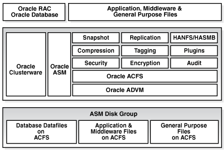

Oracle Automatic Storage Management Cluster File System (Oracle ACFS) is a multi-platform, scalable file system, and storage management technology that extends Oracle Automatic Storage Management (Oracle ASM) functionality to support all customer files.

Oracle ACFS supports Oracle Database files and application files, including executables, database data files, database trace files, database alert logs, application reports, BFILEs, and configuration files. Other supported files are video, audio, text, images, engineering drawings, and all other general-purpose application file data. Oracle ACFS conforms to POSIX standards for Linux and UNIX, and to Windows standards for Windows.

An Oracle ACFS file system communicates with Oracle ASM and is configured with Oracle ASM storage, as shown in the following figure.

Figure 11-1 Oracle ACFS Storage Layers

[Description of "Figure 11-1 Oracle ACFS Storage Layers"](img_text/ostmg005b.md)

Oracle ACFS leverages Oracle ASM functionality that enables:

- Oracle ACFS dynamic file system resizing

- Maximized performance through direct access to Oracle ASM disk group storage

- Balanced distribution of Oracle ACFS across Oracle ASM disk group storage for increased I/O parallelism

- Data reliability through Oracle ASM mirroring protection mechanisms

Oracle ACFS establishes and maintains communication with the Oracle ASM instance to participate in Oracle ASM state transitions including Oracle ASM instance and disk group status updates and disk group rebalancing. Oracle Automatic Storage Management with Oracle ACFS and Oracle ASM Dynamic Volume Manager (Oracle ADVM) delivers support for all customer data and presents a common set of Oracle storage management tools and services across multiple vendor platforms and operating system environments on both Oracle Restart (standalone) and cluster configurations.

Oracle ACFS is tightly coupled with Oracle Clusterware technology, participating directly in Clusterware cluster membership state transitions and in Oracle Clusterware resource-based high availability (HA) management. In addition, Oracle installation, configuration, verification, and management tools have been updated to support Oracle ACFS.

Oracle ACFS can be accessed and managed using native operating system file system tools and standard application programming interfaces (APIs). Oracle ACFS can also be managed with Oracle ASM Configuration Assistant. Oracle ACFS can be accessed using industry standard Network Attached Storage (NAS) File Access Protocols: Network File System (NFS) and Common Internet File System (CIFS). However, CIFS clients on Windows cannot use ACLs when interfacing with Oracle ACFS Linux, Solaris, or AIX servers, but can use ACLs with Oracle ACFS on Windows.

In addition to sharing file data, Oracle ACFS provides additional storage management services including support for the Oracle Grid Infrastructure clusterwide mount registry, dynamic online file system resizing, and multiple space efficient snapshots for each file system.

Oracle ACFS contributes to the overall Oracle storage management by providing:

- A general-purpose standalone server and cluster file system solution that is integrated with Oracle ASM and Oracle Clusterware technologies

- A common set of file system features across multiple vendor platforms and operating systems, offering an alternative to native operating system or third-party file system solutions

- Standalone and clusterwide shared Oracle Database homes, all Oracle Database files, and application data

- Uniform, coherent shared file access and clusterwide naming of all customer application files

- Integration with Oracle Clusterware High Availability Resources

Oracle ACFS accommodates large storage capacities and large numbers of cluster nodes. It efficiently manages large numbers of file systems, files, and supports both small and large sized files with exabyte-capable file and file system capacities. Oracle ACFS provides optimized fast directory lookup for large directories with millions of files.

Oracle ACFS provides support for sparse files. Oracle ACFS sparse files greatly benefit NFS client write operations which are commonly received out of order by the NFS server and the associated Oracle ACFS file system. Usually when an application writes beyond the end of file, storage is allocated and zeroes inserted beyond the old end of file and the beginning of the new. With this feature, a hole remains in the file instead of the inserted zeroes. Oracle ACFS then fills these holes with zeroes in memory when the holes are read. The sparse files feature benefits NFS performance and also the performance and disk utilization of other applications that intentionally perform this type of writing. In addition, there are also reduced time and storage benefits for files that are inherently sparse, meaning they have a lot of unused space, such as some image files for virtual machines. For sparse file support, the `COMPATIBLE.ADVM` disk group attribute must be set to `12.2` or greater.

Oracle ACFS file systems are generally mounted on all cluster nodes to deliver a single name space for the cluster so that each node maintains the same view and access capabilities to the mounted file systems. In the event of a member failure, another cluster member quickly recovers any outstanding metadata transactions on behalf of the failed member. Following recovery, access by other active cluster members and any remote client systems can resume.

The following list provides important information about Oracle ACFS:

- For all applications, Oracle ACFS performance is best with larger write() sizes, such as 8 K or larger.

- For best performance, use the Deadline I/O Scheduler for the disks in the disk group on a Linux system.

- When creating Oracle ACFS file systems on Windows, log on as a Windows domain user. Also, when creating files in an Oracle ACFS file system on Windows, you should be logged in as a Windows domain user to ensure that the files are accessible by all nodes.

- When using a file system across cluster nodes on Windows platforms, the best practice is to mount the file system using a domain user, to ensure that the security identifier is the same across cluster nodes. Windows security identifiers, which are used in defining access rights to files and directories, use information which identifies the user. Local users are only known in the context of the local node. Oracle ACFS uses this information during the first file system mount to set the default access rights to the file system.

  Oracle ACFS does not support any files associated with the management of Oracle ASM, such as files in the Oracle Grid Infrastructure home and in the Oracle ASM diagnostic directory.

- Oracle ACFS does not support Oracle Cluster Registry (OCR) and voting files.

- Oracle ACFS functionality requires that the disk group compatibility attributes for `ASM` and `ADVM` be set to `11.2` or higher.

- To use an Oracle ACFS file system for an Oracle Database home, the release level must be Oracle 11g Release 2 (11.2) or later.

**Note:**

The following features are deprecated in Oracle ACFS 19c:

- Deprecation of Oracle ACFS Replication Version 1

  Starting with Oracle ACFS 19c (19.3), Oracle ACFS replication protocol version 1 is deprecated. Replication protocol version 1 has been replaced with snapshot-based replication version 2, introduced in Oracle ACFS 12c Release 2 (12.2.0.1).

- Deprecation of Oracle ACFS Encryption on Solaris and Windows

  Starting with Oracle ACFS 19c (19.3), Oracle ACFS encryption is deprecated on Solaris and Microsoft Windows operating systems. Oracle ACFS Encryption on Oracle Solaris and Microsoft Windows is based on RSA technology. Retirement of RSA technology has been announced. Oracle ACFS Encryption continues to be supported on Linux, and is unaffected by this deprecation, because Linux uses an alternative technology.

- Deprecation of Oracle ACFS on Windows

  Starting with Oracle ACFS 19c (19.5), Oracle ACFS is deprecated on Microsoft Windows. Deprecating certain clustering features with limited adoption allows Oracle to focus on improving core scaling, availability, and manageability across all features and functionality. Oracle ACFS file systems on Microsoft Windows are deprecated, and can be desupported in a future release. Depending on the use case, to replace current Oracle ACFS file systems, Oracle recommends that you move to Oracle Automatic Storage Management (Oracle ASM), Oracle Database File System (DBFS), or Microsoft Windows shares.

- Deprecation of Oracle ACFS Security (Vault) and Oracle ACFS Auditing

  Starting with Oracle ACFS 19c (19.5), Oracle ACFS Security (Vault) and ACFS Auditing are deprecated. Deprecating certain clustering features with limited adoption enables Oracle to focus on improving core scaling, availability, and manageability across all features and functionality. Oracle ACFS Security (Vault) and Oracle ACFS Auditing are deprecated, and can be desupported in a future release.

- Deprecation of Oracle ACFS on Member Clusters (ACFS Remote)

  Starting with Oracle ACFS 19c (19.5), Oracle ACFS on Member Clusters (ACFS Remote) is deprecated. Oracle Oracle ACFS on Member Clusters (ACFS Remote) is deprecated, and can be removed in a future release. Deprecating certain clustering features with limited adoption enables Oracle to focus on improving core scaling, availability, and manageability across all features and functionality.

- Deprecation of Cluster Domain - Member Clusters

  Starting with Oracle Grid Infrastructure 19c (19.5), Member Clusters, which are part of the Oracle Cluster Domain architecture, are deprecated. Oracle Member Clusters are deprecated, and can be desupported in a future release. Deprecating certain clustering features with limited adoption allows Oracle to focus on improving core scaling, availability, and manageability across all features and functionality. Oracle Cluster Domains consist of a Domain Services Cluster (DSC) and Member Clusters. The deprecation of Member Clusters affects the clustering used with the DSC, but not its ability to host services for other production clusters. Oracle recommends that customers align their next software or hardware upgrade with the transition off Cluster Domain - Member Clusters.

**See Also:**

- [Overview of Oracle ASM Dynamic Volume Manager](overview-advm.md) for an overview of Oracle ADVM

- [Oracle Clusterware Resources and Oracle ACFS Administration](understand-acfs-admin.md)for information Oracle Clusterware High Availability Resources

- [Disk Group Compatibility](diskgroup-compatibility.md) for information about disk group compatibility

- [Managing Oracle ACFS with Command-Line Tools](manage-acfs-advm-commands.md) and [Using Views to Display Oracle ACFS Information](views-acfs-advm-info.md) for information about managing and monitoring Oracle ACFS

- [Oracle Database Installation Guide](../install-and-upgrade.md) for the Windows platform for information about Oracle Base permissions when a file system is mounted under Oracle Base.
