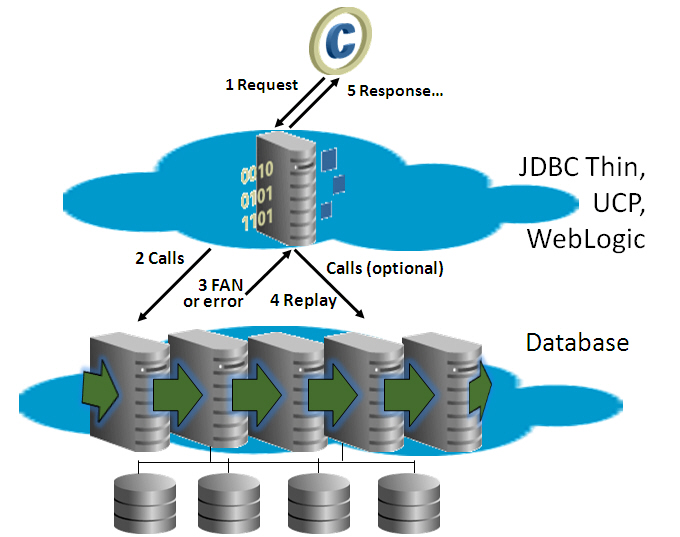

Application Continuity is a feature that enables the replay, in a non-disruptive and rapid manner, of a request against the database after a recoverable error that makes the database session unavailable so an outage appears to the user as no more than a delayed execution of the request.

The request can contain transactional and non-transactional work. After a successful replay, the application can continue where that database session left off, instead of having users left in doubt, not knowing what happened to their funds transfers, flight bookings, and so on, and avoiding the need to reboot mid-tier servers to recover from an overload of log ins when the application comes back online. With Application Continuity, the end-user experience is improved by masking many outages, planned and unplanned, without the application developer needing to attempt to recover the request.

Without Application Continuity, it can be almost impossible for an application to mask outages in a safe way, for reasons that include the following:

- The state at the client remains at present time, with entered data, returned data, and variables cached.

- If a `COMMIT` has been issued, then the `COMMIT` failure message cannot be retrieved if it is not received by the client or the application.

- Checking the status of an in-doubt tansaction at a point in time is no guarantee that it will not `COMMIT` later.

- Non-transactional database session state that the application needs to operate is lost.

- If the request can continue, the database and the database session must be in the right state.

With Application Continuity, however, Oracle Database, the Oracle drivers, and the Oracle connection pools all collaborate to mask many outages in a safe and reliable way.

Application Continuity improves developer productivity by attempting to mask outages that can be masked. However, applications still must include error handling for these cases:

- Nonrecoverable errors, such as invalid input data. (Application Continuity applies only to recoverable errors.)

- Recoverable errors when replay has encountered a restriction, such as use of concrete classes in the application, or when replay has not been able to restore the client-visible state to that on which the client may have made decisions so far.

Introduced in Oracle Database 12c Release 1 (12.1.0.1), Application Continuity strengthens the fault tolerance of systems and applications that use an Oracle database.

This chapter assumes that you are familiar with the major relevant concepts and techniques of the technology or product environment in which you are using Application Continuity, such as Oracle WebLogic Server, Oracle RAC, or Oracle Active Data Guard (Oracle ADG).

This chapter includes the following topics:

- Fast Application Notification

- Managing Unplanned Outages

- Managing Planned Maintenance

- About Application Continuity

- Application Continuity Operation and Usage

- Potential Side Effects of Application Continuity

- Restrictions and Other Considerations for Application Continuity

- Transaction Guard for Improving Client Failover

- Failing Over OCI Clients with Transparent Application Failover

### Fast Application Notification

The Oracle RAC high availability framework monitors a database and its services and sends event notifications using Fast Application Notification (FAN).

Oracle Database focuses on maintaining the highest possible service availability. In Oracle RAC, services are designed to be continuously available with loads shared across one or more instances. The Oracle RAC high-availability framework maintains service availability by using Oracle Clusterware and resource profiles. Oracle Clusterware recovers and balances services according to business rules and the service attributes.

This section includes the following topics:

- Overview of Fast Application Notification

- Fast Application Notification High Availability Events

- Subscription to High Availability Events

- Using Fast Application Notification Callouts

**Related Topics**

- [Enabling Clients for Oracle RAC](workload-management-with-dynamic-database-services.md)

#### Overview of Fast Application Notification

FAN provides immediate interrupt of clients following outages related to the database, nodes, and networks.

FAN is essential to break clients out of TCP/IP timeouts immediately following failures. FAN notifies clients immediately when resources become available and initiates draining of database sessions so clients experience no outages during planned maintenance. FAN also includes notifying configuration- and service-level information that includes changes in service status.

The Oracle client drivers and Oracle connection pools respond to FAN events and take immediate action. FAN UP and DOWN events apply to services, databases, instances, networks, and nodes.

**Note:**

FAN is supported starting with Oracle Database 10g release 2 (10.2).

Oracle connection pools, for example, use FAN to receive very fast notification of failures, to balance connections following failures, and to balance connections again after the failed components are repaired. So, when a service at an instance starts, the connection pool uses the FAN event to route work to that resource, immediately. When a service at an instance or node fails, the connection pool uses the FAN event to immediately interrupt applications to recover. FAN is essential to prevent applications from hanging on TCP/IP timeouts.

##### Importance of FAN

Applications can waste time in many critical ways:

- Waiting for TCP/IP timeouts when a node fails without closing sockets, and for every subsequent connection while that IP address is down.

- Attempting to connect when services are down.

- Not connecting when services resume.

- Processing the last result at the client when the server goes down.

- Attempting to execute work on sub-optimal nodes.

When a node fails without closing sockets, all sessions that are blocked in an I/O wait (read or write) wait for `tcp_keepalive`. This wait status is the typical condition for an application connected by a socket. Sessions processing the last result are even worse off, not receiving an interrupt until the next data is requested. Using FAN events eliminates applications waiting on TCP timeouts, time wasted processing the last result at the client after a failure has occurred, and time wasted executing work on slow, hung, or dead nodes.

For cluster configuration changes, the Oracle RAC high availability framework publishes a FAN event immediately when a state change occurs in the cluster. Instead of waiting for the application to time out against the database and detect a problem, applications can receive FAN events and react immediately. With FAN, in-flight transactions are immediately terminated and the client notified when the instance fails.

FAN also publishes load balancing advisory events. Applications can take advantage of the load balancing advisory FAN events to direct work requests to the instance in the cluster that is currently providing the best service quality.

Oracle Database 12c release 2 (12.2) client drivers are FAN-aware, and FAN is enabled, by default. This includes the JDBC Thin driver (12.2.0.1) and Oracle Data Provider for Net (ODP.NET) drivers. A client driver can detect planned and unplanned FAN events and take action beneath the application.

For planned maintenance and applications using OCI or Pro\* (and not using the OCI session pool or Tuxedo), an application must check `OCI_ATTR_SERVER_STATUS`. Add this check when sessions are returned to your own connection pool, and for idle connections, regularly.

Following a FAN down event with planned maintenance, this attribute is set to `OCI_SERVER_NOT_CONNECTED`. The application closes the connection after reading this disconnected status. The session remains open for draining of active work until the application closes, providing error-free failover.

You can take advantage of FAN events in the following ways:

- Applications can use FAN without programmatic changes if you use an integrated Oracle client. The integrated clients for FAN events include Oracle JDBC Universal Connection Pool, ODP.NET connection pool, OCI session pool, Oracle WebLogic Server Active Gridlink for Oracle RAC, and OCI and ODP.NET clients. The integrated Oracle clients must be Oracle Database 10g release 2 (10.2) or later to take advantage of the FAN high-availability events. The pooled clients can also take advantage of the load balancing advisory FAN events.

- You can configure third-party application containers, such as those provided by Apache Tomcat and WebSphere, to use the built-in FAN support offered by using the Universal Connection Pool in place of the default pool, which is certified as a connection pool for third-party Java application servers including Apache Tomcat and WebSphere.

- Use the FAN-aware capability of the Oracle drivers by using standard interfaces to test connections on get or release from the third-party connection pools in use by third-party application servers or custom applications.

  - This solution applies to standard Java applications through the use of the standard TNS connect string and ensures that the `ons.jar` and `simpleFAN.jar` files are available on the application CLASSPATH.

  - For the OCI/OCCI driver, the `OCI_ATTR_SERVER_STATUS` server context handle attribute is sensitive to FAN events and will return `OCI_SERVER_NOT_CONNECTED` if the connection has been affected by a FAN event.

- You can implement FAN with server-side callouts on your database tier.

- Applications can use FAN programmatically by using the JDBC and Oracle RAC FAN application programming interface (API) or by using callbacks with OCI and ODP.NET to subscribe to FAN events and to run event handling actions upon the receipt of an event.

If you use one of the integrated clients listed in the first item of the preceding list, then, for DOWN events, the disruption to the application is minimized because the FAN-aware client terminates the connections to the failed instance or node before they are reused. Active work can be allowed to complete and, if there is a surviving instance, then continuous service can be maintained for ongoing work. Any sessions active when the instance or service stops are terminated and the application user is immediately notified. Incomplete transactions can be protected by Application Continuity, if it is enabled. Application users who request connections are directed to available instances, only.

For `UP` events, when services and instances are started, new connections are created so that the application can immediately take advantage of the extra hardware resources or additional capacity.

To take advantage of FAN-aware capabilities in the drivers, as mentioned in the previous list, the following is required:

- For the thin Java driver, beginning with release 12.2, FAN is automatically enabled by placing the `ons.jar` and `simpleFAN.jar` files on the CLASSPATH, and by using the recommended TNS format (as shown in Example 6-1). Using the recommended TNS format automatically configures ONS. Also with the Java thin driver, FAN is supported for both planned and unplanned events. For unplanned outages, the FAN interrupt is immediate. For planned maintenance, configure the Java application servers or custom pools using standard interfaces to test connections on get or release from third-party connection pools. For example, `TestConnectionsOnReserve`, `TestOnBorrow`, or `PreTest` connections, depending on the application server.

  With this approach, when a FAN event is received during planned maintenance, Fast Connection Failover closes sessions when they are tested, because the application does not have a connection to the database at this time, and can retry for a new connection. The connection tests may use `isValid`, `isClosed`, `isUsable`, `PingDatabase`, or a SQL statement that is preceded by the hint `/*+ CLIENT_CONNECTION_VALIDATION */`.

- For a SQL test, the SQL syntax must begin with the hint `/*+ CLIENT_CONNECTION_VALIDATION */`. At the time the SQL command runs, the driver will drain the connection, if it is affected by the upcoming planned maintenance. Connection pools, data sources, and, in the programmatic case, customer applications, must all be ready to manage the recoverable error that occurs when the SQL command runs, which usually closes the physical connection.

  **Note:**

  The SQL hint must be placed as the first non-comment token within the SQL string to avoid changing current, driver-based SQL parsing. For example:

      /*+ CLIENT_CONNECTION_VALIDATION */ SELECT 1 FROM DUAL;

- Third-party Java application servers and Java applications can use the `PooledConnection` standard interface when developing connection pools.

- Beginning with the 11.2.0.3 release of the OCI/OCCI driver, when the `OCI_ATTR_SERVER_STATUS` server context handle attribute returns `OCI_SERVER_NOT_CONNECTED`, the application must terminate the connection. Work will be drained for planned maintenance. The 12.2 release of the driver can also detect `OCISessionRelease` and `OCIRequestEnd` when it receives a planned DOWN event.

FAN callouts are server-side scripts or executables that run whenever a FAN event is generated. You can design and build callouts to do many things. For example:

- Log status information

- Page DBAs or to open support tickets when resources fail to start

- Automatically start dependent external applications that must be co-located with a service

- Change resource plans or shut down services when the number of available instances for a policy-managed database decreases, for example, if nodes fail

- Automate the fail back of a service to preferred instances for administrator-managed databases, if needed

FAN events are published using Oracle Notification Service and Advanced Queuing, the latter being continued for backward compatibility to previous Oracle Database releases. The publication mechanisms are automatically configured as part of your Oracle RAC installation. If you are using thin Java JDBC connections, then the client can be automatically configured for Oracle Notification Service, by obtaining the database-server Oracle Notification Service configuration from the database connection. It is not necessary to configure Oracle Notification Service on the client.

Oracle Net Services listeners and Global Data Services (GDS) are integrated with FAN events, enabling the listener and GDS to immediately de-register services provided by the failed instance and to avoid erroneously sending connection requests to failed instances.

If you specify the connection load balancing goal `CLB_GOAL_SHORT` for the service, then the listener uses the load balancing advisory when the listener balances the connection loads. When load balancing advisory is enabled, the metrics used for the listener are finer grained.

**Related Topics**

- Server Draining Ahead of Planned Maintenance

#### Fast Application Notification High Availability Events

This section describes the information delivered in the FAN event to a callout program.

FAN event types are listed following the example, and Table 6-1 describes name-value pairs for the event parameters. The event type is always the first entry when you receive FAN information through a callout, as in the following example:

    SERVICEMEMBER VERSION=1.0
       service=test.company.com database=ractest
       instance=ractest11 host=ractest1_host0343_1 status=up reason=FAILURE
       timestamp=2018-05-08 22:06:02 timezone=-07:00 db_domain=company.com

Note that the preceding example displays as one line.

FAN event types include:

- `DATABASE`
- `INSTANCE`
- `NODE`
- `SERVICE`
- `SERVICEMEMBER`
- `SERVICEMETRICS`

The `DATABASE` and `INSTANCE` types list the default database service as `DB_UNIQUE_NAME`.

All events except for `NODE` events include a `db_domain` field.

Events of `SERVICEMETRICS` type are load balancing advisory events.

See Also: [Table 5-1](workload-management-with-dynamic-database-services.md) for more information about load balancing events

Table 6-1 Event Parameter Name-Value Pairs and Descriptions

| Parameter     | Description                                                                                                                                                                                                                                                                                                                                                                                                                                                                                                                                                                                                                                                                                                                                                                                                       |
|:--------------|:------------------------------------------------------------------------------------------------------------------------------------------------------------------------------------------------------------------------------------------------------------------------------------------------------------------------------------------------------------------------------------------------------------------------------------------------------------------------------------------------------------------------------------------------------------------------------------------------------------------------------------------------------------------------------------------------------------------------------------------------------------------------------------------------------------------|
| `VERSION`     | Version of the event record. Used to identify release changes.                                                                                                                                                                                                                                                                                                                                                                                                                                                                                                                                                                                                                                                                                                                                                    |
| `database`    | The unique name of the database supporting the service; matches the initialization parameter value for `DB_UNIQUE_NAME`, which defaults to the value of the `DB_NAME` initialization parameter.                                                                                                                                                                                                                                                                                                                                                                                                                                                                                                                                                                                                                   |
| `instance`    | The name of the instance that supports the service; matches the `ORACLE_SID` value.                                                                                                                                                                                                                                                                                                                                                                                                                                                                                                                                                                                                                                                                                                                               |
| `host`        | The name of the node that supports the service or the node that has stopped; matches the node name known to Cluster Synchronization Services (CSS).                                                                                                                                                                                                                                                                                                                                                                                                                                                                                                                                                                                                                                                               |
| `service`     | The service name; matches the name of the service as listed in `DBA_SERVICES` and is domain-qualified as appropriate. Refer to the following examples: `SERVICEMEMBER VERSION=1.0 service=swingbench` ` database=orcl instance=orcl_2 host=rwsbj13 status=up` ` reason=USER card=1 timestamp=2018-05-29 17:26:37` ` timezone=-07:00 db_domain=` `SERVICEMEMBER VERSION=1.0 service=swingbench.example.com` ` database=orcl instance=orcl1 host=rwsbj09 status=up` ` reason=USER card=2 timestamp=2018-05-03 17:29:28` ` timezone=-07:00 db_domain=example.com` `SERVICEMEMBER VERSION=1.0 service=swingbench.example.com` ` database=orcl instance=orcl2 host=rwsbj10 status=up` ` reason=USER card=1 timestamp=2018-07-03 17:29:18` ` timezone=-07:00 db_domain=example.com` |
| `status`      | Values are `UP`, `DOWN`, `NODEDOWN` (this only applies to the `NODE` event type), `NOT_RESTARTING`, and `UNKNOWN`. Notes: • When the node is down, the status is `NODEDOWN`, as opposed to `DOWN` for other event types. • When `STATUS=NODEDOWN` and `REASON=MEMBER_LEAVE`, a node has failed and is no longer part of the cluster, or a user has stopped a node. • When `STATUS=NODEDOWN` and `REASON=PUBLIC_NW_DOWN`, the node is up but it is unreachable because the public network is down because of either a failure or a user action. • Multiple public networks are supported by Oracle Clusterware. The FAN event reflects this fact.                                                                                                                                                   |
| `reason`      | `AUTOSTART`, `BOOT`, `DEPENDENCY`, `FAILURE`, `MEMBER_LEAVE`, `PUBLIC_NW_DOWN`, `USER`. Notes: • For `DATABASE` and `SERVICE` event types, `REASON=AUTOSTART` if, when the node started, the `AUTO_START` resource attribute was set to restore, and the resource was offline before the node started. • For `DATABASE` and `SERVICE` event types, `REASON=BOOT` if, when the node started, the resource started because it was online before the node started. • For SRVCTL and Oracle Enterprise Manager operations, `REASON=USER` describes planned actions for such operations as draining work.                                                                                                                                                                                                  |
| `cardinality` | The number of service members that are currently active; included in all `SERVICEMEMBER UP` events. Following is an example of `SERVICEMEMBER UP` event: `SERVICEMEMBER VERSION=1.0 service=swingbench.example.com` `database=orcl instance=orcl_2 host=mjkbj09 status=up` `reason=USER card=1 timestamp=2018-07-12 14:46:46  timezone=-07:00 db_domain=example.com`                                                                                                                                                                                                                                                                                                                                                                                                                                  |
| `incarnation` | For `NODEDOWN` events; the new cluster incarnation. This value changes each time a member joins or leaves the cluster. Following is an example of a `NODEDOWN` event: `NODE VERSION=1.0 host=stru09 incarn=175615351 status=down` `reason=member_leave timestamp=27-Jul-2018 14:49:32  timezone=-07:00`                                                                                                                                                                                                                                                                                                                                                                                                                                                                                                  |
| `timestamp`   | The time according to Oracle Clusterware that an event occurs.                                                                                                                                                                                                                                                                                                                                                                                                                                                                                                                                                                                                                                                                                                                                                    |
| `timezone`    | The time zone of Oracle Clusterware where the event occurred, given as GMT +/-hh:mm.                                                                                                                                                                                                                                                                                                                                                                                                                                                                                                                                                                                                                                                                                                                              |

Some of the FAN event record parameters have values that correspond to values returned by the `SYS_CONTEXT` function using the default namespace `USERENV`, as shown in Table 6-2.

Table 6-2 FAN Parameters and Matching Session Information

| FAN Parameter          | Matching Session Information               |
|:-----------------------|:-------------------------------------------|
| `SERVICE`              | `sys_context('userenv', 'service_name')`   |
| `DATABASE_UNIQUE_NAME` | `sys_context('userenv', 'db_unique_name')` |
| `INSTANCE`             | `sys_context('userenv', 'instance_name')`  |
| `CLUSTER_NODE_NAME`    | `sys_context('userenv', 'server_host')`    |

#### Subscription to High Availability Events

Oracle RAC uses FAN to notify applications about configuration changes and the current service level that is provided by each instance where the service is enabled. If you are using an OCI client or an ODP.NET client to receive FAN events, then you must enable the service used by that client to access the alert notification queue by using SRVCTL with the `-notification` parameter.

#### Using Fast Application Notification Callouts

Fast Application Notification (FAN) callouts are server-side program files that Oracle RAC runs immediately when high availability events occur.

You can use FAN callouts to automate activities when events occur in a cluster configuration, such as:

- Opening fault tracking tickets
- Sending messages to pagers
- Sending e-mail
- Starting and stopping server-side applications
- Maintaining an up-time log by logging each event as it occurs
- Relocating low-priority services when high priority services come online

To use FAN callouts, place a program file in the `Grid_home``/racg/usrco` directory on every node that runs Oracle Clusterware. The program file must be able to run standalone when called, with optional arguments, from another program. The following is an example of a shell script, named `callout.sh`, which is placed in the `Grid_home``/racg/usrco` directory:

    #! /bin/bash
    FAN_LOGFILE= [your_path_name]/admin/log/'hostname'_uptime'.log
    echo $* "reported="'date' >> $FAN_LOGFILE &

The previous example adds entries similar to the following in the log file, indicated by `$FAN_LOGFILE` in the shell script, each time a FAN event is generated:

    NODE VERSION=2.0 host=my-exa status=nodedown reason=public_nw_down
    incarn=0 timestamp=2019-10-24  09:02:35 timezone=+00:00 vip_ips=10.1.1.94

The contents of a FAN event record matches the current session of the user logged on to the database. The user environment (`USERENV`) information is also available using Oracle Call Interface (OCI) connection handle and descriptor attributes (using `OCIAttrGet()`). Use this information to take actions on sessions that match the FAN event data.

In general, events are only posted to user callouts on the node from which the event originated. For example, if the database on `node1` goes down, then the callout is posted to `node1`, only. The only exceptions to this are node down and VIP down events—these events are posted to all nodes, regardless of from where they originated.

**Related Topics**

- Fast Application Notification High Availability Events
- [Oracle Call Interface Programmer's Guide](../lnoci/oci-programming-basics.md)

### Managing Unplanned Outages

You can assign services to one or more instances in an administrator-managed Oracle RAC database or to server pools in a policy-managed database.

If Oracle RAC detects an outage, then Oracle Clusterware isolates the failed component and recovers the dependent components. For services, if the failed component is an instance, then Oracle Clusterware attempts to maintain the cardinality of the service. If the service definition allows for failover and that is necessary to maintain cardinality, then failover occurs.

FAN events can occur at various levels within the Oracle Database architecture and are published through Oracle Notification Service and Advanced Queuing for backward compatibility with previous OCI clients. FAN callouts can also be written to execute on the database server in response to FAN events.

**Note:**

Oracle Database does not run Oracle RAC callouts with guaranteed ordering. Callouts are run asynchronously and they are subject to scheduling variability.

FAN is published from a surviving node when the failed node is out of service. The location and number of instances in an Oracle RAC environment that provide a service are transparent to applications. Restart and recovery are automatic, including the restarting of the subsystems, such as the listener and the Oracle Automatic Storage Management (Oracle ASM) processes, not just the database. You can use FAN callouts to report faults to your fault management system and to initiate repair jobs.

It is a complex task for application developers to mask outages of a database session (instance, node, storage or network, or any other related component) and, as a result, errors and timeouts are often exposed to the end users leading to user frustration, lost productivity, and lost opportunities. Together, FAN and Application Continuity mask outages from users and applications by recovering the in-flight work for impacted database sessions following outages. Application Continuity performs this recovery beneath the application so that the outage appears to the application as a slightly delayed execution of the request.

**Related Topics**

- About Application Continuity
- [Oracle Database Net Services Administrator's Guide](../netag/identifying-and-accessing-database.md)

### Managing Planned Maintenance

To minimize service disruption to application users, Oracle Real Application Clusters (Oracle RAC) provides interfaces that relocate, disable, and enable services.

#### Managing Planned Maintenance Without User Interruption

Oracle recommends that you drain database sessions from the instance over a controlled time period from FAN-enabled Oracle or non-Oracle connection pools, or, beginning with Oracle Database 18c at the database, itself.

Draining database sessions is the safest way to migrate work without interrupting applications. When draining occurs at connection tests and outside of request boundaries, it is 100% correct. Applications continue with no interruption as existing work completes and new work acquires a session for the same service functioning at another instance, resulting in no errors returned to applications and no risk of incorrect database session states. For connection tests, the caller expects to receive a good or bad return code and is ready to handle the result, making inspecting connection tests a widely applicable and very powerful solution.

The service attributes `-drain_timeout` and `-stopoption` control the drain time period, and then how the service manages sessions that have not completed once this time period expires. Requests that complete and then check back in to the pool or close, can be directed to a new location that is not affected by the planned maintenance.

Application Continuity provides additional cover, giving continuous service for those requests that do not complete within the allotted drain time. Using any FAN-aware pool allows sessions to drain at request boundaries after receipt of the FAN planned `DOWN` event.

Because not every application uses an Oracle connection pool and not every application is FAN-aware, beginning with Oracle Database 18c, the database inspects sessions during planned maintenance seeking safe places to stop a session so that the application is not disrupted. After stopping the service, the database looks for safe places where the connection can be closed. When the connection is closed, the database cleans up the session.

Stopping a session at a safe place enables the application to open a new connection with the states that it needs. Draining sessions may take a period of work to flow through each session. There is no requirement that closing a session is immediate, rather the close must occur at a safe place that exposes no errors to the application, and, preferably, before the drain timeout period has expired.

Requests are far more important than transactions because they enable the issued work to complete. For draining requests, the Oracle Universal Connection Pool uses the drain timeout to gradually drain, which prevents an overload of logins on the instances drained, by slowly releasing the original sessions across the time period rather than all at once. Gradual draining has the benefit of not disturbing the other work ongoing at the target instances.

Both `DRAIN_TIMEOUT` and `STOP_OPTION` are service attributes that you can define when you add the service or modify it after creation. You can also specify these attributes using SRVCTL, which will take precedence over what is defined on the service. You can specify the `-drain_timeout` and `-stopoption` parameters when using the following SRVCTL commands:

- `srvctl add service`

- `srvctl modify service`

- `srvctl relocate service`

- `srvctl stop service`

- `srvctl stop database`

- `srvctl stop instance`

To manage planned maintenance without user interruption:

1.  Use SRVCTL to relocate a singleton service or a service not running on all nodes. Use the `-force` flag with the previously listed SRVCTL commands, except `add` and `modify`. You must use the `-force` flag if you specify the `-stopoption` parameter on the command line when you run either `srvctl relocate service` or `srvctl stop service`. For example:
        $ srvctl relocate service –db mycdb01 –service myservice –drain_timeout 120
          –stopoption IMMEDIATE –oldinst mycdb01_01 -force

    The preceding command relocates the service named `myservice01` from the instance named `mycdb01_01` to any instance on which it is configured to run. Oracle Clusterware chooses this instance if you do not specify a target on the command line, and waits two minutes (in this example) for any active sessions to drain, after which any sessions remaining on `mycdb01_01` are forcibly disconnected. The connection pool automatically releases a connection at a request boundary.
    **Note:**

    If the service you want to relocate is a uniform service that is currently running on all nodes, then the preceding command returns an error, unless the service is not up on all instances, in which case the preceding command example would succeed for a uniform service.
2.  The FAN planned `DOWN` event clears idle sessions from the connection pool immediately and marks active sessions to be released at the next check-in. These FAN actions drain the sessions from the instance without disrupting the users.
    Existing connections on other instances remain usable, and new connections can be opened to these instances if needed. The database also marks the sessions to drain. The database looks for connection tests and, in Oracle Database 19c and later, for safe places to failover. An implicit connection boundary with Transparent Application Continuity is such a place.
3.  Not all sessions, in all cases, will check their connections into the pool. Oracle recommends, as a best practice, to have a timeout period (by setting the `-drain_timeout` parameter), after which the instance is forcibly shut down or the service stopped, evicting any remaining client connections.
    After the drain interval expires, the `-stopoption` parameter is implemented, which you can define against a service or a database, as follows:
    - When stopping a service (`srvctl stop service`), you can specify one of the following stop options using the `-stopoption` parameter: TRANSACTIONAL or IMMEDIATE

    - When stopping a database (`srvctl stop database`), you can specify one of the following stop options using the `-stopoption` parameter: NORMAL, TRANSACTIONAL, IMMEDIATE, or ABORT

    The database stop options correlate to the service stop options, as follows:
    - NORMAL=NONE
    - TRANSACTIONAL/TRANSACTIONAL LOCAL=TRANSACTIONAL
    - IMMEDIATE/ABORT=IMMEDIATE

    For those services that are configured to use Application Continuity, an attempt is made to recover these remaining sessions, after they are terminated, masking the outage from users and applications.
4.  Once maintenance is complete, restart the instance and the services on the original node.
5.  The FAN `UP` event for the service informs the connection pool that a new instance is available for use, allowing sessions to be created on this instance at next request boundaries.

**Related Topics**

- About Application Continuity
- Server Draining Ahead of Planned Maintenance

#### Managing a Group of Services for Maintenance

Many enterprises run a large number of services, whether it be many services offered by a single database or instance, or many databases offering a few services running on the same node.

You no longer need to run SRVCTL commands for each individual service but need only specify the node name, database name, pluggable database name, or the instance name for all affected services.

- For example, if you want to stop all of the services running on a given node, then you could use the following command:
      $ srvctl stop service –node racnode01 –drain_timeout 60 –stopoption IMMEDIATE

  The command stops all services running on `racnode01`, allowing a drain interval of 60 seconds. After 60 seconds any remaining sessions are stopped immediately. The 60-second drain timeout interval overrides any attribute setting on any of the services.

  The command could also be qualified to stop the databases on a node, as in the following example:
      $ srvctl stop instance     -node racnode01 -drain_timeout 60 –stopoption TRANSACTIONAL
        LOCAL -failover –force

  When you specify the `-failover` parameter:
  - All services are relocated, if possible, respecting the drain timeout interval and the stop option specified.

  - Any services that cannot be failed over are stopped, using the stop option specified.

  - Wait for the length of the drain timeout interval or until all sessions for targeted services are removed, whichever is sooner.

  - All instances stop according to the stop option specified.

  When you specify the `–stopoption TRANSACTIONAL LOCAL` parameter:
  - Remaining services stop according to the drain timeout interval and stop option specified.

  - Wait for the length of the drain timeout interval or until all sessions for targeted services are removed, whichever is sooner.

  - The instance stops using the `TRANSACTIONAL LOCAL` stop option.

This section includes the following topics:

- Starting Services

- Pluggable Database-Level Operations

- Relocating Services

- Stopping Services

##### Starting Services

You can use the `srvctl start service` command to start all services on a node, all services offered by a database, all services offered by a pluggable database, or all services offered on an instance or within a given server pool.

You can also supply a list of services (a subset of all services) to the `srvctl start service` command that you want to start. Additionally, you can provide a node restriction, used in conjunction with the database option, for all services that can be started on a particular node. You can restrict the `srvctl start service` command to start only the parallel query service by specifying the `-pq` parameter.

The following examples illustrate how you can start services:

- To start all of the services offered by a single pluggable database:
      $ srvctl start service –db myRACCDB01 –pdb myPDB01 –startoption OPEN

  To start all services on a given database and any of its pluggable databases:

      $ srvctl start service –db myRACDB

  To start a list of services on a given database, regardless of any pluggable database with which they are associated:

      $ srvctl start service –db myRACDB –service "myFirstService,mySecondService,myThirdService"

  To start all services for a database that can run on a given node:

      $ srvctl start service –d myRACDB –node racnode01

##### Pluggable Database-Level Operations

You can use SRVCTL to manage services on pluggable databases.

- To start all services for a pluggable database, for all instances or a single instance:
      $ srvctl start service -db db_name -pdb pdb_name [-instance instance_name]
- To stop all services for a pluggable database, for all instances or a single instance:
      $ srvctl stop service -db db_name -pdb pdb_name [-node node_name | -instance
         inst_name | -serverpool pool_name] [-stopoption stop_option] [-drain_timeout timeout]
         [-force [-noreplay]]

  **Note:**

  The `-pdb ``pdb_name` parameter is optional. If you omit the pluggable database name, then the operation occurs for the entire container database (all pluggable databases within this container).

##### Relocating Services

You can use the `srvctl relocate service` command to relocate services to a target destination, which can be an instance, a node, or a database.

In the following command examples, all services are relocated from the named database, Pluggable Database, instance, or node. The services will only relocate if the target can support that service, as defined by the service configuration. Any services that cannot be relocated remain at the original location. A placement error is recorded against any services that could not be relocated, or were already running at the new target. Services that fail to relocate remain running at their original location, and any sessions remain active.

    $ srvctl relocate service –db myRACCDB –oldinst RACCDB_01 –newinst RACCDB_03
      -drain_timeout 30 -stopoption immediate

or

    $ srvctl relocate service –db myRACCDB –pdb myPDB01 –currentnode racnode01
      –targetnode racnode02 -drain_timeout 30 -stopoption immediate

The relocate operation starts the service in the new location before stopping the service in its existing location.

If you do not specify a target destination, then Oracle Clusterware relocates all services or specific services from the specified database, Pluggable Database, instance, or node, as in the following examples:

    $ srvctl relocate service –db myRACCDB –service "myService01,myService02"
      -drain_timeout 30 -stopoption immediate

or

    $ srvctl relocate service –db myRACCDB –pdb myPDB01 -drain_timeout 30
      -stopoption transactional

If there is no valid target available, then the service remains at the original location and the sessions remain active. You must examine the services and stop them if that is what you want to do.

When you relocate a service, it starts at the new location before it stops at the original location. Oracle Clusterware can start that new instance or Pluggable Database as a dependency. When specified, the `-drain_timeout` and `-stopoption` parameters override the service attributes.

##### Stopping Services

You can use the `srvctl stop service` command to stop all services on a node, all services offered by a database, all services offered by a pluggable database, or all services offered on an instance or within a given server pool.

You can also supply a list of services (a subset of all services) that you want to stop to the `srvctl stop service` command, and you can also restrict the `srvctl stop service` command to stop only the parallel query service by specifying the `-pq` parameter.

The following examples illustrate how you can stop services:

- To stop all of the services offered by a single pluggable database:
      $ srvctl stop service –db myRACCDB01 –pdb myPDB01 –drain_timeout 15 –stopoption TRANSACTIONAL

  To stop all services on a given database and any of its pluggable databases:

      $ srvctl stop service –db myRACDB –drain_timeout 15 –stopoption IMMEDIATE

  To stop only a subset of the services offered by a database:

      $ srvctl stop service –db myRACDB –service "myFirstService,mySecondService,
        myThirdService" –drain_timeout 60 –stopoption IMMEDIATE

  **Note:**

  If you use the `–wait YES` SRVCTL command line parameter, then the `–stopoption` parameter is not enforced until the entire drain timeout interval has expired, even if all of the sessions have exited prior to this interval completing.

#### Server Draining Ahead of Planned Maintenance

Before planned maintenance, drain or fail over database sessions at the database instance so application work is not interrupted. Beginning with Oracle Database 18c, the database itself drains the sessions.

When you prepare for planned maintenance, you must stop or relocate the services that are using the server infrastructure. Relocating services is done over a period of time prior to the planned outage and is based on the nature of work associated with each service.

The procedure for rolling planned maintenance moves services in advance of maintenance to another database instance, and notifies the client-side drivers, connections pools, the database instance itself, and other subscribers that maintenance is pending, and what needs to be drained (either connections or sessions using this service). Once notified of draining, a [Fast Application Notification (FAN)](glossary.md) event is sent and the client pools behave as described elsewhere, in addition, the database begins to search for safe places to release connections and, if needed, to migrate the connections.

Moving or stopping a service triggers a FAN notification that is received by the subscribing Oracle drivers and Oracle connection pools. Starting with Oracle Database 18c, the FAN notification also triggers session draining at the server. Immediately, new work to that service is directed to another functioning instance of that service. Existing sessions are marked for release after their work completes. As work completes and the connections are returned to the connection pool, either the Oracle driver or the connection pool terminates these sessions.

##### Draining Sessions at the Database

For OLTP applications, application servers, and custom applications, which all have their own connection pools that borrow and return database sessions, it is safe to drain a database session when it is no longer borrowed. The optimal point for the Oracle server infrastructure to close a session is when the application server tests the validity of that connection. No error is returned to the application when the connection pool manager tests the validity of connections when borrowing and releasing, and also finds that the connection is no longer valid.

A safe place is a point where an application is not disturbed. In the case of connection pools, that means connections that are not borrowed (checked-in), and, in the case of applications, the same applies at the point of borrowing or returning a connection. At this time, all work is either complete or not started. The database can also fail over connections when all states can be restored transparent to the application.

Starting with Oracle Database 18c, the database uses an extensible set of rules and heuristics to detect when to take the database session away. When draining starts, the database session persists at the database until a rule is satisfied. The rules include the following:

- Standard application server tests for validity

- Custom SQL tests for validity

- Request boundaries are in effect and no request is active

- Request boundaries are in effect and the current request has ended

- The session has one or more session states that are recoverable, and can be recreated at failover

**Note:**

To drain connections beginning with Oracle Database 18c, see "Adding, Disabling, Enabling, and Removing Connection Tests for Draining at the Server".

In the case of connection tests, for example, it is standard practice for application servers, pooled applications, job schedulers, and others, to test connections when borrowed from connection pools, when returned to the pool, and at batch commits. When draining, the database intercepts the connection test, closes the connection and returns a failed status for the test. The application layer issuing the connection test is ready to handle a failed return status and, typically, issues a further request, to obtain a different connection. The application is not disturbed.

Not all sessions can be drained, such as when a connection is not returned to the pool or when FAN is not in use. If Transparent Application Continuity or Application Continuity is enabled, then the server detects request boundaries where Application Continuity can recover the session fast. The server can interrupt the session, which Application Continuity recovers elsewhere (such as, to another server in the Oracle RAC cluster) with no interruption.

For database sessions that do not drain, the database must find a break point when the session can be replaced. At a break point, a connection can be failed over transparently when states are known and recoverable. Break points can be transaction boundaries, a request starting (beginRequest), before calls are processed in that request, and patterns, such as an audit call that signals that a request is starting or ending. Break points apply only when states are known to be restorable.

Failing over connections requires that you enable Application Continuity, Transparent Application Continuity, or transparent application failover (TAF), depending on your application.

**Note:**

Oracle recommends that you use Oracle connection pools such as UCP or OCI Session Pool because these offer significant advantages in providing continuous availability, load balancing, and so on.

##### Adding, Disabling, Enabling, and Removing Connection Tests for Draining at the Server

You can add a SQL connection test to a service, a Pluggable Database, or non-container database.

There are four SQL connection tests added for every database service and Pluggable Database service, by default, so, if an application uses these following SQL connection tests on the connection, then you do not to need to add them:

    SELECT 1 FROM DUAL;
    SELECT COUNT(*) FROM DUAL;
    SELECT 1;
    BEGIN NULL;END;

- To add a server-side SQL connection test for a service, use a SQL statement similar to the following:
      SQL> execute dbms_app_cont_admin.add_sql_connection_test('select dummy from dual','sw_orcl');

  To add a server-side SQL connection test for a Pluggable Database or non-container database, log on to the non-container database and use a SQL statement similar to the following:
      SQL> execute dbms_app_cont_admin.add_sql_connection_test('begin null;end;');

  After you add the SQL connection test, it will be enabled by default.
- You can disable a SQL connection test if you do not need it or it is not in use by logging on to a Pluggable Database or non-container database and using a SQL statement similar to the following:
      SQL> execute dbms_app_cont_admin.disable_connection_test(dbms_app_cont_admin.sql_test,'select dummy from dual');

  By default, the ping test and end request test are disabled but, if you want to disable them after enabling them, then you can use either of the following SQL statements:

  If you want to disable the ping test, then use a SQL statement similar to the following:
      SQL> execute dbms_app_cont_admin.disable_connection_test(dbms_app_cont_admin.ping_test);

  If you want to disable the end request test, then use a SQL statement similar to the following:
      SQL> execute dbms_app_cont_admin.disable_connection_test(dbms_app_cont_admin.endrequest_test);
- You can enable a SQL connection test after you disable it by logging on to the Pluggable Database or non-container database and using a SQL statement similar to the following:
      SQL> execute dbms_app_cont_admin.enable_connection_test(dbms_app_cont_admin.sql_test,'select dummy from dual');

  You can also enable the ping test and end request test if they are disabled by using either of the following SQL statements:

  If you want to run any test that uses ping such as `isValid`, `isUsable`, `OCIping`, or `connection.status`, then use a SQL statement similar to the following:
      SQL> execute dbms_app_cont_admin.enable_connection_test(dbms_app_cont_admin.ping_test);

  If you want to enable draining at the end of a request, then use a SQL statement similar to the following:
      SQL> execute dbms_app_cont_admin.enable_connection_test(dbms_app_cont_admin.endrequest_test);

  If you want to disable draining on the end of a request, then use a SQL statement similar to the following:
      SQL> execute dbms_app_cont_admin.disable_connection_test(dbms_app_cont_admin.endrequest_test);
- You can remove a SQL connection test if it is not needed by logging on to the Pluggable Database or non-container database and running SQL statements similar to the following:
      SQL> execute dbms_app_cont_admin.delete_sql_connection_test('select dummy from dual','sw_orcl');
      SQL> execute dbms_app_cont_admin.delete_sql_connection_test('begin null;end;');

Every application server has a feature to test the validity of the connections in their respective connection pools, which is set either by a configuration property or at the administrative console. The purpose of the test is to prevent vending an unusable connection to an application, and when an unusable connection is detected, to remove it when released to the pool.

Across the various application servers, the tests have similar names. The tests offered use various approaches, the most common being a SQL statement. Oracle recommends that Java application servers use the standard Java call `connection.isValid`. Beginning with Oracle Database 18c, these tests are used to drain the database. Also beginning with Oracle Database 18c, the database drains sessions without using FAN by inspecting sessions for safe draining points.

The following table describes the standard connection tests available for several of the more common application servers:

Table 6-3 Standard Connection Tests for Some Common Application Servers

| Application Server                     | Connection Test to Database                                                                                                                                                                                                                                                                             |
|:---------------------------------------|:--------------------------------------------------------------------------------------------------------------------------------------------------------------------------------------------------------------------------------------------------------------------------------------------------------|
| Oracle WebLogic Server                 | The tests offered include: `dbms_app_cont_admin.enable_connection_test(dbms_app_cont_admin.sql_test,'select 1 from dual');` • `TestConnectionsonReserve`: • `isUsable`, `isValid`, or `PingDatabase` • `TestConnectionsOnCreate` (SQL syntax) for server draining: `Select 1 from dual;` |
| Oracle WebLogic Server Active Gridlink | The test is embedded: `isUsable`                                                                                                                                                                                                                                                                     |
| IBM WebSphere                          | `dbms_app_cont_admin.enable_connection_test(dbms_app_cont.sql_test,'select 1 from dual');` Pretest connections (SQL syntax) for server draining: `Select 1 from dual;`                                                                                                                            |
| RedHat JBoss                           | `check-valid-connection-sql` (SQL syntax): `dbms_app_cont_admin.enable_connection_test(dbms_app_cont_admin.sql_test,'select 1 from` `      dual');`                                                                                                                                               |
| Apache Tomcat                          | There are two tests available—`testOnBorrow` and `testOnReturn`—and they both use SQL syntax to test the connection to the database: `dbms_app_cont.enable_connection_test(dbms_app_cont.sql_test,'select 1 from dual');` Application server uses: `Select 1 from dual;`                       |

Oracle recommends that you use the following format for supporting automatic configuration of Oracle Notification Services (ONS), so that you can receive FAN events (over ONS):

Example 6-1 Automatic Configuration of FAN

    alias =(DESCRIPTION =
     (CONNECT_TIMEOUT=90)(RETRY_COUNT=20)(RETRY_DELAY=3)(TRANSPORT_CONNECT_TIMEOUT=3)
       (ADDRESS_LIST =
       (LOAD_BALANCE=on)
       ( ADDRESS = (PROTOCOL = TCP)(HOST=primary-scan)(PORT=1521)))
       (ADDRESS_LIST =
       (LOAD_BALANCE=on)
       ( ADDRESS = (PROTOCOL = TCP)(HOST=secondary-scan)(PORT=1521)))
      (CONNECT_DATA=(SERVICE_NAME = gold-cloud)))

**Related Topics**

- Managing Planned Maintenance Without User Interruption
- Transparent Application Continuity

### About Application Continuity

The Application Continuity feature offered with Oracle Database increases fault tolerance for systems and applications using the database.

Client requests can contain transactional and non-transactional work. After a successful replay on Oracle Database, the application can continue where that database session left off, instead of having users left in doubt, not knowing what happened to their funds transfers, flight bookings, and so on. Recovering these client requests also helps to avoid the need to reboot mid-tier servers to recover from an overload of logins when the application comes back online. With Application Continuity, the end-user experience is improved by masking many outages, planned and unplanned, without the application developer needing to attempt to recover the request.

Application Continuity masks many recoverable Oracle Database outages (when replay is successful) from applications and users by restoring the database session: the full session, including all states, cursors, variables, and the last transaction if there is one. Application Continuity addresses the problem that arises when an application is trying to access the database and the database instance becomes unavailable due to an unplanned outage or planned maintenance (timeout, network outage, instance failure, repair, configuration change, patch apply, and so on). Without Application Continuity in place, database recovery does not mask outages to applications and end users. In such scenarios, developers and users must handle the exception conditions, and users can be left not knowing what happened to their funds transfers, time sheets, orders, bill payments, and so on. Users might lose screens of uncommitted data, and must log in again and reenter that data. In the worst cases, the administrator might be forced to restart the middle tier to recover from an overwhelming number of logins.

With Application Continuity, if the database instance becomes unavailable, then Application Continuity attempts to rebuild the session and any open transactions using the correct states; and if the transaction committed and need not be resubmitted, then the successful return status is returned to the application. If replay is successful, then the request can continue safely without risk of duplication. If replay cannot restore data that the application has already processed and potentially made decisions on, then the database rejects the replay and the application receives the original error.

Application Continuity performs the recovery of in-flight transactions and database session state, while ensuring the transaction idempotence provided by Transaction Guard. Each database session is tagged with a logical transaction ID (LTXID), so the database recognizes whether each replay committed any transactions, and if it did commit any transactions, whether the work also ran to completion. While Application Continuity attempts to replay, the replay appears to the application as a delayed processing, or the application receives the commit response for the original transaction (if the last transaction had completed before the outage).

Application Continuity is supported for Oracle RAC and Oracle Active Data Guard. It is supported for Oracle Database using the multitenant architecture (with failover at the Pluggable Database level). It is not currently supported for Oracle GoldenGate, Logical Standby, third-party replication solutions, or DML redirection if using Oracle Active Data Guard.

**Related Topics**

- Application Continuity Operation and Usage

#### Key Concepts for Application Continuity

This section describes several terms and concepts that you must understand to use Application Continuity.

The following terms are used throughout this chapter:

##### Database request

A database request is a unit of work submitted to the database from the application, such as a transaction. A request typically corresponds to the SQL and PL/SQL, and other database calls, of a single web request on a single database connection, and it is generally demarcated by the calls made to check-out and check-in the database connection from a connection pool.

##### Recoverable error

A recoverable error is an error that arises due to an external system failure, independent of the application session logic that is executing, such as a lost or invalid connection. Recoverable errors occur following planned and unplanned outages of foregrounds, networks, nodes, storage, and databases. The application receives an error code that can leave the application not knowing the status of the last operation submitted. Application Continuity reestablishes database sessions and resubmits the pending work for the class of recoverable errors.

Application Continuity does not resubmit work following call failures due to nonrecoverable errors. An example of a nonrecoverable error that would not be replayed is submission of invalid data values.

##### Commit outcome

A transaction is committed by updating its entry in the transaction table. Oracle Database generates a redo-log record corresponding to this update and writes out this redo-log record. Once this redo-log record is written out to the redo log on disk, the transaction is considered committed at the database. From the client perspective, the transaction is considered committed when an Oracle message (called the commit outcome), generated after that redo is written, is received by the client. However, if a `COMMIT` has been issued, then the `COMMIT` failure message cannot be retrieved if it is not received by the client or the application.

##### Mutable functions

Mutable functions are non-deterministic functions that can obtain a new value every time they are called, and thus their results can change frequently. Mutable functions cause a problem for replay because the results can change at replay. Consider sequence`.NEXTVAL` and `SYSDATE`, often used in key values. If a primary key is built with values from these function calls, and is used in later foreign keys or other binds, at replay the same function result must be returned.

Application Continuity provides mutable object value replacement at replay for granted Oracle function calls to provide opaque bind-variable consistency. If the call uses database functions that are mutable, including sequence`.NEXTVAL`, `SYSDATE`, `SYSTIMESTAMP`, and `SYSGUID`, the original values returned from the function execution are saved and are reapplied at replay.

##### Session state consistency

After a `COMMIT` statement has executed, if state was changed in that transaction, it is not possible to replay the transaction to reestablish that state if the session is lost. When configuring Application Continuity, the applications are categorized depending on whether the session state after the initial setup is static or dynamic (or use `AUTO` so the decision is automatic), and thus whether it is correct to continue past a `COMMIT` operation within a request.

- A session has dynamic state if the session state changes are not fully encapsulated by the initialization, and cannot be fully captured by FAILOVER_RESTORE or in a callback at failover. After the first transaction completes, failover is internally disabled until the next request begins. Session state may change during the course of the request.

- A session has a static state if all session state changes (for example, NLS settings and PL/SQL package state) occur as part of initialization, and can be encapsulated by `FAILOVER_RESTORE` or in a callback at failover. Static applications are those that were able to use Transparent Application Failover (TAF) before Application Continuity. Session state does not change during the course of the request. (Choose setting session state consistency to `AUTO` over `STATIC` mode, when possible, because auto mode purges and cleans more efficiently than the pre-Application Continuity TAF mode.)

- With Transparent Application Continuity, the state is managed for you by setting session state consistency to `AUTO` (this is a mandatory setting for Transparent Application Continuity). These session states are tracked and verified at failover. You can add further states if outside the preset states.

#### Transparent Application Continuity

Applications achieve continuous availability when planned maintenance and unplanned outages of the database are transparent.

- About Transparent Application Continuity
- Transparent Application Continuity for Various Applications

##### About Transparent Application Continuity

Transparent Application Continuity is a functional mode of Application Continuity introduced with Oracle Real Application Clusters (Oracle RAC) in Oracle Database release 18c that transparently tracks and records session and transactional state so that a database session can be recovered following recoverable outages.

Recovery of the user database session is done safely and with no need for a DBA to have any knowledge of the application or make application code changes. Transparency is achieved by using a state-tracking infrastructure that categorizes session state usage as an application issues user calls.

Transparent Application Continuity is enabled when `FAILOVER_TYPE=AUTO`.

You can enable Transparent Application Continuity to protect applications during planned maintenance and when unplanned outages occur. For planned maintenance, database sessions that reach a safe place (such as a connection test or a known recoverable point) are drained at the database. For database sessions that do not drain, the database determines where to fail the database session over and invokes Application Continuity to do so. Application Continuity hides unplanned outages for Java-based applications, OCI and ODP.NET applications including SQL\*Plus, all Oracle connection pools, Tuxedo, WebLogic Server, and third-party application servers using Universal Connection Pool.

For unplanned outages, Transparent Application Continuity is invoked for outages that result in recoverable errors, typically related to underlying software, foreground, hardware, communications, network, or storage layers, hiding most failures from applications and users.

With Transparent Application Continuity, DBAs no longer need to have knowledge of an application to:

- Restore preset states—At run time, Transparent Application Continuity records the initial preset session states, monitors further states, and records session signatures sufficient to detect deviation in the state of a session at failover for monitored states. At failover, Transparent Application Continuity restores the preset session states before replay starts, and verifies that these session states fully match the original before replay starts. This also allows for session state that has been restored using both Application Continuity and other mechanisms, such as log-on triggers, labels, and connection call backs. You will continue to add log-on triggers, call backs, or labels if the state is outside the preset states.

- Recognize and disable application-level side effects when recovering a session—During normal run-time, Transparent Application Continuity detects side effects. The type of side effect is distinguished between those that relate to an application’s logic and those that are internal, relating to database housekeeping. For applications that use statements that have side effects, capture is disabled when the statement is running. Once a new request starts, capture is re-enabled automatically.

- Keep mutable values for owned functions—Mutable functions are functions that can return a new value each time they are run. Oracle provides support for keeping the original results of mutable functions `SYSDATE`, `SYSTIMESTAMP`, `SYS_GUID`, and `sequence.NEXTVAL`. If the original values are not kept and if different values are returned to the application at replay, then Transparent Application Continuity rejects replay. Use grants to keep your sequences, dates, and times. When an application is using its own schema, you can assign the grants for keeping to a role and then grant this role to users.

- Know about request boundaries—Request Boundaries demarcate where applications and application servers borrow and return connections from their connection pools. For applications using Application Continuity with JDBC thin driver (beginning with Oracle Database 18c) and OCI and ODP.NET Unmanaged Provider (beginning with Oracle Database 19c release 19.3), DBAs do not need to know about request boundaries, but, when they are in use, Transparent Application Continuity takes advantage of them. It is best practice that you use request boundaries because it is not always possible to identify a checkpoint where a request boundary can be inserted.

  Prior to Oracle RAC release 18c, without request boundaries, the lower layers, (such as the database and drivers) have no insight as to how the applications and application servers are managing their connections. Almost every application server and enterprise application, and custom development using good practices, caches their connections in their layer for best performance. The lower layers cannot see how the connections are being handled and balanced. The lower layer could only see user calls to the database.

  Using Transparent Application Continuity, the server and the drivers are tracking transaction and session state usage. This allows the driver to detect and inject possible request boundaries (also referred to as implicit boundaries). At a possible request boundary, no objects are open, cursors are returned to the driver statement cache, no transactions are open, and the session state is known to be restorable. The driver either closes the current capture and starts new, or enables capture if there had been a disabling event. On the next call to the server, the server verifies and, if applicable, creates a request boundary where there was previously no explicit boundary.

When you use Transparent Application Continuity with Java (beginning with Oracle Database 18c) and OCI and ODP.NET Unmanaged Provider (beginning with Oracle Database 19c release 19.3), your applications will experience lower resource usage and faster recovery because statements that do not contribute to the state are not recorded, or they are purged when no longer needed, and request boundaries are advanced automatically.

##### Transparent Application Continuity for Various Applications

Transparent Application Continuity covers applications that belong to three different groups, automatically tracked by the state tracking system.

The various applications are of the following types:

- Request boundaries: Applications that use containers with request boundaries allow Application Continuity to manage replay between explicit boundaries.

- Database agnostic: Applications set a state at connection establishment and do not change non-transactional session states again, or change it rarely. For these applications, Application Continuity identifies implicit boundaries.

- Black Box: Applications that are using either Oracle proprietary states, changing states, or both, at run time. This category is further divided:
  - Applications with short user calls, such as OLTP with no visible boundaries

  - Applications with long user calls, such as DSS, reports, and warehouses

##### Request Boundaries

A [request boundary](glossary.md) is a tag that marks the beginning and end of a database request. Beginning with Oracle Database 12c release 2 (12.2.0.1), connection pools that embed request boundaries include Oracle Universal Connection Pool, all WebLogic server data sources, Tuxedo, Oracle Call Interface, ODP.NET Unmanaged Provider, and standard third-party application servers and standalone Java pools that use the Oracle Database 12c JDBC drivers’ `PooledConnection` interface, in addition to SQL\*PLUS.

When an Oracle database is aware of request boundaries:

- The database can process web requests effectively and with no performance overhead, including when to attach and release connections, so it can multiplex, drain, rebalance, shed, and allow complex states inside requests. Without request boundaries, the lower layers of the database are not aware of web requests. Subsequently, the database relies on Oracle client actions, advisory methods and heuristics, such as fast connection failover, connection validation, and state advice.

- The length of replay is limited to the initial state followed by the user calls in that request less those that are purged by Application Continuity. Request boundaries are an important hint to control the length of replay, and also where to drain for planned maintenance (at the end of the request), and to where to fail over for planned maintenance (at the beginning of the request).

- When using Transparent Application Continuity for Java, only the first request boundary is required (only for Oracle Database 18c).

- When using Application Continuity for Java, the replay driver detects safe places to move the request boundaries forward automatically. This feature is only available with AUTO.

- Applications deployed using middle-tier containers that set request boundaries have access to the full set of transparency features that the database server provides. The database detects when a client sets request boundaries and uses the boundaries to mark safe points for draining, failover, concentration, and throughput measures.

Request boundaries enable an application to use all complex, non-transactional session states within a request. The request boundary specification requires that these states are not dependent across boundaries.

##### Database-agnostic Applications

Database-agnostic applications (applications with no request boundaries) set simple, non-transactional states and use none of the Oracle proprietary features or sequences. These applications often set state once when a connection is created and then do not change state again or change the state infrequently. This category of applications includes those applications that use anonymous PL/SQL that do not create server-side session state.

When using Transparent Application Continuity for JDBC applications, the state classification is used to find a point at which to enable and start recording for Application Continuity after authentication, and to re-enable recording after capture has been disabled by a disabling event. Only the first request boundary is required, and, when request boundaries are there, they are used. Request boundaries are not required for SQL\*Plus, and they are embedded for ODP.NET, OCI session pool, Tuxedo, and Oracle Universal Connection Pool.

### Application Continuity Protection Check

The Application Continuity Protection Check (ACCHK) feature generates Application Continuity coverage reports and views that describe the protection of your application by Application Continuity.

- About Application Continuity Protection Check
- Creating ACCHK Views and Role for Oracle Database 19c
- Enabling and Disabling Application Continuity Protection Check
- Running Application Continuity Protection Check

#### About Application Continuity Protection Check

The Application Continuity Protection Check (ACCHK) utility provides protection guidance for applications that use Application Continuity.

ACCHK provides guidance on the level of protection for each application that uses Application Continuity and helps guide you to increase protection, if required. ACCHK uses Application Continuity traces to collect coverage for a workload and provides detailed information as per your request. You must enable Application Continuity tracing to collect coverage before you run a database workload. ACCHK also provides diagnostics for an unsuccessful failover.

Database views and PL/SQL-based reports show you the level of protection for your applications for failover. If an application is not fully protected, then ACCHK identifies that application, finds out the reason why the application is not fully protected, and guides you how to increase the protection.

For the protected applications, ACCHK also reports which operations of an application are protected, and which operations of an application are not protected. If any operation or configuration of an application is not protected by the Application Continuity, then you can make configuration changes to increase the protection coverage. ACCHK generates a report with coverage statement and percentage value for the workload. The ACCHK report also shows how many operations were performed, how many operations were fully protected, and how many operations were not fully protected.

**Related Topics**

- [Understanding Application Continuity](https://docs.oracle.com/en/database/oracle/oracle-database/19/racad/unresolvable-reference.html#GUID-F86F480F-E2AE-422D-B226-40AEE19A3FF6)
- Transparent Application Continuity

#### Creating ACCHK Views and Role for Oracle Database 19c

Before using Application Continuity Protection Check (ACCHK) for the first time for Oracle Database 19c, you need to manually create ACCHK views and role in your PDB.

1.  Connect to your Oracle Pluggable Database (PDB) using SQL\*Plus.
2.  Create Application Continuity Protection Check views and role for your PDB using the `dbms_app_cont_admin.acchk_views` procedure:
        SQL> execute dbms_app_cont_admin.acchk_views;

    The above procedure creates views and a role that ACCHK uses. You can safely repeat this procedure even if the views and role already exist.

    **Note:**

    Set the `COMPATIBLE` parameter to 12.2.0 or greater. If the `COMPATIBLE` parameter was previously set to a lower value, then the `acchk_views` procedure creates the ACCHK views and roles when you run the procedure for the first time after updating the `COMPATIBLE` parameter.

**Related Topics**

- Running Application Continuity Protection Check

#### Enabling and Disabling Application Continuity Protection Check

You can manually enable or disable the Application Continuity Protection Check (ACCHK) feature for applications that use Application Continuity.

Application Continuity Protection Check is not enabled by default. Follow this procedure to enable or disable ACCHK and generate reports to check protection level for the applications.

1.  Grant read access to the users, who will run the Application Continuity Protection Check report and views, using the `ACCHK_READ` role:
        GRANT ACCHK_READ TO USER;
2.  Enable Application Continuity tracing for your applications using the `dbms_app_cont_admin.acchk_set(true)` procedure:
        SQL> execute dbms_app_cont_admin.acchk_set(true);

    By default, ACCHK is disabled automatically after 600 seconds. You can specify a lower number to reduce the auto disable time. For example, use the `dbms_app_cont_admin.acchk_set(true,300)` procedure to disable ACCHK after 300 seconds.

    The `dbms_app_cont_admin.acchk_set(true)` procedure enables Application Continuity tracing at the database level to which you are connected. If you are connected at the CDB level, then tracing is enabled for the CDB, and if you are connected at the PDB level, then tracing is enabled for the PDB.

    **Note:**

    Set the `COMPATIBLE` parameter to 12.2.0 or greater. If the `COMPATIBLE` parameter was previously set to a lower value, then the `acchk_set` procedure creates the ACCHK views and roles when you run the procedure for the first time after updating the `COMPATIBLE` parameter.
3.  Use the `dbms_app_cont_admin.acchk_set(false)` procedure to disable Application Continuity tracing for new sessions in your applications:
        SQL> execute dbms_app_cont_admin.acchk_set(false);

    **Note:**

    - The tracing will be disabled for the current sessions after the time expires.
    - The tracing is enabled by default for the entire Oracle Real Application (Oracle RAC) Cluster.

**Related Topics**

- [ACCHK_SET Procedure](../arpls/dbms_app_cont_admin1.md)
- Running Application Continuity Protection Check

#### Running Application Continuity Protection Check

Generate the Application Continuity Protection Check (ACCHK) report to get guidance for the level of protection, reason for incomplete protection, and methods to increase the protection level.

The ACCHK utility is a post-processing tool that uses pre-generated database traces to report Application Continuity coverage. Enable the Application Continuity tracing and Application Continuity Protection Check before running a workload and generating the report.

1.  Run a set of database options after enabling ACCHK and tracing for your applications.
    ACCHK generates reports only for the Application Continuity sessions.
2.  Generate the Application Continuity Protection Check report using the `dbms_app_cont_report.acchk_report` procedure:
        SQL> SET SERVEROUTPUT ON FORMAT WRAPPED;
        SQL> execute dbms_app_cont_report.acchk_report;

    You can specify the type of the report from `FULL`, `WARNING`, or `SUMMARY`. For example:
        SQL> SET SERVEROUTPUT ON FORMAT WRAPPED;
        SQL> execute dbms_app_cont_report.acchk_report(dbms_app_cont_report.FULL);
        SQL> execute dbms_app_cont_report.acchk_report(dbms_app_cont_report.WARNING);
        SQL> execute dbms_app_cont_report.acchk_report(dbms_app_cont_report.SUMMARY);

    The default report type is `SUMMARY`.
3.  Analyze the report and increase the protection level for the applications that are not fully protected. For example, a summary report looks like the following:
        --------------------------------------
        ------------ ACCHK Report ------------
        --------------------------------------
        CON_ID SERVICE       FAILOVER PROTECTED_ PROTECTED_ REQUESTS AVG_CALLS/ PROTECTED_    AVG_TIME/  PROTECTED_TIME/ EVENT_  ERROR_ PROGRAM   MODULE            ACTION    SQL_ CALL      TOTAL
                                      CALLS %    TIME %              REQUEST    CALLS/REQUEST REQUEST MS REQUEST MS      TYPE    CODE                                         ID
        ------ ------------- -------- ---------- ---------- -------- ---------- ------------- ---------- --------------- ------- ------ --------- ----------------- –-------- ---- --------- –-----
        3      srv_tacr_pdb1 AUTO     98.734     98.432     117      9.453      9.333         2279.751   2244.014        DISABLE 41409  JDBC Thin AddCustNewOrder   Action-20      COMMIT    1
                                                                                                                                        Client
        3      srv_tacr_pdb1 AUTO     98.734     98.432     117      9.453      9.333         2279.751   2244.014        REPLAY_ 41412  JDBC Thin InsertNewChecksum Action-1       SQL/PLSQL 1
                                                                                                                         FAILED         Client                                     Execu
        End of report.

The following examples show how to query detailed information from an ACCHK report using the ACCHK views.

Example 6-2 Using the DBA_ACCHK_EVENTS View

In this example, the last row indicates that the application that is using the `srv_tacr_pdb1` service has an event that caused Application Continuity to fail.

    SQL> SELECT * FROM DBA_ACCHK_EVENTS ORDER BY TIMESTAMP;
    INST_ID CON_ID TIMESTAMP        SESSION_ID SERIAL# SERVICE_NAME  PROGRAM  MODULE            ACTION    SQL_ID CALL_NAME EVENT_TYPE ERROR_CODE
    ------- ------ ---------------- ---------- ------- ------------- -------  ----------------- --------- ------ --------- ---------- ----------
    2       3    21-SEP-20          9598       1644    srv_tacr_pdb1 JDBC     AddCustNewOrder   Action-36        COMMIT    DISABLE    41409
                 06.54.18.191 PM                                     Thin
                 -07:00                                              Client
    2       3    21-SEP-20          1703       61265   srv_tacr_pdb1 JDBC     InsertNewChecksum  Action-1        SQL/PLSQL REPLAY_    41412
                 06.51.07.624 PM                                     Thin                                        Execution FAILED
                 -07:00                                               Client

Example 6-3 Using the DBA_ACCHK_EVENTS_SUMMARY View

In this example, the last row indicates that the application that is using the `srv_tacr_pdb1` service has an event that caused Application Continuity to fail.

    SQL> SELECT * FROM DBA_ACCHK_EVENTS_SUMMARY ORDER BY SERVICE_NAME;
    INST_ID CON_ID SERVICE_NAME  FAILOVER_TYPE FAILOVER_RESTORE RESET_STATE PROGRAM MODULE            ACTION    SQL_ID CALL_NAME EVENT_TYPE ERROR_CODE FREQUENCY
    ------- ------ ------------- ------------- ---------------- ----------- ------- ----------------- --------- ------ --------- ---------- ---------- ----------
    2       3      srv_tacr_pdb1 AUTO          AUTO             LEVEL1      JDBC    AddCustNewOrder   Action-20        COMMIT    DISABLE    41409      1
                                                                            Thin                                       Execution
                                                                            Client
    2       3      srv_tacr_pdb1 AUTO          AUTO             LEVEL1      JDBC    InsertNewChecksum Action-1         SQL/PLSQL REPLAY_    41412      1
                                                                            Thin                                       Execution FAILED
                                                                            Client

Example 6-4 Using the DBA_ACCHK_STATISTICS View

In this example, the first row indicates that the application that is using the `srv_tacr_pdb1` service has 11 implicit requests from JDBC and 31 calls in the application. 30 calls in these requests are protected.

    SQL> SELECT * FROM DBA_ACCHK_STATISTICS ORDER BY TIMESTAMP;
    INST_ID CON_ID TIMESTAMP        SESSION_ID SERIAL# STAT_TYPE  SERVICE_NAME  FAILOVER_ FAILOVER_ RESET_ PROGRAM  BEGIN_   END_     USER_CALLS_ PROTECTED_CALLS_ TIME_IN_ TIME_PROTECTED_
                                                                                TYPE      RESTORE   STATE           REQUESTS REQUESTS IN_REQUESTS IN_REQUESTS      REQUESTS IN_REQUEST
    ------- ------ ---------------- ---------- ------- ---------- ------------- --------- --------- ------ -------  -------- -------- ----------- ---------------- -------- ---------------
    2       3      21-SEP-20        5653       54237   SESSION_   srv_tacr_pdb1 AUTO      AUTO      LEVEL1 JDBC     11       11       31          30               13316750 12415247
                   06.54.25.321 PM                     STATISTICS                                          Thin
                   -07:00                                                                                  Client
    2       3      21-SEP-20        11291      26560   SESSION_   srv_tacr_pdb1 AUTO      AUTO      LEVEL1 JDBC     3        3        50          49               13094072 13068259
                   06.54.24.915 PM                     STATISTICS                                          Thin
                   -07:00                                                                                  Client

Example 6-5 Using the DBA_ACCHK_STATISTICS_SUMMARY View

In this example, the application that is using the `srv_tacr_pdb1` service has 144 implicit requests, 99.5688328 percent calls in these requests are protected by Application Continuity or Transparent Application Continuity.

    SQL> SELECT * FROM DBA_ACCHK_STATISTICS_SUMMARY ORDER BY SERVICE_NAME;
    INST_ID CON_ID SERVICE_NAME  FAILOVER_ FAILOVER_ RESET_ TOTAL_   PROTECTED_CALLS_ PROTECTED_TIME_ AVG_USER_CALLS_ AVG_PROTECTED_    AVG_TIME_   AVG_TIME_
                                 TYPE      RESTORE   STATE  REQUESTS PERCENT          PERCENT         IN_REQUESTS     CALLS_IN_REQUESTS IN_REQUESTS PROTECTED_IN_REQUESTS
    ------- ------ ------------- --------- --------- ------ -------- ---------------- --------------- --------------- ----------------- ----------- –--------------------
    2       3      srv_tacr_pdb1 AUTO      AUTO      LEVEL1 144       99.5688328       99.0130288      22.5486111      22.4513889         3078654.35  3048268.92

You can also use the following statistics to monitor protection for your applications:

- `cumulative begin requests`
- `cumulative end requests`
- `cumulative time in requests`
- `cumulative user calls in requests`
- `cumulative user calls protected by Application Continuity`
- `cumulative DB time in requests`
- `cumulative DB time protected in requests`

**Related Topics**

- [ACCHK_REPORT Procedure](../arpls/dbms_app_cont_report.md)
- Enabling Application Continuity Protection Check

### Application Continuity Operation and Usage

This section explains how Application Continuity works, and how you can use it in applications.

This section includes the following topics:

- How Application Continuity Works for Applications

- Actions for Using Application Continuity

- Mutable Functions and Application Continuity

- Administering Mutable Values

- Protection-Level Statistics

- Session State Consistency

#### How Application Continuity Works for Applications

If a recoverable error occurs and if you enabled replay, then Application Continuity attempts recovery of the database session.

The following figure is a graphical representation of how Application Continuity works.

Figure 6-1 Application Continuity

[Description of "Figure 6-1 Application Continuity"](img_text/app_cont_50pct.md)

To attempt to recover a database session following a recoverable error, Application Continuity performs the following steps:

**Note:**

The steps to recover a database session apply for both unplanned and planned outages, although specific steps vary depending on the type of outage.

1.  The client application makes a request, which is passed to a middle tier (such as the Universal Connection Pool (UCP), ODP.NET, WebLogic Server, OCI session pool, Tuxedo, or third-party pool using UCP) and forwarded to the database. The application could also make a request directly to the database using the JDBC replay driver or OCI driver.

2.  The middle tier, or the JDBC replay driver or OCI driver, issues each call in the request.

3.  A planned or unplanned `DOWN` Fast Application Notification (FAN) event or recoverable error occurs. FAN or Fast Connection Failover (FCF) aborts the dead physical session.

4.  Application Continuity begins the replay and does the following:

    1.  Replaces the dead physical session with a new clean session.

    2.  Prepares for replay by using Transaction Guard to determine the outcome of the in-flight transaction, if one was open.

    3.  If `FAILOVER_RESTORE=LEVEL1` or `FAILOVER_TYPE=AUTO`, then Application Continuity restores the common initial session state. Application Continuity uses a label callback or initial callback if an application also sets session states that are not provided by `FAILOVER_RESTORE` in the callback

    4.  Rebuilds the database session, recovering the transactional and non-transactional states, and validating at each step that the data and messages seen by the client driver are the same as those that the client may have seen and used to make a decision.

    5.  Ends the replay and returns to run-time mode.

    6.  Submits the last queued call.

        This is the last call made when the outage was discovered. During replay, only this call can execute a `COMMIT`. A `COMMIT` midway through rebuilding the session aborts replay (excluding autonomous transactions).

5.  The response is returned to the application.

    If replay succeeded, then the application can continue with the problem masked. If not, then the application must handle the original error.

The behavior of Application Continuity after a communication failure depends on the Oracle products and technologies involved. For example:

- If you use Oracle RAC or an Oracle Active Data Guard farm, then, after the connection is reestablished on another running instance, Application Continuity attempts to rebuild the session and replay the last transaction if there is one in flight.

- If you use Oracle Active Data Guard and fail over to a standby site, then Application Continuity connects to the failover instance and attempts to rebuild the session and replay the last transaction there, if a transaction was in-flight. (Application Continuity does not replay if the Oracle Active Data Guard switchover or failover has lost data, and if this is not an Oracle Active Data Guard reader farm with approved lags.)

- If you are using Oracle RAC or Oracle RAC One Node and not using Oracle Active Data Guard, and if an outage causes a break in all public networks or causes the database or database session to shut down briefly, then Application Continuity attempts to rebuild the session and replay the last transaction (if a transaction was in flight) against the database after connectivity is restored.

- You no longer need to run SRVCTL commands for each individual service but need only specify the node name, database name, pluggable database name, or the instance name for all affected services.

**Related Topics**

- Using Application Continuity for Planned Maintenance

#### Actions for Using Application Continuity

Application Continuity masks outages with few or no application changes when you use the Oracle integrated stack.

##### Support for Oracle Application Continuity and Transparent Application Continuity

Support for Application Continuity is integrated into many Oracle applications.

Application Continuity is available for general use with the following Oracle technologies:

- ODP.NET, Unmanaged Driver 12.2 or later
- OCI Session Pool 12.2 and later
- Universal Connection Pool 12.1 or later
- Oracle WebLogic Server 12c
- JDBC Thin Oracle replay driver 12.1 or later
- Java connection pools or standalone Java applications using Oracle JDBC -Replay Driver 12c or later with Request Boundaries
- SQL\*Plus 19.3 or later
- Third-party JDBC application servers with Universal Connection Pool

Transparent Application Continuity is available for general use with the following Oracle technologies:

- Oracle Call Interface (OCI) and Oracle C++ Call Interface (OCCI)
- ODP.NET, Unmanaged Driver 12.2 or later
- Oracle Tuxedo 19.3 or later
- OCI Session Pool 12.2 and later
- SQL\*Plus 19.3 or later
- Oracle JDBC OCI driver (thick driver is not recommended in genera

Application Continuity for Java is embedded in the Universal Connection Pool, WebLogic data sources, including non-XA and XA data sources, and is available with the thin JDBC replay driver, standalone (which is a JDBC replay driver without Oracle connection pools, such as Apache Tomcat or a custom Java connection pool). Application Continuity for OCI is embedded in SQL\*Plus, OCI Session Pool 12.2 or later, and ODP.NET, Unmanaged Provider. With Transparent Application Continuity, JDBC applications auto enable starting with Oracle Database 18c, and OCI applications starting with Oracle Database 19c (19.3).

If a connection pool or container does not use an Oracle connection pool, then many third-party Java applications fully support replacing the connection pool with the Universal Connection Pool. This includes IBM WebSphere and Apache Tomcat. Alternatively—for Java applications, only—an application can add its own request boundaries.

##### Request Boundaries

Request boundaries are embedded in Oracle connection pools starting with Oracle Database release 12.1. Request boundaries are also embedded for third party Java Application Servers that are standard with JDK9 or later. When you use the Oracle connection pools, request boundaries are implicitly marked at check-out and check-in, delimiting the size of each replay. When using third-party connection pools, use UCP if Java, or use Transparent Application Continuity, or add request boundaries, or use third party Java Application Servers that are standard with JDK9 or later. Request boundaries are discovered using state tracking when using Transparent Application Continuity. This functionality is available starting with the Oracle Database 18c Java replay driver, and the Oracle Database 19c OCI driver, which includes open source and ODBC.

**Note:**

For Oracle Database 18c ONLY: Java requires an initial `beginRequest`. This is not needed when using later versions of the Java replay driver.

**Related Topics**

- [Introducing Oracle Data Provider for .NET](../odpnt/intro.md)
- [Introducing JDBC](../jjdbc/introducing-JDBC.md)

##### Overview of Application Continuity Configuration Tasks

The Application Continuity features in various Oracle applications are used automatically if you set the required service attributes.

Support for Application Continuity is integrated into many Oracle applications, so the features in such applications are used automatically if you set the Application Continuity-related service attributes.

The main actions for ensuring transparent replay for an application are the following:

1.  Only if using Java, determine whether the application uses Oracle JDBC concrete classes. For Application Continuity to be used, the deprecated concrete classes must be replaced.

    Use the `-acchk` parameter with the ORAchk utility to verify whether an application has any concrete classes. Use a connection without Application Continuity if there is anything that should not be replayed. (Most applications will be replayable.)

    **See Also:**

    Oracle Autonomous Health Framework User's Guide for more information about ORAchk

2.  Ensure that you have the necessary CPU and memory resources.

    - CPU: Application Continuity is managed on the client and server sides and requires minimal CPU overhead to operate.

      At the client, CPU is used to build proxy objects and for garbage collection (GC).

      At the server, CPU is used for validation. CPU overhead is reduced for platforms with current Intel and SPARC chips where validation is assisted in the hardware.

    - Memory: When using Application Continuity, the replay driver requires more memory than the base driver because the calls are retained until the end of a request. At the end of the request, the calls are released to the garbage collector. This action differs from the base driver that releases closed calls.

      The memory consumption of the replay driver depends on the number of calls per request. If this number is small, then the memory consumption of the replay driver is less, and comparable to the base driver.

      To obtain the best performance, you must set the same value for both the `-Xmx` and `-Xms` parameters on the client. For example, if there is sufficient memory, then allocate 4 to 8 GB (or more) of memory for the Virtual Machine (VM), for example, by setting `-Xms4g` for 4 GB. If the `-Xms` parameter has a lower value, then the VM also uses a lower value from the operating system, and performance might suffer and garbage collection operations increase.

3.  Determine whether the application borrows and returns connections from the connection pool, for example WebLogic Server Pool, Universal Connection Pool, OCI Session Pool, Oracle Tuxedo request, or ODP.NET connection pool, for each request, or whether to add `beginRequest` and `endRequest` APIs to the application's own connection pool to identify request boundaries for Java, only.
    **Important:**

    Do not use the `beginRequest` and `endRequest` Java API calls anywhere other than at request boundaries (borrow and return connections from your connection pool). `endRequest` indicates that the request is complete, and that it is now stateless. Replay starts from the next `beginRequest`. If there is prior state, it must be reestablished using `FAILOVER_RESTORE` or callback.

4.  Application Continuity replays all states in a request. If the application sets states before vending connections, `FAILOVER_RESTORE` or a callback is needed. When using Oracle WebLogic Server or the Universal Connection Pool, use `FAILOVER_RESTORE`, connection labeling, or triggers. When using OCI session pool, Oracle Tuxedo or ODP.NET with Oracle Database 18c, or later clients, use `FAILOVER_RESTORE`, and only add the TAF callback if it is needed. The labeling is used for both runtime and replay.

5.  Determine whether the application requires, and therefore needs to configure keeping original values for, `SYSDATE`, `SYSTIMESTAMP`, and `SYS_GUID` and sequences during failover.

6.  Assess the application style for the `session_state_consistency` value, and set the appropriate value on the service:

    - If `session_state_consistency` is set to `AUTO`, then Transparent Application Continuity monitors the session state and decides what to do. If you are unsure about state usage or know that states can change in the future, then use Transparent Application Continuity. See the list of preset session states because you may need to restore additional preset states.

    - If `session_state_consistency` is set to `DYNAMIC`, then the application changes the environment or settings during the request. Replay is disabled after the first `COMMIT` until the beginning of the next request. `DYNAMIC` is the default mode, appropriate for most applications.

    - If `session_state_consistency` is set to `STATIC`, then the application never changes the session state after initial setup. This mode is typical for database agnostic applications that do not use PL/SQL state and do not use `ALTER` part-way through transactions. Use Transparent Application Continuity with `session_state_consistency` set to `AUTO` instead of `STATIC`. The `AUTO` setting verifies that the session state is static.

7.  Determine if any requests in the application should not be replayed.

    For example, replay may need to be disabled for requests using external PL/SQL actions.

8.  Follow these configuration guidelines:

    - Use Oracle Database 12c release 1 (12.1.0.1), or later, for Java. Use Oracle Database 12c release 2 (12.2), or later, for OCI-based applications.

    - For .NET applications, use ODP.NET, Unmanaged Driver 12.2, or later, connecting to an Oracle Database 12c Release 2 (12.2) or later. By default, Application Continuity is enabled for ODP.NET applications in this configuration. When using OCI-based applications that do not use the OCI Session Pool, including SQL\*Plus, use Transparent Application Continuity that adds boundaries for you.

    - For Java-based applications, use Universal Connection Pool 12.1 (or later) or WebLogic Server 12.1.2 (or later) configured with the JDBC Replay data source; or for third party applications, including third party JDBC pools, use JDBC replay driver. For IBM WebSphere, Apache Tomcat, RedHat Spring, and custom Java solutions, the most effective solution is to use UCP as the pooled data source.

      Custom Java pools and standalone Java applications can also use the JDBC Replay data source directly. When using custom Java pools and standalone applications, Oracle recommends that you use Transparent Application Continuity which adds boundaries for you. You can also add `beginRequest` and `endRequest` Java API's to your application.

    - If the application does not borrow and return from the Oracle connection pools, explicitly mark request boundaries. For example, if using custom JDBC pools, or other pools, Oracle recommends that you use Transparent Application Continuity which adds boundaries for you. You can also add `beginRequest` and `endRequest` Java API's to your application. These APIs can also be used for standalone JDBC applications without a connection pool.

    - Enable FAN for fast interrupt on errors. This is essential to eliminate a TCP hang occurring before the failover can start. In 12.2 FAN is built into the JDBC and OCI drivers and is on by default for Java.

    - Use a database service to connect; never use a SID or an instance name, or the administration service that is the `DB_NAME` or `DB_UNIQUE_NAME`.

    - Use a connection string that sets retries for new incoming connections and a delay between these retries.

    - For the service, set `FAILOVER_TYPE` to `TRANSACTION` for the manual mode of Application Continuity or set `FAILOVER_TYPE` to `AUTO` for Transparent Application Continuity. Set `COMMIT_OUTCOME` to `TRUE` and, for OCI FAN, set `NOTIFICATION` to `TRUE`. Optionally to find the best connections to use, set `GOAL` to `SERVICE_TIME` and `CLB_GOAL` to `LONG`.

    - Use the statistics for request boundaries and protection level to monitor the level of coverage. If you need more details, then use Application Continuity Check Coverage (with the ORAchk utility) to report the percentage of requests that are fully protected by Application Continuity, and the location of those requests that are not fully protected. Use this coverage check before deployment and after application changes. Developers and management will know how well protected an application release is from failures of the underlying infrastructure. If there is a problem, then it can be fixed before the application is released, or waived knowing the level of coverage.

##### Configuring Connections for High Availability and Application Continuity

These are general recommendations for configuring the connections used by applications for high availability.

If you are using Java, then you must use the `oracle.jdbc.replay.OracleDataSourceImpl`, `oracle.jdbc.replay.OracleConnectionPoolDataSourceImpl`, or `oracle.jdbc.replay.driver.OracleXADataSourceImpl` data source to obtain JDBC connections. These data sources support all the properties and configuration parameters of all the Oracle JDBC data sources, for example, the `oracle.jdbc.pool.OracleDataSource`.

For OCI based applications including SQL\*Plus and ODP.NET, the OCI driver 12.2, and later, supports Application Continuity.

You must remember the following points while using the connection URL:

- If the `REMOTE_LISTENER` setting for the database does not match the addresses in the `ADDRESS_LIST` at the client, then it does not connect, showing `services cannot be found`. So, the `REMOTE_LISTENER` setting for the database must match the addresses in the `ADDRESS_LIST` at the client:

  - If the connect string uses the SCAN Name, then `REMOTE_LISTENER` must be set to the SCAN name.
  - If the connect string uses an `ADDRESS_LIST` of host VIPs, then `REMOTE_LISTENER` must be set to an address list that includes all SCAN VIPs and all host VIPs

  **Note:**

  Use SCAN for location independence, to avoid having to reconfigure the client when you add or delete nodes, or when databases change to running on different nodes.

- Set `RETRY_COUNT`, `RETRY_DELAY`, `CONNECT_TIMEOUT`, and `TRANSPORT_CONNECT_TIMEOUT` parameters in the connection string. These settings improve acquiring new connections at runtime, at replay, and during work drains for planned outages.

  The `CONNECT_TIMEOUT` parameter is equivalent to the `SQLNET.OUTBOUND_CONNECT_TIMEOUT` parameter in the `sqlnet.ora` file and applies to the full connection. The `TRANSPORT_CONNECT_TIMEOUT` parameter applies per address.

- Set `CONNECT_TIMEOUT` to a high value to prevent an overabundance of log ins. Low values can result in log in storms to the application or server pool canceling and retrying. Do not set `(RETRY_COUNT+1)*RETRY_DELAY` or `CONNECT_TIMEOUT` larger than your response time SLA. The application must either connect or receive an error within the response time SLA.

- Starting with Oracle Database release 19c you can use Easy Connect syntax, as it has high availability capabilities. For example:

      primary-vip,secondary-vip:1521/sales.example.com?connect_timeout=90&transport_connect_timeout
      =3&retry_count=30&retry_delay=3

Example 6-6 Example TNS Entry for ONS

The following is an example of a Transparent Network Substrate (TNS entry). This is the required TNS format for Oracle Notification Service (ONS) to be auto configured. ONS is the transport system used for Fast Application Notification (FAN). Oracle recommends using FAN with Application Continuity to provide fast outage detection.

    myAlias=(DESCRIPTION=
       (CONNECT_TIMEOUT=90)(RETRY_COUNT=30)(RETRY_DELAY=3)(TRANSPORT_CONNECT_TIMEOUT=3)
       (ADDRESS_LIST=
          (LOAD_BALANCE=ON)
          (ADDRESS=(PROTOCOL=TCP)(HOST=RAC-scan)(PORT=1521)))
       (ADDRESS_LIST=
          (LOAD_BALANCE=ON)
          (ADDRESS=(PROTOCOL=TCP)(HOST=DG-Scan)(PORT=1521)))
       (CONNECT_DATA=(SERVICE_NAME=service_name))

**Related Topics**

- [Local Naming Parameters in the tnsnames.ora File](../netrf/index.md)
- [Installing and Configuring Oracle Data Provider for .NET](../odpnt/install.md)

##### Configuring Oracle Database for Application Continuity

Your Oracle Database configuration must include the following to use Application Continuity:

- If you are using Oracle Real Application Clusters (Oracle RAC) or Oracle RAC One Node, Oracle Data Guard, or Oracle Active Data Guard, then ensure that FAN is configured with Oracle Notification Service (ONS) to communicate with Oracle Database 12c pools and drivers.

- Set the service attributes on the service for replay and load balancing. For example, set:

  - `FAILOVER_TYPE = AUTO | TRANSACTION`: Use `FAILOVER_TYPE=AUTO` for Transparent Application Continuity or `FAILOVER_TYPE=TRANSACTION` for manual Application Continuity. This attribute enables the replay functionality for the replay drivers and Application Continuity. Oracle drivers keep track of all replayable statements issued during a database session. If all of the statements are replayable, and any in-flight transactions did not commit or the session is in conversation, then Oracle replays the uncommitted work following a planned or unplanned database outage. This mode re-establishes transactional and non-transaction states automatically with no additional application steps.

  - `REPLAY_INITIATION_TIMEOUT = ``n`: For setting the duration, in seconds, to allow replay to start (where the value of `n` can be, for example, 60, 300, 900, or 1800, depending on your needs)

  - `FAILOVER_RETRIES = 30`: For specifying the number of connection retries for each replay

  - `FAILOVER_DELAY = 10`: For specifying the delay in seconds between connection retries

  - `GOAL = SERVICE_TIME`: If you are using Oracle RAC or Oracle Global Data Services, then this is a recommended setting

  - `CLB_GOAL = SHORT`: If you are using Oracle RAC or Oracle Global Data Services, then this is a recommended setting

  - `COMMIT_OUTCOME = TRUE`: For using Transaction Guard

  - `FAILOVER_RESTORE = AUTO | LEVEL1`: Use `FAILOVER_RESTORE=AUTO` for Transparent Application Continuity and `FAILOVER_RESTORE=LEVEL1` for manual Application Continuity. To automatically restore client states that are preset on the connection pool before replay begins—including AUTOCOMMIT state (for Java and SQL\*Plus), NLS states, and TAGS (MODULE, ACTION, ECID, CLIENT_ID, CLIENT_INFO) states.

- Grant permission on the Application Continuity package, `DBMS_APP_CONT`, to the database users that fail over using Application Continuity, as follows:
      GRANT EXECUTE ON DBMS_APP_CONT TO user_name;

- Do not use the default database service corresponding to the `DB_NAME` or `DB_UNIQUE_NAME`. Also, do not use the default database service for high availability, because this service cannot be enabled or disabled, and cannot be relocated on Oracle RAC or switched over to Oracle Data Guard. This service is reserved for Oracle Enterprise Manager Cloud Control (Cloud Control) and for DBAs.

##### Establishing the Initial State Before Application Continuity Replays

Some applications set an initial state for the connection before allowing applications to use the connection.

Application Continuity must establish this initial state before replay starts. For these applications, `FAILOVER_RESTORE` restores common states listed here. If the states that the application presets are not listed here, and the application needs initial states, then you must add an additional callback.

**See Also:**

Oracle Database Release Notes for your platform because more parameters are restored in each release

Examples of states that can be preset include:

- PL/SQL package state
- NLS Setting
- Optimizer setting

During a request, Application Continuity reestablishes the entire state for the request. This prerequisite is for the initial state before Application Continuity starts replaying.

A callback is not required if `FAILOVER_RESTORE` restores all required states, which is the case for most applications.

The topics in this section apply to applications that set state only at the beginning of a request, or for stateful applications that gain performance benefits from using connections with a preset state.

- FAILOVER_RESTORE

- States Restored with FAILOVER_RESTORE

- FAILOVER_RESTORE Extended

- Configuring a Keystore for FAILOVER_RESTORE

- Configuring a Wallet and SQLNET.ORA for FAILOVER_RESTORE

- FAILOVER_RESTORE = NONE and No Callback

- Connection Labeling

- Connection Initialization Callback

###### FAILOVER_RESTORE

Setting `FAILOVER_RESTORE` to `LEVEL1` (for manual Application Continuity) or `AUTO` (for Transparent Application Continuity) automatically restores common state initial settings before replaying the request.

`FAILOVER_RESTORE` is a setting on your service. Available with Oracle Database 12.2 and later, `FAILOVER_RESTORE` automatically restores all session states available for your application at the client-side.

Oracle recommends setting `FAILOVER_RESTORE` to `LEVEL1` or `AUTO` for all applications.

Refer to States Restored with FAILOVER_RESTORE for the client-side session states that are restored.

###### States Restored with FAILOVER_RESTORE

This topic lists the session states that are restored and those not supported when `FAILOVER_RESTORE` is set to `LEVEL1` or `AUTO`.

##### Session States That Are Restored

- NLS_CALENDAR
- NLS_CURRENCY
- NLS_DATE_FORMAT
- NLS_DATE_LANGUAGE
- NLS_DUAL_CURRENCY
- NLS_ISO_CURRENCY
- NLS_LANGUAGE
- NLS_LENGTH_SEMANTICS
- NLS_NCHAR_CONV_EXCP
- NLS_NUMERIC_CHARACTER
- NLS_SORT
- NLS_TERRITORY
- NLS_TIME_FORMAT
- NLS_TIME_TZ_FORMAT
- TIME_ZONE
- NLS_TIMESTAMP_FORMAT
- NLS_TIMESTAMP_TZ_FORMAT
- CURRENT_SCHEMA
- MODULE
- ACTION
- CLIENT_ID
- AUTOCOMMIT states (for Java and SQL\*Plus)
- CONTAINER (PDB) and SERVICE
- ROLES (excludes secure roles, which continue to require a call back)
- ROW_ARCHIVAL
- EDITION
- ERROR_ON_OVERLAP_TIME
- SQL_TRANSLATION_PROFILE
- CLIENT_INFO. (JDBC)

##### Session States That Are Not Restored with FAILOVER_RESTORE=AUTO

The following are not supported by the THIN driver, so are excluded from the auto-restoration option:

- NLS_COMP
- CALL_COLLECT_TIME
- CLIENT_INFO

###### FAILOVER_RESTORE Extended

Starting with Oracle Database 19.5 and Oracle client drivers 19.5, if your application uses a session state outside of the common client-side session states, `FAILOVER_RESTORE` restores all sessions parameters set with the `ALTER SESSION` prior to the request being replayed.

At failover, the extended `FAILOVER_RESTORE` restores session parameters that were altered in your session. Examples of session parameters restored include `optimizer_capture_sql_plan_baselines` and `create_stored_outlines` that were set in the session.

If you are already using a logon trigger, connection label, or callback to restore session parameters, you can continue to use them. Labels and callbacks are fully supported with and without extended `FAILOVER_RESTORE`. Using extended `FAILOVER_RESTORE` has the advantage that you do not need to update it as the application changes.

To use this feature, you must set `FAILOVER_RESTORE` to `LEVEL1` or `AUTO` and ensure that the dictionary credentials are encrypted on your system.

There are two methods of adding the wallet or keystore for dictionary credentials encryption:

- Recommended: Use the `WALLET_ROOT` database instance initialization parameter to specify the wallet location. Using an initialization parameter for the wallet location ensures consistency across Oracle Real Application Clusters (Oracle RAC) and Oracle Data Guard. This method requires a rolling restart of the database.

- Modify the `sqlnet.ora` file in your `TNS_ADMIN` directory on the database server to point to the wallet location. This method does not require a database restart,unless your database runs on the Microsoft Windows operating system. You are responsible for ensuring that the `sqlnet.ora` files are consistent in all `ORACLE_HOME` directories. Also, the `sqlnet.ora` might require additional maintenance when performing database upgrades.

**Related Topics**

- [Recommendations for Oracle Net Services When Upgrading Oracle Database](../upgrd/database-preparation-tasks-to-complete-before-upgrades.md)
- [Using Application Contexts to Retrieve User Information](../dbseg/using-application-contexts-to-retrieve-user-information.md)
- Connection Initialization Callback

###### Configuring a Keystore for FAILOVER_RESTORE

Use these steps to configure encryption of dictionary credentials by using a software keystore (wallet) and Transparent Data Encryption (TDE) for use with `FAILOVER_RESTORE`.

1.  If you are using Oracle Autonomous Database, you do not need to perform these steps.
    For Oracle Autonomous Database, a software keystore already exists and dictionary credentials are encrypted
2.  If you are not using Oracle Autonomous Database, then check if your system is already configured to enforce dictionary credential encryption.
    1.  Verify a wallet (a Keystore) exists using the following SQL query:
            SELECT con_id, wrl_type, status , wallet_type FROM V$ENCRYPTION_WALLET
            ORDER BY con_id;
                CON_ID WRL_TYPE     STATUS   WALLET_TYPE
            ---------- ------------ -------- -----------
                     0 FILE         OPEN     PASSWORD

        If no rows are returned by this SQL query, then a wallet, or keystore, does not exist.
    2.  Verify that dictionary credentials are encrypted using the following SQL query:
            SQL> SELECT enforcement FROM DICTIONARY_CREDENTIALS_ENCRYPT;
            ENFORCEMENT
            ---------------
            ENABLED

        If this SQL query returns `DISABLED`, then the dictionary is not encrypted.

    If you have a wallet and dictionary credentials encrypted, you can use extended `FAILOVER_RESTORE` by setting the attribute on your service. You do not need to complete any more of the steps in this procedure.

    If you do not have an existing wallet, or if you need to enable dictionary credentials encryption, then continue with the following steps.
3.  Configure the database to use a software keystore.
    The following steps should be run by an operator user with `SYSKM` privileges. Grant the role `SYSKM` to the operator user.

    1.  If necessary, create a directory to store the wallet.
        The location selected needs to be shared across Oracle RAC nodes and replicated to Oracle Data Guard sites. For Oracle RAC, the directory must be on shared storage.
    2.  Change the static initialization parameter `WALLET_ROOT`.
        The parameter value should be the directory where the wallet is stored.
            ALTER SYSTEM SET WALLET_ROOT='/myOracleBase/admin/wallet/' SCOPE=spfile;
    3.  Change the initialization parameter `TDE_CONFIGURATION` to specify a software keystore.
            ALTER SYSTEM SET TDE_CONFIGURATION="KEYSTORE_CONFIGURATION=FILE" SCOPE=BOTH SID='*'
    4.  Perform a rolling restart of the database instances to activate the new initialization parameters.
        For example, for a two node clustered database named `orcl`, where the instances are named `orcl1` and `orcl2`, you would use the following commands to stop and restart each instance individually to avoid a complete outage of your database.

            $ srvctl stop instance -db orcl -instance orcl1 -drain_timeout 600 -stopoption IMMEDIATE
            $ srvctl start instance -db orcl -instance orcl1

            srvctl stop instance -db orcl -instance orcl2 -drain_timeout 600 -stopoption IMMEDIATE
            srvctl start instance -db orcl -instance orcl2

        **Note:**

        Fleet Patching and Provisioning, if used, automates this process and can be used instead if you are modifying the parameters during a patch upgrade.
    5.  Verify that the parameters are set to the correct values after restarting the instances.
            SQL> SHOW PARAMETER WALLET_ROOT;

            SQL> SHOW PARAMETER TDE_CONFIGURATION;
4.  Create a keystore with a password, if one does not already exist.
    In the following example password is the password for the keystore. The password is case sensitive. Keystore passwords adhere to the same rules as database user passwords.

        ADMINISTER KEY MANAGEMENT CREATE KEYSTORE IDENTIFIED BY "password";
5.  Open a keystore and set an encryption key.
    If your database is configured as an Oracle Multitenant database, then a keystore and encryption key must be set for each PDB using the `CONTAINER=all` clause. In the following example password is the password for the keystore.

        ADMINISTER KEY MANAGEMENT SET KEYSTORE OPEN IDENTIFIED BY "password" CONTAINER=all;
        ADMINISTER KEY MANAGEMENT SET ENCRYPTION KEY IDENTIFIED BY "password"
        WITH BACKUP CONTAINER=all;

    If your database is not configured as an Oracle Multitenant database, then use the following SQL commands, where password is the password for the keystore:

        ADMINISTER KEY MANAGEMENT SET KEYSTORE OPEN IDENTIFIED BY "password";
        ADMINISTER KEY MANAGEMENT SET ENCRYPTION KEY IDENTIFIED BY "password"
        WITH BACKUP;
6.  Encrypt the database dictionary credentials.
    Use an operator with the SYSKM role to run the following SQL command from within the Container Database (CDB) root and each PDB.

        ALTER DATABASE DICTIONARY ENCRYPT CREDENTIALS;

Encryption and decryption of the information occurs automatically at the server during failover restoration.

**WARNING:**

It is recommended to backup the software keystore and the wallet location. Do not lose your TDE software keystore or `WALLET_ROOT` location. If you do, for Application Continuity or Transparent Application Continuity, a new keystore can be created but encrypted dictionary credentials will need to be re-instantiated. Failover will not succeed while there is a mismatch in the wallet keys.

**Related Topics**

- [Configuring a Software Keystore](../asoag/configuring-transparent-data-encryption.md)
- [Managing the Keystore and the Master Encryption Key](../asoag/managing-keystore-and-tde-master-encryption-key.md)
- [Permitted Features, Options, and Management Packs by Oracle Database Offering](../dblic/Licensing-Information.md)

###### Configuring a Wallet and SQLNET.ORA for FAILOVER_RESTORE

Use these steps to configure encryption of dictionary credentials by using `SQLNET.ORA` to point to the wallet location for use with `FAILOVER_RESTORE`.

This method does not require a database restart, unless your database runs on the Microsoft Windows operating system. You are responsible for ensuring that the sqlnet.ora files are consistent in all `ORACLE_HOME` directories.

1.  If you are using Oracle Autonomous Database, you do not need to perform these steps.
    For Oracle Autonomous Database, a software keystore already exists and dictionary credentials are encrypted
2.  If you are not using Oracle Autonomous Database, then check if your system is already configured to enforce dictionary credential encryption.
    1.  Verify a wallet exists using the following SQL query:
            SELECT con_id, wrl_type, status , wallet_type FROM V$ENCRYPTION_WALLET
            ORDER BY con_id;
                CON_ID WRL_TYPE     STATUS   WALLET_TYPE
            ---------- ------------ -------- -----------
                     0 FILE         OPEN     PASSWORD

        If no rows are returned by this SQL query, then a wallet, or keystore, does not exist.
    2.  Verify that dictionary credentials are encrypted using the following SQL query:
            SQL> SELECT enforcement FROM DICTIONARY_CREDENTIALS_ENCRYPT;
            ENFORCEMENT
            ---------------
            ENABLED

        If this SQL query returns `DISABLED`, then the dictionary is not encrypted.

    If you have a wallet and dictionary credentials encrypted, you can use extended `FAILOVER_RESTORE` by setting the attribute on your service. You do not need to complete any more of the steps in this procedure.

    If you do not have an existing wallet, or if you need to enable dictionary credentials encryption, then continue with the following steps.
3.  Configure the database to use a wallet.
    1.  View the `TNS_ADMIN` environment variable to find the location of the network configuration files used by your database.
        - On Linux and UNIX systems, as the Oracle Home software owner, view the current setting of the `TNS_ADMIN` environment variable.

              $ env | grep TNS_ADMIN

        - On Microsoft Windows systems, check the value set for `TNS_ADMIN` as both an environment variable and in the registry in the path `Computer\HKEY_LOCAL_MACHINE\SOFTWARE\ORACLE\KEY_``HOME_NAME`.

        If the `TNS_ADMIN` variable is not set, then the default location of `$ORACLE_HOME\network\admin` is used for the Oracle Net configuration files.
    2.  If necessary, create a directory to store the wallet.
        The location selected needs to be shared across Oracle RAC nodes and replicated to Oracle Data Guard sites. For Oracle RAC, the directory must be on shared storage.
    3.  Locate and edit the `SQLNET.ORA` file.
        Using the location retrieved in the previous substep, edit the `sqlnet.ora` file and add the following entry, where `/``myOracleWalletLoc` is the full path name of the directory created to store the wallet:
            ENCRYPTION_WALLET_LOCATION =
              (SOURCE=
               (METHOD=FILE)
                (METHOD_DATA=
                 (DIRECTORY=/myOracleWalletLoc)))
    4.  Change the initialization parameter `TDE_CONFIGURATION` to specify a software keystore.
            ALTER SYSTEM SET TDE_CONFIGURATION="KEYSTORE_CONFIGURATION=FILE" SCOPE=BOTH SID='*'
4.  Create a keystore with a password, if one does not already exist.
    In the following example myOracleWalletLoc is the full path name of the directory created to store the wallet (or keystore) and password is the password for the keystore. The password is case sensitive. Keystore passwords adhere to the same rules as database user passwords.

        ADMINISTER KEY MANAGEMENT CREATE KEYSTORE '/myOracleWalletLoc' IDENTIFIED BY "password";
5.  Open a keystore and set an encryption key.
    If your database is configured as an Oracle Multitenant database, then a keystore and encryption key must be set for each PDB using the `CONTAINER=all` clause. In the following example password is the password for the keystore.

        ADMINISTER KEY MANAGEMENT SET KEYSTORE OPEN IDENTIFIED BY "password" CONTAINER=all;
        ADMINISTER KEY MANAGEMENT SET ENCRYPTION KEY IDENTIFIED BY "password"
        WITH BACKUP CONTAINER=all;

    If your database is not configured as an Oracle Multitenant database, then use the following SQL commands, where password is the password for the keystore:

        ADMINISTER KEY MANAGEMENT SET KEYSTORE OPEN IDENTIFIED BY "password";
        ADMINISTER KEY MANAGEMENT SET ENCRYPTION KEY IDENTIFIED BY "password"
        WITH BACKUP;
6.  Encrypt the database dictionary credentials.
    Use an operator with the SYSKM role to execute the following SQL command from within the container database (CDB) root and each PDB.

        ALTER DATABASE DICTIONARY ENCRYPT CREDENTIALS;

Encryption and decryption of the information occurs automatically at the server during failover restoration.

**WARNING:**

It is recommended to backup the wallet location. Do not lose your wallet or location. If you do, for Application Continuity or Transparent Application Continuity, a new wallet can be created but encrypted dictionary credentials will need to be re-instantiated. Failover will not succeed while there is a mismatch in the wallet keys.

**Related Topics**

- [Locating Oracle Net Services Configuration Files](../unxar/configuring-oracle-net-services.md)
- [Using sqlnet.ora to Configure Transparent Data Encryption Keystores](../asoag/using-sqlnet-ora-to-configure-tde-keystores.md)
- [Permitted Features, Options, and Management Packs by Oracle Database Offering](../dblic/Licensing-Information.md)

###### FAILOVER_RESTORE = NONE and No Callback

In this scenario, which is applicable to databases and clients prior to Oracle Database 18c, the application does not assume any state when borrowing a connection from a pool, or uses UCP or WebLogic labels to reestablish the initial state.

Beginning with Oracle Database 18c databases and clients, or later, Oracle recommends setting `FAILOVER_RESTORE` to `LEVEL1` or `AUTO` for all applications.

###### Connection Labeling

Oracle recommends using Connection Labeling, a generic pool feature, as a best practice. When Connection Labeling is present, Application Continuity uses it. Since the Connection Labeling is recreating the state, `FAILOVER_RESTORE` can be set to `NONE`.

This scenario is applicable to Universal Connection Pool (UCP) and Oracle WebLogic server. The application can be modified to take advantage of the preset state on connections. Connection Labeling APIs determine how well a connection matches, and use a callback to populate the gap when a connection is borrowed.

**Related Topics**

- [Oracle Universal Connection Pool Developer’s Guide](../jjucp/application-continuity-using-ucp.md)

###### Connection Initialization Callback

In this scenario, the replaying driver (JDBC or OCI) uses an application callback to set the initial state of the session during runtime and replay. The JDBC replay driver provides a connection initialization callback interface and methods to register and unregister connection initialization callbacks in the `oracle.jdbc.replay.OracleDataSource` interface. For OCI and ODP.NET, register the TAF callback.

When registered, the initialization callback is executed every time a connection is borrowed from the pool and at each successful reconnection following a recoverable error. (This is true for the JDBC/UCP initialization callback and should be the same for TAF.) Using the same callback during both runtime and replay ensures that the same initialization is established at replay, as it was when the session was first established. An application is responsible for ensuring that the initialization actions are the same as that on the original connection before failover. If the callback invocation fails, then replay is disabled on that connection. Use the connection initialization callback only when the application has not implemented UCP and WebLogic Connection Labeling and the state cannot be restored automatically by setting either `FAILOVER_RESTORE=AUTO` for Transparent Application Continuity or `FAILOVER_RESTORE=LEVEL1` for manual Application Continuity.

##### Delaying the Reconnection in Application Continuity

By default, when Application Continuity initiates a failover, the driver attempts to recover the in-flight work at an instance where the service is available.

For recovering the work, the driver must establish a good connection with the instance. This reconnection can take some time if the database or the instance must be restarted before the service is relocated and published. So, the failover must be delayed until the service is available from another instance or database.

You must use the `FAILOVER_RETRIES` and `FAILOVER_DELAY` parameters to manage connecting and reconnecting. These parameters can work well in conjunction with a planned outage, for example, an outage that may make a service unavailable for several minutes. While setting the `FAILOVER_DELAY` and `FAILOVER_RETRIES` parameters, check the value of the `REPLAY_INITIAITION_TIMEOUT` parameter first. The default value for this parameter is 900 seconds. A high value for the `FAILOVER_DELAY` parameter can cause replay to be canceled.

| Parameter Name     | Possible Value                 | Default Value |
|:-------------------|:-------------------------------|:--------------|
| `FAILOVER_RETRIES` | Positive integer zero or above | 30            |
| `FAILOVER_DELAY`   | Time in seconds                | 10            |

The following examples show various failover scenarios:

- Creating Services on Oracle RAC with Application Continuity

- Modifying Services on Single-instance Databases to use Application Continuity

###### Creating Services on Oracle RAC with Application Continuity

You can create services on Oracle RAC that utilize Transparent Application Continuity or manual Application Continuity.

You can create services that use Transparent Application Continuity, as follows:

For policy-managed databases:

    $ srvctl add service -db mydb -service TACSERVICE -serverpool ora.Srvpool -clbgoal SHORT
      -rlbgoal SERVICE_TIME -failovertype AUTO -failover_restore AUTO -commit_outcome TRUE --replay_init_time 600
      -retention 86400 -notification TRUE -drain_timeout 300 -stopoption IMMEDIATE

For administrator-managed databases:

    $ srvctl add service -db mydb -service TACSERVICE -pdb mypdb -preferred inst1 -available inst2
      -failovertype AUTO -failover_restore AUTO -commit_outcome TRUE --replay_init_time 600 -retention 86400
      -notification TRUE -drain_timeout 300 -stopoption IMMEDIATE -role PRIMARY

You can create services that use manual Application Continuity, as follows::

For policy-managed databases:

    $ srvctl add service -db mydb -service ACSERVICE -serverpool ora.Srvpool -failovertype TRANSACTION
      -failover_restore LEVEL1 -commit_outcome TRUE -session_state dynamic -replay_init_time 600 -retention 86400
      -notification TRUE -drain_timeout 300 -stopoption IMMEDIATE

For administrator-managed databases:

    $ srvctl add service -db mydb -service ACSERVICE -pdb mypdb -preferred inst1 -available inst2
      -failovertype TRANSACTION -failover_restore LEVEL1 -commit_outcome TRUE -session_state dynamic -replay_init_time 600
      -retention 86400 -notification TRUE -drain_timeout 300 -stopoption IMMEDIATE -role PRIMARY

###### Modifying Services on Single-instance Databases to use Application Continuity

If you are using a single-instance database, then use the `DBMS_SERVICE` package to modify services.

For manual Application Continuity:

    DECLARE
    params dbms_service.svc_parameter_array;
    BEGIN
    params('FAILOVER_TYPE'):='TRANSACTION';
    params('REPLAY_INITIATION_TIMEOUT'):=1800;
    params('RETENTION_TIMEOUT'):=86400;
    params('FAILOVER_DELAY'):=10;
    params('FAILOVER_RETRIES'):=30;
    params('FAILOVER_RESTORE'):='LEVEL1';
    params('commit_outcome'):='true';
    params('aq_ha_notifications'):='true';
    dbms_service.modify_service('[your service]',params);
    END;
    /

For Transparent Application Continuity:

    DECLARE
    params dbms_service.svc_parameter_array;
    BEGIN
    params('FAILOVER_TYPE'):='AUTO';
    params('REPLAY_INITIATION_TIMEOUT'):=1800;
    params('RETENTION_TIMEOUT'):=86400;
    params('FAILOVER_DELAY'):=10;
    params('FAILOVER_RETRIES'):=30;
    params('FAILOVER_RESTORE'):='AUTO';
    params('commit_outcome'):='true';
    params('aq_ha_notifications'):='true';
    dbms_service.modify_service('[your service]',params);
    END;
    /

##### Using Application Continuity for Planned Maintenance

For planned maintenance, the recommended approach is to drain requests from Oracle connection pools in combination with Application Continuity for those requests that do not complete. Instances do need to be stopped to switch over to the patched software.

This has the least impact when there is minimal recovery to complete.

To use Application Continuity for planned maintenance:

1.  Use any FAN-aware pool, such as OCI, UCP, WebLogic Server, or ODP.NET Managed and Unmanaged Drivers.

    The FAN planned event drains at request boundaries.
    **Note:**

    ODP.NET Managed Driver does not support Application Continuity.

2.  Use the `srvctl relocate service` command to relocate the service from the instance without disrupting the sessions or, for a uniform service, use the `srvctl stop service` command on the instance (do not use the `-force` parameter).

    The FAN planned event clears the idle sessions immediately and marks the active sessions to be released at check-in (end of request). This drains the sessions from the instance without disrupting work.

3.  If not all sessions have checked in and the time to stop the instance has been reached, then stop the instance (abort).

    For Application Continuity-enabled pools (UCP, WebLogic, Tuxedo, ODP.NET, and OCI), and any Java pool that adds `beginRequest`/`endRequest` , Application Continuity attempts to recover those remaining sessions.

4.  Restart the instance and service.

    Runtime load balancing, when enabled, balances the sessions back to the restored instance at the next request boundaries.

##### Running Without Application Continuity

Sometimes Application Continuity is not in effect because a disabling call has been issued.

Application Continuity is not in effect when it has not been started or when it has been disabled. If it has been disabled, it remains so through to the `endRequest` call.

Application Continuity is not started when the service property `FAILOVER_TYPE` does not have the value set to `TRANSACTION` or `AUTO`. For planned maintenance, set the `FAILOVER_TYPE` value to `TRANSACTION` or `AUTO`, beforehand; the setting applies to new connections, and existing connections retain their original service value.

Application Continuity is disabled for the current request when any of the following occurs:

- The application runs a statement that is restricted for Application Continuity (for example, `ALTER SYSTEM`).

- Application Continuity is explicitly disabled using `disableReplay`.

- A `COMMIT` statement is issued when the service parameter `session_state_consistency` is set to `Dynamic` (the default, when not using Transparent Application Continuity).

- An `endRequest` statement is issued until the next `beginRequest` is issued.

- The session is terminated or disconnected and the `NOREPLAY` keyword is specified.

**Related Topics**

- Transparent Application Continuity
- Disabling Replay in Application Continuity
- Terminating or Disconnecting a Session Without Replay

##### Disabling Replay in Application Continuity

Replay occurs following a recoverable error but you can disable replay.

If an application has requests that the application does not want repeated, then the application can take a connection to a service that does not have Application Continuity enabled, or can explicitly call an API to disable replay for those requests. If you use Transparent Application Continuity, then side effects are detected and disabled automatically. You do not need to understand the application or to disable requests with side effects.

When using manual Application Continuity all calls are replayed. If an application uses `UTL_SMTP`, for example, and does not want messages repeated, then the application could use a connection to a different service, or use the `disableReplay` API on Java, or `OCIRequestDisableReplay` API for OCI. All other requests continue to be replayed.

For applications with external actions (for example, autonomous transactions or using `UTL_HTTP` to issue an SOA call), Application Continuity remains transparent if the application's correctness is preserved when these external actions are replayed after a failure.

The following rules are generic. They apply to all applications that replay work, including Application Continuity, and TAF (release 12.2 and after).

- Application Calls Autonomous Transactions, External PL/SQL, or Java Actions that Should Not Be Repeated

- Application Synchronizes Independent Sessions

- Application Uses Time at the Middle Tier in the Execution Logic

- Application Assumes that ROWIds Do Not Change

- Application Assumes that Location Values Do Not Change

**Related Topics**

- Transparent Application Continuity
- Potential Side Effects of Application Continuity
- Restrictions and Other Considerations for Application Continuity

###### Application Calls Autonomous Transactions, External PL/SQL, or Java Actions that Should Not Be Repeated

Autonomous transactions, external PL/SQL calls, and Java callouts can have side effects that are separate from the main transaction, and these side effects are replayed unless you specify otherwise.

Examples of side effects separate from the main transaction include writing to an external table, sending email, forking sessions out of PL/SQL (including calls to UTL_HTTP, UTL_URL, UTL_FILE, UTL_FILE_TRANSFER, UTL_SMPT, UTL_TCP, UTL_MAIL, DBMS_PIPE, or DBMS_ALERT) or Java (including executing a shell script in the form Process proc = rt.exec(command);), transferring files, and accessing external URLs. Actions such as these leave persistent side effects. PL/SQL messaging and Java callouts can leave persistent results behind. For example, if a user walks away part way through some work without committing and the session times out or the user issues Ctrl+C, the foreground or a component fails; the main transaction rolls back while the side effects may have been applied. (For more information about side effects, see Potential Side Effects of Application Continuity.)

Application developers decide whether to allow replay for external actions. Examples include using `UTL_HTTP` to issue an SOA call, or `UTL_SMTP` to send a message, or `UTL_URL` to access a website. If such external actions must not be replayed, use a connection without AC, or use one of the disable Replay APIs.

###### Application Synchronizes Independent Sessions

You must not configure an application for replay if the application synchronizes independent sessions using volatile entities that are held until `COMMIT`, `ROLLBACK`, or session loss. For example, the application might synchronize multiple sessions connected to several data sources that are otherwise inter-dependent using resources such as a database lock. This synchronization may be acceptable if the application is only serializing these sessions and understands that any session may fail. However, if the application assumes that a lock or any other volatile resource held by one data source implies exclusive access to data on the same or a separate data source from other connections, then this assumption may be invalidated when replaying.

During replay, the client driver is not aware that the sessions are dependent on one session holding a lock or other volatile resource. You can also use pipes, buffered queues, stored procedures taking a resource (such as a semaphore, device, or socket) to implement the synchronization that are lost by failures.

###### Application Uses Time at the Middle Tier in the Execution Logic

You must not configure an application for replay if the application uses the wall clock at the middle tier as part of the execution logic. The client driver does not repeat the middle-tier time logic, but uses the database calls that execute as part of this logic. For example, an application using middle-tier time might assume that a statement executed at Time T1 is not reexecuted at Time T2, unless the application explicitly does so.

###### Application Assumes that ROWIds Do Not Change

If an application caches ROWIDs, then access to these ROWIDs might be invalidated due to database changes. Although a ROWID uniquely identifies a row in a table, a ROWID might change its value in the following situations:

- The underlying table is reorganized.

- An index is created on the table.

- The underlying table is partitioned.

- The underlying table is migrated.

- The underlying table is exported and imported using EXP/IMP/DUL.

- The underlying table is rebuilt using Golden Gate or Logical Standby or other replication technology.

- The database of the underlying table is flashed back or restored.

Oracle does not recommend, in general, that an application store ROWIDs for later use because the corresponding row might either not exist or contain completely different data. Note that ROWIDs do not prevent using Application Continuity. Replays can be rejected.

###### Application Assumes that Location Values Do Not Change

`SYSCONTEXT` options comprise a location-independent set such as National Language Support (NLS) settings, `ISDBA`, `CLIENT_IDENTIFIER`, `MODULE`, and `ACTION`, and a location-dependent set that uses physical locators. Typically, an application does not use the physical identifiers, except in testing environments. If physical locators are used in mainline code, then the replay finds the mismatch and rejects it. However, it is acceptable to use physical locators between requests (before `beginRequest`) or in callbacks. A common issue is for QA to modify test applications to select `V$INSTANCE`. As `V$INSTANCE` can change, only put this check in the callback or select the instance locally at the client and not from the database.

##### Example

    select
        sys_context('USERENV','DB_NAME')
        ,sys_context('USERENV','HOST')
        ,sys_context('USERENV','INSTANCE')
        ,sys_context('USERENV','IP_ADDRESS')
        ,sys_context('USERENV','ISDBA')
        ,sys_context('USERENV','SESSIONID')
        ,sys_context('USERENV','TERMINAL')
        ,sys_context('USERENV','SID')
    from dual;

##### Terminating or Disconnecting a Session Without Replay

If Application Continuity is configured and if a DBA terminates or disconnects a session by using the `ALTER SYSTEM KILL SESSION` or `ALTER SYSTEM DISCONNECT SESSION` statement, then Application Continuity, by default attempts, to recover the session. However, if you do not want the session to be replayed, then use the `NOREPLAY` keyword, as follows:

    alter system kill session 'sid, serial#, @inst' noreplay;

    alter system disconnect session 'sid, serial#, @inst' noreplay

    $ srvctl stop service -db orcl -instance orcl2 –drain_timeout 60 -stopoption immediate -force -noreplay

    $ srvctl stop service -db orcl -node myode3 –noreplay -drain_timeout 60 -stopoption immediate -force

    $ srvctl stop instance -node mynode3 -drain_timeout 60 -stopoption immediate -force –noreplay

To terminate all sessions running on the local instance (rather that only one session) and not have the sessions replayed, you can also use the `DBMS_SERVICE.DISCONNECT_SESSION` PL/SQL procedure and specify `NOREPLAY` for the `disconnect_option` parameter.

**Related Topics**

- [ALTER SYSTEM](../sqlrf/ALTER-SYSTEM.md)
- [DBMS_SERVICE.DISCONNECT_SESSION](../arpls/DBMS_SERVICE.md)

#### Mutable Functions and Application Continuity

When a request is replayed, the default and desired treatment of mutable objects can vary.

By default, for SQL the original value received is replayed for sequences. This is the value that the application owns. For PL/SQL, DATE and TIME, and SYSGUID mutables, the `KEEP` clause must be granted as a part of the schema.

Support for keeping mutable function values is currently provided for `SYSDATE`, `SYSTIMESTAMP`, `LOCAL_TIMESTAMP`, `CURRENT_TIMESTAMP`, `SYS_GUID`, and `sequence``.NEXTVAL`. If the original values are not kept and if different values for these mutable objects are returned to the client, then replay is rejected because the client observes different results. If the application can use original values, then configure mutable functions using the `KEEP` clause for owned sequences and `GRANT KEEP` for other users. (Most applications need sequence values to be kept at replay, for bind variable consistency.)

**Note:**

Keeping `SYS_GUID` values is supported only for serial processing plans. When parallel query is used, Application Continuity is not able to restore original values for `SYS_GUID`.

The following table shows examples of the treatment of mutable functions by products during replay. (Actual implementation depends on specific products and releases.)

Table 6-4 Example Treatment of Mutable Objects by Products During Replay

| Mutable Function                 | Product 1 | Product 2        | Product 3        |
|:---------------------------------|:----------|:-----------------|:-----------------|
| `SYSDATE`, `SYSTIMESTAMP`        | Original  | Original         | Current          |
| Sequence `NEXTVAL` and `CURRVAL` | Original  | Original         | (Not applicable) |
| `SYS_GUID`                       | Original  | (Not applicable) | (Not applicable) |

To allow Application Continuity to keep and use original function results at replay:

- The database user running the application might have the `KEEP DATE TIME` and `KEEP SYSGUID` privileges granted, and the `KEEP SEQUENCE` object privilege on each sequence whose value is to be kept. For example:

      GRANT KEEP DATE TIME TO user2;
      GRANT KEEP SYSGUID TO user2;
      GRANT KEEP SEQUENCE ON sales.seq1 TO user2;

  **Notes:**

  - Starting with Oracle Database 19c, grants are not required for keeping mutables for SQL for sequences.

  - `GRANT ALL ON ``object` does not include (that is, does not grant the access provided by) the `KEEP DATE TIME` and `KEEP SYSGUID` privileges, and the `KEEP SEQUENCE` object privilege.

  - Grant privileges related to mutable function support only to application users, and to each application user grant only the necessary privileges.

  - Do not grant DBA privileges to database users running applications for which you want replay to be enabled.

- Sequences in the application can use the `KEEP` attribute, which keeps the original values of `sequence``.NEXTVAL` for the sequence owner, so that the keys match during replay. Most applications need sequence values to be kept at replay. The following example sets the `KEEP` attribute for a sequence (in this case, one owned by the user running the statement; for others, use `GRANT KEEP SEQUENCE`):

      SQL> CREATE SEQUENCE my_seq KEEP;
      SQL> -- Or, if the sequence already exists but without KEEP:
      SQL> ALTER SEQUENCE my_seq KEEP;

  **Note:**

  Specifying `ALTER SEQUENCE ... KEEP/NOKEEP` applies to the owner of the sequence. It does not affect other users (not the owner) that have the `KEEP SEQUENCE` object privileges. If you want `NOKEEP` for all users, then be sure not to grant the `KEEP SEQUENCE` object privilege to these users (or to revoke it from each user if the privilege has been granted).

- To keep function results (for named functions) at replay, the DBA must grant `KEEP` privileges to the user invoking the function. This security restriction ensures that it is valid for replay to save and restore function results for code that is not owned by that user.

For identity sequences, keeping mutables is supported for owned sequences. Keeping mutables at SQL level is automatic for identity sequences. To keep mutables in PL/SQL for identity sequences use the `KEEP` clause. The definition of procedure and table are as follows:

    create table tab_identity_mine( id NUMBER GENERATED ALWAYS AS IDENTITY keep, content varchar2(50));

Use the following statement to create or replace a procedure:

    insert_identity(cnt in varchar2,newid out number as
    begin
    insert into tab_identity_mine(content) values(cnt) returning id into newid;
    end insert_identity;

**Related Topics**

- Rules for Grants on Mutables
- [ALTER SEQUENCE](../sqlrf/ALTER-SEQUENCE.md)
- [GRANT](../sqlrf/GRANT.md)

#### Administering Mutable Values

To manage mutable values you need to grant certain privileges.

##### Granting and Revoking Keep Permissions for Mutables

To keep function results at replay, you must grant `KEEP` privileges to the user invoking the function.

- To grant permission to keep mutables for `SYSDATE` and `SYSTIMESTAMP`, or `SYSGUID`:
      GRANT [KEEP DATE TIME | KEEP SYSGUID]...[to USER]

  For example, for possible Oracle E-Business Suite usage with original dates:

      GRANT KEEP DATE TIME, KEEP SYSGUID to [custom user];
      GRANT KEEP DATE TIME, KEEP SYSGUID to [apps user];
- To revoke permission to keep mutables for `SYSDATE` and `SYSTIMESTAMP`, or `SYSGUID`:
      REVOKE [KEEP DATE TIME | KEEP SYSGUID]...[from USER]

##### Granting Permission to Keep Mutables for Oracle Sequences

To keep the original values of `sequence.nextval` for replaying so that keys match, you must grant permissions on the sequence.

- To grant permission as the owner of the sequence:
      CREATE SEQUENCE [sequence object] [KEEP|NOKEEP];
      ALTER SEQUENCE [sequence object] [KEEP|NOKEEP];
- To grant and revoke permission for others using the sequence:
      GRANT KEEP SEQUENCE on sequence.object to [myUser|role];
      REVOKE KEEP SEQUENCE on sequence.object from [myUser|role];

  For example, for possible Oracle E-Business Suite usage with original sequence values:

      GRANT KEEP SEQUENCE on sequence.object to apps-user;
      REVOKE KEEP SEQUENCE on sequence.object from my-user ;

  For example, for identity sequences, use the `KEEP` clause on the table create or alter statements:

      CREATE TABLE tab_identity_mine(id NUMBER GENERATED ALWAYS AS IDENTITY keep,
      content varchar2(50));

##### Rules for Grants on Mutables

These considerations apply to granting and revoking privileges on mutable functions.

- If you grant all on an object for a user, then mutables are excluded. Mutables require explicit grants. Oracle does not support granting mutables to the users supplied or created by Oracle Database, such as SYS, AUDSYS, GSMUSER, and SYSTEM.

- The DBA role includes mutable permission.

- If a user has mutables granted, then the objects inherit mutable access when the mutable functions are called (in `SYS_GUID`, `SYSDATE` and `SYSTIMESTAMP`).

- If keeping mutables on a sequence object is revoked, then SQL or PL/SQL commands using that object does not allow mutable collection or application for that sequence.

- If grants are revoked between run time and failover, then the mutables that were collected are not applied.

- If grants are granted between run time and failover, then mutables are not collected and so none are applied.

#### Protection-Level Statistics

Use the statistics for request boundaries and protection level to monitor the level of coverage.

Application Continuity collects statistics from the system, the session, and the service, enabling you to monitor your protection levels. The statistics are available in `V$SESSTAT`, `V$SYSSTAT`, and, when service statistics are enabled, in `V$SERVICE_STATS`. For example, if you query `V$SESSTAT` and join with `V$STATNAME`, you can view output like the following:

    NAME                                                             VALUE
    ---------------------------------------------------------------- ----------
    cumulative begin requests                                               731
    cumulative end requests                                                 739
    cumulative user calls in requests                                      7285
    cumulative user calls protected by Application Continuity              7228
    cumulative time in requests                                      2665167909

These statistics are saved in the Automatic Workload Repository (AWR) and are available in AWR reports. Statistics include:

- Requests completed per second
- User calls in a request
- Protected user calls

The AWR report output is similar to the following:

    Statistic                                Total    per Second    per Trans
    ---------------------------------------- -------- ------------- ---------
    cumulative requests                       177,406          49.2       5.0
    cumulative user calls in request          493,329         136.8      13.8
    cumulative user calls protected           493,329         136.8      13.8

To enable protection-level statistics, use `(_request_boundaries = 3)`.

#### Session State Consistency

Session state consistency describes how non-transactional state is changed during a request.

Oracle recommends that you set `session_state_consistency` to `AUTO` available with Transparent Application Continuity, which tracks and manages session states. If you choose to use Transparent Application Continuity, then you do not have to do anything else to ensure session state consistency.

You can set `session_state_consistency` to `DYNAMIC` or `STATIC` for manual Application Continuity. Set `session_state_consistency` to `DYNAMIC` or `STATIC` if you fully understand the application, and the application is not expected to change from the value set.

Examples of session state are NLS settings, optimizer preferences, event settings, PL/SQL global variables, temporary tables, advanced queues, LOBs, and result cache. If non-transactional values change in committed transactions, then use the default value, `DYNAMIC` (`session_state_consistency` is a service level attribute, the default value of which is `DYNAMIC`).

Using `DYNAMIC` mode, after a `COMMIT` has executed, if the state was changed in that transaction, then it is not possible to replay the transaction to reestablish that state if the session is lost. Applications can be categorized depending on whether the session state after the initial setup is static or dynamic, and hence whether it is correct to continue past a `COMMIT` operation.

`DYNAMIC` mode is appropriate for almost all applications. If you are unsure, then use `DYNAMIC` mode. If your customers or users can modify your application, then you must use `DYNAMIC` mode.

**Note:**

Set `session_state_consistency` to `AUTO` or `STATIC` for long-running, stateless applications. Do not set `session_state_consistency` to `STATIC` for applications that are not stateless. Unless you require manual Application Continuity, Oracle recommends setting `session_state_consistency` to `AUTO`.

This section includes the following topics:

- Auto Session State Consistency

- Dynamic Session State Consistency

- Static Session State Consistency

##### Auto Session State Consistency

When you set `session_state_consistency` to `AUTO`, Transparent Application Continuity tracks and records session and transactional states so the database session can be recovered following recoverable outages. Setting `session_state_consistency` to `AUTO` is the only value permitted for Transparent Application Continuity.

When set to `AUTO`, a state-tracking infrastructure categorizes session state usage as the application issues user calls. Tracked session states are monitored and verified.

##### Dynamic Session State Consistency

A session has dynamic state if the session state values are not fully restored by FAILOVER_RESTORE, or by adding the initialization callback.

Once the first transaction completes, failover is internally disabled until the next request starts. In `Dynamic` session state consistency mode, state changes occur during the request and replay is enabled at the beginning of the next request.

Set the session state consistency mode to `Dynamic` if the nontransactional session state changes while transactions are running. Examples of nontransactional session state that can change at runtime are `ALTER` `SESSION`, PL/SQL global variables, `SYS_CONTEXT`, and temporary table contents. If the application changes nontransactional state inside transactions and commits, this state cannot be replayed and the state setting must be `Dynamic`. When using `Dynamic` mode for Application Continuity, replay is disabled at `COMMIT` until the next request begins. `Dynamic` is the default value.

The nontransactional session state (NTSS) changes during a request when the session state consistency mode is `Dynamic`.

Replay (that is, Application Continuity) is enabled at the `beginRequest` call, and is disabled on a `COMMIT` , an `endRequest` call, or a restricted call. Following is the step logic for three application scenarios:

- No transaction

- A transaction with `COMMIT` as the last statement

- A transaction with an embedded `COMMIT` statement

For the request with no transaction, the logical steps are as follows:

1.  Check out.

2.  Begin request and enable replay.

3.  Issue one or more `SELECT` statements and perhaps other PL/SQL statements.

4.  Other actions.

5.  Check in.

6.  End request and disable replay.

For the request with a transaction with COMMIT as the last statement, the logical steps are as follows:

1.  Check out.

2.  Begin request and enable replay.

3.  Issue one or more `SELECT` statements and perhaps other PL/SQL statements.

4.  The transaction begins.

5.  Other actions.

6.  Commit (which disables replay).

7.  Check in.

8.  End request.

For the request with a transaction with an embedded COMMIT statement, the logical steps are as follows:

1.  Check out.

2.  Begin request and enable replay.

3.  Issue one or more `SELECT` statements and perhaps other PL/SQL statements.

4.  The transaction begins.

5.  Other actions.

6.  Commit (which disables replay).

7.  Other actions, during which Application Continuity is not covering the application.

8.  Check in.

9.  End request.

##### Static Session State Consistency

`Static` mode is used for long running stateless applications. Do not use `Static` mode for applications that are not stateless.

Set the session state consistency mode to `Static`, only if all non-transactional state changes, such as NLS settings, `SYS_CONTEXT`, PL/SQL variables, and optimizer preferences, are set as part of the initialization once per request, and if this session state does not change during transactions. The settings can be established once per connection at connection establishment when using `FAILOVER_RESTORE=LEVEL1`, a callback, or labels, for example, or at each checkout from a pool.

When using `Static` mode for Application Continuity, transactional failover continues beyond the first transaction of a request. This is useful for applications that set `beginRequest` once and run long processing operations such as batch jobs, and long reports.

Static mode is not supported for applications that use calls that change non-transactional state in transactions. Specific examples of such calls include:

- PL/SQL subprograms

- `SYS_CONTEXT`

- `ALTER` `SESSION`

Specify static mode with caution. Use static mode only when the application does not change the non-transactional session state inside transactions. Declaring the session state consistency mode as `Static` indicates that it is safe to continue beyond the first `COMMIT` in a request. Dynamic mode is appropriate for most applications. Do not use static mode if users or customers can modify or customize the application.

The non-transactional session state remaining constant (that is, not changing) during a request when the session state consistency mode is `Static`.

Replay (that is, Application Continuity) is enabled at the `beginRequest` call, and is disabled on a restricted call, on a `disableReplay` or `OCIRequestDisableReplay` call, or on an `endRequest` call.

Following is the step logic for three application scenarios:

- No transaction

- One or more transactions each ending with `COMMIT` as the last statement

- A transaction with a `COMMIT` statement followed by a transaction with a restricted call that disables Application Continuity

For the request with no transaction, the logical steps are as follows:

1.  Check out.

2.  Begin request and enable replay.

3.  Issue one or more `SELECT` statements and perhaps other PL/SQL statements.

4.  Other actions.

5.  Check in.

6.  End request and disable replay.

Replay is disabled at `endRequest`, at a restricted call, and for an explicit `disableReplay` or `OCIRequestDisableReplay` call.

For the request with one or more transactions (each with COMMIT as the last statement), the logical steps are as follows:

1.  Check out.

2.  Begin request and enable replay.

3.  Issue one or more `SELECT` statements and perhaps other PL/SQL statements.

4.  The transaction begins.

5.  The transaction commits.

6.  The transaction is purged.

    (For each additional transaction, steps 4 through 6 occur.)

7.  Other actions.

8.  Check in.

9.  End request.

Replay is disabled at `endRequest`, at a restricted call, and for an explicit `disableReplay` or `OCIRequestDisableReplay` call.

For the request with a transaction with a COMMIT followed by a transaction with a restricted call, the logical steps are as follows:

1.  Check out.

2.  Begin request and enable replay.

3.  Issue one or more `SELECT` statements and perhaps other PL/SQL statements.

4.  The transaction begins.

5.  The transaction commits.

6.  The transaction is purged.

7.  The second transaction begins.

8.  The transaction makes a restricted call, which causes Application Continuity to be disabled.

9.  The transaction is purged.

10. Other actions

11. Check in.

12. End request.

Replay is disabled at `endRequest`, at a restricted call, and for an explicit `disableReplay` or `OCIRequestDisableReplay` call.

**Related Topics**

- FAILOVER_RESTORE

### Potential Side Effects of Application Continuity

When you use Application Continuity with `FAILOVER_TYPE` set to `TRANSACTION`, statements that leave side effects are replayed.

**Note:**

As an application owner you can elect to disable replay for requests that contain side effects that you do not want to repeat. The simplest way to disable side effects is to use Transparent Application Continuity (set `FAILOVER_TYPE` to `AUTO`, which disables side effects for you.

Application Continuity replays PL/SQL chronologically to restore database state. This serves to rebuild the session as if the user submission was delayed. Most applications want the full state rebuilt as if the submission was repeated, such as writing a report or completing some auditing. However, the actions that are replayed to build the state might include some for which you want to take action to accommodate or mitigate the effects of the replay. Some applications elect to disable replay for requests that contain calls that they do not want to repeat.

Examples of actions that create side effects include the following:

- `DBMS_ALERT` calls (email or other notifications)

- `DBMS_FILE_TRANSFER` calls (copying files)

- `DBMS_PIPE` and RPC calls (to external sources)

- `UTL_FILE` calls (writing text files)

- `UTL_HTTP` calls (making HTTP callouts)

- `UTL_MAIL` calls (sending email)

- `UTL_SMTP` calls (sending SMTP messages)

- `UTL_TCP` calls (sending TCP messages)

- `UTL_URL` calls (accessing URLs)

For applications with external actions (such as autonomous transactions or using `UTL_HTTP` to issue a service-oriented application (SOA) call), Application Continuity is transparent when the application is satisfied with replaying external actions, such as resending email, auditing, and transferring a file.

**Related Topics**

- Disabling Replay in Application Continuity

### Restrictions and Other Considerations for Application Continuity

Be aware of these restrictions and considerations when using Application Continuity.

Application Continuity excludes:

- JDBC OCI driver (type 2)
- ODP.NET, Managed Driver
- OLE DB
- ODBC
- OCCI
- Pro\* precompilers including Proc\*C, Pro\*COBOL, and Pro\*FORTRAN

**Note:**

If these resources are required for a planned maintainence, then consider draining using either connection tests when using XA, or TAF Plus.

For OCI and ODP.NET, in Oracle Database 12c release 2 (12.2.0.1), Application Continuity on the OCI driver excludes ADTs, advance queues, and some LOB APIs. These exclusions do not apply to Java.

For applications using JDBC, there is no support for `oracle.sql` deprecated concrete classes: `OPAQUE`, `ANYDATA`, or `STRUCT`.

If a statement cache at the application server level is enabled (for example, the WebLogic or third-party application server statement cache), this cache must be disabled when replay is used. Instead, configure the JDBC statement cache, which supports Application Continuity and is optimized for JDBC and Oracle Database (`oracle.jdbc.implicitstatementcachesize=``nnn`).

Note the following restrictions related to when replay of transactions can occur:

- Starting with Oracle Database 12 release 2 (12.2), replay is supported for the XA data source for Java and ODP.NET, Unmanaged Driver. Replay supports local transactions. Replay is silently disabled when two-phase commit is used. This enables Application Continuity to support promotable XA and applications using the XA data source and mostly not using XA.

  If the request uses two-phase commit XA, then starting with Oracle Database 12c release 2 (12.2), Application Continuity is supported for promotable XA and using XA data sources, while XA is not in use.

- Replay is disabled if a request issues an `ALTER SYSTEM` or `ALTER DATABASE` statement.

- Replay is disabled at a request level for `ALTER SESSION` statements that are deemed unsafe to rebuild the session. These include statements for setting support-level events, and disabling and enabling `COMMIT IN PROCEDURE` and `GUARD`.

  However, `ALTER SESSION` statements at an application level are supported for replay. These include statements for globalization support (NLS) settings, stored and private outlines, setting the container (CDB/PDB), SQL trace, and PL/SQL warnings.

- The replay target database must be in the same database cluster (Oracle RAC, Oracle Data Guard, Oracle Active Data Guard, or Oracle Multitenant) as the source database. To protect the integrity of business transactions, Application Continuity does not replay if the target is a different database. Application Continuity also does not replay if the target database is the same as the source database (or Pluggable Database) but with data loss, such as one flashed back, recovered incompletely by media recovery, or opened by Oracle Data Guard to an earlier point in time.

- For streams arguments, replay is on a "best effort" basis. For example, if the application is using physical addresses, the address has gone with the outage and cannot be repositioned. JDBC stream setters (such as `setBinaryStream`), for example, cause replay to be disabled.

- Replay is not supported if you are using Oracle Active Data Guard with read/write database links back to the primary database. This is a security restriction from Transaction Guard.

- Replay is not initiated for failure of a parallel query call when this is a statement-level failure. For example, replay would not occur after an `ORA-12805:parallel query server died unexpectedly` error for a call failure encountered during an instance or node failure or memory issue.

- Replay does not support DRCP for Java. Dedicated and Shared Servers are supported.

- Replay does not support `ISOLATION_LEVEL=SERIALIZABLE`.

**Note:**

If you are creating clones of databases by splitting disk images (for example, BCVs) or by cloning so it is a "different" database for the purpose of making a logical standby or logical copy that is not a physical or Oracle Active Data Guard database, then the `nid` utility must be used to change the DBID to differentiate the databases.

**Related Topics**

- [When Application Continuity in OCI Can Fail Over](../lnoci/high-availability-in-oci.md)
- [How to Change the DBID, DBNAME Using NID Utility (My Oracle Support Doc ID 863800.1)](https://support.oracle.com/rs?type=doc&id=863800.1)

### Transaction Guard for Improving Client Failover

Transaction Guard prevents a transaction being replayed by Application Continuity from being applied more than once.

Failing to recognize that the last submission has committed, or that it shall commit sometime soon, or that the last submission has not run to completion, is a problem for applications. It can cause users who resubmit or applications that use their own replay to issue duplicate requests, repeating changes that are already committed to the database, and other forms of logical corruption. Transaction Guard can be used to solve this problem.

Application Continuity automatically enables and uses Transaction Guard, but you can also enable Transaction Guard independently. If the application has implemented an application-level replay, then it requires the application to be integrated with Transaction Guard to provide idempotence.

In Oracle Database 12c, Transaction Guard provides a new, fully integrated tool for applications to use to achieve idempotence automatically and transparently, and in a manner that scales. Transaction Guard uses Logical Transaction ID (LTXID) to avoid submitting duplicate transactions. This is referred to as transaction idempotence. The LTXID persists on commit and is reused following a rollback. During normal runtime, a LTXID is automatically held in the session at both the client and server for each database transaction. At commit, the LTXID is persisted as part of committing the transaction and the next LTXID to use is returned to the client.

#### Transaction Guard for XA Transactions

Transaction Guard also supports XA-based transactions, which are transactions that are an option for transaction managers, such as Oracle WebLogic Server, Oracle Tuxedo, and MicroSoft Transaction Server (exposed to Oracle Database through Oracle ODP.NET).

Transaction Guard support for XA transactions provides safe replay following recoverable outages for XA transactions on Oracle WebLogic Server. With the addition of XA support, Oracle WebLogic Server can provide replay with idempotence enforced using Transaction Guard.

This section includes the following topics:

- Transaction Guard Configuration Checklist

- Configuring Services for Transaction Guard

- Failing Over OCI Clients with Transparent Application Failover

**Related Topics**

- [Oracle Database Development Guide](../adfns/sql-processing-for-application-developers.md)
- [Oracle Database Development Guide](../adfns/transaction-guard.md)
- [Oracle Database JDBC Developer’s Guide](../jjdbc/transaction-guard.md)

#### Transaction Guard Configuration Checklist

Before configuring services for Transaction Guard, use the following configuration checklist:

- Grant permission to the application user who will call `GET_LTXID_OUTCOME`, as follows:

      GRANT EXECUTE ON DBMS_APP_CONT to user_name;

  **Note:**

  Do not run this statement if you use Application Continuity.

- Locate and define the transaction history table for optimal performance.

  The transaction history table (`LTXID_HIST`) is created, by default, in the SYSAUX tablespace when you create or upgrade an Oracle Database. New partitions are added when you add instances, using the storage of the last partition. If the location of transaction history table is not optimal for performance, then you can move it to another tablespace and create partitions there. For example, the following statement moves the transaction history table to a tablespace named FastPace:

      ALTER TABLE LTXID_TRANS move partition LTXID_TRANS_1 tablespace FastPace
         storage ( initial 10G next 10G minextents 1 maxextents 121 );

- Set values for the `-commit_outcome` and `-retention` service parameters.

- If you are using Oracle RAC, Oracle Data Guard, or Oracle Active Data Guard, then Oracle recommends that you use FAN for fast notification of an outage.

#### Configuring Services for Transaction Guard

To configure services to use Transaction Guard, set the following service parameters:

- `-commit_outcome`: Set the `-commit_outcome` service parameter to `TRUE`. This service parameter determines whether the transaction [commit outcome ](glossary.md) is accessible after the COMMIT has executed and an outage has occurred. While Oracle Database has always made COMMIT durable, Transaction Guard makes the outcome of the COMMIT durable, and is used by applications to enforce the status of the last transaction executed before an outage.

- `-retention`: Use the `-retention` service parameter with `-commit_outcome`. This service parameter determines the amount of time, in seconds, that the COMMIT outcome is retained. Oracle recommends that most installations use the default value.

The following SRVCTL command configures a policy-managed service named `sales` for Transaction Guard:

    $ srvctl add service -db crm -service sales -serverpool spool_1
      -commit_outcome TRUE -retention 86400 -notification TRUE

The following SRVCTL command configures an administrator-managed service named `sales` for Transaction Guard:

    $ srvctl add service -db crm -service sales -preferred crm_1,crm_2
      -available crm_3,crm_4 -commit_outcome TRUE -retention 86400
      -notification TRUE

You can also modify an existing service to configure it for Transaction Guard by using the `srvctl modify service` command.

**Note:**

Do not use the default database service, the service which has the name set to the value of `db_name` or `db_unique_name`. The default service is used for administrative purposes and does not have the same properties as user-created services.

**Related Topics**

- [srvctl add service](server-control-utility-reference.md)
- [srvctl modify service](server-control-utility-reference.md)
- About Application Continuity
- [Oracle Database JDBC Developer’s Guide](../jjdbc/transaction-guard.md)
- [Oracle Call Interface Programmer's Guide](../lnoci/high-availability-in-oci.md)

### Failing Over OCI Clients with Transparent Application Failover

When Oracle Net Services establishes a connection to an instance, the connection remains open until the Oracle Call Interface (OCI) client closes the connection, the instance is shutdown, or a failure occurs.

If you configure transparent application failover (TAF) for the connection, then Oracle Database replays the session at a remaining instance when an outage occurs.

TAF can restart a query after failover has completed but for other types of transactions, such as `INSERT`, `UPDATE`, or `DELETE`, the application must rollback the failed transaction and resubmit the transaction. You must also reexecute any session customizations, in other words, `ALTER SESSION` statements, after failover has occurred if you did not set `FAILOVER_RESTORE` to `LEVEL1` or `AUTO`. However, with TAF, a connection is not moved during normal processing, even if the workload changes over time.

Services simplify the deployment of TAF. You can define a TAF policy for a service, and all connections using this service will automatically have TAF enabled. This does not require any client-side changes. The TAF setting on a service overrides any TAF setting in the client connection definition.

You can define a TAF policy for all users of a service by defining the `-failovermethod` and `-failovertype` parameters. You can further define the TAF policy by setting the number of times that a failed session attempts to reconnect to the service and how long it should wait between reconnection attempts using the `-failoverretry` and `-failoverdelay` parameters, respectively.

To define a TAF policy for a service, use `SRVCTL` as in the following example, where the service name is `tafconn.example.com` and the database name is `crm`:

    $ srvctl modify service -db crm -service tafconn.example.com -failovermethod BASIC
      -failovertype SELECT -failoverretry 10 -failoverdelay 30

OCI applications with TAF enabled should use FAN high availability events for fast connection failover.

#### TAF Supports Transaction Guard and FAILOVER_RESTORE

When you are using Transaction Guard, TAF manages the errors for the developers. When you use both TAF and Transaction Guard, developers can use the TAF errors to roll back and safely resubmit or return uncommitted transactions (for TAF error codes `ORA-25402`, `ORA-25408`, `ORA-25405`).

When you are using `FAILOVER_RESTORE`, TAF automatically restores common states, which avoids the need for a callback for most applications.

**Related Topics**

- FAILOVER_RESTORE
- [Understanding Transaction Guard](../adfns/sql-processing-for-application-developers.md)
