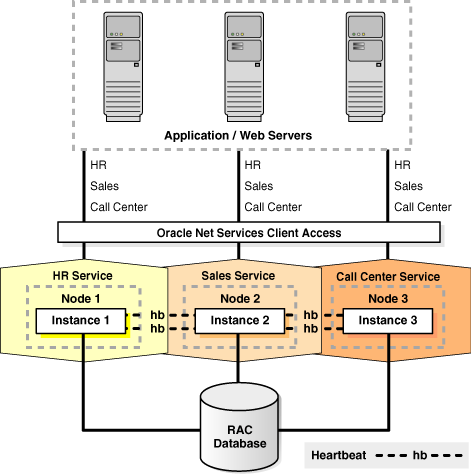
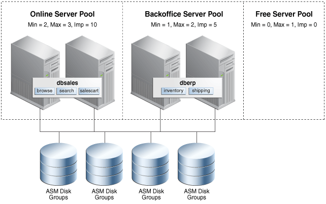
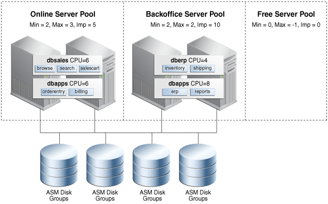

Provides an overview of Oracle Real Application Clusters (Oracle RAC) installation and administration, and various components and functions.

This chapter includes the following topics:

- Overview of Oracle RAC

- Overview of Installing Oracle RAC

- Overview of Oracle Real Application Clusters One Node

- Overview of Oracle Clusterware for Oracle RAC

- Overview of Oracle RAC Architecture and Processing

- Overview of Automatic Workload Management with Dynamic Database Services

- Overview of Server Pools and Policy-Managed Databases

- Overview of Oracle Database Quality of Service Management

- Overview of Hang Manager

- Overview of Oracle Multitenant with Oracle RAC

- Overview of Database In-Memory and Oracle RAC

- Overview of Managing Oracle RAC Environments

### Overview of Oracle RAC

This topic provides an introduction to Oracle RAC and its functionality.

Non-cluster Oracle databases have a one-to-one relationship between the Oracle database and the instance. Oracle RAC environments, however, have a one-to-many relationship between the database and instances. An Oracle RAC database can have several instances, all of which access one database. All database instances must use the same interconnect, which can also be used by Oracle Clusterware.

Oracle RAC databases differ architecturally from non-cluster Oracle databases in that each Oracle RAC database instance also has:

- At least one additional thread of redo for each instance

- An instance-specific undo tablespace

The combined processing power of the multiple servers can provide greater throughput and Oracle RAC scalability than is available from a single server.

A [cluster](glossary.md) comprises multiple interconnected computers or servers that appear as if they are one server to end users and applications. The Oracle RAC option with Oracle Database enables you to cluster Oracle databases. Oracle RAC uses Oracle Clusterware for the infrastructure to bind multiple servers so they operate as a single system.

Oracle Clusterware is a portable cluster management solution that is integrated with Oracle Database. Oracle Clusterware is a required component for using Oracle RAC that provides the infrastructure necessary to run Oracle RAC. Oracle Clusterware also manages resources, such as [Virtual Internet Protocol (VIP)](glossary.md) addresses, databases, listeners, services, and so on. In addition, Oracle Clusterware enables both non-cluster Oracle databases and Oracle RAC databases to use the Oracle high-availability infrastructure. Oracle Clusterware along with Oracle Automatic Storage Management (Oracle ASM) (the two together comprise the [Oracle Grid Infrastructure](glossary.md)) enables you to create a clustered pool of storage to be used by any combination of non cluster and Oracle RAC databases.

Oracle Clusterware is the only clusterware that you need for most platforms on which Oracle RAC operates. If your database applications require vendor clusterware, then you can use such clusterware in conjunction with Oracle Clusterware if that vendor clusterware is certified for Oracle RAC.

Figure 1-1 shows how Oracle RAC is the Oracle Database option that provides a single system image for multiple servers to access one Oracle database. In Oracle RAC, each Oracle instance must run on a separate server.

Figure 1-1 Oracle Database with Oracle RAC Architecture

[Description of "Figure 1-1 Oracle Database with Oracle RAC Architecture"](img_text/haovw002.md)

Traditionally, an Oracle RAC environment is located in one data center. However, you can configure Oracle RAC on an [Oracle Extended Cluster](glossary.md), which is an architecture that provides extremely fast recovery from a site failure and allows for all nodes, at all sites, to actively process transactions as part of a single database cluster. In an extended cluster, the nodes in the cluster are typically dispersed, geographically, such as between two fire cells, between two rooms or buildings, or between two different data centers or cities. For availability reasons, the data must be located at both sites, thus requiring the implementation of disk mirroring technology for storage.

If you choose to implement this architecture, you must assess whether this architecture is a good solution for your business, especially considering distance, latency, and the degree of protection it provides. Oracle RAC on extended clusters provides higher availability than is possible with local Oracle RAC configurations, but an extended cluster may not fulfill all of the disaster-recovery requirements of your organization. A feasible separation provides great protection for some disasters (for example, local power outage or server room flooding) but it cannot provide protection against all types of outages. For comprehensive protection against disasters—including protection against corruptions and regional disasters—Oracle recommends the use of Oracle Data Guard with Oracle RAC, as described in the Oracle Data Guard Concepts and Administration and on the Maximum Availability Architecture (MAA) Web site.

Oracle RAC is a unique technology that provides high availability and scalability for all application types. The Oracle RAC infrastructure is also a key component for implementing the Oracle enterprise grid computing architecture. Having multiple instances access a single database prevents the server from being a single point of failure. Oracle RAC enables you to combine smaller commodity servers into a cluster to create scalable environments that support mission critical business applications. Applications that you deploy on Oracle RAC databases can operate without code changes.

**Related Topics**

- [Introduction to Oracle Clusterware](../cwadd/introduction-to-oracle-clusterware.md)
- [Oracle Grid Infrastructure Installation and Upgrade Guide](../install-and-upgrade.md)
- [Oracle Data Guard and Oracle Real Application Clusters](../sbydb/configuring-data-guard-standby-databases-in-oracle-RAC.md)
- [Maximum Availability Architecture (MAA)](http://www.oracle.com/au/products/database/maa-096107.html)

### Overview of Installing Oracle RAC

Install Oracle Grid Infrastructure and Oracle Database software using Oracle Universal Installer, and create your database with Oracle Database Configuration Assistant (Oracle DBCA).

This ensures that your Oracle RAC environment has the optimal network configuration, database structure, and parameter settings for the environment that you selected.

Alternatively, you can install Oracle RAC using Fleet Patching and Provisioning, which offers all of the advantages of Oracle Universal Installer and Oracle DBCA previously specified. In addition, Fleet Patching and Provisioning allows for standardization and automation.

This section introduces the installation processes for Oracle RAC under the following topics:

- Understanding Compatibility in Oracle RAC Environments

- Oracle RAC Database Management Styles and Database Installation

- Oracle RAC Database Management Styles and Database Creation

- Overview of Extending an Oracle RAC Cluster

  **Note:**

  You must first install Oracle Grid Infrastructure before installing Oracle RAC.

**Related Topics**

- [Oracle Real Application Clusters Installation Guide](../install-and-upgrade.md)
- [Oracle Grid Infrastructure Installation and Upgrade Guide](../install-and-upgrade.md)

#### Understanding Compatibility in Oracle RAC Environments

To run Oracle RAC in configurations with different versions of Oracle Database in the same cluster, you must first install Oracle Grid Infrastructure, which must be the same version, or higher, as the highest version of Oracle Database that you want to deploy in this cluster. For example, to run an Oracle RAC 12c database and an Oracle RAC 18c database in the same cluster, you must install Oracle Grid Infrastructure 18c. Contact My Oracle Support for more information about version compatibility in Oracle RAC environments.

**Note:**

Oracle does not support deploying an Oracle9i cluster in an Oracle Grid Infrastructure 12c, or later, environment.

#### Oracle RAC Database Management Styles and Database Installation

Before installing the Oracle RAC database software and creating respective databases, decide on the management style you want to apply to the Oracle RAC databases, as described in "Overview of Server Pools and Policy-Managed Databases".

The management style you choose impacts the software deployment and database creation. If you choose the administrator-managed database deployment model, using a per-node installation of software, then it is sufficient to deploy the Oracle Database software (the database home) on only those nodes on which you plan to run Oracle Database.

If you choose the policy-managed deployment model, using a per-node installation of software, then you must deploy the software on all nodes in the cluster, because the dynamic allocation of servers to server pools, in principle, does not predict on which server a database instance can potentially run. To avoid instance startup failures on servers that do not host the respective database home, Oracle strongly recommends that you deploy the database software on all nodes in the cluster. When you use a shared Oracle Database home, accessibility to this home from all nodes in the cluster is assumed and the setup needs to ensure that the respective file system is mounted on all servers, as required.

Oracle Universal Installer will only allow you to deploy an Oracle Database home across nodes in the cluster if you previously installed and configured Oracle Grid Infrastructure for the cluster. If Oracle Universal Installer does not give you an option to deploy the database home across all nodes in the cluster, then check the prerequisite, as stated, by Oracle Universal Installer.

During installation, you can choose to create a database during the database home installation. Oracle Universal Installer runs DBCA to create your Oracle RAC database according to the options that you select.

**See Also:**

"Oracle RAC Database Management Styles and Database Creation" for more information if you choose this option

**Note:**

Before you create a database, a default listener must be running in the Oracle Grid Infrastructure home. If a default listener is not present in the Oracle Grid Infrastructure home, then DBCA returns an error instructing you to run NETCA from the Oracle Grid Infrastructure home to create a default listener.

The Oracle RAC software is distributed as part of the Oracle Database installation media. By default, the Oracle Database software installation process installs the Oracle RAC option when it recognizes that you are performing the installation on a cluster. Oracle Universal Installer installs Oracle RAC into a directory structure referred to as the Oracle home, which is separate from the Oracle home directory for other Oracle software running on the system. Because Oracle Universal Installer is cluster aware, it installs the Oracle RAC software on all of the nodes that you defined to be part of the cluster.

**Related Topics**

- Overview of Server Pools and Policy-Managed Databases
- Oracle RAC Database Management Styles and Database Creation
- [Oracle Database Net Services Administrator's Guide](../netag/managing-oracle-net-services.md)

#### Oracle RAC Database Management Styles and Database Creation

Part of Oracle Database deployment is the creation of the database.

You can choose to create a database as part of the database software deployment, or you can choose to only deploy the database software, first, and then, subsequently, create any database that is meant to run out of the newly created Oracle home by using DBCA. In either case, you must consider the management style that you plan to use for the Oracle RAC databases.

For administrator-managed databases, you must ensure that the database software is deployed on the nodes on which you plan to run the respective database instances. You must also ensure that these nodes have access to the storage in which you want to store the database files. Oracle recommends that you select Oracle ASM during database installation to simplify storage management. Oracle ASM automatically manages the storage of all database files within disk groups.

For policy-managed databases, you must ensure that the database software is deployed on all nodes on which database instances can potentially run, given your active server pool setup. You must also ensure that these nodes have access to the storage in which you want to store the database files. Oracle recommends using Oracle ASM, as previously described for administrator-managed databases.

Server pools are a feature of Oracle Grid Infrastructure (specifically Oracle Clusterware). There are different ways you can set up server pools on the Oracle Clusterware level, and Oracle recommends you create server pools for database management before you create the respective databases. DBCA, however, will present you with a choice of either using precreated server pools or creating a new server pool, when you are creating a policy-managed database. Whether you can create a new server pool during database creation depends on the server pool configuration that is active at the time.

By default, DBCA creates one service for your Oracle RAC installation. This is the default database service and should not be used for user connectivity. The default database service is typically identified using the combination of the `DB_NAME` and `DB_DOMAIN` initialization parameters: `db_name.db_domain`. The default service is available on all instances in an Oracle RAC environment, unless the database is in restricted mode.

**Note:**

Oracle recommends that you reserve the default database service for maintenance operations and create dynamic database services for user or application connectivity as a post-database-creation step, using either SRVCTL or Oracle Enterprise Manager. DBCA no longer offers a dynamic database service creation option for Oracle RAC databases. For Oracle RAC One Node databases, you must create at least one dynamic database service.

**Related Topics**

- Oracle RAC Database Management Styles and Database Installation
- [Oracle Clusterware Administration and Deployment Guide](../cwadd/policy-based-cluster-and-capacity-management.md)

#### Overview of Extending an Oracle RAC Cluster

If you want to extend the Oracle RAC cluster (also known as cloning) and add nodes to the existing environment after your initial deployment, then you must to do this on multiple layers, considering the management style that you currently use in the cluster.

Oracle provides various means of extending an Oracle RAC cluster. In principle, you can choose from the following approaches to extend the current environment:

- Fleet Patching and Provisioning to provision new Oracle RAC databases and other software

- Cloning using cloning scripts

- Adding nodes using the `addnode.sh` (`addnode.bat` on Windows) script

Both approaches are applicable, regardless of how you initially deployed the environment. Both approaches copy the required Oracle software on to the node that you plan to add to the cluster. Software that gets copied to the node includes the Oracle Grid Infrastructure software and the Oracle database homes.

For Oracle database homes, you must consider the management style deployed in the cluster. For administrator-managed databases, you must ensure that the database software is deployed on the nodes on which you plan to run the respective database instances. For policy-managed databases, you must ensure that the database software is deployed on all nodes on which database instances can potentially run, given your active server pool setup. In either case, you must first deploy Oracle Grid Infrastructure on all nodes that are meant to be part of the cluster.

**Note:**

Oracle cloning is not a replacement for cloning using Oracle Enterprise Manager as part of the Provisioning Pack. When you clone Oracle RAC using Oracle Enterprise Manager, the provisioning process includes a series of steps where details about the home you want to capture, the location to which you want to deploy, and various other parameters are collected.

For new installations or if you install only one Oracle RAC database, use the traditional automated and interactive installation methods, such as Oracle Universal Installer, Fleet Patching and Provisioning, or the Provisioning Pack feature of Oracle Enterprise Manager. If your goal is to add or delete Oracle RAC from nodes in the cluster, you can use the procedures detailed in "Adding and Deleting Oracle RAC from Nodes on Linux and UNIX Systems".

The cloning process assumes that you successfully installed an Oracle Clusterware home and an Oracle home with Oracle RAC on at least one node. In addition, all root scripts must have run successfully on the node from which you are extending your cluster database.

**Related Topics**

- [Cloning Oracle RAC to Nodes in a New Cluster](cloning-oracle-rac-to-nodes-in-a-new-cluster.md)
- [Adding and Deleting Oracle RAC from Nodes on Linux and UNIX Systems](adding-and-deleting-oracle-rac-from-nodes-on-linux-and-unix-systems.md)
- [Adding and Deleting Oracle RAC from Nodes on Windows Systems](adding-and-deleting-oracle-rac-from-nodes-on-windows-systems.md)
- [Oracle Clusterware Administration and Deployment Guide](../fppad/fleet-patching-provisioning.md)

**See Also:**

- Oracle Clusterware Administration and Deployment Guide for more information about Fleet Patching and Provisioning

- Oracle Enterprise Manager online help system for more information about the Provisioning Pack

### Overview of Oracle Real Application Clusters One Node

Oracle Real Application Clusters One Node (Oracle RAC One Node) is an option to Oracle Database Enterprise Edition available since Oracle Database 11g release 2 (11.2).

Oracle RAC One Node is a single instance of an Oracle RAC-enabled database running on one node in the cluster, only, under normal operations. This option adds to the flexibility that Oracle offers for database consolidation while reducing management overhead by providing a standard deployment for Oracle databases in the enterprise. Oracle RAC One Node database requires Oracle Grid Infrastructure and, therefore, requires the same hardware setup as an Oracle RAC database.

Oracle supports Oracle RAC One Node on all platforms on which Oracle RAC is certified. Similar to Oracle RAC, Oracle RAC One Node is certified on Oracle Virtual Machine (Oracle VM). Using Oracle RAC or Oracle RAC One Node with Oracle VM increases the benefits of Oracle VM with the high availability and scalability of Oracle RAC.

With Oracle RAC One Node, there is no limit to server scalability and, if applications grow to require more resources than a single node can supply, then you can upgrade your applications online to Oracle RAC. If the node that is running Oracle RAC One Node becomes overloaded, then you can relocate the instance to another node in the cluster. With Oracle RAC One Node you can use the Online Database Relocation feature to relocate the database instance with no downtime for application users. Alternatively, you can limit the CPU consumption of individual database instances per server within the cluster using Resource Manager Instance Caging and dynamically change this limit, if necessary, depending on the demand scenario.

Using the Single Client Access Name (SCAN) to connect to the database, clients can locate the service independently of the node on which it is running. Relocating an Oracle RAC One Node instance is therefore mostly transparent to the client, depending on the client connection. Oracle recommends to use either Application Continuity and Oracle Fast Application Notification or Transparent Application Failover to minimize the impact of a relocation on the client.

Oracle RAC One Node databases are administered slightly differently from Oracle RAC or non-cluster databases. For administrator-managed Oracle RAC One Node databases, you must monitor the candidate node list and make sure a server is always available for failover, if possible. Candidate servers reside in the Generic server pool and the database and its services will fail over to one of those servers.

For policy-managed Oracle RAC One Node databases, you must ensure that the server pools are configured such that a server will be available for the database to fail over to in case its current node becomes unavailable. In this case, the destination node for online database relocation must be located in the server pool in which the database is located. Alternatively, you can use a server pool of size 1 (one server in the server pool), setting the minimum size to 1 and the importance high enough in relation to all other server pools used in the cluster, to ensure that, upon failure of the one server used in the server pool, a new server from another server pool or the Free server pool is relocated into the server pool, as required.

**Note:**

- Oracle RAC One Node supports Transaction Guard and Application Continuity for failing clients over.

- To prepare for all failure possibilities, you must add at least one Dynamic Database Service (Oracle Clusterware-managed database service) to an Oracle RAC One Node database.

**Related Topics**

- [Oracle Real Application Clusters Installation Guide for Linux and UNIX](../rilin/installing-oracle-rac-and-oracle-rac-one-node.md)
- [Transaction Guard for Improving Client Failover](ensuring-application-continuity.md)

### Overview of Oracle Clusterware for Oracle RAC

Oracle Clusterware provides a complete, integrated clusterware management solution on all Oracle Database platforms.

This clusterware functionality provides all of the features required to manage your cluster database including node membership, group services, global resource management, and high availability functions.

You can install Oracle Clusterware independently or as a prerequisite to the Oracle RAC installation process. Oracle Database features, such as services, use the underlying Oracle Clusterware mechanisms to provide advanced capabilities. Oracle Database also continues to support select third-party clusterware products on specified platforms.

Oracle Clusterware is designed for, and tightly integrated with, Oracle RAC. You can use Oracle Clusterware to manage high-availability operations in a cluster. When you create an Oracle RAC database using any of the management tools, the database is registered with and managed by Oracle Clusterware, along with the other required components such as the VIP address, the Single Client Access Name (SCAN) (which includes the SCAN VIPs and the SCAN listener), Oracle Notification Service, and the Oracle Net listeners. These resources are automatically started when the node starts and automatically restart if they fail. The Oracle Clusterware daemons run on each node.

Anything that Oracle Clusterware manages is known as a CRS resource. A CRS resource can be a database, an instance, a service, a listener, a VIP address, or an application process. Oracle Clusterware manages CRS resources based on the resource's configuration information that is stored in the Oracle Cluster Registry (OCR). You can use SRVCTL commands to administer any Oracle-defined CRS resources. Oracle Clusterware provides the framework that enables you to create CRS resources to manage any process running on servers in the cluster which are not predefined by Oracle. Oracle Clusterware stores the information that describes the configuration of these components in OCR that you can administer.

This section includes the following topics:

- Overview of Oracle Flex Clusters

- Overview of Reader Nodes

- Overview of Local Temporary Tablespaces

**Related Topics**

- [Oracle Clusterware Administration and Deployment Guide](../cwadd/managing-oracle-cluster-registry-and-voting-files.md)
- [Oracle Clusterware Administration and Deployment Guide](../cwadd/oracle-flex-clusters.md)

#### Overview of Oracle Flex Clusters

Oracle Flex Clusters provide a platform for a variety of applications, including Oracle RAC databases with large numbers of nodes.

Oracle Flex Clusters also provide a platform for other service deployments that require coordination and automation for high availability.

All nodes in an Oracle Flex Cluster belong to a single Oracle Grid Infrastructure cluster. This architecture centralizes policy decisions for deployment of resources based on application needs, to account for various service levels, loads, failure responses, and recovery.

**Related Topics**

- [Oracle Clusterware Administration and Deployment Guide](../cwadd/oracle-flex-clusters.md)

#### Overview of Reader Nodes

Reader nodes are instances of an Oracle RAC database that provide read-only access, primarily for reporting and analytical purposes.

The advantage of read-only instances is that they do not suffer performance impacts like normal (read/write) database instances do during cluster reconfigurations, for example, when a node is undergoing maintenance or suffers a failure.

You can create services to direct queries to read-only instances running on reader nodes. These services can use parallel query to further speed up performance. Oracle recommends that you size the memory in these reader nodes as high as possible so that parallel queries can use the memory for best performance.

While it is possible for a reader node to host a writable database instance, Oracle recommends that reader nodes be dedicated to hosting read-only instances to achieve the best performance.

#### Overview of Local Temporary Tablespaces

Oracle uses local temporary tablespaces to write spill-overs to the local (non-shared) temporary tablespaces which are created on local disks on the reader nodes.

It is still possible for SQL operations, such as hash aggregation, sort, hash join, creation of cursor-duration temporary tables for the `WITH` clause, and star transformation to spill over to disk (specifically to the global temporary tablespace on shared disks). Management of the local temporary tablespace is similar to that of the existing temporary tablespace.

Local temporary tablespaces improve temporary tablespace management in read-only instances by:

- Storing temp files in reader node private storage to take advantage of the I/O benefits of local storage.

- Avoiding expensive cross-instance temporary tablespace management.

- Increased addressability of temporary tablespace.

- Improving instance warm-up performance by eliminating on-disk space metadata management.

**Note:**

You cannot use local temporary tablespaces to store database objects, such as tables or indexes. This same restriction is also true for space for Oracle global temporary tables.

This section includes the following topics:

- Parallel Execution Support for Cursor-Duration Temporary Tablespaces

- Local Temporary Tablespace Organization

- Temporary Tablespace Hierarchy

- Local Temporary Tablespace Features

- Metadata Management of Local Temporary Files

- DDL Support for Local Temporary Tablespaces

- Local Temporary Tablespaces for Users

- Atomicity Requirement for Commands

- Local Temporary Tablespace and Dictionary Views

##### Parallel Execution Support for Cursor-Duration Temporary Tablespaces

The temporary tablespaces created for the `WITH` clause and star transformation exist in the temporary tablespace on the shared disk. A set of parallel query child processes load intermediate query results into these temporary tablespaces, which are then read later by a different set of child processes. There is no restriction on how these child processes reading these results are allocated, as any parallel query child process on any instance can read the temporary tablespaces residing on the shared disk.

For read-write and read-only instance architecture, as the parallel query child processes load intermediate results to the local temporary tablespaces of these instances, the parallel query child processes belonging to the instance where the intermediate results are stored share affinity with the reads for the intermediate results and can thus read them.

##### Local Temporary Tablespace Organization

You can create local temporary tablespace as follows:

    CREATE LOCAL TEMPORARY TABLESPACE TEMPFILE\
       '/u01/app/oracle/database/12.2.0.1/dbs/temp_file'\
       EXTENT MANAGEMENT LOCAL UNIFORM SIZE 1M AUTOEXTEND ON;

- Creation of a local temporary tablespace results in the creation of local temporary files on every instance and not a single file, as is currently true for shared global temporary tablespaces.

- You can create local temporary tablespaces for both read-only and read-write instances. For example:

      CREATE LOCAL TEMPORARY TABLESPACE TEMPFILE\
        ‘/u01/app/oracle/database/12.2.0.1/dbs/temp_file’\
        EXTENT MANAGEMENT LOCAL UNIFORM SIZE 1M AUTOEXTEND ON;

##### Temporary Tablespace Hierarchy

When you define local temporary tablespace and shared (existing) temporary tablespace, there is a hierarchy in which they are used. To understand the hierarchy, remember that there can be multiple shared temporary tablespaces in a database, such the default shared temporary tablespace for the database and multiple temporary tablespaces assigned to individual users. If a user has a shared temporary tablespace assigned, then that tablespace is used first, otherwise the database default temporary tablespace is used.

Once a tablespace has been selected for spilling during query processing, there is no switching to another tablespace. For example, if a user has a shared temporary tablespace assigned and during spilling it runs out of space, then there is no switching to an alternative tablespace. The spilling, in that case, will result in an error. Additionally, remember that shared temporary tablespaces are shared among instances.

The allocation of temporary space for spilling to a local temporary tablespace differs between read-only and read-write instances. For read-only instances, the following is the priority of selecting which temporary location to use for spills:

1.  Allocate from a user's local temporary tablespace.

2.  Allocate from the database default local temporary tablespace.

3.  Allocate from a user's temporary tablespace.

4.  Allocate from the database default temporary tablespace.

**Note:**

If there is no local temporary tablespace in the database, then read-only instances will spill to shared temporary tablespace.

For read-write instances, the priority of allocation differs from the preceding allocation order, as shared temporary tablespaces are given priority, as follows:

1.  Allocate from a user’s shared temporary tablespace.

2.  Allocate from a user’s local temporary tablespace.

3.  Allocate from the database default shared temporary tablespace.

4.  Allocate from the database default local temporary tablespace.

##### Local Temporary Tablespace Features

Instances cannot share local temporary tablespace, hence one instance cannot take local temporary tablespace from another. If an instance runs out of temporary tablespace during spilling, then the statement resutls in an error.

- Local temporary tablespace support only one `BIGFILE` per tablespace.

- To address contention issues arising from having only one `BIGFILE`-based local temporary tablespace, multiple local temporary tablespaces can be assigned to different users, as default.

- A database administrator can specify the default temporary tablespace for a user using `ALTER USER` syntax. For example:

      ALTER USER MAYNARD LOCAL TEMPORARY TABLESPACE temp_ts;

- A user can be configured with two default temporary tablespaces:

  - One local temporary when the user is connected to the read-only instance running on reader nodes.

  - One shared temporary tablespace to be used when the same user is connected on the read-write instances running on a Hub Node.

##### Metadata Management of Local Temporary Files

Currently, temporary file information (such as file name, creation size, creation SCN, temporary block size, and file status) is stored in the control file along with the initial and max files, as well as auto extent attributes. However, the information about local temporary files in the control file is common to all applicable instances.

Instance-specific information, such as bitmap for allocation, current size for a temporary file, and the file status, is stored in the SGA on instances and not in the control file because this information can be different for different instances. When an instance starts up, it reads the information in the control file and creates the temporary files that constitute the local temporary tablespace for that instance. If there are two or more instances running on a node, then each instance will have its own local temporary files.

For local temporary tablespaces, there is a separate file for each involved instance. The local temporary file names follow a naming convention such that the instance numbers are appended to the temporary file names specified while creating the local temporary tablespace.

For example, assume that a read-only node, N1, runs two Oracle read-only database instances with numbers 3 and 4. The following DDL command creates two files on node N1—`/temp/temp_file_3` and `/temp/temp_file_4`, for instance 3 and 4 respectively:

    CREATE LOCAL TEMPORARY TABLESPACE TEMPFILE  '/temp/temp_file'\
       EXTENT MANAGEMENT LOCAL UNIFORM SIZE 1M AUTOEXTEND ON;

Assuming that there are two read-write instances (instance numbers 1 and 2) and two read-only instances (instance numbers 3 and 4), the following DDL command creates four files—`/temp/temp_file_all_1` and `/temp/temp_file_all_2` for instances 1 and 2, respectively, and `/temp/temp_file_all_3` and `/temp/temp_file_all_4` for instances 3 and 4, respectively:

    CREATE LOCAL TEMPORARY TABLESPACE temp_ts TEMPFILE  '/temp/temp_file_all'\
       EXTENT MANAGEMENT LOCAL UNIFORM SIZE 1M AUTOEXTEND ON;

##### DDL Support for Local Temporary Tablespaces

You manage local temporary tablespaces and temporary files with either `ALTER TABLESPACE`, `ALTER DATABASE`, or both DDL commands. All DDL commands related to local temporary tablespace management and creation are run from the read-write instances. Running all other DDL commands will affect all instances in a homogeneous manner.

For example, the following command resizes the temporary files on all read-only instances:

    ALTER TABLESPACE temp_ts RESIZE 1G;

For local temporary tablespaces, Oracle supports the allocation options and their restrictions currently active for temporary files.

To run a DDL command on a local temporary tablespace on a read-only instance, there must be at least one read-only instance in the cluster. Users can assign a default local temporary tablespace to the database with a `DEFAULT LOCAL TEMPORARY TABLESPACE` clause appended to the `ALTER DATABASE` command.

For example:

    ALTER DATABASE DEFAULT LOCAL TEMPORARY TABLESPACE temp_ts;

A database administrator can specify default temporary tablespace when creating the database, as follows:

    CREATE DATABASE .. DEFAULT TEMPORARY TABLESPACE temp_ts_for_dbtemp_ts TEMPFILE\
       '/temp/temp_file_for_db' EXTENT MANAGEMENT LOCAL UNIFORM SIZE 1M AUTOEXTEND ON;

It is not possible to specify default local temporary tablespaces using the `CREATE DATABASE` command. When you create a database, its default local temporary tablespace will point to the default shared temporary tablespace. Database administrators must run the `ALTER DATABASE` command to assign an existing local temporary tablespace as the default for the database.

##### Local Temporary Tablespace for Users

When you create a user without explicitly specifying shared or local temporary tablespace, the user inherits shared and local temporary tablespace from the corresponding default database tablespaces. You can specify default local temporary tablespace for a user, as follows:

    CREATE USER new_user IDENTIFIED BY new_user LOCAL TEMPORARY TABLESPACE temp_ts_for_all;

You can change the local temporary tablespace for a user using the `ALTER USER` command, as follows:

    ALTER USER maynard LOCAL TEMPORARY TABLESPACE temp_ts;

As previously mentioned, default user local temporary tablespace can be shared temporary space. Consider the following items for the `ALTER USER...TEMPORARY TABLESPACE` command:

- You can change the user default local temporary tablespace to any existing local temporary tablespace.

- If you want to set the user default local temporary tablespace to a shared temporary tablespace, `T`, then `T` must be the same as the default shared temporary tablespace.

- If a default user local temporary tablespace points to a shared temporary tablespace, then, when you change the default shared temporary tablespace of the user, you also change the default local temporary tablespace to that tablespace.

Following are some examples of local temporary space management using the `ALTER` command:

- To take a local temporary tablespace offline:

      ALTER DATABASE TEMPFILE ‘/temp/temp_file’ OFFLINE;

- To decrease the size of a local temporary tablespace:

      ALTER TABLESPACE temp_ts SHRINK SPACE KEEP 20M

- To change the auto-extension attributes of a local temporary file:

      ALTER TABLESPACE temp_ts AUTOEXTEND ON NEXT 20G

- To resize a local temporary file:

      ALTER TABLESPACE temp_ts RESIZE 10G

  **Note:**

  When you resize a local temporary file, it applies to individual files.

Some read-only instances may be down when you run any of the preceding commands. This does not prevent the commands from succeeding because, when a read-only instance starts up later, it creates the temporary files based on information in the control file. Creation is fast because Oracle reformats only the header block of the temporary file, recording information about the file size, among other things. If you cannot create any of the temporary files, then the read-only instance stays down. Commands that were submitted from a read-write instance are replayed, immediately, on all open read-only instances.

##### Atomicity Requirement for Commands

All the commands that you run from the read-write instances are performed in an atomic manner, which means the command succeeds only when it succeeds on all live instances.

##### Local Temporary Tablespace and Dictionary Views

Oracle extended dictionary views to display information about local temporary tablespaces. Oracle made the following changes:

- All the diagnosibility information related to temporary tablespaces and temporary files exposed through AWR, SQL monitor, and other utilities, is also available for local temporary tablespaces and local temporary files. This information is available with the exisiting dictionary views for temporary tablespaces and temporary files: `DBA_TEMP_FILES`, `DBA_TEMP_FREE_SPACE`.

- The `USER_TABLESPACES` and `DBA_TABLESPACES` dictionary view are extended by a column, called `SHARED`, that indicates whether the temporary file is local or shared.

- The `DBA_TEMP_FILES` dictionary view is extended by two columns: `SHARED` and `INST_ID`. The `SHARED` column indicates whether the temp file is local or shared. The `INST_ID` column contains the instance number. For shared temporary files, there is a single row per file, and the `INST_ID` is null. For local temporary files, this column contains information about temporary files per instance, such as the size of the file in bytes (`BYTES` column).

- The `DBA_TEMP_FREE_SPACE` dictionary view is extended by two columns: `SHARED` and `INST_ID`. The `SHARED` column indicates whether the temporary file is local or shared. The `INST_ID` column contains the instance number. For shared temporary files, there is a single row per file, and the `INST_ID` is null. For local temporary files, this column contains information about temporary files per instance, such as total free space available (`FREE_SPACE` column).

- In the dictionary views, such as `DBA_TABLESPACES`, Oracle distinguishes the type of the tablespace using the `SHARED` column with the following values:

  - `SHARED`: for shared temporary tablespace

  **Note:**

  Currently, spills onto temporary tablespace for queries (such as sort and hash join spills) are automatically encrypted. This is also true for spills to local temporary tablespace.

**Related Topics**

- [Oracle Database SQL Language Reference](../sqlrf/CREATE-TABLESPACE.md)

### Overview of Oracle RAC Architecture and Processing

At a minimum, Oracle RAC requires Oracle Clusterware software infrastructure to provide concurrent access to the same storage and the same set of data files from all nodes in the cluster, a communications protocol for enabling interprocess communication (IPC) across the nodes in the cluster, enable multiple database instances to process data as if the data resided on a logically combined, single cache, and a mechanism for monitoring and communicating the status of the nodes in the cluster.

The following sections describe these concepts in more detail:

- Understanding Cluster-Aware Storage Solutions

- Oracle RAC and Network Connectivity

- Overview of Using Dynamic Database Services to Connect to Oracle Databases

- Restricted Service Registration in Oracle RAC

- About Oracle RAC Software Components

- About Oracle RAC Background Processes

#### Understanding Cluster-Aware Storage Solutions

An Oracle RAC database is a [shared everything](glossary.md) database. All data files, control files, SPFILEs, and redo log files in Oracle RAC environments must reside on cluster-aware shared disks, so that all of the cluster database instances can access these storage components. Because Oracle RAC databases use a shared everything architecture, Oracle RAC requires cluster-aware storage for all database files.

In Oracle RAC, the Oracle Database software manages disk access and is certified for use on a variety of storage architectures. It is your choice how to configure your storage, but you must use a supported cluster-aware storage solution. Oracle Database provides the following storage options for Oracle RAC:

- Oracle Automatic Storage Management (Oracle ASM)

  Oracle recommends this solution to manage your storage.

- A certified cluster file system

  - Oracle recommends Oracle Automatic Storage Management Cluster File System (Oracle ACFS).

  - A third-party cluster file system on a cluster-aware volume manager that is certified for Oracle RAC. For example:

    - Oracle OCFS2 (Linux, only)

    - IBM GPFS (IBM AIX, only)

- Certified network file system (NFS) solution

#### Oracle RAC and Network Connectivity

All nodes in an Oracle RAC environment must connect to at least one Local Area Network (LAN) (commonly referred to as the public network) to enable users and applications to access the database.

In addition to the public network, Oracle RAC requires private network connectivity used exclusively for communication between the [node](glossary.md)s and database instances running on those nodes. This network is commonly referred to as the interconnect.

The interconnect network is a private network that connects all of the servers in the cluster. The interconnect network must use at least one switch and a Gigabit Ethernet adapter.

**Note:**

- Oracle supports interfaces with higher bandwidth but does not support using crossover cables with the interconnect.

- Do not use the interconnect (the private network) for user communication, because [Cache Fusion](glossary.md) uses the interconnect for interinstance communication.

You can configure Oracle RAC to use either the User Datagram Protocol (UDP) or Reliable Data Socket (RDS) protocols for inter-instance communication on the interconnect. Oracle Clusterware uses the same interconnect using the UDP protocol, but cannot be configured to use RDS.

An additional network connectivity is required when using [Network Attached Storage (NAS)](glossary.md). Network attached storage can be typical NAS devices, such as NFS filers, or can be storage that is connected using Fibre Channel over IP, for example. This additional network communication channel should be independent of the other communication channels used by Oracle RAC (the public and private network communication). If the storage network communication must be converged with one of the other network communication channels, then you must ensure that storage-related communication gets first priority.

#### Overview of Using Dynamic Database Services to Connect to Oracle Databases

Applications should use the Dynamic Database Services feature to connect to an Oracle database over the public network.

Dynamic Database Services enable you to define rules and characteristics to control how users and applications connect to database instances. These characteristics include a unique name, workload balancing and failover options, and high availability characteristics.

Users can access an Oracle RAC database using a client/server configuration or through one or more middle tiers, with or without connection pooling. By default, a user connection to an Oracle RAC database is established using the TCP/IP protocol but Oracle supports other protocols. Oracle RAC database instances must be accessed through the SCAN for the cluster.

**Related Topics**

- Overview of Automatic Workload Management with Dynamic Database Services

#### Overview of Virtual IP Addresses

Node VIPs are virtual IP (VIP) addresses that clients use to connect to an Oracle RAC database.

Oracle Clusterware hosts node VIP addresses on the public network. A typical connect attempt from a database client to an Oracle RAC database instance can be summarized, as follows:

1.  The database client connects to SCAN (which includes a SCAN VIP on a public network), providing the SCAN listener with a valid service name.

2.  The SCAN listener then determines which database instance hosts this service and routes the client to the local or node listener on the respective node.

3.  The node listener, listening on a node VIP and a given port, retrieves the connection request and connects the client to the an instance on the local node.

If multiple public networks are used on the cluster to support client connectivity through multiple subnets, then the preceding operation is performed within a given subnet.

If a node fails, then the VIP address fails over to another node on which the VIP address can accept TCP connections, but it does not accept connections to the Oracle database. Clients that attempt to connect to a VIP address not residing on its home node receive a rapid connection refused error instead of waiting for TCP connect timeout messages. When the network on which the VIP is configured comes back online, Oracle Clusterware fails back the VIP to its home node, where connections are accepted. Generally, VIP addresses fail over when:

- The node on which a VIP address runs fails
- All interfaces for the VIP address fail
- All interfaces for the VIP address are disconnected from the network

Oracle RAC supports multiple public networks to enable access to the cluster through different subnets. Each network resource represents its own subnet and each database service uses a particular network to access the Oracle RAC database. Each network resource is a resource managed by Oracle Clusterware, which enables the VIP behavior previously described.

SCAN is a single network name defined either in your organization's Domain Name Server (DNS) or in the Grid Naming Service (GNS) that round robins to three IP addresses. Oracle recommends that all connections to the Oracle RAC database use the SCAN in their client connection string. Incoming connections are load balanced across the active instances providing the requested service through the three SCAN listeners. With SCAN, you do not have to change the client connection even if the configuration of the cluster changes (nodes added or removed). SCAN fully supports multiple subnets, which means you can create one SCAN for each subnet in which you want the cluster to operate.

#### Restricted Service Registration in Oracle RAC

The valid node checking feature provides the ability to configure and dynamically update a set of IP addresses or subnets from which registration requests are allowed by the listener.

Database instance registration with a listener succeeds only when the request originates from a valid node. The network administrator can specify a list of valid nodes, excluded nodes, or disable valid node checking altogether. The list of valid nodes explicitly lists the nodes and subnets that can register with the database. The list of excluded nodes explicitly lists the nodes that cannot register with the database. The control of dynamic registration results in increased manageability and security of Oracle RAC deployments.

By default, the SCAN listener agent sets `REMOTE_ADDRESS_REGISTRATION_``listener_name` to a private IP endpoint. The SCAN listener accepts registration requests only from the private network. Remote nodes that are not accessible to the private network of the SCAN listener must be included in the list of valid nodes by using the `registration_invited_nodes_``alias` parameter in the `listener.ora` file, or by modifying the SCAN listener using the command-line interface, SRVCTL.

**Note:**

Starting with Oracle Grid Infrastructure 12c, for a SCAN listener, if the `VALID_NODE_CHECKING_REGISTRATION_``listener_name` and `REGISTRATION_INVITED_NODES_``listener_name` parameters are set in the `listener.ora` file, then the listener agent overwrites these parameters.

If you use the SRVCTL utility to set the `invitednodes` and `invitedsubnets` values, then the listener agent automatically sets `VALID_NODE_CHECKING_REGISTRATION_``listener_name` to SUBNET and sets `REGISTRATION_INVITED_NODES_``listener_name` to the specified list in the `listener.ora` file.

For other listeners managed by CRS, the listener agent sets `VALID_NODE_CHECKING_REGISTRATION_``listener_name` to be SUBNET in the `listener.ora` file only if it is not already set in the `listener.ora` file. The SRVCTL utility does not support setting the `invitednodes` and `invitedsubnets` values for a non-SCAN listener. The listener agent does not update `REGISTRATION_INVITED_NODES_``listener_name` in the `listener.ora` file for a non SCAN listener.

#### About Oracle RAC Software Components

Oracle RAC databases generally have two or more database instances that each contain memory structures and background processes.

An Oracle RAC database has the same processes and memory structures as a noncluster Oracle database and additional processes and memory structures that are specific to Oracle RAC. Any one instance's database view is nearly identical to any other instance's view in the same Oracle RAC database; the view is a single system image of the environment.

Each instance has a buffer cache in its System Global Area (SGA). Using Cache Fusion, Oracle RAC environments logically combine each instance's buffer cache to enable the instances to process data as if the data resided on a logically combined, single cache.

**Note:**

- The In-Memory Transaction Manager integrates with the Cache Fusion protocol.

- The SGA size requirements for Oracle RAC are greater than the SGA requirements for noncluster Oracle databases due to Cache Fusion.

To ensure that each Oracle RAC database instance obtains the block that it requires to satisfy a query or transaction, Oracle RAC instances use two processes, the Global Cache Service (GCS) and the Global Enqueue Service (GES). The GCS and GES maintain records of the statuses of each data file and each cached block using a Global Resource Directory (GRD). The GRD contents are distributed across all of the active instances, which effectively increases the size of the SGA for an Oracle RAC instance.

After one instance caches data, any other instance within the same cluster database can acquire a block image from another instance in the same database faster than by reading the block from disk. Therefore, Cache Fusion moves current blocks between instances rather than re-reading the blocks from disk. When a consistent block is needed or a changed block is required on another instance, Cache Fusion transfers the block image directly between the affected instances. Oracle RAC uses the private interconnect for interinstance communication and block transfers. The GES Monitor and the Instance Enqueue Process manage access to Cache Fusion resources and enqueue recovery processing.\\

Cache Fusion monitors the latency on the private networks and the service time on the disks, and automatically chooses the best path. If shared disks include low latency SSDs, then Oracle automatically chooses the best path.

**Related Topics**

- [Oracle Database In-Memory Guide](../inmem/concepts-for-the-im-column-store.md)

#### About Oracle RAC Background Processes

The **global cache service** (GCS) and the **global enqueue service** (GES) processes, along with the **global resource directory** (GRD) collaborate to enable Cache Fusion.

The Oracle RAC processes and their identifiers are as follows:

- `ACMS`: Atomic Controlfile to Memory Service (`ACMS`)

  In Oracle RAC environments, the `ACMS` process on each instance is an agent that contributes to ensuring a distributed SGA memory update is either globally committed on success or globally terminated if a failure occurs.

- `GTX0-j`: Global Transaction Process

  The `GTX0-j` process provides transparent support for XA global transactions in Oracle RAC environments. The database autotunes the number of these processes based on the workload of XA global transactions.

- `LMON`: Global Enqueue Service Monitor

  The `LMON` process monitors global enqueues and resources across the cluster and performs global enqueue recovery operations.

- `LMD`: Global Enqueue Service Daemon

  The `LMD` process manages incoming remote resource requests within each instance.

- `LMS`: Global Cache Service Process

  The `LMS` process maintains records of the data file statuses and each cached block by recording information in the **global resource directory** (GRD). The `LMS` process also controls the flow of messages to remote instances and manages global data block access and transmits block images between the buffer caches of different instances. This processing is part of Cache Fusion.

- `LCK0`: Instance Enqueue Process

  The `LCK0` process manages non-Cache Fusion resource requests such as library and row cache requests.

- `RMS``n`: Oracle RAC Management Processes (`RMS``n`)

  The `RMS``n` processes perform manageability tasks for Oracle RAC. Tasks that are accomplished by an `RMS``n` process include the creation of resources that are related to Oracle RAC when new instances are added to the clusters.

- `RSMN`: Remote Slave Monitor manages background secondary process creation and communication on remote instances. These background secondary processes perform tasks on behalf of a coordinating process running in another instance.

**Note:**

Many of the Oracle Database components that this section describes are in addition to the components that are described for single-instance Oracle databases in Oracle Database Concepts.

**Related Topics**

- [Oracle Database Concepts](../cncpt/introduction-to-oracle-database.md)

### Overview of Automatic Workload Management with Dynamic Database Services

Services represent groups of applications with common attributes, service level thresholds, and priorities.

Application functions can be divided into workloads identified by services. For example, Oracle E-Business Suite can define a service for each responsibility, such as general ledger, accounts receivable, order entry, and so on. A service can span one or more instances of an Oracle database, multiple databases in a global cluster, and a single instance can support multiple services. The number of instances that are serving the service is transparent to the application. Services provide a single system image to manage competing applications, and allow each workload to be managed as a unit.

Middle tier applications and clients select a service by specifying the service name as part of the connection in the TNS connect string. For example, data sources for Oracle WebLogic Server are set to route to a service. Using Net Easy\*Connection, this connection comprises simply the service name and network address, as follows: `user_name``/``password``@SCAN/``service_name`. Server-side work such as Oracle Scheduler, Parallel Query, and Oracle GoldenGate queues set the service name as part of the workload definition. For Oracle Scheduler, jobs are assigned to job classes and job classes execute within services. For Parallel Query and Parallel DML, the query coordinator connects to a service and the parallel query slaves inherit the service for the duration of the parallel execution. For Oracle GoldenGate, streams queues are accessed using services. Work executing under a service inherits the thresholds and attributes for the service and is measured as part of the service.

Oracle Database Resource Manager binds services to consumer groups and priorities. This allows the database to manage the services in the order of their importance. For example, the DBA can define separate services for high priority online users and lower priority internal reporting applications. Likewise, the DBA can define Gold, Silver and Bronze services to prioritize the order in which requests are serviced for the same application. When planning the services for a system, the plan should include the priority of each service relative to the other services. In this way, Oracle Database Resource Manager can satisfy the priority-one services first, followed by the priority-two services, and so on.

When users or applications connect to a database, Oracle recommends that you use a service specified in the `CONNECT_DATA` portion of the connect string. Oracle Database automatically creates one database service when the database is created but the behavior of this service is different from that of database services that you subsequently create. To enable more flexibility in the management of a workload using the database, Oracle Database enables you to create multiple services and specify on which instances (or in which server pools) the services start. If you are interested in greater workload management flexibility, then continue reading this chapter to understand the added features that you can use with services.

**Note:**

The features discussed in this chapter do not work with the following default database services: `DB_NAME`, `DB_UNIQUE_NAME`, `PDB_NAME`, `SYS$BACKGROUND`, and `SYS$USERS`. Oracle strongly recommends that you do not use these services for applications to connect to the database. You must create cluster managed services to take advantage of these features. You can only manage the services that you create. Any service that the database create automatically is managed by the database server.

#### Dynamic Database Services

Dynamic database services enable you to manage workload distributions to provide optimal performance for users and applications. Dynamic database services offer the following features:

- Services: Oracle Database provides a powerful automatic workload management facility, called services, to enable the enterprise grid vision. Services are entities that you can define in Oracle RAC databases that enable you to group database workloads, route work to the optimal instances that are assigned to offer the service, and achieve high availability for planned and unplanned actions.

- High Availability Framework: An Oracle RAC component that enables Oracle Database to always maintain components in a running state.

- Fast Application Notification (FAN): Provides information to Oracle RAC applications and clients about cluster state changes and Load Balancing Advisory events, such as `UP` and `DOWN` events for instances, services, or nodes. FAN has two methods for publishing events to clients, the Oracle Notification Service daemon, which is used by Java Database Connectivity (JDBC) clients including the Oracle Application Server, and Oracle GoldenGate Advanced Queueing, which is only used by previous releases of Oracle Call Interface (OCI) and Oracle Data Provider for .NET (ODP.NET) clients.

  **Note:**

  All clients beginning with Oracle Database 12c release 2 (12.2) use Oracle Notification Service.

- Transaction Guard: A tool that provides a protocol and an API for at-most-once execution of transactions in case of unplanned outages and duplicate submissions.

- Application Continuity: Provides a general purpose infrastructure that replays the in-flight request when a recoverable error is received, masking many system, communication, and storage outages, and hardware failures. Unlike existing recovery technologies, this feature attempts to recover the transactional and non-transactional session states beneath the application, so that the outage appears to the application as a delayed execution.

- Connection Load Balancing: A feature of Oracle Net Services that balances incoming connections across all of the instances that provide the requested database service.

- Load Balancing Advisory: Provides information to applications about the current service levels that the database and its instances are providing. The load balancing advisory makes recommendations to applications about where to direct application requests to obtain the best service based on the management policy that you have defined for that service. Load balancing advisory events are published through Oracle Notification Service.

- Automatic Workload Repository (AWR): Tracks service-level statistics as [metric](glossary.md)s. Server generated alerts can be created for these metrics when they exceed or fail to meet certain thresholds.

- Fast Connection Failover (FCF): This is the ability of Oracle Clients to provide rapid failover of connections by subscribing to FAN events.

- Runtime Connection Load Balancing: This is the ability of Oracle Clients to provide intelligent allocations of connections in the connection pool based on the current service level provided by the database instances when applications request a connection to complete some work.

- Single Client Access Name (SCAN): Provides a single name to the clients connecting to Oracle RAC that does not change throughout the life of the cluster, even if you add or remove nodes from the cluster. Clients connecting with SCAN can use a simple connection string, such as a thin JDBC URL or EZConnect, and still achieve the load balancing and client connection failover.

You can deploy Oracle RAC and noncluster Oracle database environments to use dynamic database service features in many different ways. Depending on the number of nodes and your environment's complexity and objectives, your choices for optimal automatic workload management and high-availability configuration depend on several considerations that are described in this chapter.

**Related Topics**

- [Oracle Database Administrator’s Guide](../admin/managing-resources-with-oracle-database-resource-manager.md)
- [Workload Management with Dynamic Database Services](workload-management-with-dynamic-database-services.md)

### Overview of Server Pools and Policy-Managed Databases

Server pools are the basis for policy-managed databases.

You can create Oracle RAC databases, whether multinode or Oracle Real Application Clusters One Node (Oracle RAC One Node), using the following deployment models:

- Administrator-managed deployment is based on the Oracle RAC deployment types that existed before Oracle Database 11g release 2 (11.2) and requires that you statically configure each database instance to run on a specific node in the cluster, and that you configure database services to run on specific instances belonging to a certain database using the `preferred` and `available` designation.

- Policy-managed deployment is based on server pools, where database services run within a server pool as singleton or uniform across all of the servers in the server pool. Databases are deployed in one or more server pools and the size of the server pools determine the number of database instances in the deployment.

**Related Topics**

- [Oracle Database Quality of Service Management User's Guide](../atnms/supported-configurations-qos-management.md)

#### Introduction to Server Pools

Server pools logically apportion a cluster into groups of servers offering database or application services.

Server pool properties control the scalability and availability of those databases and applications. You can configure each server pool with a minimum and maximum size, which determines scalability. Oracle Clusterware manages availability between server pools, and you can further regulate availability by configuring the importance value of individual server pools.

Servers are not assigned to server pools by name but by number. Therefore, you must configure any server to run any database. If you cannot configure servers due to, for example, heterogeneous servers or storage connectivity, then you can restrict servers by using server category definitions to determine server pool membership eligibility.

**Related Topics**

- [Oracle Clusterware Administration and Deployment Guide](../cwadd/policy-based-cluster-and-capacity-management.md)

##### Examples of Using Server Pools

This section includes the following examples of using server pools:

- Minimum and Maximum Number of Servers

- IMPORTANCE Attribute of Server Pools

- Consolidation of Databases

##### Minimum and Maximum Number of Servers

Consider a four-node cluster configured into two server pools named `online` and `backoffice`. A database named `dbsales` runs in the `online` server pool offering the `browse`, `search`, and `salescart` services. A database named `dberp` runs in the `backoffice` server pool and offers the `inventory` and `shipping` services, as shown in Figure 1-2. During normal business hours the enterprise requires a minimum of two instances of the `dbsales` database and one instance of the `dberp` database to meet normal demand.

Figure 1-2 Server Placement by Minimum and Maximum Limits

[Description of "Figure 1-2 Server Placement by Minimum and Maximum Limits"](img_text/racad_vm_039.md)

In this policy-managed deployment, the value of the `MIN_SIZE` server pool attribute for the `online` server pool is 2, while the value of the `MIN_SIZE` server pool attribute for the `backoffice` server pool is 1. Configured this way, Oracle Clusterware ensures that there are always two servers in the `online` server pool and one server in the `backoffice` server pool. Because this is a four-node cluster, there is one server left not assigned to either server pool. Where that last server gets deployed is determined by the `MAX_SIZE` server pool parameter of each server pool. If the sum of the values of the `MAX_SIZE` server pool attribute for each server pool is less than the total number of servers in the cluster, then the remaining servers stay in the Free server pool awaiting a failure of a deployed node.

If the value of `MAX_SIZE` is greater than that of `MIN_SIZE`, then the remaining server will be deployed into the server pool whose importance value is greatest, as shown in Figure 1-2, and fully discussed in the next section. In this case, the server is a shareable resource that can be relocated online to join the server pool where it is required. For example, during business hours the server could be given to the `online` server pool to add an instance of the `dbsales` database but after hours could be relocated to the `backoffice` server pool, adding a `dberp` database instance. All such movements are online and instances are shut down, transactionally.

These two policy-managed databases are running only the instances that are required and they can be dynamically increased or decreased to meet demand or business requirements.

##### IMPORTANCE Attribute of Server Pools

The `IMPORTANCE` server pool attribute is used at cluster startup and in response to a node failure or eviction. In contrast to administrator-managed databases, you can configure server pools with different importance levels to determine which databases are started first and which databases remain online in case there is a multinode outage.

Consider a four-node cluster that hosts a database named `dbapps` in two server pools, `sales` and `backoffice`. Two services, `orderentry` and `billing`, run in the `sales` server pool, while two other services, `erp` and `reports`, run in the `backoffice` server pool, as shown in Figure 1-3. By configuring the value of the `IMPORTANCE` server pool attribute of the `sales` server pool higher than that of the `backoffice` server pool, the services in `sales` start first when the cluster starts and are always available, even if there is only one server left running after a multinode failure. The `IMPORTANCE` server pool attribute enables you to rank services and also eliminates the requirement to run a service on all nodes in a cluster to ensure that it is always available.

Figure 1-3 Server Pool Importance

[Description of "Figure 1-3 Server Pool Importance"](img_text/racad_vm_038.md)

##### Consolidation of Databases

You can use several different approaches, either discretely or combined, to consolidate Oracle databases. Policy-managed deployments facilitate consolidation. In the case of schema consolidation, where multiple applications are being hosted in a single database separated into discrete schemas or pluggable databases (PDBs), you can use server pools to meet required capacity. Because of the dynamic scaling property of server pools, you can increase or decrease the number of database instances to meet current demand or business requirements. Since server pools also determine which services run together or separately, you can configure and maintain required affinity or isolation.

When it is not possible to use schema consolidation because of, for example, version requirements, you can host multiple databases on a single set of servers. Using policy-managed databases facilitates this database consolidation because they can share the same server pool by making use of [instance caging](glossary.md), which enables you to dynamically increase or decrease databases, both horizontally (using server pool size) and vertically (using the `CPU_COUNT` server configuration attribute) to meet demand or business policies and schedules.

By contrast, with administrator-managed databases, you are required to reserve capacity on each server to absorb workload failing over should a database instance or server fail. With policy-managed databases, however, you can effectively rank server pools by the business necessity of the workloads that they are running using the `MIN_SIZE`, `MAX_SIZE`, and `IMPORTANCE` server pool attributes.

When the failure of a server brings a server pool to below its configured minimum number of servers, another server will move from a less important server pool to take its place and bring the number of servers back up to the configured minimum. This eliminates the risk of cascade failures due to overloading the remaining servers and enables you to significantly reduce or even eliminate the need to reserve capacity for handling failures.

Migrating or converting to policy-managed databases also enables cluster consolidation and creates larger clusters that have greater availability and scalability because of the increased number of servers available to host and scale databases. Because policy-managed databases do not require binding their instance names to a particular server and binding services to particular instances, the complexity of configuring and managing large clusters is greatly reduced.

An example deployment is shown in Figure 1-4 where the previous two cluster examples (shown in Figure 1-2 and Figure 1-3) are consolidated into a single cluster, making use of both database consolidation (using instance caging) and cluster consolidation (using server pools) configured so that workloads are properly sized and prioritized.

Figure 1-4 Consolidating Databases

[Description of "Figure 1-4 Consolidating Databases"](img_text/racad_vm_037.md)

**Related Topics**

- [Oracle Clusterware Administration and Deployment Guide](../cwadd/policy-based-cluster-and-capacity-management.md)

#### Deploying Policy-Managed Databases

When you deploy a policy-managed database you must first determine the services and their required sizing, taking into account that services cannot span server pools.

If you are going to collocate this database with other databases, then you should factor in its CPU requirements relative to the other hosted databases, and also factor in the value of its `CPU_COUNT` attribute for instance caging, so that you can size the database both vertically and horizontally in one or more server pools.

If you are going to collocate the server pools for this database with other server pools, then consider configuring the server pools to adjust the server pool sizes on a calendar or event basis to optimize meeting demand and business requirements. Once you have determined the sizes of the server pools, and configured the appropriate values for the `MIN_SIZE` and `MAX_SIZE` server pool attributes, you can then determine the relative importance of each server pool.

You, as the cluster administrator, create policy-managed database server pools using the `srvctl add serverpool` command. You can modify the properties of the server pool using the `srvctl modify serverpool` command in the Oracle Grid Infrastructure home.

While it is possible to create a server pool using DBCA, Oracle recommends this only for small, single server pool deployments, because DBCA will fail if servers are already allocated to other server pools. Additionally, if the cluster is made up of servers with different capacities, such as old and new servers, Oracle recommends that you set up server category definitions defining the minimum server requirements for a server to join each server pool.

After you create the server pools, you can run DBCA from the appropriate database home. Depending on the database type and task, you will be presented with different default options. For all new Oracle RAC and Oracle RAC One Node databases, including container databases (CDBs), the Policy-Managed option is the default and the option that Oracle recommends.

If you are upgrading your database from an administrator-managed database or a database earlier than Oracle Database 11g release 2 (11.2), then you will not have the option to directly upgrade to a policy-managed database. After you upgrade, however, you can convert the database to policy managed using the `srvctl modify database` command.

When you convert from an administrator-managed database to a policy-managed database, the instance names are automatically updated to include the underscore (for example: `orcl1` becomes `orcl_1`). The underscore is required so that the database can automatically create instances when a server pool grows in size.

**Related Topics**

- [Oracle Clusterware Administration and Deployment Guide](../cwadd/policy-based-cluster-and-capacity-management.md)
- [Oracle Clusterware Administration and Deployment Guide](../cwadd/policy-based-cluster-and-capacity-management.md)
- [Converting an Administrator-Managed Database to a Policy-Managed Database](administering-database-instances-and-cluster-databases.md)

#### Managing Policy-Managed Databases

Managing a policy-managed database requires less configuration and reconfiguration steps than an administrator-managed one with respect to creation, sizing, patching, and load balancing.

Also, because any server in the server pools within the cluster can run any of the databases, you do not have to create and maintain database instance-to-node-name mappings. If, however, you want a database to use a specific instance name whenever it runs on a particular node, then you can create instance-to-node-name mappings using the `srvctl modify instance -db ``db_unique_name`` -instance ``inst_name`` -node ``node_name` command. This can be useful when scripts on a particular node connect to the database using a fixed `ORACLE_SID` value.

You can perform maintenance tasks such as patching by relocating servers into the Free pool or by adjusting the server pool minimum and maximum sizes, thereby retaining required availability.

Policy-managed databases also facilitate the management of services, because they are assigned to a single server pool and run as singletons or uniform across all servers in the pool. You no longer have to create or maintain explicit preferred and available database instance lists for each service. If a server moves into a server pool because of manual relocation or a high availability event, all uniform services and their dependent database instances are automatically started. If a server hosting one or more singleton services goes down, those services will automatically be started on one or more of the remaining servers in the server pool. In the case of Oracle RAC One Node, the corresponding database instance will also be started automatically.

Managing services relative to each other is improved by making use of the importance attribute of each server pool. Each service running in a server pool inherits the server pool's importance relative to the other server pool-hosted services in the cluster. If the minimum size of the most important server pool is greater than zero, then the services and associated database instances in that server pool are started first on cluster startup and will be the last services and database instances running, as long as there is one server running in the cluster. You can offer services not critical to the business in the least important server pool, ensuring that, should sufficient resources not be available due to demand or failures, those services will eventually be shut down and the more business-critical services remain available.

Because many management tasks may involve making changes that can affect multiple databases, services, or server pools in a consolidated environment, you can use the evaluate mode for certain SRVCTL commands to get a report of the resource impact of a command.

Consider the following example, that evaluates the effect on the system of modifying a server pool:

    $ srvctl modify srvpool -l 3 -g online -eval

    Service erp1 will be stopped on node test3
    Service reports will be stopped on node test3
    Service inventory will be stopped on node test3
    Service shipping will be stopped on node test3
    Database dbsales will be started on node test3
    Service orderentry will be started on node test3
    Service billing will be started on node test3
    Service browse will be started on node test3
    Service search will be started on node test3
    Service salescart will be started on node test3
    Server test3 will be moved from pool backoffice to pool online

As shown in the preceding example, modifying a server pool can result in many resource state changes. You can use a policy set through either Oracle Clusterware or Oracle Database Quality of Service Management.

**Related Topics**

- [srvctl modify srvpool](server-control-utility-reference.md)
- [srvctl relocate server](server-control-utility-reference.md)
- [SRVCTL Usage Information](server-control-utility-reference.md)
- [Oracle Clusterware Administration and Deployment Guide](../cwadd/policy-based-cluster-and-capacity-management.md)

#### Policy-Based Cluster Management

Oracle Clusterware supports the management of a cluster configuration policy set as a native Oracle Clusterware feature.

A [cluster configuration policy](glossary.md) contains one definition for each server pool that is defined in the system. A cluster configuration policy also specifies resource placement and cluster node availability. A [cluster configuration policy set](glossary.md) defines the names of all of the server pools that are configured in a cluster, and contains one or more configuration policies.

There is always only one configuration policy in effect at any one time. However, administrators typically create several configuration policies to reflect the different business needs and demands based on calendar dates or time of day parameters. For instance, morning hours during business days are typically when most users log in and download their email; email-related workloads are usually light at nighttime and on weekends. In such cases, you can use cluster configuration policies to define the server allocation based on the expected demand. More specifically for this example, a configuration policy that allocates more servers to OLTP workloads is in effect during workday mornings, and another configuration policy allocates more servers to batch workloads on weekends and workday evenings.

Using cluster configuration policies can also help manage clusters that comprise servers of different capabilities, such as different computer and memory sizes (heterogeneous). To create management and availability policies for clusters comprised of heterogeneous server types, the cluster administrator can create server categories based on server attributes. These attributes can restrict which servers can be assigned to which server pools. For example, if you have some servers in a cluster that run older hardware, then you can use an attribute to specify that these servers should only be allocated to the server pools that support batch jobs and testing, instead of allocating them to the server pools that are used for online sales or other business-critical applications.

**Related Topics**

- [Oracle Clusterware Administration and Deployment Guide](../cwadd/policy-based-cluster-and-capacity-management.md)

### Overview of Oracle Database Quality of Service Management

Oracle Database Quality of Service Management (Oracle Database QoS Management) is an automated, policy-based product that monitors the workload requests for an entire system.

Oracle Database QoS Management manages the resources that are shared across applications, and adjusts the system configuration to keep the applications running at the performance levels needed by your business. Oracle Database QoS Management responds gracefully to changes in system configuration and demand, thus avoiding additional oscillations in the performance levels of your applications.

Oracle Database QoS Management monitors and manages Oracle RAC database workload performance objectives by identifying bottlenecked resources impacting these objectives, and both recommending and taking actions to restore performance. Administrator-managed deployments bind database instances to nodes but policy-managed deployments do not, so the Oracle Database QoS Management server pool size resource control is only available for the latter. All other resource management controls are available for both deployments.

Oracle Database QoS Management supports administrator-managed Oracle RAC and Oracle RAC One Node databases with its Measure-Only, Monitor, and Management modes. This enables schema consolidation support within an administrator-managed Oracle RAC database by adjusting the CPU shares of performance classes running in the database. Additionally, database consolidation is supported by adjusting CPU counts for databases hosted on the same physical servers.

Because administrator-managed databases do not run in server pools, the ability to expand or shrink the number of instances by changing the server pool size that is supported in policy-managed database deployments is not available for administrator-managed databases. This new deployment support is integrated into the Oracle QoS Management pages in Oracle Enterprise Manager Cloud Control.

### Overview of Hang Manager

Hang Manager is an Oracle Database feature that automatically detects and resolves system hangs.

Hang Manager was first available in Oracle Database 11g release 1 (11.1) and, initially, identified system hangs and then dumped the relevant information about the hang into a trace file. In Oracle Database 12c release 2 (12.2), Hang Manager can take action on and attempt to resolve the system hang. Hang Manager also runs in both single-instance and Oracle RAC database instances.

Hang Manager functions, as follows:

- First detects a system hang and then analyzes the hang and verifies the cause of the hang. It then applies heuristics to decide on a course of action to resolve the hang.

- Automates the tasks that used to require manual steps by a DBA to provide the trace files to My Oracle Support so that someone there could identify the source of the hang, minimizing or eliminating database and application downtime.

- Periodically scans all processes and analyzes a smaller subset of processes that are holding resources in successive scans. Hang manager ignores processes if there is nothing waiting on the resource.

- Considers cross-instance hangs, which are hangs where the holder is a database process waiting on a response from an Oracle ASM instance.

- Is aware of processes running in reader nodes instances, and checks whether any of these processes are blocking progress on Hub Nodes and takes action, if possible.

- Considers the Oracle Database Quality of Service Management settings of the holder.

- Terminates the holder process so the next process waiting on that resource can move on and prevent a hang.

- Notifies a DBA with an ORA-32701 error message in the alert log.

### Overview of Oracle Multitenant with Oracle RAC

You can configure a multitenant Container Database (CDB) to use Oracle RAC.

You can make each PDB available on either every database instance of the Oracle RAC CDB or on a subset of instances. In either case, access to PDBs is regulated using dynamic database services. Applications uses these services to connect to a PDB, like they would connect to a single-instance non-CDB.

You can isolate PDBs to prevent certain operations from being performed on or within a particular PDB that may interfere with other PDBs sharing the same Oracle RAC database or instance. PDB isolation allows for greater consolidation.

If you create an Oracle RAC database as a CDB, and if you plug PDBs into the CDB, then by default a PDB is not started automatically on any instance. With the first dynamic database service assigned to the PDB (other than the default database service, which has the same name as the database name), the PDB is made available on those instances on which the service runs.

Regardless of whether a PDB is available on multiple instances of an Oracle RAC CDB, the CDB is typically managed by the services running on the PDB. You can manually enable PDB access on each instance by starting the PDB manually on that instance.

### Overview of Database In-Memory and Oracle RAC

Every Oracle RAC node has its own In-Memory (IM) column store. By default, populated objects are distributed across all IM column stores in the cluster.

Oracle recommends that you size the IM column stores equally on every Oracle RAC node. If an Oracle RAC node does not require an IM column store, then set the `INMEMORY_SIZE` parameter to `0`.

Starting with Oracle Database 19c, Release Update 19.8, Database In-Memory has a new Base Level feature that allows you to use Database In-Memory with up to a 16 GB column store without requiring the Database In-Memory option. In an Oracle RAC database, the `INMEMORY_SIZE` setting in each database instance must not exceed 16 GB. Set the `INMEMORY_FORCE` parameter to `BASE_LEVEL` to enable this feature.

It is possible to have completely different objects populated on every node, or to have larger objects distributed across all of the IM column stores in the cluster. On Oracle Engineered Systems, it is also possible for the same objects to appear in the IM column store on every node. The distribution of objects across the IM column stores in a cluster is controlled by two subclauses to the `INMEMORY` attribute: `DISTRIBUTE` and `DUPLICATE`.

In an Oracle RAC environment, an object that only has the `INMEMORY` attribute specified is automatically distributed across the IM column stores in the cluster. You can use the `DISTRIBUTE` clause to specify how an object is distributed across the cluster. By default, the type of partitioning used (if any) determines how the object is distributed. If the object is not partitioned, then it is distributed by rowid range. Alternatively, you can specify the `DISTRIBUTE` clause to override the default behavior.

On an Oracle Engineered System, you can duplicate or mirror populated objects across the IM column stores in the cluster. This technique provides the highest level of redundancy. The `DUPLICATE` clause controls how an object is duplicated. If you specify only `DUPLICATE`, then one mirrored copy of the data is distributed across the IM column stores in the cluster. To duplicate the entire object in each IM column store, specify `DUPLICATE ALL`.

**Note:**

When you deploy Oracle RAC on a non-Engineered System, the `DUPLICATE` clause is treated as `NO DUPLICATE`.

**Related Topics**

- [Oracle Database In-Memory Guide](../inmem/enabling-the-im-column-store.md)

### Overview of Managing Oracle RAC Environments

This section describes the following Oracle RAC environment management topics:

- About Designing and Deploying Oracle RAC Environments

- About Administrative Tools for Oracle RAC Environments

- About Monitoring Oracle RAC Environments

- About Evaluating Performance in Oracle RAC Environments

#### About Designing and Deploying Oracle RAC Environments

Any enterprise that is designing and implementing a high availability strategy with Oracle RAC must begin by performing a thorough analysis of the business drivers that require high availability.

An analysis of business requirements for high availability combined with an understanding of the level of investment required to implement different high availability solutions enables the development of a high availability architecture that achieves both business and technical objectives.

**Related Topics**

- [Design and Deployment Techniques](design-and-deployment-techniques.md)

**See Also:**

For help choosing and implementing the architecture that best fits your availability requirements:

- "Design and Deployment Techniques" provides a high-level overview you can use to evaluate the high availability requirements of your business.

- Oracle Database High Availability Overview describes how to select the most suitable architecture for your organization, describes several high availability architectures, and provides guidelines for choosing the one that best meets your requirements, and also provides information about the Oracle Maximum Availability Architecture

#### About Administrative Tools for Oracle RAC Environments

You administer a cluster database as a single-system image using the Server Control Utility (SRVCTL), Oracle Enterprise Manager, SQL\*Plus, and other utilities.

- Server Control Utility (SRVCTL): SRVCTL is a command-line interface that you can use to manage an Oracle RAC database from a single point. You can use SRVCTL to start and stop the database and instances and to delete or move instances and services. You can also use SRVCTL to manage configuration information, Oracle Real Application Clusters One Node (Oracle RAC One Node), Oracle Clusterware, and Oracle ASM.

- Oracle Fleet Patching and Provisioning (Oracle FPP): Use Oracle Fleet Patching and Provisioning to patch, upgrade, and provision Oracle RAC databases.

- Oracle Enterprise Manager: Oracle Enterprise Manager Cloud Control GUI interface for managing both noncluster database and Oracle RAC database environments. Oracle recommends that you use Oracle Enterprise Manager to perform administrative tasks whenever feasible.

  You can use Oracle Enterprise Manager Cloud Control to also manage Oracle RAC One Node databases.

- SQL\*Plus: SQL\*Plus commands operate on the current instance. The current instance can be either the local default instance on which you initiated your SQL\*Plus session, or it can be a remote instance to which you connect with Oracle Net Services.

- Cluster Verification Utility (CVU): CVU is a command-line tool that you can use to verify a range of cluster and Oracle RAC components, such as shared storage devices, networking configurations, system requirements, and Oracle Clusterware, in addition to operating system groups and users. You can use CVU for preinstallation checks and for postinstallation checks of your cluster environment. CVU is especially useful during preinstallation and during installation of Oracle Clusterware and Oracle RAC components. Oracle Universal Installer runs CVU after installing Oracle Clusterware and Oracle Database to verify your environment.

  Install and use CVU before you install Oracle RAC to ensure that your configuration meets the minimum Oracle RAC installation requirements. Also, use CVU for verifying the completion of ongoing administrative tasks, such as node addition and node deletion.

- Oracle DBCA: The recommended utility for creating and initially configuring Oracle RAC, Oracle RAC One Node, and Oracle noncluster databases.

- NETCA: Configures the network for your Oracle RAC environment.

**Related Topics**

- [Oracle Clusterware Administration and Deployment Guide](../fppad/fleet-patching-provisioning.md)
- [Administering Database Instances and Cluster Databases](administering-database-instances-and-cluster-databases.md)
- [Monitoring Oracle RAC and Oracle Clusterware](monitoring-performance.md)
- [Server Control Utility Reference](server-control-utility-reference.md)
- [Oracle Clusterware Administration and Deployment Guide](../cwadd/cluster-verification-utility-reference.md)
- [Oracle Database Net Services Administrator's Guide](../netag/managing-oracle-net-services.md)

**See Also:**

- "Administering Database Instances and Cluster Databases" for an introduction to Oracle RAC administration using SRVCTL, Oracle Enterprise Manager, and SQL\*Plus

- "Monitoring Oracle RAC and Oracle Clusterware"

- "Server Control Utility Reference" for SRVCTL reference information

- Oracle Clusterware Administration and Deployment Guide for information about the Cluster Verification Utility (CVU), in addition to other Oracle Clusterware tools, such as the OIFCFG tool for allocating and deallocating network interfaces and the `OCRCONFIG` command-line tool for managing OCR

- Oracle Database Net Services Administrator's Guide for more information about NETCA

#### About Monitoring Oracle RAC Environments

Web-based Oracle Enterprise Manager Cloud Control enables you to monitor an Oracle RAC database.

Oracle Enterprise Manager Cloud Control is a central point of control for the Oracle environment that you access by way of a graphical user interface (GUI). See "Monitoring Oracle RAC and Oracle Clusterware" for more information about using Oracle Enterprise Manager to monitor Oracle RAC environments.

Also, note the following recommendations about monitoring Oracle RAC environments:

- Use Oracle Enterprise Manager Cloud Control to initiate cluster database management tasks.

- Use Oracle Enterprise Manager Cloud Control to administer multiple or individual Oracle RAC databases.

- Use the global views (`GV$` views), which are based on `V$` views. The `catclustdb.sql` script creates the `GV$` views. Run this script if you do not create your database with Oracle DBCA. Otherwise, Oracle DBCA runs this script for you.

  For almost every `V$` view, there is a corresponding global `GV$` view. In addition to the `V$` information, each `GV$` view contains an extra column named `INST_ID`, which displays the instance number from which the associated `V$` view information was obtained.

- Use the sophisticated management and monitoring features of the Oracle Database Diagnostic and Tuning packs within Oracle Enterprise Manager that include the Automatic Database Diagnostic Monitor (ADDM) and Automatic Workload Repository (AWR).

  **Note:**

  Although Statspack is available for backward compatibility, Statspack provides reporting only. You must run Statspack at level 7 to collect statistics related to block contention and segment block waits.

**Related Topics**

- [Monitoring Oracle RAC and Oracle Clusterware](monitoring-performance.md)
- [Oracle Database Performance Tuning Guide](../tgdba/automatic-performance-diagnostics.md)

#### About Evaluating Performance in Oracle RAC Environments

You do not need to perform special tuning for Oracle RAC; Oracle RAC scales without special configuration changes.

If your application performs well on a noncluster Oracle database, then it will perform well in an Oracle RAC environment. Many of the tuning tasks that you would perform on a noncluster Oracle database can also improve Oracle RAC database performance. This is especially true if your environment requires scalability across a greater number of CPUs.

Some of the performance features specific to Oracle RAC include:

- Dynamic resource allocation

  - Oracle Database dynamically allocates Cache Fusion resources as needed

  - The dynamic acquiring of resources improves performance by keeping resources local to data blocks

- Cache Fusion enables a simplified tuning methodology

  - You do not have to tune any parameters for Cache Fusion

  - No application-level tuning is necessary

  - You can use a bottom-up tuning approach with virtually no effect on your existing applications

- More detailed performance statistics

  - More views for Oracle RAC performance monitoring

  - Oracle RAC-specific performance views in Oracle Enterprise Manager
