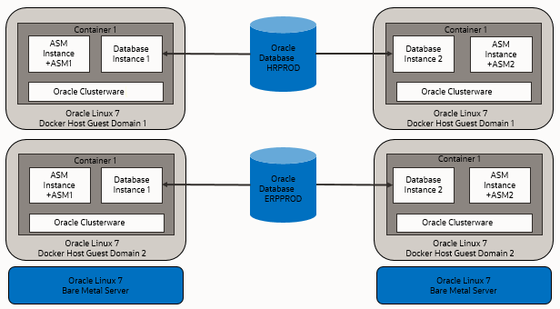
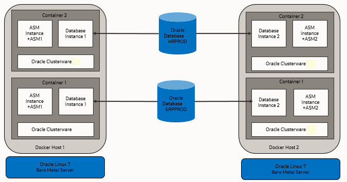
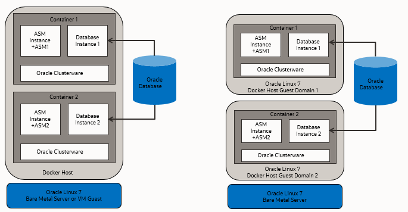

Use these instructions to install Oracle Real Application Clusters (Oracle RAC) on Oracle Container Runtime for Docker.

In this publication, the Linux server hosting the Docker containers is referred to as the **Docker host**, or just the **Host**. The Docker containers running the Oracle RAC, Oracle Grid Infrastructure, and Oracle Automatic Storage Management (Oracle ASM) are collectively referred to as the Docker Oracle RAC Container, or just the Oracle RAC Container.

- Prerequisites for Oracle RAC on Docker
  Before beginning to deploy Oracle Real Application Clusters (Oracle RAC) on Docker, ensure that you are prepared for the installation, and that your system meets software and storage requirements.
- Target Configuration for Oracle RAC on Docker
  The procedures in this document are tested for a 2-node Oracle RAC cluster running on two separate Linux host servers, and using block devices for shared storage.
- Provisioning the Docker Host Server
  You can provision the Linux server hosting Docker (the Docker host server) either on a bare metal (physical) server, or on an Oracle Linux Virtual Machine (VM).
- Docker Host Preparation
  Before you can install Oracle Grid Infrastructure and Oracle Real Application Clusters, you must install Oracle Container Runtime for Docker.
- Build the Docker Image for Oracle RAC on Docker
  To build Oracle Real Application Clusters (Oracle RAC) installation images, you create an image directory, create an image, and ensure the Docker host has connectivity to the Internet.
- Provision Shared Devices for Oracle ASM
  Ensure that you provision storage devices for Oracle Automatic Storage Management (Oracle ASM) with clean disks.
- Create Public and Private Networks for Oracle RAC on Docker
  Use this example to see how to configure the public network and private networks for Oracle Real Application Clusters (Oracle RAC).
- Options to Consider Before Deployment
  Before deployment of Oracle RAC on Docker, review network and host configuration options.
- Create the Oracle RAC Containers
  To create Oracle Real Application Clusters (Oracle RAC) containers, run `docker create` commands similar to these examples.
- Check Shared Memory File System Mount
  Use this command to check the shared memory mount.
- Connect the Network and Start the Docker Containers
  Before you start the containers, you set up the public and private networks, and assign the networks to the Oracle RAC Containers.
- Download Oracle Grid Infrastructure and Oracle Database Software
  Download the Oracle Database and Oracle Grid Infrastructure software from the Oracle Technology Network, and stage it.
- Deploy Oracle Grid Infrastructure and Oracle RAC in the Containers
  After you prepare the containers, complete a standard Oracle Grid Infrastructure and Oracle Real Application Clusters (Oracle RAC) deployment.
- Options to Consider After Deployment
  After deployment of Oracle Real Application Clusters (Oracle RAC) on Docker containers, you can choose to add more or remove Oracle RAC nodes, or install different releases of Oracle RAC.
- Known Issues for Oracle RAC on Docker
  When you deploy Oracle Real Application Clusters (Oracle RAC) on Docker containers, if you encounter an issue, check to see if it is a known issue.
- Additional Information for Oracle RAC on Docker Configuration
  This information can help to resolve issues that can arise with Oracle Real Application Clusters (Oracle RAC) on Docker.

### Prerequisites for Oracle RAC on Docker

Before beginning to deploy Oracle Real Application Clusters (Oracle RAC) on Docker, ensure that you are prepared for the installation, and that your system meets software and storage requirements.

- Preparing to Install Oracle RAC on Docker
  To use these instructions, you should have background knowledge of the technology and operating system.
- Software and Storage Requirements for Oracle RAC on Docker
  Review which Oracle software releases are supported for deployment with Oracle RAC on Docker, and what storage options you can use.

**Parent topic:** How to Install and Configure Oracle RAC on Docker

#### Preparing to Install Oracle RAC on Docker

To use these instructions, you should have background knowledge of the technology and operating system.

You should be familiar with the following technologies:

- Linux
- Docker
- Oracle Real Application Clusters (Oracle RAC) installation
- Oracle Grid Infrastructure installation
- Oracle Automatic Storage Management (Oracle ASM).

The installation basically follows the standard Linux installation procedure. However, because Docker is closely integrated with the host operating system, some of the environment setup steps are slightly different. Refer to the Docker documentation for an explanation of the Docker architecture, including namespaces, and resources for which you cannot use a namespace. This guide focuses on what is different. For information about standard steps and details of configuration, refer to Oracle Grid Infrastructure Installation and Upgrade Guide for Linux. Review the Oracle Grid Infrastructure Installation Checklist before starting the installation.

**Related Topics**

- [Oracle Grid Infrastructure Installation Checklist](../cwlin/oracle-grid-infrastructure-installation-checklist.md)

**Parent topic:** Prerequisites for Oracle RAC on Docker

#### Software and Storage Requirements for Oracle RAC on Docker

Review which Oracle software releases are supported for deployment with Oracle RAC on Docker, and what storage options you can use.

##### Software Requirements

Oracle Real Application Clusters (Oracle RAC) on Docker is currently supported only with the following releases:

- Oracle Grid Infrastructure Release 19c (`19.16` or later release updates)

- Oracle Database Release 19c (`19.16` or later)

- Oracle Container Runtime for Docker Release `18.09` or later

- Oracle Linux 7-slim Docker image (`oraclelinux:7-slim`)

- Oracle Linux for Docker host on Oracle Linux 7.4 (Linux-x86-64) or later updates.

- Unbreakable Enterprise Kernel Release 5 (UEKR5), Unbreakable Enterprise Kernel 6 (UEKR6), and their updates. Refer to Oracle Linux Oracle Container Runtime for Docker User's Guide for the supported kernel versions.

  In this example, we use Oracle Linux 7.9 (Linux-x86-64) with the Unbreakable Enterprise Kernel 5: `4.14.35-2047.501.2el7uek.x86_64` .

**See Also:**

Oracle operating systems documentation. Select Oracle Linux, then Oracle Linux 7, and then search for "Docker" to find Oracle Linux: Oracle Container Runtime for Docker User's Guide.

<https://docs.oracle.com/en/operating-systems/>

##### Storage Requirements

Database storage for Oracle RAC on Docker must use Oracle Automatic Storage Management (Oracle ASM) configured either on block storage, or on a network file system (NFS).

**Caution:**

Oracle Automatic Storage Management Cluster File System (Oracle ACFS) and Oracle ASM Filter Driver (Oracle ASMFD) are not supported.

**Related Topics**

- [Oracle RAC on Docker - Released Versions and Known Issues (Doc ID 2488326.1)](https://support.oracle.com/rs?type=doc&id=2488326.1)
- [Oracle RAC Technologies Certification Matrix for UNIX Platforms](https://www.oracle.com/database/technologies/tech-generic-unix-new.html)

**Parent topic:** Prerequisites for Oracle RAC on Docker

### Target Configuration for Oracle RAC on Docker

The procedures in this document are tested for a 2-node Oracle RAC cluster running on two separate Linux host servers, and using block devices for shared storage.

- Overview of Oracle RAC on Docker
  Starting with Oracle Database 19c (19.16), Oracle RAC is supported in Docker containers for production deployments.
- Docker Host Server Configuration
  When configuring your Docker host server, follow these guidelines, and see the configuration Oracle used for testing.
- Docker Containers and Oracle RAC Nodes
  Learn about the configuration used in this document, so that you can understand the procedures we follow.

**Parent topic:** How to Install and Configure Oracle RAC on Docker

#### Overview of Oracle RAC on Docker

Starting with Oracle Database 19c (19.16), Oracle RAC is supported in Docker containers for production deployments.

To prevent a single host causing complete downtime in a production environment, distribute Oracle RAC nodes across Docker hosts running on different physical servers. It is possible to configure Oracle RAC on Docker hosts running on same physical server for test and development environments. The procedures in this document are tested for a two-node Oracle RAC cluster, with each node running on a separate Linux Docker host server, and using block devices for shared storage.

The following figures show examples of typical test and development deployments.

This figure shows a production deployment, in which containers are located in different Docker hosts on separate hardware servers, with a high availability storage and network configuration:

Figure 1-1 Production Configuration Oracle RAC on Docker

[Description of "Figure 1-1 Production Configuration Oracle RAC on Docker"](img_text/racdk-prod-vm.md)

Placing Docker cluster nodes in containers on different Docker host virtual machines on different hardware servers enhances high availability. The following figure shows another production configuration, in which there are two containers on one host, in separate guest domains, and two containers on a second host, also with two separate guest domains, with a high availability storage and network configuration:

Figure 1-2 Bare Metal Server Production Deployment for Oracle RAC on Docker

[Description of "Figure 1-2 Bare Metal Server Production Deployment for Oracle RAC on Docker "](img_text/racdk-prod-baremetal.md)

The next figure shows a Docker host in which the cluster member nodes are containers in the same Docker host. The example on the right shows two Docker hosts on the same hardware server, with separate containers on each host. This is not a production environment, but can be useful for development.

Figure 1-3 Test or Development Deployment Examples of Oracle RAC on Docker

[Description of "Figure 1-3 Test or Development Deployment Examples of Oracle RAC on Docker"](img_text/racdk-test-dev.md)

For virtual test and development clusters, you can use two or more Docker containers as nodes of the same cluster, running on only one Oracle Linux Docker host, because high availability is not required for testing.

**Parent topic:** Target Configuration for Oracle RAC on Docker

#### Docker Host Server Configuration

When configuring your Docker host server, follow these guidelines, and see the configuration Oracle used for testing.

The Docker server must be sufficient to support the intended number of Docker containers, each of which must meet at least the minimum requirements for Oracle Grid Infrastructure servers hosting an Oracle Real Application Clusters node. Client machines must provide sufficient support for the X Window System (X11) remote display interactive installation sessions run from the Oracle RAC node. However, if you use noninteractive (silent) installation, then the client machine is not needed.

The Docker containers in this example configuration were created on the machine `docker-host-1` and `docker-host-2` for Oracle Real Application Clusters (Oracle RAC):

- Oracle RAC Node 1

  - Docker host: docker-host -1

  - Container: `racnode1`

  - CPU Core IDs: 0 and 1

  - RAM: 60GB

  - Swap memory: 32 GB

  - Hugepages: 16384

  - Operating system disk:

    You can use any supported storage options for Oracle Grid Infrastructure. Ensure that your storage has at least the following available space:

    - Root (`/`): 40 GB
    - `/scratch`: 80 GB (the Docker host directory, which will be used for `/u01` to store Oracle Grid Infrastructure and Oracle Database homes")
    - `/var/lib/docker`: 100 GB `xfs`

  - Docker version: `19.03.1-01`

  - Linux: Oracle Linux 7.9 (Linux-x86-64) with the Unbreakable Enterprise Kernel 5: `4.14.35-2047.501.2el7uek.x86_64`

- Oracle RAC Node 2

  - Docker host: `docker-host-2`

  - Container: `racnode2`

  - CPU Core IDs: 0 and 1

  - RAM: 60GB

  - Swap memory: 32 GB

  - Hugepages: 16384

  - Operating system disk:

    You can use any supported storage options for Oracle Grid Infrastructure. Ensure that your storage has at least the following available space:

    - Root (`/`): 40 GB
    - `/scratch`: 80 GB (the Docker host directory, which will be used for `/u01` to store Oracle Grid Infrastructure and Oracle Database homes")
    - `/var/lib/docker`: 100 GB `xfs`

  - Docker version: `19.03.1-01`

  - Linux: Oracle Linux 7.9 (Linux-x86-64) with the Unbreakable Enterprise Kernel 5: `4.14.35-2047.501.2el7uek.x86_64`

- Block devices

  You can use any supported storage options for Oracle Grid Infrastructure. Ensure that your storage has at least the following available space:

  - `/dev/sdd` (50 GB)
  - `/dev/sde` (50 GB)

**Related Topics**

- [Supported Storage Options for Oracle Grid Infrastructure](../cwlin/supported-storage-options-for-oracle-grid-infrastructure.md)

**Parent topic:** Target Configuration for Oracle RAC on Docker

#### Docker Containers and Oracle RAC Nodes

Learn about the configuration used in this document, so that you can understand the procedures we follow.

This document provides steps and commands to create Docker containers using the two-node configuration as an the example that this guide provides. The configuration information that follows is a reference for that configuration.

**Caution:**

For your own configuration, keep in mind that a configuration that can support running real-time processes in the Docker containers incurs a limit of no more than 10 Docker containers in a given Docker host that you use as a node, either in the same or in different clusters. In your own deployment, if you want to increase the number of possible nodes, then you can use multiple Docker hosts. Each Docker host is limited to no more than 10 Docker containers.

The Docker containers in this example configuration were created on the Docker hosts `docker-host-1` and `docker-host-2` for Oracle Real Application Clusters (Oracle RAC):

##### Oracle RAC Node 1

- Container: `racnode1`

- CPU core IDs: 0 and 1

- Memory
  - RAM memory: 16 GB
  - Swap memory: 16 GB

- Oracle Automatic Storage Management (Oracle ASM) Disks
  - `/dev/asm-disk1`
  - `/dev/asm-disk2`

- Host names and IP addresses
  - `racnode1, 10.0.20.150`
  - `racnode1-vip, 10.0.20.160`
  - `racnode1-priv, 192.168.17.150`
  - `racnode-scan, 10.0.20.170/171/172`
  - Domain: `example.info`

- The `racnode1` Docker volumes are mounted using Docker host directory paths and appropriate permissions.

  To ensure that the mount is performed as a directory, each mount is specified using `-v` or `--volume`. A volume consists of three fields, separated by colon characters (`:`). When you set up volumes, you must set the volume fields in the following order: `source-path``:``target-path``:``options`. For example:

      # docker container create ... --volume /boot:/boot:ro ... -name racnode1

  Note that `/boot` must be `readonly` inside the container.

  Each of the following volumes are mounted:

  - `/boot `: read-only (`/boot:ro`)
  - `/dev/shm` read-write (`/dev/shm`)
  - `/software/stage` read-write (`/scratch/software/stage`)
  - `/u01` read-write (`/scratch/rac/cluster01/node1`)
  - `/sys/fs/cgroup` read-only (`/sys/fs/cgroup`)
  - `/etc/localtime` read-only (`/etc/localtime`)

  **Note:**

  After this procedure is completed, to confirm mounts are set up, you can run the Docker command `docker container inspect racnode1`. For more information about using this command to check mounts for your configuration, refer to the Docker documentation.

- Oracle Database configuration
  - Instance: `orclcdb1`
  - Release 19.16
  - CDB name: `orclcdb`
  - PDB name: `orclpdb`
  - Instance: `orclcdb1`
  - SGA size: 3 GB
  - PGA size: 2 GB

##### Oracle RAC Node 2

- Container: `racnode2`

- CPU core IDs: 2 and 3

- Memory
  - RAM memory: 16 GB
  - Swap memory: 16 GB

- Oracle Automatic Storage Management (Oracle ASM) Disks
  - `/dev/asm/disk1`
  - `/dev/asm-disk2`

- Host names and IP addresses
  - `racnode2 10.0.20.151`
  - `racnode2-vip 10.0.20.161`
  - `racnode2-priv 192.168.17.151`
  - `racnode-scan 10.0.20.170/171/172`
  - Domain: `example.info`

- The `racnode2` Docker volumes are mounted using Docker host directory paths and appropriate permissions.

  To ensure that the mount was performed as a directory, mounts are created for Docker using `-v` or `--volume`. A volume consists of three fields, separated by colon characters (:). When you configure your volumes, you must set the volume fields in the following order: `source-path``:``target-path``:``options`. For example:

      # docker container create ... --volume /boot:/boot:ro ... -name racnode2

  Each of the following volumes are created:

  - `/boot `: read-only (`/boot:ro`)
  - `/dev/shm` read-write (`/dev/shm`)
  - `/software/stage` read-write (`/scratch/software/stage`)
  - `/u01` read-write (`/scratch/rac/cluster01/node2`)
  - `/sys/fs/cgroup` read-only (`/sys/fs/cgroup`)
  - `/etc/localtime` read-only (`/etc/localtime`)

  **Note:**

  After this procedure is completed, to confirm mounts are set up, you can run the Docker command `docker container inspect racnode2`. For more information about using this command to check mounts for your configuration, refer to the Docker documentation.

- Oracle Database configuration
  - Instance: `orclcdb2`
  - Release 19.16
  - CDB name: `orclcdb`
  - PDB name: `orclpdb`
  - Instance: `orclcdb1`
  - SGA size: 3 GB
  - PGA size: 2 GB

**Related Topics**

- <https://docs.docker.com/>

**Parent topic:** Target Configuration for Oracle RAC on Docker

### Provisioning the Docker Host Server

You can provision the Linux server hosting Docker (the Docker host server) either on a bare metal (physical) server, or on an Oracle Linux Virtual Machine (VM).

In addition to the standard memory (RAM) required for Oracle Linux (Linux-x86-64) and the Oracle Grid Infrastructure and Oracle Real Application Clusters (Oracle RAC) instances, Oracle recommends that you provide an additional 2 GB of RAM to each Docker host for the Docker engine.

**Parent topic:** How to Install and Configure Oracle RAC on Docker

### Docker Host Preparation

Before you can install Oracle Grid Infrastructure and Oracle Real Application Clusters, you must install Oracle Container Runtime for Docker.

- Preparing for Docker Container Installation
  Review the Oracle Docker Container documentation, and prepare your system for deployment.
- Installing Docker Engine
  In this example, the Docker engine is installed on an Oracle Linux 7.9 (Linux-x86-64) with the Unbreakable Enterprise Kernel 5: 4.14.35-2047.501.2el7uek.x86_64.
- Allocate Linux Resources for Oracle Grid Infrastructure Deployment
  Configure Linux resource allocations and configuration settings on the Docker host for Oracle Grid Infrastructure and the Oracle Real Application Clusters (Oracle RAC) container.
- Enable Real Time Mode for Oracle RAC Processes
  To run processes inside a Docker container for Oracle Real Application Clusters (Oracle RAC), you must enable Open Container Initiative (OCI) runtime capabilities in the Docker daemon and container.

**Parent topic:** How to Install and Configure Oracle RAC on Docker

#### Preparing for Docker Container Installation

Review the Oracle Docker Container documentation, and prepare your system for deployment.

Each container that you deploy as part of your cluster must satisfy the minimum hardware requirements of the Oracle Real Application Clusters (Oracle RAC) and Oracle Grid Infrastructure software. If you are planing to install Oracle Grid Infrastructure and Oracle RAC database software on data volumes exposed from your environment, then you must have at least 5 GB space allocated for the Oracle RAC on Docker image. However, if you are planning to install software inside the image, then you must have approximately 20 GB allocated for the Oracle RAC on docker image.

To understand Docker better, we highly recommend that you review following sections in Oracle Container Runtime for Docker:

- Installing Oracle Container Runtime for Docker
- Configuring Docker Storage
- Working with Containers and Images
- About Docker Networking

**See Also:**

Oracle operating systems documentation. Select Oracle Linux, then Oracle Linux 7, and then search for "Docker" to find Oracle Linux: Oracle Container Runtime for Docker User's Guide.

<https://docs.oracle.com/en/operating-systems/>

**Parent topic:** Docker Host Preparation

#### Installing Docker Engine

In this example, the Docker engine is installed on an Oracle Linux 7.9 (Linux-x86-64) with the Unbreakable Enterprise Kernel 5: 4.14.35-2047.501.2el7uek.x86_64.

In that installation, the Docker storage is in `/var/lib/docker`, and used the Docker OverlayFS storage driver option `overlay2`, with an `xfs` backing file system, with `d_type=true` enabled. After the setup, the Docker engine looks like the following example:

    # docker info

    Client:
     Debug Mode: false

    Server:
     Containers: 0
     Running: 0
     Paused: 0
     Stopped: 0
     Images: 0
     Server Version: 19.03.1-ol
     Storage Driver: overlay2
     Backing Filesystem: xfs
     Supports d_type: true
     Native Overlay Diff: false
     Logging Driver: json-file
     Cgroup Driver: cgroupfs
     Plugins:
     Volume: local
     Network: bridge host ipvlan macvlan null overlay
     Log: awslogs fluentd gcplogs gelf journald json-file local logentries splunk syslog
     Swarm: inactive
     Runtimes: runc
     Default Runtime: runc
     Init Binary: docker-init
     containerd version: c4444445cb9z30000f49999ed999e6d4zz11c7c39
     runc version:
     init version: fec3683
     Security Options:
     seccomp
     Profile: default
     Kernel Version: 4.14.35-2047.501.2el7uek.x86_64
     Operating System: Oracle Linux Server 7.9
     OSType: linux
     Architecture: x86_64
     CPUs: 8
     Total Memory: 58.71GiB
     Name: docker-inst-1-99242
     ID: ZZZ2:YYYG:VVVV:VVVV:RRRR:EZI2:XYRX:RJPS:7ZZZ:4KZ4:GFJ5:P26O
     Docker Root Dir: /var/lib/docker
     Debug Mode: false
     Registry: https://index.docker.io/v1/
     Labels:
     Experimental: false
     Insecure Registries:
     127.0.0.0/8
     Live Restore Enabled: false

    WARNING: bridge-nf-call-iptables is disabled
    WARNING: bridge-nf-call-ip6tables is disabled
    Registries:

**Related Topics**

- [Use the OverlayFS storage driver](https://docs.docker.com/storage/storagedriver/overlayfs-driver/)

**See Also:**

Oracle operating systems documentation. Select Oracle Linux, then Oracle Linux 7, and then search for "Docker" to find Oracle Linux: Oracle Container Runtime for Docker User's Guide.

<https://docs.oracle.com/en/operating-systems/>

**Parent topic:** Docker Host Preparation

#### Allocate Linux Resources for Oracle Grid Infrastructure Deployment

Configure Linux resource allocations and configuration settings on the Docker host for Oracle Grid Infrastructure and the Oracle Real Application Clusters (Oracle RAC) container.

- Set Kernel Parameters on the Docker Host
  To ensure that your kernel resource allocation is adequate, update the Linux `/etc/sysctl.conf` file.
- Create Mount Points for the Oracle Software Binaries
  As the `root` user, create mount points for the Oracle software on local or remote storage.
- Check Shared Memory File System Mount
  Use this command to check the shared memory mount.
- Configure NTP on the Docker Host
  You must set up the NTP (Network Time Protocol) server on the Docker host for the Oracle Real Application Clusters (Oracle RAC) container.
- Create a Directory to Stage the Oracle Software on the Docker Host
  To stage Oracle Grid Infrastructure and Oracle Real Application Clusters software, create mount points, either on local or remote storage.
- Using CVU to Validate Readiness for Docker Host
  Oracle recommends that you use standalone Cluster Verification Utility (CVU) on your Docker host to help to ensure that the Docker host is configured correctly.

**Parent topic:** Docker Host Preparation

##### Set Kernel Parameters on the Docker Host

To ensure that your kernel resource allocation is adequate, update the Linux `/etc/sysctl.conf` file.

The `/etc/sysconfig` directory contains files that control your system's configuration.

1.  Log in as root

2.  Use the `vim` editor to update `/etc/sysctl.conf` parameters to the following values:
    - fs.aio-max-nr=1048576

    - fs.file-max = 6815744

    - net.core.rmem_max = 4194304

    - net.core.rmem_default = 262144

    - net.core.wmem_max = 1048576

    - net.core.wmem_default = 262144

    - vm.nr_hugepages=16384

3.  Run the following commands:

        # sysctl -a
        # sysctl –p

**Parent topic:** Allocate Linux Resources for Oracle Grid Infrastructure Deployment

##### Create Mount Points for the Oracle Software Binaries

As the `root` user, create mount points for the Oracle software on local or remote storage.

The mount points that you create must be available to all Docker hosts, use interfaces such as `iscsi`, and be mountable within each container under the file path `/u01`.

As the `root` user, run commands similar to the following:

On `docker-host-1`:

    # mkdir -p /scratch/rac/cluster01/node1

On `docker-host-2`:

    # mkdir -p /scratch/rac/cluster01/node2

**Parent topic:** Allocate Linux Resources for Oracle Grid Infrastructure Deployment

##### Check Shared Memory File System Mount

Use this command to check the shared memory mount.

Verify that shared memory (`/dev/shm`) is mounted properly with sufficient size. These procedures were tested with 4 GB.

For example:

    # df -h /dev/shm

The `df -h` command displays the file system on which `/dev/shm` is mounted, and also displays in GB the total size, and the free size of shared memory.

**Parent topic:** Allocate Linux Resources for Oracle Grid Infrastructure Deployment

##### Configure NTP on the Docker Host

You must set up the NTP (Network Time Protocol) server on the Docker host for the Oracle Real Application Clusters (Oracle RAC) container.

Containers on Docker inherit the time from the Docker host. For this reason, the network time protocol daemon (NTPD) must run on the Docker host, not inside the Oracle RAC container. For information about how to set up the network time server, refer to the section describing how to configure the NTPD service in Oracle Linux 7 Administrator's Guide.

**Related Topics**

- [Oracle Linux 7 Administrator's Guide](https://docs.oracle.com/en/operating-systems/oracle-linux/7/admin/section_m5p_j1h_pp.html)

**Parent topic:** Allocate Linux Resources for Oracle Grid Infrastructure Deployment

##### Create a Directory to Stage the Oracle Software on the Docker Host

To stage Oracle Grid Infrastructure and Oracle Real Application Clusters software, create mount points, either on local or remote storage.

Assuming that you perform the installation from node 1 of the Oracle RAC cluster, the mount point that you create for the Oracle software must be available to at least the Docker host of node 1, and be mountable within the container under the file path `/software/stage`.

As the root user, run commands similar to the following:

    # mkdir -p /scratch/software/stage
    # chmod a+rwx /scratch/software/stage

**Parent topic:** Allocate Linux Resources for Oracle Grid Infrastructure Deployment

##### Using CVU to Validate Readiness for Docker Host

Oracle recommends that you use standalone Cluster Verification Utility (CVU) on your Docker host to help to ensure that the Docker host is configured correctly.

You can use CVU to assist you with system checks in preparation for creating a Docker container for Oracle Real Application Clusters (Oracle RAC), and installing Oracle RAC inside the containers. CVU runs the appropriate system checks automatically, and prompts you to fix problems that it detects. To obtain the benefits of system checks, you must run the utility on all the Docker hosts that you want to configure to host the Oracle RAC containers.

To obtain CVU, download Patch 30839369: Standalone CVU version 21.7 for container host July 2022 (Patch).

**Note:**

Ensure that you download the **container host** patch, which is different from the standard CVU distribution.

**Related Topics**

- [Patch 30839369: Standalone CVU version 21.7 for container host July 2022 (Patch)](https://updates.oracle.com/Orion/Services/download/cvupack_linux_ol7_x86_64.zip?aru=24906122&patch_file=cvupack_linux_ol7_x86_64.zip)

**Parent topic:** Allocate Linux Resources for Oracle Grid Infrastructure Deployment

#### Enable Real Time Mode for Oracle RAC Processes

To run processes inside a Docker container for Oracle Real Application Clusters (Oracle RAC), you must enable Open Container Initiative (OCI) runtime capabilities in the Docker daemon and container.

To run processes inside a container in real time mode, you must update the OPTIONS value in `/etc/sysconfig/docker`.

(Optional) Enter task prerequisites here.

1.  Log in as `root`, and open `/usr/lib/systemd/system/docker.service` in an editor.

2.  Append the following parameter setting for the line starting with entry `ExecStart=` under the `[Service]` section:

        --cpu-rt-runtime=950000

    After appending the parameter, the ExecStart value should appear similar to the following example:

        ExecStart=/usr/bin/dockerd -H fd:// --containerd=/run/containerd/containerd.sock --cpu-rt-runtime=950000

3.  Save the `/usr/lib/systemd/system/docker.service` file.

4.  Run the following commands to reload the daemon and container with the changes:

        # systemctl daemon-reload
        # systemctl stop docker
        # systemctl start docker

After the changes, running a Docker service status command must return a result similar to the following:

    # systemctl status docker

     docker.service - Docker Application Container Engine
     Loaded: loaded (/usr/lib/systemd/system/docker.service; disabled; vendor preset: disabled)
     Active: active (running) since Mon 2020-04-13 23:45:39 GMT; 17h ago
     Docs: https://docs.docker.com
     Main PID: 12892 (dockerd)
     CGroup: /system.slice/docker.service
     12892 /usr/bin/dockerd -H fd:// --containerd=/run/containerd/containerd.sock --cpu-rt-runtime=950000

**Parent topic:** Docker Host Preparation

### Build the Docker Image for Oracle RAC on Docker

To build Oracle Real Application Clusters (Oracle RAC) installation images, you create an image directory, create an image, and ensure the Docker host has connectivity to the Internet.

**Note:**

You can do this procedure on one Docker host, and use the image on the other Docker hosts, or repeat the same image build procedure on each Docker host.

- Create the Docker Image Build Directory
  To perform the Docker Image creation, use this procedure to create a directory for the build process.
- Prepare Container Setup Script
  To maintain device permissions, default route and host environment configuration, create a script to run automatically after container restarts to configure the container environment.
- Create a Dockerfile for Oracle RAC on Docker Image
  To set up the Oracle Real Application Clusters (Oracle RAC) Dockerfile images, you must pull a base Oracle Linux image.
- Create the Oracle RAC on Docker Image
  To create the Oracle Real Application Clusters (Oracle RAC) image, set your Oracle Linux environment as required, and build an image from the Dockerfile and context.
- Use a Central Image Repository for Oracle RAC on Docker
  You can chose to set up a container image repository for your Docker images.

**Parent topic:** How to Install and Configure Oracle RAC on Docker

#### Create the Docker Image Build Directory

To perform the Docker Image creation, use this procedure to create a directory for the build process.

Log in as `root`, and enter the following commands:

    # mkdir /scratch/image
    # cd /scratch/image

**Parent topic:** Build the Docker Image for Oracle RAC on Docker

#### Prepare Container Setup Script

To maintain device permissions, default route and host environment configuration, create a script to run automatically after container restarts to configure the container environment.

When you restart Docker containers, device permissions, default routes, and `/etc/hosts` entries that were previously configured for the containers are reset. To maintain your configuration between Docker and Docker container restarts, use this procedure to build a script that you can configure to run on each container to set up the environment after restarts.

Because Oracle Real Application Clusters (Oracle RAC) uses containers based on `systemd`, you can run the container environment script on every restart by adding the script to the `/etc/rc.local` folder inside the container when you create the Oracle RAC slim image. After restarts, the script you add to `rc.local` can ensure that your Docker container environments are restored. Complete each of these steps in sequence. Create the files and script in the docker image build directory, which in this example is `/stage/image`.

1.  Create and populate `resolv.conf` on the Docker host for your container environment. Also, if you are planning to deploy containers on multiple hosts, then you must ensure that this `resolv.conf` that you create is available on all Docker hosts where the image is built, because this file contains entries for your domain name server (DNS) search, and search domains.
    For the example configuration in this guide, the host file contents for the DNS are as follows:

        search example.info
        nameserver 162.88.2.6
2.  If the host names for your Docker containers are not in a DNS (see step 1), then create and populate your `hostfile` on all Docker hosts where the image is built, and populate the file with the host entries of your Docker containers' Public IP addresses, Private IP addresses, and Virtual IP addresses. Use the IP addresses and host names that you set up for your environment. If you are planning to deploy containers on multiple hosts, then you must ensure that the `hostfile` is available on all of your Docker hosts where you plan to deploy containers.
    For the example configuration in this guide, the host file contents are as follows:

        127.0.0.1 localhost
        ::1 localhost ip6-localhost ip6-loopback

        ## Public IP addresses
        10.0.20.150 racnode1.example.info racnode1
        10.0.20.151 racnode2.example.info racnode2

        ## Virtual IP addresses
        10.0.20.160 racnode1-vip.example.info racnode1-vip
        10.0.20.161 racnode2-vip.example.info racnode2-vip

        ## Private IPs
        192.168.17.150 racnode1-priv.example.info racnode1-priv
        192.168.17.151 racnode2-priv.example.info racnode2-priv
3.  Create the script `setupContainerEnv.sh` in the Docker image build directory, and copy and paste the following contents into the script:
    For example:

        #!/bin/bash
        chown grid:asmadmin /dev/asm-disk1
        chown grid:asmadmin /dev/asm-disk2
        chmod 660 /dev/asm-disk1
        chmod 660 /dev/asm-disk2
        ip route del default
        # In the ip route command, replace with appropriate gateway IP
        ip route add default via 10.0.20.1
        cat /opt/scripts/startup/resolv.conf > /etc/resolv.conf
        cat /opt/scripts/startup/hostfile > /etc/hosts
        systemctl reset-failed

    Always use complete paths for the location of files in the script, so that the script does not require the `PATH` variable to be set.

We will add this script to run at container startup by using the Oracle RAC containers `/etc/rc.local`. This step is described in the section "Build Oracle RAC Database on Docker Image." After you add the line to `/etc/rc.local` to call the `setupContainerEnv.sh` script, if the Docker Container is reset, then when a Docker container is started and `init` loads, `setupContainerEnv.sh` runs the following operations on every container restart:

1.  Sets the default gateway
2.  Sets the correct device permissions on ASM devices
3.  Sets up the `/etc/hosts` file.
4.  Sets up the `/etc/resolv.conf` file.

If you plan to deploy containers on multiple hosts, then you must copy `setupContainerEnv.sh` on all the Docker hosts where the image is built.

**Note:**

The setup script at the time of the image build, and the content of the `resolv.conf` and `hostfile` files, are embedded in the Docker image during the build. That content may not be applicable to the containers deployed using the same image for other deployments, which will have different ASM disks and network configuration. However, you can modify that content after the containers are created and started, for example by logging in the containers and editing the files and script in `/opt/scripts/startup`.

**Parent topic:** Build the Docker Image for Oracle RAC on Docker

#### Create a Dockerfile for Oracle RAC on Docker Image

To set up the Oracle Real Application Clusters (Oracle RAC) Dockerfile images, you must pull a base Oracle Linux image.

1.  Create a file named `Dockerfile` under `/scratch/image`.

2.  Open the Dockerfile with an editor, and paste the following lines into the Dockerfile:

        # Pull base image
        # ---------------
        FROM oraclelinux:7-slim
        # Environment variables required for this build (do NOT change)
        # -------------------------------------------------------------
        ## Environment Variables
        ## ---
        ENV container=true \
            SCRIPT_DIR=/opt/scripts/startup \
            RESOLVCONFENV="resolv.conf" \
            HOSTFILEENV="hostfile" \
            SETUPCONTAINERENV="setupContainerEnv.sh"

        ### Copy Files
        # ----

        COPY $RESOLVCONFENV $HOSTFILEENV $SETUPCONTAINERENV $SCRIPT_DIR/

        ### RUN Commands
        # -----
        RUN yum -y install systemd oracle-database-preinstall-19c vim passwd openssh-server && \
         yum -y install policycoreutils && \
         yum -y install policycoreutils-python && \
         yum clean all && \
         sync && \
         groupadd -g 54334 asmadmin && \
         groupadd -g 54335 asmdba && \
         groupadd -g 54336 asmoper && \
         useradd -u 54332 -g oinstall -G oinstall,asmadmin,asmdba,asmoper,racdba,dba grid && \
         usermod -g oinstall -G oinstall,dba,oper,backupdba,dgdba,kmdba,asmdba,racdba,asmadmin oracle && \
         cp /etc/security/limits.d/oracle-database-preinstall-19c.conf /etc/security/limits.d/grid-database-preinstall-19c.conf && \
         sed -i 's/oracle/grid/g' /etc/security/limits.d/grid-database-preinstall-19c.conf && \
         rm -f /etc/rc.d/init.d/oracle-database-preinstall-19c-firstboot && \
         rm -f /etc/sysctl.conf && \
         echo "$SCRIPT_DIR/$SETUPCONTAINERENV" >> /etc/rc.local && \
         chmod +x $SCRIPT_DIR/$SETUPCONTAINERENV && \
         chmod +x /etc/rc.d/rc.local && \
         sync

        USER root
        WORKDIR /root
        VOLUME ["/software/stage"]
        VOLUME ["/u01"]
        CMD ["/usr/sbin/init"]
        # End of the Dockerfile

    If you require additional packages for your application, then you can add them to the `RUN yum` command.

**Parent topic:** Build the Docker Image for Oracle RAC on Docker

#### Create the Oracle RAC on Docker Image

To create the Oracle Real Application Clusters (Oracle RAC) image, set your Oracle Linux environment as required, and build an image from the Dockerfile and context.

1.  Log in as `root`, and move to the directory for image creation that you have previously prepared:

        # cd /scratch/image

2.  Run the procedure for your use case:

    - Your server is behind a proxy firewall:

      - Run the following commands, where:
        - `localhost-domain` is the local host and domain for the internet gateway in your network
        - `http-proxy` is the HTTP proxy server for your network environment
        - `https-proxy` is the HTTPS proxy server for your network environment
        - `19.16` is the Oracle Database release that you are planning to install inside the container.

      <!-- -->

          # export NO_PROXY=localhost-domain
          # export http_proxy=http-proxy
          # export https_proxy=https-proxy
          # export version=19.16.0
          # docker build --force-rm=true --no-cache=true --build-arg \
          http_proxy=${http_proxy} --build-arg https_proxy=${https_proxy} \
          -t oracle/database-rac:$version-slim  -f Dockerfile .

    - Your server is not behind a proxy firewall:

      - Run the following commands:

      <!-- -->

          # export version=19.16.0
          # docker build --force-rm=true --no-cache=true -t oracle/database-rac:$version-slim -f Dockerfile .

3.  After the image builds successfully, you should see the image `oracle/database-rac:19.16.0-slim` created on your Docker host:

        # docker images
             REPOSITORY TAG IMAGE ID CREATED SIZE
             oracle/database-rac 19.16.0-slim 7d0a89984725 11 hours ago 359MB
             oraclelinux 7-slim f23503228fa1 3 days ago 120MB

4.  Save the image into an archive file, and transfer it to the other Docker host:

        # docker image save -o /var/tmp/database-rac.tar oracle/database-rac:19.16.0-slim
        # scp /var/tmp/database-rac.tar docker-host-2:/var/tmp/database-rac.tar

5.  On the other Docker host load the image from the tar file and check that it is loaded

        # docker image load -i /var/tmp/database-rac.tar
        # docker images
             REPOSITORY TAG IMAGE ID CREATED SIZE
             oracle/database-rac 19.16.0-slim 7d0a89984725 20s ago 359MB

**Parent topic:** Build the Docker Image for Oracle RAC on Docker

#### Use a Central Image Repository for Oracle RAC on Docker

You can chose to set up a container image repository for your Docker images.

If you have a container image repository on the network that reachable by the Docker hosts, then after the Oracle RAC on Docker image has been created on one Docker host, it can be pushed to the repository and used by all Docker hosts. For the details of the setup and the use of a repository, refer to the Docker documentation.

**Parent topic:** Build the Docker Image for Oracle RAC on Docker

### Provision Shared Devices for Oracle ASM

Ensure that you provision storage devices for Oracle Automatic Storage Management (Oracle ASM) with clean disks.

Storage for the Oracle Real Application Clusters must use Oracle ASM, either on block storage, or on a network file system (NFS). Using Oracle Advanced Storage Management Cluster File System (Oracle ACFS) for Oracle RAC on Docker is not supported.

The devices you use for Oracle ASM should not have any existing file system. To overwrite any other existing file system partitions or master boot records from the devices, use commands such as the following on one Docker host:

    # dd if=/dev/zero of=/dev/sdd  bs=1024k count=1024
    # dd if=/dev/zero of=/dev/sde  bs=1024k count=1024

In this example deployment, the Docker host devices `/dev/sdd` and `/dev/sde` are at the same device paths in both Docker hosts. and will be mapped in the containers as `/dev/asm-disk1` and `/dev/asm-disk2`. This mapping is done in the container creation procedure "Create the Oracle RAC Containers"

**Parent topic:** How to Install and Configure Oracle RAC on Docker

### Create Public and Private Networks for Oracle RAC on Docker

Use this example to see how to configure the public network and private networks for Oracle Real Application Clusters (Oracle RAC).

Before you start installation, you should create at least one public and two private networks in your containers. Oracle recommends that you create redundant private networks. Use this example as a model for your own configuration, but with the addresses you configure in your network domain. .

For development testing, the networks are created on private IP addresses, using the following configuration:

- `rac_eth0pub1_nw` (`10.0.20.0/24`): Public network
- `rac_eth1priv1_nw` (`192.168.17.0/24`): Private network 1
- `rac_eth2priv2_nw` (`192.168.18.0/24`): Private network 2

You can use any network subnet that is suitable for your deployment. However, other examples that follow in this publication use these network names and addresses.

To set up the public network using a parent gateway interface in the Docker host, you must run Oracle RAC on Docker for multi-host, using either the Docker `MACVLAN`, or the `IPVLAN` Driver. Also, the gateway interface that you use must be one to which the domain name servers (DNS) where you have registered the single client access names (SCANs) and host names for Oracle Grid Infrastructure can resolve. For our example, we used `macvlan` for the public network, and also `macvlan` for the Oracle RAC private network communication crossing different Docker hosts.

The `--subnet` option must correspond to the subnet associated with the physical interface named with the `-o parent` parameter. The `-o parent` parameter should list the physical interface to which the `macvlan` interfaces should be associated. The `--gateway` option must correspond to the gateway on the network of the physical interface. For details, refer the Docker Documentation.

There are two options for network configuration: Standard maximum transmission unit (MTU) networks, and Jumbo Frames MTU networks. To improve Oracle RAC communication performance, Oracle recommends that you enable Jumbo Frames for the network interfaces, so that the MTU is greater than 1,500 bytes. If you have Jumbo Frames enabled, then you can use a network device option parameter to set the MTU parameter of the networks to the same value as the Jumbo Frames MTU.

Example 1-1 Standard MTU Network Configuration

Run the following commands on each Docker host:

    # docker network create -d macvlan --subnet=10.0.20.0/24 --gateway=10.0.20.1 -o parent=eth0 rac_eth0pub1_nw
    # docker network create -d macvlan --subnet=192.168.17.0/24 -o parent=eth1 rac_eth1priv1_nw
    # docker network create -d macvlan --subnet=192.168.18.0/24 -o parent=eth2 rac_eth2priv2_nw

Example 1-2 Jumbo Frames MTU Network Configuration

First, confirm the Jumbo Frame MTU configuration. For example:

    # ip link show | egrep "eth0|eth1|eth2"
    3: eth0: <BROADCAST,MULTICAST,UP,LOWER_UP> mtu 9000 qdisc pfifo_fast state UP mode DEFAULT group default qlen 1000
    4: eth1: <BROADCAST,MULTICAST,UP,LOWER_UP> mtu 9000 qdisc pfifo_fast state UP mode DEFAULT group default qlen 1000
    5: eth2: <BROADCAST,MULTICAST,UP,LOWER_UP> mtu 9000 qdisc pfifo_fast state UP mode DEFAULT group default qlen 1000

Because the MTU on each interface is set to 9000, you can then run the following commands on each Docker host: to extend the maximum payload length for each network to use the entire MTU:

    # docker network create -d macvlan \
    --subnet=10.0.20.0/24 \
    --gateway=10.0.20.1 \
    -o parent=eth0 \
    -o "com.docker.network.driver.mtu=9000" \
    rac_eth0pub1_nw
    # docker network create -d macvlan \
    --subnet=192.168.17.0/24 \
    -o parent=eth1 \
    -o "com.docker.network.driver.mtu=9000" \
    rac_eth1priv1_nw
    # docker network create -d macvlan \
    --subnet=192.168.18.0/24 \
    -o parent=eth2 \
    -o "com.docker.network.driver.mtu=9000" \
    rac_eth2priv2_nw

To set up networks to run Oracle RAC in Docker containers, you can choose to use more than one public network, and more than two private networks, or just a single private network. If you choose to configure multiple networks, then to create these networks, repeat the `docker network create` commands, using the appropriate values for your network.

After the network creation, run the command `docker network ls`. The result of this command must show networks created on the Docker host. You should see results similar to the following:

    NETWORK ID    NAME              DRIVER   SCOPE
    09a0cccfd773  bridge            bridge   local
    881fe01c864d  host              host     local
    0ed10efde310  none              null     local
    bd42e49e6d95  rac_eth0pub1_nw   macvlan  local
    846f22e74cee  rac_eth1priv1_nw  macvlan  local
    876f275ffeda  rac_eth2priv2_nw  macvlan  local

**Related Topics**

- Multiple Private Networks Option for Oracle RAC on Docker
- <https://docs.docker.com/>

**Parent topic:** How to Install and Configure Oracle RAC on Docker

### Options to Consider Before Deployment

Before deployment of Oracle RAC on Docker, review network and host configuration options.

Before deployment, you can decide if you want to use one private network, or configure multiple private networks. You can also choose one of the following options:

- Multiple Docker hosts
- Multiple Docker bridges on a single Docker host

After you decide what network configuration option you want to use, complete the deployment procedure for your chosen configuration.

**Note:**

In this document, we present the typical and recommended block device storage and network options. However, depending on your deployment topology and storage possibilities, you can consider other options that better fit the requirements of your deployment of Oracle RAC on Docker.

- Configuring NFS for Storage for Oracle RAC on Docker
  If you want to use NFS for storage, then use this procedure to create an NFS volume, and make it available to the Oracle RAC containers.
- Multiple Private Networks Option for Oracle RAC on Docker
  Before deployment, if you want to use multiple private networks for Oracle RAC on Docker, then change your Docker container creation so that you can use multiple NICs for the private interconnect.
- Multiple Docker Hosts Option
  If you use multiple Docker hosts, then use commands similar to this example to create the network bridges.
- Multiple Docker Bridges On a Single Docker Host Option
  If you cannot use the `MACVLAN` driver in your environment, then you can use this example to see how to create a Docker bridge on a single host.

**Parent topic:** How to Install and Configure Oracle RAC on Docker

#### Configuring NFS for Storage for Oracle RAC on Docker

If you want to use NFS for storage, then use this procedure to create an NFS volume, and make it available to the Oracle RAC containers.

After the NFS volume is created with the supported mount options for its usage, it can be used by the container.

For example, to create an NFS volume that you can use as cluster shared storage, you can use this command, where `nfs-server` is your NFS server IP or hostname:

    docker volume create --driver local \
    --opt type=nfs \
    --opt o=addr=nfs-server,rw,bg,hard,tcp,vers=3,timeo=600,rsize=32768,wsize=32768,actimeo=0,noac \
    --opt device=:/oradata \
    racstorage

In this case, you then provide the following argument in the Docker `docker container create` command:

      --volume racstorage:/oradata \

After these example commands are run, and the docker container is created with the volume argument, it can access the NFS file system at `/oradata` when the container is up and running.

**Related Topics**

- [My Oracle Support Mount Options for Oracle files for RAC databases and Clusterware when used with NFS on NAS devices (Doc ID 359515.1)](https://support.oracle.com/rs?type=doc&id=359515.1)

**Parent topic:** Options to Consider Before Deployment

#### Multiple Private Networks Option for Oracle RAC on Docker

Before deployment, if you want to use multiple private networks for Oracle RAC on Docker, then change your Docker container creation so that you can use multiple NICs for the private interconnect.

If you want to use multiple private networks for Oracle Real Application Clusters (Oracle RAC), then you must set the `rp_filter` tunable to `0` or `2`. To set the `rp_filter` value, you add the arguments for that tunable to the `docker create` container command when you create your containers:

    --sysctl 'net.ipv4.conf.private_interface_name.rp_filter=2'

Based on the order of connection to the public and private networks that you previously configured, you can anticipate the private interface names that you define with this command.

For example in this guide the private network, `rac_eth1priv1_nw`, is connected after the public network. If the interface name configured for `rac_eth1priv1_nw` is `eth1`, then a second private network connection on the interface will be on the interface name `eth2`, as the Ethernet network interface is assigned by the order of connection.

In this case, you then provide the following arguments in the `docker container create` command:

    --sysctl 'net.ipv4.conf.eth1.rp_filter=2' --sysctl 'net.ipv4.conf.eth2.rp_filter=2'.

**Related Topics**

- Create the Oracle RAC Containers
- [Setting Multiple Private Interconnects and Oracle Linux](../cwlin/multiple-private-interconnects-and-oracle-linux.md)

**Parent topic:** Options to Consider Before Deployment

#### Multiple Docker Hosts Option

If you use multiple Docker hosts, then use commands similar to this example to create the network bridges.

You must use the Docker MACVLAN driver with a parent adapter (using the argument `-o parent=``adapter name`) for the connectivity to the external network.

    # docker network create -d macvlan --subnet=10.0.20.0/24 --gateway=10.0.20.1 -o parent=eth0 rac_eth0pub1_nw
    # docker network create -d macvlan --subnet=192.168.17.0/24 -o parent=eth1 rac_eth1priv1_nw

**Note:**

If you prefer not to repeat the process of building an Oracle RAC on Docker image on each Docker host, then you can create the Docker image on one Docker host, and export that image to an archive file. To use this option, run the `docker image save` command on the Docker host where you create the image, and then transfer the archive file to other Docker hosts. These Docker hosts can then import the image by using the `docker image load` command. For more information about these commands, refer to the Docker documentation

**Parent topic:** Options to Consider Before Deployment

#### Multiple Docker Bridges On a Single Docker Host Option

If you cannot use the `MACVLAN` driver in your environment, then you can use this example to see how to create a Docker bridge on a single host.

If you cannot use the `MACVLAN` driver in your environment, then you can still create a Docker bridge in your environment. However, this bridge will not be reachable from an external network. In addition, the Oracle RAC Docker containers for a given cluster will be limited to be in the same Docker host.

Log in as on the Docker host, and use commands similar to these:

    # docker network create --driver=bridge --subnet=10.0.20.0/24 rac_eth0pub1_nw
    # docker network create --driver=bridge --subnet=192.168.17.0/24 rac_eth1priv1_nw

**Parent topic:** Options to Consider Before Deployment

### Create the Oracle RAC Containers

To create Oracle Real Application Clusters (Oracle RAC) containers, run `docker create` commands similar to these examples.

- Create Racnode1 Container with Block Devices
  Use this procedure to create the first Oracle Real Application Clusters (Oracle RAC) container on Docker on `docker-host-1`.
- Create Racnode2 Container with Block Devices
  Use this procedure to create the second Oracle Real Application Clusters (Oracle RAC) container on Docker on `docker-host-2`.

**Parent topic:** How to Install and Configure Oracle RAC on Docker

#### Create Racnode1 Container with Block Devices

Use this procedure to create the first Oracle Real Application Clusters (Oracle RAC) container on Docker on `docker-host-1`.

Use this example of a container configuration as a guideline. The containers that you create for Oracle RAC must have explicit assignment of compute, memory and storage resources to support the database workload you expect for your Oracle RAC cluster. Accordingly, change the values for `--cpuset-cpu`, `--memory`, and `--device --dns` to the values that you require for your workload environment. Ensure that the domain name servers (DNS) that you specify with `--dns` can resolve the host names and single client access names (SCANs) that you plan to use for Oracle Grid Infrastructure. Also, the default Docker container stop uses the `SIGTERM` signal to send to the container when a container stop command is issued. However, the Docker `SIGTERM` signal does not shut down the systemd services inside the container. Oracle Clusterware supports graceful shutdown of a cluster node with a systemd service shutdown. To enable the Docker container stop to trigger a systemd service shutdown in Oracle Clusterware, include the argument `--stop-signal=SIGRTMIN+5` in the `docker create` command. To understand all of the options mentioned in the following command, refer to the Docker documentation for the Oracle Docker version installed on the Docker host. You can also shut down the container gracefully with manual commands. See "How to Gracefully Shut Down a RAC container" in this document.

    # docker create -t -i \
      --hostname racnode1 \
      --volume /boot:/boot:ro \
      --volume /dev/hugepages:/dev/hugepages \
      --volume /dev/shm \
      --tmpfs /dev/shm:rw,exec,size=2G \
      --dns-search=example.info \
      --dns=162.88.2.6 \
      --device=/dev/sdd:/dev/asm-disk1  \
      --device=/dev/sde:/dev/asm-disk2  \
      --privileged=false  \
      --volume /scratch/software/stage:/software/stage \
      --volume /scratch/rac/cluster01/node1:/u01 \
      --volume /sys/fs/cgroup:/sys/fs/cgroup:ro \
      --volume /etc/localtime:/etc/localtime:ro \
      --cpuset-cpus 0-3 \
      --memory 16G \
      --memory-swap 32G \
      --sysctl kernel.shmall=2097152  \
      --sysctl "kernel.sem=250 32000 100 128" \
      --sysctl kernel.shmmax=8589934592  \
      --sysctl kernel.shmmni=4096 \
      --sysctl 'net.ipv4.conf.eth1.rp_filter=2' \
      --sysctl 'net.ipv4.conf.eth2.rp_filter=2' \
      --cap-add=SYS_NICE \
      --cap-add=SYS_RESOURCE \
      --cap-add=NET_ADMIN \
      --restart=always \
      --tmpfs=/run \
      --cpu-rt-runtime=95000 \
      --stop-signal=SIGRTMIN+5 \
      --ulimit rtprio=99  \
      --name racnode1 \
    oracle/database-rac:19.16.0-slim

**Parent topic:** Create the Oracle RAC Containers

#### Create Racnode2 Container with Block Devices

Use this procedure to create the second Oracle Real Application Clusters (Oracle RAC) container on Docker on `docker-host-2`.

To use this example on your Docker host, change the values for `--cpuset-cpu`, `--memory`, and `--device --dns` values to the correct values for your environment. Ensure that the domain name servers (DNS) that you specify with `--dns` can resolve the host names and single client access names (SCANs) that you plan to use for Oracle Grid Infrastructure. Also, the default Docker container stop uses the `SIGTERM` signal to send to the container when a container stop command is issued. However, the Docker `SIGTERM` signal does not shut down the systemd services inside the container. Oracle Clusterware supports graceful shutdown of a cluster node with a systemd service shutdown. To enable the Docker container stop to trigger a systemd service shutdown in Oracle Clusterware, include the argument `--stop-signal=SIGRTMIN+5` in the `docker create` command. To understand all of the options mentioned in the following command, refer to the Docker documentation for the Oracle Docker version installed on the Docker host. You can also shut down the container gracefully with manual commands. See "How to Gracefully Shut Down a RAC container" in this document.

    # docker create -t -i \
      --hostname racnode2 \
      --volume /boot:/boot:ro \
      --volume /dev/hugepages:/dev/hugepages \
      --volume /dev/shm \
      --tmpfs /dev/shm:rw,exec,size=2G \
      --dns-search=example.info \
      --dns=162.88.2.6 \
      --device=/dev/sdd:/dev/asm-disk1  \
      --device=/dev/sde:/dev/asm-disk2  \
      --privileged=false  \
      --volume /scratch/rac/cluster01/node2:/u01 \
      --volume /sys/fs/cgroup:/sys/fs/cgroup:ro \
      --volume /etc/localtime:/etc/localtime:ro \
      --cpuset-cpus 0-3 \
      --memory 16G \
      --memory-swap 32G \
      --sysctl kernel.shmall=2097152  \
      --sysctl "kernel.sem=250 32000 100 128" \
      --sysctl kernel.shmmax=8589934592  \
      --sysctl kernel.shmmni=4096 \
      --sysctl 'net.ipv4.conf.eth1.rp_filter=2' \
      --sysctl 'net.ipv4.conf.eth2.rp_filter=2' \
      --cap-add=SYS_NICE \
      --cap-add=SYS_RESOURCE \
      --cap-add=NET_ADMIN \
      --restart=always \
      --tmpfs=/run \
      --cpu-rt-runtime=95000 \
      --ulimit rtprio=99  \
      --name racnode2 \
    oracle/database-rac:19.16.0-slim

**Parent topic:** Create the Oracle RAC Containers

### Check Shared Memory File System Mount

Use this command to check the shared memory mount.

Verify that shared memory (`/dev/shm`) is mounted properly with sufficient size. These procedures were tested with 4 GB.

For example:

    # df -h /dev/shm

The `df -h` command displays the file system on which `/dev/shm` is mounted, and also displays in GB the total size, and the free size of shared memory.

**Parent topic:** How to Install and Configure Oracle RAC on Docker

### Connect the Network and Start the Docker Containers

Before you start the containers, you set up the public and private networks, and assign the networks to the Oracle RAC Containers.

- Assign Networks to the Oracle RAC Containers
  Use these procedures to assign networks to each of the Oracle Real Application Clusters (Oracle RAC) nodes that you create in the Oracle RAC on Docker containers.
- Start the Containers
  To enable your Oracle RAC on Docker environment, start the containers.

**Parent topic:** How to Install and Configure Oracle RAC on Docker

#### Assign Networks to the Oracle RAC Containers

Use these procedures to assign networks to each of the Oracle Real Application Clusters (Oracle RAC) nodes that you create in the Oracle RAC on Docker containers.

To ensure that the network interface name used by each node for a given network is the same, each node must use the exact same order of the disconnect and connect commands to the associated networks. For example, consistently across all nodes, the `eth0` interface is public. The `eth1` interface is the first private network interface, and the `eth2` interface is the second private network interface.

On `docker-host-1`, assign networks to `racnode1`:

    # docker network disconnect bridge racnode1
    # docker network connect rac_eth0pub1_nw --ip 10.0.20.150 racnode1
    # docker network connect rac_eth1priv1_nw --ip 192.168.17.150  racnode1
    # docker network connect rac_eth2priv2_nw --ip 192.168.18.150  racnode1

On `docker-host-2`, assign networks to `racnode2`:

    # docker network disconnect bridge racnode2
    # docker network connect rac_eth0pub1_nw --ip 10.0.20.151 racnode2
    # docker network connect rac_eth1priv1_nw --ip 192.168.17.151  racnode2
    # docker network connect rac_eth2priv2_nw --ip 192.168.18.151  racnode2

**Parent topic:** Connect the Network and Start the Docker Containers

#### Start the Containers

To enable your Oracle RAC on Docker environment, start the containers.

On `docker-host-1`

    # docker start racnode1

On docker-host-2

    # docker start racnode2

**Parent topic:** Connect the Network and Start the Docker Containers

### Download Oracle Grid Infrastructure and Oracle Database Software

Download the Oracle Database and Oracle Grid Infrastructure software from the Oracle Technology Network, and stage it.

The way the containers are created, there is a Docker volume provisioned for the containers to access the staged download files. The stage volume only needs to be provisioned for `racnode1`. This line in the `docker container create` commands creates the volume:

    --volume /scratch/software/stage:/software/stage \

- Oracle Database 19c Grid Infrastructure (19.3) for Linux x86-64 (`LINUX.X64_193000_grid_home.zip`)
- Oracle Database 19c (19.3) for Linux x86-64 (`LINUX.X64_193000_db_home.zip`)
- Oracle Grid Infrastructure 19.16 GIRU, Patch 34130714
- Patch 34339952, patched on top of Oracle Grid Infrastructure 19.16
- Patch 32869666, patched on top of Oracle Grid Infrastructure 19.16
- Latest OPatch version (at the time of this release, p6880880_190000_Linux-x86-64.zip)

Download the software to the Docker host and stage it in the folder `/scratch/software/stage` so that in the containers those files are accessible under `/software/stage`

<https://www.oracle.com/database/technologies/>

**Related Topics**

- [Oracle RAC on Docker - Released Versions and Known Issues (Doc ID 2488326.1)](https://support.oracle.com/rs?type=doc&id=2488326.1)

**Parent topic:** How to Install and Configure Oracle RAC on Docker

### Deploy Oracle Grid Infrastructure and Oracle RAC in the Containers

After you prepare the containers, complete a standard Oracle Grid Infrastructure and Oracle Real Application Clusters (Oracle RAC) deployment.

Follow the directions in the platform-specific installation guides documentation to install and configure Oracle Grid Infrastructure, and deploy Oracle Real Application Clusters (Oracle RAC).

**Related Topics**

- [Oracle Grid Infrastructure Installation Checklist](../cwlin/oracle-grid-infrastructure-installation-checklist.md)
- [Overview of Installing Oracle RAC](../racad/introduction-to-oracle-rac.md)

**Parent topic:** How to Install and Configure Oracle RAC on Docker

### Options to Consider After Deployment

After deployment of Oracle Real Application Clusters (Oracle RAC) on Docker containers, you can choose to add more or remove Oracle RAC nodes, or install different releases of Oracle RAC.

#### Adding more Oracle RAC nodes

To add more Oracle RAC nodes on the existing Oracle RAC cluster running in Oracle RAC containers, you must create the containers in the same way as described in the section "Create the Oracle RAC Database with DBCA" in this document, but change the name of the container and the host name. For the other steps required, refer to the Oracle Grid Infrastructure documentation.

#### Recreating the environment: Same or Different Releases

Oracle supports Oracle RAC on Docker for Oracle Database 19c. To install other versions after Oracle Database 19c, refer to the Oracle RAC on Docker installation guides for the release on which you want to install.

**Parent topic:** How to Install and Configure Oracle RAC on Docker

### Known Issues for Oracle RAC on Docker

When you deploy Oracle Real Application Clusters (Oracle RAC) on Docker containers, if you encounter an issue, check to see if it is a known issue.

For issues specific to Oracle RAC on Docker deployments, refer to My Oracle Support Doc ID 2488326.1.

**Related Topics**

- [My Oracle Support Doc ID 2488326.1](https://support.oracle.com/rs?type=doc&id=2488326.1)

**Parent topic:** How to Install and Configure Oracle RAC on Docker

### Additional Information for Oracle RAC on Docker Configuration

This information can help to resolve issues that can arise with Oracle Real Application Clusters (Oracle RAC) on Docker.

- How To Recover an Interface Name for Oracle RAC
  If a network interface name in the Oracle RAC node on the container disappears, and a different interface name is created, then use this procedure to recover the name.
- How to Replace NIC adapters Used by Docker Networks
  If you need to replace a network interface card (NIC) in a physical network outside of the Docker host, then use this procedure.
- How to Clean Up Oracle RAC on Docker
  If you need to remove Oracle Real Application Clusters (Oracle RAC) on Docker, then use this procedure.
- Clean Up Docker Images with docker image prune
  When you need to clean up Docker images on your Oracle RAC on Docker servers, you can use the `docker image prune` command.
- How to Ensure Availability of Oracle RAC Nodes After Docker Host Restarts
  To ensure the availability of Oracle RAC Nodes after restarts, keep the Docker service enabled.
- How to Gracefully Shut Down an Oracle RAC Container
  To shut down gracefully Oracle Real Application Clusters (Oracle RAC) on Docker containers, use this procedure.
- Guidelines for Docker Host Operating System Upgrades
  Choose the operating system and server upgrade option that meets your availability requirements, and that meets the Oracle Linux operating system requirements for Oracle RAC on Docker Installation.

**Parent topic:** How to Install and Configure Oracle RAC on Docker

#### How To Recover an Interface Name for Oracle RAC

If a network interface name in the Oracle RAC node on the container disappears, and a different interface name is created, then use this procedure to recover the name.

If a network for a container running Oracle Real Application Clusters (Oracle RAC) is disconnected, then reconnecting the same network can result in the network interface name in the Oracle RAC node to disappear. In the place of the previous network interface, a different interface name is created. When this scenario happens, the result is a network configuration that is inconsistent with the network configuration in Oracle Clusterware. If that network interface was the sole private interface for the cluster node, then that node can be evicted from the cluster.

To correct this problem, use this procedure to restore the network interface names on the containers to the same network interface names that were originally configured with Oracle Clusterware.

1.  Stop the container.
2.  Disconnect all of the networks.
3.  Reconnect the networks in the same order that you used when the container was created and configured for Oracle Grid Infrastructure installation.
4.  Restart the container.

After you complete this procedure, the network interface names for the Oracle RAC node on the container are restored to their original configuration, and consistent with the Oracle Clusterware configuration.

**Parent topic:** Additional Information for Oracle RAC on Docker Configuration

#### How to Replace NIC adapters Used by Docker Networks

If you need to replace a network interface card (NIC) in a physical network outside of the Docker host, then use this procedure.

When an Oracle RAC public or private network is connected to a physical network outside of the Docker host, the corresponding Docker network uses the Macvlan mode of bypassing the Linux bridge, using a NIC adapter in the Docker host as the parent adapter.

After configuration, if you need to disconnect and replace a NIC card used with a network for a container running Oracle Real Application Clusters (Oracle RAC), then reconnecting the same network can result in the network interface name in the Oracle RAC node to disappear. In the place of the previous network interface name, a different interface name is created. When this scenario happens, the result is a network configuration that is inconsistent with the network configuration in Oracle Clusterware. If that network interface was the sole private interface for the cluster node, then that node can be evicted from the cluster.

To resolve that issue, use the following procedure:

1.  Disable and then stop the Oracle Clusterware on the node:

        # crsctl disable crs
        # crsctl stop crs

2.  Disconnect the container from the network corresponding to the host NIC being replaced. For example, where the container name is `mycontainer`, and the network name is `mypriv1`, enter the following command:

        # docker network disconnect mycontainer mypriv1

3.  Replace the host NIC, and ensure that the new NIC is discovered, is available to the host, and the host operating system device name is found. The NIC name can be different from what it was previously. Depending on the host environment, this step can require restarting the host operating system. For example, if the NIC device name was previously `eth1`, it can be `eth3` after replacement.

4.  Recreate the network using the NIC device name that you find. For example, where the network name is `mypriv1`, and the NIC that previously was `eth1` and now is `eth3`:

        # docker network rm mypriv1
        # docker network create .... -o parent=eth3 mypriv1

5.  Stop the container.

6.  Disconnect the other networks from the container.

7.  Reconnect all of the networks to the container, using the same order that you used when originally creating the container. Connecting networks in the same order ensures that the interface names in the container are the same as before the replacement.

8.  Start the container, and verify that network interface names and IP addresses are the same as they were when you originally created the container.

9.  Restart and enable Clusterware in the node:

        # crsctl enable crs
        # crsctl start crs

**Parent topic:** Additional Information for Oracle RAC on Docker Configuration

#### How to Clean Up Oracle RAC on Docker

If you need to remove Oracle Real Application Clusters (Oracle RAC) on Docker, then use this procedure.

To remove Oracle RAC on Docker, first stop and deinstall Oracle software, and then deconfigure Docker. .

1.  In each container, stop the cluster, delete the Oracle RAC instance from the cluster, and delete the Oracle Clusterware node.
    See:

    [Adding and Deleting Oracle RAC from Nodes on Linux and UNIX Systems in Oracle Grid Infrastructure Installation and Upgrade Guide for Linux](../racad/adding-and-deleting-oracle-rac-from-nodes-on-linux-and-unix-systems.md)

    [Adding and Deleting Cluster Nodes on Linux and UNIX Systems in Oracle Real Application Clusters Administration and Deployment Guide](../cwadd/adding-and-deleting-cluster-nodes.md)
2.  Deinstall Oracle Grid Infrastructure and Oracle RAC software.
    See:

    ["Removing Oracle Database Software" in Oracle Grid Infrastructure Installation and Upgrade Guide for Linux](../cwlin/removing-oracle-database-software.md)
3.  After Oracle software is removed, run the Docker container removal commands on the Docker host for each container.
    For example:

        # docker container stop racnode1
        # docker container rm racnode1

After you delete the container that you used for an Oracle RAC node, if you recreate that container again, then it is not an Oracle RAC node, even though you use the same volume for the mount point (`/u01`). To make the container an Oracle RAC node again, use the node delete and node add procedures in Oracle Grid Infrastructure Installation and Upgrade Guide for Linux, and in Oracle Real Application Clusters Administration and Deployment Guide.

**Related Topics**

- [Docker Documentation](https://docs.docker.com/)
- [Adding and Deleting Cluster Nodes on Linux and UNIX Systems](../cwadd/adding-and-deleting-cluster-nodes.md)
- [Adding and Deleting Oracle RAC from Nodes on Linux and UNIX Systems](../racad/adding-and-deleting-oracle-rac-from-nodes-on-linux-and-unix-systems.md)

**Parent topic:** Additional Information for Oracle RAC on Docker Configuration

#### Clean Up Docker Images with docker image prune

When you need to clean up Docker images on your Oracle RAC on Docker servers, you can use the `docker image prune` command.

Objects on Docker generally are not removed unless you explicitly remove them. To find out how to use the `docker image prune` commands to remove Oracle RAC on Docker images, refer to the Docker documentation:

[Prune Unused Docker Objects](https://docs.docker.com/config/pruning/)

**Parent topic:** Additional Information for Oracle RAC on Docker Configuration

#### How to Ensure Availability of Oracle RAC Nodes After Docker Host Restarts

To ensure the availability of Oracle RAC Nodes after restarts, keep the Docker service enabled.

By default, after the Docker Engine installation, the Docker service is enabled in the Docker host. That service must stay enabled to ensure the availability of the Oracle RAC nodes in the Docker host. If the Docker service is enabled, then when Docker hosts are restarted, whether due to planned maintenance or to unplanned outages, the Docker service is also restarted. The Docker service automatically restarts the containers it manages, so the Oracle RAC node container is automatically restarted. If Oracle Clusterware (CRS) is enabled for automatic restart, then Docker will also try to start up Oracle Clusterware in the restarted node.

**Parent topic:** Additional Information for Oracle RAC on Docker Configuration

#### How to Gracefully Shut Down an Oracle RAC Container

To shut down gracefully Oracle Real Application Clusters (Oracle RAC) on Docker containers, use this procedure.

You can shut down containers gracefully either by stopping the Cluster Ready Services (CRS) stack inside the container, and then stopping the container, or by stopping the container directly from the host, using a grace period sufficient for the graceful shutdown of Oracle RAC inside the container.

Example 1-3 Graceful Shutdown by Stopping the CRS Stack and the Container

To gracefully stop the CRS stack, and then stop the container, complete these steps:

1.  Stop the CRS stack inside the container. For example:

        [root@racnode1 ~]# crsctl stop crs

2.  Stop the container from the host. For example:

        # docker stop racnode1

Example 1-4 Graceful Shutdown by Stopping the Container from the Host with a Grace Period

To stop the container directly from the host using a grace period, the timeout in seconds must be sufficient for the graceful shutdown of Oracle RAC inside the container. For example:

    # docker stop -t 600 racnode1

**Note:**

If the container is able to shut down gracefully more quickly than the grace period in seconds that you specify, then the command completes before the grace period limit.

**Parent topic:** Additional Information for Oracle RAC on Docker Configuration

#### Guidelines for Docker Host Operating System Upgrades

Choose the operating system and server upgrade option that meets your availability requirements, and that meets the Oracle Linux operating system requirements for Oracle RAC on Docker Installation.

You can patch or upgrade your Docker host operating system. In a multi-docker host configuration, you can upgrade your Docker host in rolling fashion. Because Oracle RAC on Docker on a single Docker host is for development and test environments, so availability is not a concern, you can migrate your Oracle RAC on Docker databases to a new upgraded Docker host.

Note: Confirm that the server operating system is supported, and that kernel and package requirements for the Docker host operating system meets the minimum Oracle Container Runtime requirements for Docker.

**Related Topics**

- [Oracle Linux Oracle Container Runtime for Docker User's Guide](https://docs.oracle.com/en/operating-systems/oracle-linux/docker/)

**Parent topic:** Additional Information for Oracle RAC on Docker Configuration
