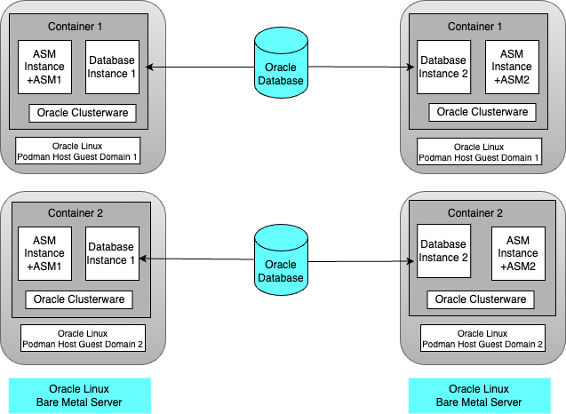
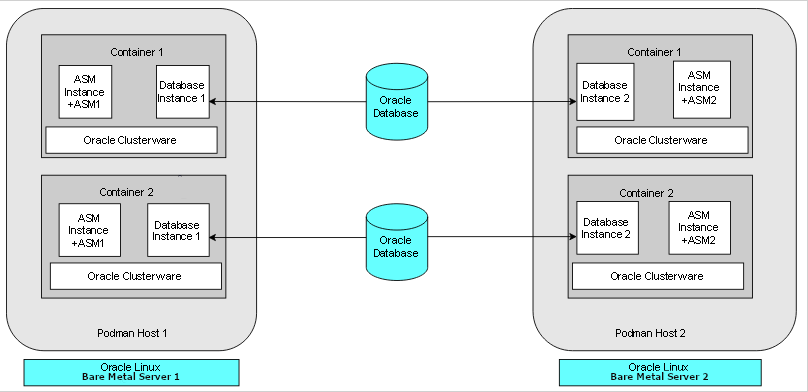
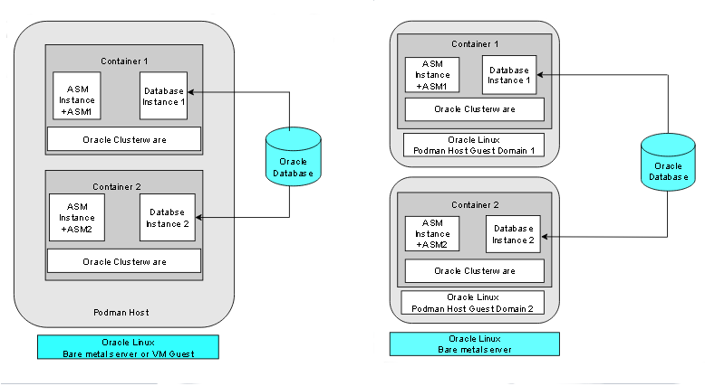

## 2 Target Configuration for Oracle RAC on Podman

The procedures in this document are tested for a 2-node Oracle RAC cluster running on two Linux host servers, and using block devices for shared storage.

- Overview of Oracle RAC on Podman
  Starting with Oracle Database 19c (19.16), Oracle RAC is supported on Podman containers for production deployments.
- Podman Host Server Configuration
  When configuring your Podman host server, follow these guidelines, and see the configuration Oracle used for testing.
- Podman Containers and Oracle RAC Nodes
  Learn about the configuration used in this document, so that you can understand the procedures we follow.
- Provisioning the Podman Host Server
  You can provision the Linux server hosting Podman (the Podman host server) either on a bare metal (physical) server, or on an Oracle Linux Virtual Machine (VM).
- Podman Host Preparation
  Before you can install Oracle Grid Infrastructure and Oracle Real Application Clusters, you must install Podman.
- Build the Podman Image for Oracle RAC on Podman
  To build Oracle Real Application Clusters (Oracle RAC) installation images, you create an image directory, create an image, and ensure the Podman host has connectivity to the Internet.
- Provision Shared Devices for Oracle ASM
  Ensure that you provision storage devices for Oracle Automatic Storage Management (Oracle ASM) with clean disks.
- Create Public and Private Networks for Oracle RAC on Podman
  Use this example to see how to configure the public network and private networks for Oracle Real Application Clusters (Oracle RAC).
- Options to Consider Before Deployment
  Before deployment of Oracle RAC on Podman, review network and host configuration options.
- Create the Oracle RAC Containers
  To create Oracle Real Application Clusters (Oracle RAC) containers, run `Podman create` commands similar to these examples.
- Connect the Network and Start the Podman Containers
  Before you start the containers, you set up the public and private networks, and assign the networks to the Oracle RAC Containers.
- Download Oracle Grid Infrastructure and Oracle Database Software
  Download the Oracle Database and Oracle Grid Infrastructure software from the Oracle Technology Network, and stage it.
- Deploy Oracle Grid Infrastructure and Oracle RAC in the Containers
  After you prepare the containers, complete a standard Oracle Grid Infrastructure and Oracle Real Application Clusters (Oracle RAC).
- Options to Consider After Deployment
  After deployment of Oracle RAC in containers, you can choose to add more or remove Oracle Real Application Clusters (Oracle RAC) nodes, or install different releases of Oracle RAC.
- Known Issues for Oracle RAC on Podman
  When you deploy Oracle Real Application Clusters (Oracle RAC) on Podman containers, if you encounter an issue, check to see if it is a known issue.
- Additional Information for Oracle RAC on Podman Configuration
  This information can help to resolve issues that can arise with Oracle Real Application Clusters (Oracle RAC) on Podman.

### Overview of Oracle RAC on Podman

Starting with Oracle Database 19c (19.16), Oracle RAC is supported on Podman containers for production deployments.

To prevent a single host causing complete downtime in a production environment, distribute Oracle RAC nodes across Podman hosts running on different physical servers. It is possible to configure Oracle RAC on Podman hosts running on same physical server for test and development environments.

The following figure shows a production configuration, in which there are two containers on one host, in separate guest domains, and two containers on a second host, also with two separate guest domains, with a high availability storage and network configuration:

[Description of the illustration prod-config-podman.png](img_text/prod-config-podman.md)

The following figure shows another production deployment, in which containers are located in different Podman hosts on separate hardware servers, with a high availability storage and network configuration:

[Description of the illustration bare-metal-server-prod-podman.png](img_text/bare-metal-server-prod-podman.md)

The following figure shows two examples of typical test and development deployments. The example on the left side shows a Podman host in which the cluster member nodes are containers in the same Podman host. The example on the right shows two Podman hosts on the same hardware server, with separate containers on each host.

[Description of the illustration test-dev-podman.png](img_text/test-dev-podman.md)

For virtual test and development clusters, you can use two or more Podman containers as nodes of the same cluster, running on only one Oracle Linux Podman host, because high availability is not required for testing.

**Parent topic:** Target Configuration for Oracle RAC on Podman

### Podman Host Server Configuration

When configuring your Podman host server, follow these guidelines, and see the configuration Oracle used for testing.

The Podman server must be sufficient to support the intended number of Podman containers, each of which must meet at least the minimum requirements for Oracle Grid Infrastructure servers hosting an Oracle Real Application Clusters node. Client machines must provide sufficient support for the X Window System (X11) remote display interactive installation sessions run from the Oracle RAC node. However, if you use noninteractive (silent) installation, then the client machine is not needed.

For details about Podman storage requirements, see "Setting Storage Configuration Options" at the following URL:

[Oracle Linux Podman User's Guide](https://docs.oracle.com/en/operating-systems/oracle-linux/podman/podman-ConfiguringStorageforPodman.html#podman-install-storage)

In the example configuration in this document, we use the following configuration. Change host and container names to match your configuration.

#### Oracle RAC Node 1

- Podman host: `podman-host-1`

- Container: `racnode1`

- CPU Core IDs: 0 and 1

- RAM: 16 GB

- Swap memory: 16 GB

- Operating system disk:

  You can use any supported storage options for Oracle Grid Infrastructure. Ensure that your storage has at least the following available space:

  - Root (`/`): 40 GB
  - `/scratch`: 80 GB (the Podman host directory, which will be used for `/u01` to store Oracle Grid Infrastructure and Oracle Database homes)
  - `/var/lib/containers`: 100 GB `xfs`

- Podman version: 4.0.2

- Linux: Oracle Linux Server release 8.5, with kernel `5.4.17-2136.300.7.el8uek.x86_64`

#### Oracle RAC Node 2

- Podman host: `podman-host-2`

- Container: `racnode2`

- CPU Core IDs: 0 and 1

- RAM: 16 GB

- Swap memory: 16 GB

- Operating system disk:

  You can use any supported storage options for Oracle Grid Infrastructure. Ensure that your storage has at least the following available space:

  - Root (`/`): 40 GB
  - `/scratch`: 80 GB (the Podman host directory, which will be used for `/u01` to store Oracle Grid Infrastructure and Oracle Database homes)
  - `/var/lib/containers`: 100 GB `xfs`

- Podman version: 4.0.2

- Linux: Oracle Linux Server release 8.5, with kernel `5.4.17-2136.300.7.el8uek.x86_64`

#### Block devices

You can use any supported storage options for Oracle Grid Infrastructure. Ensure that your storage has at least the following available space:

- `/dev/sdd (50 GB)`
- `/dev/sde (50 GB)`

**Related Topics**

- [Supported Storage Options for Oracle Grid Infrastructure](../cwlin/supported-storage-options-for-oracle-grid-infrastructure.md)

**Parent topic:** Target Configuration for Oracle RAC on Podman

### Podman Containers and Oracle RAC Nodes

Learn about the configuration used in this document, so that you can understand the procedures we follow.

This document provides steps and commands to create Podman containers using the two-node configuration as an example that this guide provides. The configuration information that follows is a reference for that configuration.

The Podman containers in this example configuration were created on the Podman hosts `podman-host-1` and `podman-host-2` for Oracle Real Application Clusters (Oracle RAC):

#### Oracle RAC Node 1

- Container: `racnode1`

- CPU core IDs: 0 and 1

- Memory
  - RAM memory: 16 GB
  - Swap memory: 16 GB

- Oracle Automatic Storage Management (Oracle ASM) Disks
  - `/dev/asm-disk1`
  - `/dev/asm-disk2`

- Host names and IP addresses
  - `racnode1, 10.0.20.150`
  - `racnode1-vip, 10.0.20.160`
  - `racnode1-priv, 192.168.17.150`
  - `racnode-scan, 10.0.20.170/171/172`
  - Domain: `example.info`

- The `racnode1` Podman volumes are mounted using Podman host directory paths and appropriate permissions.

  To ensure that the mount is performed as a directory, each mount is specified using `-v` or `--volume`. A volume consists of three fields, separated by colon characters (`:`). When you set up volumes, you must set the volume fields in the following order: `source-path``:``target-path``:``options`. For example:

      # podman container create ... --volume /boot:/boot:ro ... -name racnode1

  Note that `/boot` must be `readonly` inside the container. Also note that the paths inside the containers (`/boot`, `/software/stage`, `u01`, and` /etc/localtime`) are coming from the mounts on the Podman host (`/boot:ro`, `/scratch/software/stage`, `/scratch/rac/cluster01/node1`, and `/etc/localtime`)

  Each of the following volumes are mounted:

  - `/boot `: read-only (`/boot:ro`)
  - `/software/stage` read-write (`/scratch/software/stage`)
  - `/u01` read-write (`/scratch/rac/cluster01/node1`)
  - `/etc/localtime` read-only (`/etc/localtime`)

- Oracle Database configuration
  - Release 19.16
  - CDB name: `orclcdb`
  - PDB name: `orclpdb`
  - Instance: `orclcdb1`
  - SGA size: 3 GB
  - PGA size: 2 GB

#### Oracle RAC Node 2

- Container: `racnode2`

- CPU core IDs: 0 and 1

- Memory
  - RAM memory: 16 GB
  - Swap memory: 16 GB

- Oracle Automatic Storage Management (Oracle ASM) Disks
  - `/dev/asm/disk1`
  - `/dev/asm-disk2`

- Host names and IP addresses
  - `racnode2 10.0.20.151`
  - `racnode2-vip 10.0.20.161`
  - `racnode2-priv 192.168.17.151`
  - `racnode-scan 10.0.20.170/171/172`
  - Domain: `example.info`

- The `racnode2` Podman volumes are mounted using Podman host directory paths and appropriate permissions.

  To ensure that the mount was performed as a directory, mounts are created for Podman using `-v` or `--volume`. A volume consists of three fields, separated by colon characters (:). When you configure your volumes, you must set the volume fields in the following order: `source-path``:``target-path``:``options`. For example:

      # Podman container create ... --volume /boot:/boot:ro ... -name racnode2

  Each of the following volumes are created:

  - `/boot `: read-only (`/boot:ro`)
  - `/software/stage` read-write (`/scratch/software/stage`)
  - `/u01` read-write (`/scratch/rac/cluster01/node2`)
  - `/etc/localtime` read-only (`/etc/localtime`)

  **Note:**

  After this procedure is completed, to confirm mounts are set up, you can run the Podman command `podman container inspect racnode2`. For more information about using this command to check mounts for your configuration, refer to the Podman documentation.

- Oracle Database
  - Instance: `orclcdb2`

**Related Topics**

- [Podman Troubleshooting: Can't use volume mount, get permission denied](https://github.com/containers/podman/blob/main/troubleshooting.md#2-cant-use-volume-mount-get-permission-denied)

**Parent topic:** Target Configuration for Oracle RAC on Podman

### Provisioning the Podman Host Server

You can provision the Linux server hosting Podman (the Podman host server) either on a bare metal (physical) server, or on an Oracle Linux Virtual Machine (VM).

**Parent topic:** Target Configuration for Oracle RAC on Podman

### Podman Host Preparation

Before you can install Oracle Grid Infrastructure and Oracle Real Application Clusters, you must install Podman.

- Preparing for Podman Container Installation
  Review the Oracle Podman Container documentation, and prepare your system for deployment.
- Installing Podman Engine
  In this example, the Podman engine is installed on an Oracle Linux Server release 8.5 with a version 5.4.17 kernel.
- Allocate Linux Resources for Oracle Grid Infrastructure Deployment
  Configure Linux resource allocations and configuration settings on the Podman host for Oracle Grid Infrastructure and the Oracle Real Application Clusters (Oracle RAC) container.
- Enable Real Time Mode for Oracle RAC Processes
  To populate the real-time CPU budgeting on machine restarts on Unbreakable Enterprise Linux Release 6 kernels (UEKR6), create `oneshot systemd` service.
- How to Configure Podman for SELinux Mode
  To run Podman containers in an environment with SELinux enabled, you must configure an SELinux policy for the containers.

**Parent topic:** Target Configuration for Oracle RAC on Podman

#### Preparing for Podman Container Installation

Review the Oracle Podman Container documentation, and prepare your system for deployment.

Each container that you deploy as part of your cluster must satisfy the minimum hardware requirements of the Oracle Real Application Clusters (Oracle RAC) and Oracle Grid Infrastructure software. If you are planing to install Oracle Grid Infrastructure and Oracle RAC database software on data volumes exposed from your environment, then you must have at least 5 GB space allocated for the Oracle RAC on Podman image. However, if you are planning to install software inside the image, then you must have approximately 20 GB allocated for the Oracle RAC on Podman image.

**Parent topic:** Podman Host Preparation

#### Installing Podman Engine

In this example, the Podman engine is installed on an Oracle Linux Server release 8.5 with a version 5.4.17 kernel.

This content summarizes Podman deployment for this scenario. For details about Podman deployment, refer to "Oracle Linux: Podman User's Guide " at the following URL:

<https://docs.oracle.com/en/operating-systems/oracle-linux/podman/>

In that installation, the Podman storage is in `/var/lib/containers`, which has an `xfs` file system. After the setup, the Podman engine looks like the following example:

    # podman info
    host:
      arch: amd64
      buildahVersion: 1.24.1
      cgroupControllers:
      - cpuset
      - cpu
      - cpuacct
      - blkio
      - memory
      - devices
      - freezer
      - net_cls
      - perf_event
      - net_prio
      - hugetlb
      - pids
      - rdma
      cgroupManager: systemd
      cgroupVersion: v1
      conmon:
        package: conmon-2.1.0-1.module+el8.6.0+20665+a3b29bef.x86_64
        path: /usr/bin/conmon
        version: 'conmon version 2.1.0, commit: 9a942873287e0edbdc580ebee0fcd4b3735244f5'
      cpus: 12
      distribution:
        distribution: '"ol"'
        variant: server
        version: "8.6"
      eventLogger: file
      hostname: podman-host-01
      idMappings:
        gidmap: null
        uidmap: null
      kernel: 5.4.17-2136.309.5.el8uek.x86_64
      linkmode: dynamic
      logDriver: k8s-file
      memFree: 2094616576
      memTotal: 41633333248
      networkBackend: cni
      ociRuntime:
        name: runc
        package: runc-1.0.3-2.module+el8.6.0+20665+a3b29bef.x86_64
        path: /usr/bin/runc
        version: |-
          runc version 1.0.3
          spec: 1.0.2-dev
          go: go1.17.7
          libseccomp: 2.5.2
      os: linux
      remoteSocket:
        path: /run/podman/podman.sock
      security:
        apparmorEnabled: false
        capabilities: CAP_NET_RAW,CAP_CHOWN,CAP_DAC_OVERRIDE,CAP_FOWNER,CAP_FSETID,CAP_KILL,CAP_NET_BIND_SERVICE,CAP_SETFCAP,CAP_SETGID,CAP_SETPCAP,CAP_SETUID,CAP_SYS_CHROOT
        rootless: false
        seccompEnabled: true
        seccompProfilePath: /usr/share/containers/seccomp.json
        selinuxEnabled: true
      serviceIsRemote: false
      slirp4netns:
        executable: /bin/slirp4netns
        package: slirp4netns-1.1.8-2.module+el8.6.0+20665+a3b29bef.x86_64
        version: |-
          slirp4netns version 1.1.8
          commit: d361001f495417b880f20329121e3aa431a8f90f
          libslirp: 4.4.0
          SLIRP_CONFIG_VERSION_MAX: 3
          libseccomp: 2.5.2
      swapFree: 8571830272
      swapTotal: 8589930496
      uptime: 5h 22m 18.58s (Approximately 0.21 days)
    plugins:
      log:
      - k8s-file
      - none
      - passthrough
      - journald
      network:
      - bridge
      - macvlan
      - ipvlan
      volume:
      - local
    registries:
      search:
      - container-registry.oracle.com
      - docker.io
    store:
      configFile: /etc/containers/storage.conf
      containerStore:
        number: 2
        paused: 0
        running: 2
        stopped: 0
      graphDriverName: overlay
      graphOptions:
        overlay.mountopt: nodev,metacopy=on
      graphRoot: /var/lib/containers/storage
      graphStatus:
        Backing Filesystem: xfs
        Native Overlay Diff: "false"
        Supports d_type: "true"
        Using metacopy: "true"
      imageCopyTmpDir: /var/tmp
      imageStore:
        number: 9
      runRoot: /run/containers/storage
      volumePath: /var/lib/containers/storage/volumes
    version:
      APIVersion: 4.0.2
      Built: 1652749236
      BuiltTime: Tue May 17 01:00:36 2022
      GitCommit: ""
      GoVersion: go1.17.7
      OsArch: linux/amd64
      Version: 4.0.2

**Parent topic:** Podman Host Preparation

#### Allocate Linux Resources for Oracle Grid Infrastructure Deployment

Configure Linux resource allocations and configuration settings on the Podman host for Oracle Grid Infrastructure and the Oracle Real Application Clusters (Oracle RAC) container.

- Set Kernel Parameters on the Podman Host
  To ensure that your kernel resource allocation is adequate, update the Linux `/etc/sysctl.conf` file.
- Create Mount Points for the Oracle Software Binaries
  As the `root` user, create mount points for the Oracle software on local or remote storage.
- Check Shared Memory File System Mount
  Use this command to check the shared memory mount.
- Configure NTP on the Podman Host
  You must set up the use `chrony` implementation of the Network Time Protocol (NTP) feature server on the Podman host for the Oracle Real Application Clusters (Oracle RAC) container.
- Set Clock Source on the Podman Host
  Oracle recommends that you set the clock source to `tsc` for better performance in virtual environments (VM) on Linux x86-64.
- Create a Directory to Stage the Oracle Software on the Podman Host
  To stage Oracle Grid Infrastructure and Oracle Real Application Clusters software, create mount points, either on local or remote storage.
- Using CVU to Validate Readiness for Oracle Podman Host
  Oracle recommends that you use standalone Cluster Verification Utility (CVU) on your Podman host to help to ensure that the Podman host is configured correctly.

**Parent topic:** Podman Host Preparation

##### Set Kernel Parameters on the Podman Host

To ensure that your kernel resource allocation is adequate, update the Linux `/etc/sysctl.conf` file.

1.  Log in as root

2.  Use the `vim` editor to update `/etc/sysctl.conf` parameters to the following values:
    - fs.aio-max-nr=1048576

    - fs.file-max = 6815744

    - net.core.rmem_max = 4194304

    - net.core.rmem_default = 262144

    - net.core.wmem_max = 1048576

    - net.core.wmem_default = 262144

    - vm.nr_hugepages=16384

3.  Run the following commands:

        # sysctl -a
        # sysctl –p

**Note:**

Because `vm.nr_hugepages` enable HugePages in the Podman host, Oracle recommends that you configure `madvise` for UEK7 and disable Transparent HugePages for UEK6. For instructions on how to perform this task, refer to "Setting Transparent HugePages to madvise" and "Disabling Transparent HugePages" in Oracle Database Installation Guide for Linux.

**Related Topics**

- [Disabling Transparent Hugepages](../ladbi/setting-thp-uek.md)

**Parent topic:** Allocate Linux Resources for Oracle Grid Infrastructure Deployment

##### Create Mount Points for the Oracle Software Binaries

As the `root` user, create mount points for the Oracle software on local or remote storage.

The mount points that you create must be available to all Podman hosts, use interfaces such as `iscsi`, and mounted in the host at the mount point, such as `/scratch`. Regardless of using local or remote storage, this same mount point path must exist on each Podman host. .

**Note:**

If a device is used to mount the `/scratch` file system in the host, then the host's`/etc/fstab` file has an entry for `/scratch`, and the operating system will generate a file system mount service, `scratch.mount`, to automatically mount the file system at host restarts.

As the `root` user, run commands similar to the following:

On `podman-host-1`:

    # mkdir -p /scratch/rac/cluster01/node1

On `podman-host-2`:

    # mkdir -p /scratch/rac/cluster01/node2

**Parent topic:** Allocate Linux Resources for Oracle Grid Infrastructure Deployment

##### Check Shared Memory File System Mount

Use this command to check the shared memory mount.

Verify that shared memory (`/dev/shm`) is mounted properly with sufficient size.

For example:

    # df -h /dev/shm
    Filesystem      Size  Used Avail Use% Mounted on
    tmpfs            14G  168K   14G   1% /dev/shm

The `df -h` command displays the file system on which `/dev/shm` is mounted, and also displays in GB the total size, and the free size of shared memory.

**Parent topic:** Allocate Linux Resources for Oracle Grid Infrastructure Deployment

##### Configure NTP on the Podman Host

You must set up the use `chrony` implementation of the Network Time Protocol (NTP) feature server on the Podman host for the Oracle Real Application Clusters (Oracle RAC) container.

Containers on Podman inherit the time from the Podman host. For this reason, the `chronyd` service daemon must run on the Podman host, not inside the Oracle RAC container. The `chronyd` daemon service replaces `ntpd` for the management of NTP in Oracle Linux 8. For information about how to set up the network time server, refer to the section describing how to configure the `chrony` daemon service in Oracle Linux 8 Setting Up Networking.

**Related Topics**

- [Oracle Linux 8 Configuring Network Time](https://docs.oracle.com/en/operating-systems/oracle-linux/8/network/network-ConfiguringNetworkTime.html#ol-nettime)

**Parent topic:** Allocate Linux Resources for Oracle Grid Infrastructure Deployment

##### Set Clock Source on the Podman Host

Oracle recommends that you set the clock source to `tsc` for better performance in virtual environments (VM) on Linux x86-64.

The Podman containers inherit the clock source of their Linux host. For better performance, and to provide the clock source expected for the Oracle Real Application Clusters (Oracle RAC) database installation, Oracle recommends that you change the clock source setting to TSC.

1.  As the `root` user, check if the `tsc` clock source is available on your system.
        # cat /sys/devices/system/clocksource/clocksource0/available_clocksource
        kvm-clock tsc acpi_pm
2.  If the `tsc` clock source is available, then set `tsc` as the current clock source.
        # echo "tsc">/sys/devices/system/clocksource/clocksource0/current_clocksource
3.  Verify that the current clock source is set to `tsc`.
        # cat /sys/devices/system/clocksource/clocksource0/current_clocksource
        tsc
4.  Using any text editor, append the `clocksource` directive to the `GRUB_CMDLINE_LINUX` line in the `/etc/default/grub` file to retain this clock source setting even after a reboot.
        GRUB_CMDLINE_LINUX="rd.lvm.lv=ol/root rd.lvm.lv=ol/swap rhgb quiet numa=off transparent_hugepage=never clocksource=tsc"

**Parent topic:** Allocate Linux Resources for Oracle Grid Infrastructure Deployment

##### Create a Directory to Stage the Oracle Software on the Podman Host

To stage Oracle Grid Infrastructure and Oracle Real Application Clusters software, create mount points, either on local or remote storage.

Assuming that you perform the installation from node 1 of the Oracle RAC cluster, the mount point that you create for the Oracle software must be available to at least the Podman host of node 1, and be mountable within the container under the file path `/stage/software`.

As the root user, run commands similar to the following:

    # mkdir -p /scratch/software/stage
    # chmod a+rwx /scratch/software/stage

**Parent topic:** Allocate Linux Resources for Oracle Grid Infrastructure Deployment

##### Using CVU to Validate Readiness for Oracle Podman Host

Oracle recommends that you use standalone Cluster Verification Utility (CVU) on your Podman host to help to ensure that the Podman host is configured correctly.

You can use CVU to assist you with system checks in preparation for creating a Podman container for Oracle Real Application Clusters (Oracle RAC), and installing Oracle RAC inside the containers. CVU runs the appropriate system checks automatically, and prompts you to fix problems that it detects. To obtain the benefits of system checks, you must run the utility on all the Podman hosts that you want to configure to host the Oracle RAC containers.

To obtain CVU, download Patch 30839369: Standalone CVU version 21.7 for container host July 2022 (Patch).

**Note:**

Ensure that you download the **container host** patch, which is different from the standard CVU distribution.

**Related Topics**

- [Patch 30839369: Standalone CVU version 21.7 for container host July 2022 (Patch)](https://updates.oracle.com/Orion/Services/download/cvupack_linux_ol7_x86_64.zip?aru=24906122&patch_file=cvupack_linux_ol7_x86_64.zip)

**Parent topic:** Allocate Linux Resources for Oracle Grid Infrastructure Deployment

#### Enable Real Time Mode for Oracle RAC Processes

To populate the real-time CPU budgeting on machine restarts on Unbreakable Enterprise Linux Release 6 kernels (UEKR6), create `oneshot systemd` service.

**Note:**

Do not run this procedure if you are using Unbreakable Linux Kernel Release 7 (UEKR7). To confirm which version you are running, run the following command:

    uname -r

If the response is `kernel-uek-5.4.17-2136.307.3` or later, then you are on UEKR6. If the response is `uek-5.15.0-3.60.5.1` or later, then you are on UEKR7.

To run processes inside a container in real time mode for UEKR6, the `/sys/fs/cgroup/cpu,cpuacct/machine.slice/cpu.rt_runtime_us` must be populated with Real Time (RT) budgeting. The `oneshot systemd` service will automatically populate the RT budgeting. This service needs to run only after storage and networking for the Podman containers are available in the host. Therefore, the property `After=` has the value of `multi-user.target` as an umbrella dependency for the service.

To enable the `oneshot systemd` service, you must first create a `Systemd` initialization file, `/etc/systemd/system/podman-rac-cgroup.service` with the following content:

    [Unit]
    Description=Populate Cgroups with real time chunk on machine restart
    After=multi-user.target
    [Service]
    Type=oneshot
    ExecStart=/bin/bash -c "echo 950000 > /sys/fs/cgroup/cpu,cpuacct/machine.slice/cpu.rt_runtime_us && \
    /bin/systemctl restart podman-restart.service"
    StandardOutput=journal
    CPUAccounting=yes
    Slice=machine.slice
    [Install]
    WantedBy=multi-user.target

Next, to create and start `oneshot systemd` service, run the following commands:

    # systemctl daemon-reload
    # systemctl enable podman-restart.service
    # systemctl enable podman-rac-cgroup.service --now

**Parent topic:** Podman Host Preparation

#### How to Configure Podman for SELinux Mode

To run Podman containers in an environment with SELinux enabled, you must configure an SELinux policy for the containers.

With Security-Enhanced Linux (SELinux), you must set a policy to implement permissions for your containers. If you do not configure a policy module for your containers, then they can end up restarting indefinitely. You must add all Podman host nodes for your cluster to the policy module `rac-podman`, by installing the necessary packages and creating a type enforcement file (designated by the `.te `suffix) to build the policy, and load it into the system.

In the following example, the Podman host `podman-host-1` is configured in the SELinux policy module `rac-podman`:

    [root@podman-host-1 ~]# dnf install selinux-policy-devel
    [root@podman-host-1 ~]# dnf install setroubleshoot setools
    [root@podman-host-1 ~]# cat /var/opt/rac-podman.te
    module rac-podman  1.0;

    require {
            type kernel_t;
            class system syslog_read;
            type container_runtime_t;
            type container_init_t;
            class file getattr;
            type container_file_t;
            type lib_t;
            type textrel_shlib_t;
            type unlabeled_t;
            class file read;
            type bin_t;
            class file { execmod execute map setattr };

    }

    #============= container_init_t ==============
    allow container_init_t container_runtime_t:file getattr;
    allow container_init_t bin_t:file map;
    allow container_init_t bin_t:file execute;
    allow container_init_t container_file_t:file execmod;
    allow container_init_t lib_t:file execmod;
    allow container_init_t textrel_shlib_t:file setattr;
    allow container_init_t kernel_t:system syslog_read;
    allow container_init_t unlabeled_t:file read;

    [root@podman-host-1 ~]# cd /var/opt
    [root@podman-host-1 ~]# make -f /usr/share/selinux/devel/Makefile rac-podman.pp
    [root@podman-host-1 ~]# semodule -i rac-podman.pp
    [root@podman-host-1 ~]# semodule -l | grep rac-pod

Repeat this process for `podman-host-2`.

After you complete these commands, change the file context of the host directory that will be used by the container:

    [root@podman-host-1 ~]# semanage fcontext -a -t container_file_t /scratch/rac/cluster01/node1
    [root@podman-host-1 ~]# restorecon -vF /scratch/rac/cluster01/node1

    [root@podman-host-2 ~]# semanage fcontext -a -t container_file_t /scratch/rac/cluster01/node2
    [root@podman-host-2 ~]# restorecon -vF /scratch/rac/cluster01/node2

**Parent topic:** Podman Host Preparation

### Build the Podman Image for Oracle RAC on Podman

To build Oracle Real Application Clusters (Oracle RAC) installation images, you create an image directory, create an image, and ensure the Podman host has connectivity to the Internet.

**Note:**

You can do this procedure on one Podman host, and use the image on the other Podman hosts, or repeat the same image build procedure on each Podman host.

- Create the Podman Image Build Directory
  To perform the Podman Image creation, use this procedure to create a directory for the build process.
- Prepare Container Setup Script
  To maintain device permissions, default route and host environment configuration, create a script to run automatically after container restarts to configure the container environment.
- Create a Containerfile for Oracle RAC on Podman Image
  To set up the Oracle Real Application Clusters (Oracle RAC) Podman file images, you must pull a base Oracle Linux image.
- Create the Oracle RAC on Podman Image
  To create the Oracle Real Application Clusters (Oracle RAC) image, set your Oracle Linux environment as required, and build an image from the Containerfile and context.
- Use a Central Image Repository for Oracle RAC on Podman
  You can chose to set up a container image repository for your Podman images.

**Parent topic:** Target Configuration for Oracle RAC on Podman

#### Create the Podman Image Build Directory

To perform the Podman Image creation, use this procedure to create a directory for the build process.

Log in as `root`, and enter the following commands:

    # mkdir /scratch/image
    # cd /scratch/image

**Parent topic:** Build the Podman Image for Oracle RAC on Podman

#### Prepare Container Setup Script

To maintain device permissions, default route and host environment configuration, create a script to run automatically after container restarts to configure the container environment.

When you restart Podman containers, device permissions, default routes, and `/etc/hosts` entries that were previously configured for the containers are reset. To maintain your configuration between Podman and Podman container restarts, use this procedure to build a script that you can configure to run on each container to set up the environment after restarts.

Because Oracle Real Application Clusters (Oracle RAC) uses containers based on `systemd`, you can run the container environment script on every restart by adding the script to the `/etc/rc.local` folder inside the container when you create the Oracle RAC slim image. After restarts, the script you add to `rc.local` can ensure that your Podman container environments are restored. Complete each of these steps in sequence. Create the files and script in the Podman image build directory, which in this example is `/stage/image`.

1.  Create and populate `resolv.conf` on the Podman host for your container environment. Also, if you are planning to deploy containers on multiple hosts, then you must ensure that this `resolv.conf` that you create is available on all Podman hosts where the image is built, because this file contains entries for your domain name server (DNS) search, and search domains.
    For the example configuration in this guide, the host file contents for the DNS are as follows:

        search example.info
        nameserver 162.88.2.6
2.  If the host names for your Podman containers are not in a DNS (see step 1), then create and populate your `hostfile` on all Podman hosts where the image is built, and populate the file with the host entries of your Podman containers' Public IP addresses, Private IP addresses, and Virtual IP addresses. Use the IP addresses and host names that you set up for your environment. If you are planning to deploy containers on multiple hosts, then you must ensure that the `hostfile` is available on all of your Podman hosts where you plan to deploy containers.
    For the example configuration in this guide, the host file contents are as follows:

        127.0.0.1 localhost
        ::1 localhost ip6-localhost ip6-loopback

        ## Public IP addresses
        10.0.20.150 racnode1.example.info racnode1
        10.0.20.151 racnode2.example.info racnode2

        ## Virtual IP addresses
        10.0.20.160 racnode1-vip.example.info racnode1-vip
        10.0.20.161 racnode2-vip.example.info racnode2-vip

        ## Private IPs
        192.168.17.150 racnode1-priv.example.info racnode1-priv
        192.168.17.151 racnode2-priv.example.info racnode2-priv
3.  Create the script `setupContainerEnv.sh` in the Podman image build directory, and copy and paste the following contents into the script:
    For example:

        #!/bin/bash
        chown grid:asmadmin /dev/asm-disk1
        chown grid:asmadmin /dev/asm-disk2
        chmod 660 /dev/asm-disk1
        chmod 660 /dev/asm-disk2
        cat /opt/scripts/startup/resolv.conf > /etc/resolv.conf
        cat /opt/scripts/startup/hostfile > /etc/hosts
        systemctl reset-failed
        loginctl enable-linger root
        loginctl enable-linger grid
        loginctl enable-linger oracle

    Always use complete paths for the location of files in the script, so that the script does not require the `PATH` variable to be set.

We will add this script to run at container startup by using the Oracle RAC containers `/etc/rc.local`. This step is described in the section "Build Oracle RAC Database on Podman Image." After you add the line to `/etc/rc.local` to call the `setupContainerEnv.sh` script, if the Podman Container is reset, then when a Podman container is started and `init` loads, `setupContainerEnv.sh` runs the following operations on every container restart:

1.  Sets the default gateway
2.  Sets the correct device permissions on ASM devices
3.  Sets up the `/etc/hosts` file.
4.  Sets up the `/etc/resolv.conf` file.

If you plan to deploy containers on multiple hosts, then you must copy `setupContainerEnv.sh` on all the Podman hosts where the image is built.

**Note:**

The setup script at the time of the image build, and the content of the `resolv.conf` and `hostfile` files, are embedded in the Podman image during the build. That content may not be applicable to the containers deployed using the same image for other deployments, which will have different ASM disks and network configuration. However, you can modify that content after the containers are created and started, for example by logging in the containers and editing the files and script in `/opt/scripts/startup`.

**Parent topic:** Build the Podman Image for Oracle RAC on Podman

#### Create a Containerfile for Oracle RAC on Podman Image

To set up the Oracle Real Application Clusters (Oracle RAC) Podman file images, you must pull a base Oracle Linux image.

1.  Create a file named `Containerfile` under `/scratch/image`.

2.  Open `Containerfile` with an editor, and paste the following lines into the file:

        # Pull base image
        # ---------------
        FROM oraclelinux:8
        # Environment variables required for this build (do NOT change)
        # -------------------------------------------------------------
        ## Environment Variables
        ## ---
        ENV SCRIPT_DIR=/opt/scripts/startup \
            RESOLVCONFENV="resolv.conf" \
            HOSTFILEENV="hostfile" \
            SETUPCONTAINERENV="setupContainerEnv.sh"

        ### Copy Files
        # ----

        COPY  $SETUPCONTAINERENV $SCRIPT_DIR/

        ### RUN Commands
        # -----
        COPY $HOSTFILEENV $RESOLVCONFENV $SCRIPT_DIR/
        RUN dnf install -y oracle-database-preinstall-19c systemd vim passwd openssh-server hostname xterm xhost vi policycoreutils-python-utils && \
         dnf clean all && \
         sync && \
         groupadd -g 54334 asmadmin && \
         groupadd -g 54335 asmdba && \
         groupadd -g 54336 asmoper && \
         useradd -u 54332 -g oinstall -G oinstall,asmadmin,asmdba,asmoper,racdba,dba grid && \
         usermod -g oinstall -G oinstall,dba,oper,backupdba,dgdba,kmdba,asmdba,racdba,asmadmin oracle && \
         cp /etc/security/limits.d/oracle-database-preinstall-19c.conf /etc/security/limits.d/grid-database-preinstall-19c.conf && \
         sed -i 's/oracle/grid/g' /etc/security/limits.d/grid-database-preinstall-19c.conf && \
         rm -f /etc/rc.d/init.d/oracle-database-preinstall-19c-firstboot && \
         rm -f /etc/sysctl.conf && \
         rm -f /usr/lib/systemd/system/dnf-makecache.service && \
         echo "$SCRIPT_DIR/$SETUPCONTAINERENV" >> /etc/rc.local && \
         chmod +x $SCRIPT_DIR/$SETUPCONTAINERENV && \
         chmod +x /etc/rc.d/rc.local && \
         setcap 'cap_net_admin,cap_net_raw+ep' /usr/bin/ping && \
         sync

        USER root
        WORKDIR /root
        VOLUME ["/stage/software"]
        VOLUME ["/u01"]
        CMD ["/usr/sbin/init"]
        # End of the Containerfile

If you require additional packages for your application, then you can add them to the `RUN yum` command.

**Parent topic:** Build the Podman Image for Oracle RAC on Podman

#### Create the Oracle RAC on Podman Image

To create the Oracle Real Application Clusters (Oracle RAC) image, set your Oracle Linux environment as required, and build an image from the Containerfile and context.

1.  Log in as `root`, and move to the directory for image creation that you have previously prepared:

        # cd /scratch/image

2.  Run the procedure for your use case:

    - Your server is behind a proxy firewall:

      - Run the following commands, where:
        - `localhost-domain` is the local host and domain for the internet gateway in your network
        - `http-proxy` is the HTTP proxy server for your network environment
        - `https-proxy` is the HTTPS proxy server for your network environment
        - `19.3` with the `19.16` RU is the Oracle Database release that you are planning to install inside the container.

      <!-- -->

          # export NO_PROXY=localhost-domain
          # export http_proxy=http-proxy
          # export https_proxy=https-proxy
          # export version=19.16
          # podman build --force-rm=true --no-cache=true --build-arg \
          http_proxy=${http_proxy} --build-arg https_proxy=${https_proxy} \
          -t oracle/database-rac:$version-slim  -f Containerfile .

    - Your server is not behind a proxy firewall:

      - Run the following commands, where `version` is the Oracle Database release that you are planning to install inside the Podman Container (for example, 19.16):

      <!-- -->

          # export version=19.16
          # podman build --force-rm=true --no-cache=true -t oracle/database-rac:$version-slim -f Containerfile .

3.  After the image builds successfully, you should see the image `oracle/database-rac:19.16-slim` created on your Podman host:

        [root@podman-host--1 image]# podman images
        REPOSITORY                                    TAG         IMAGE ID      CREATED        SIZE
        localhost/oracle/database-rac                 19.16-slim  9d5fed7eb7ba  7 seconds ago  396 MB
        container-registry.oracle.com/os/oraclelinux  8-slim      2ea85efcdb48  3 weeks ago    114 MB
        container-registry.oracle.com/os/oraclelinux  8           e6ca9618a97b  3 weeks ago    243 MB

4.  Save the image into a `tar` file, and transfer it to the other Podman host:

        # podman image save -o /var/tmp/database-rac.tar localhost/oracle/database-rac:19.16-slim
        # scp -i <ssh key for host podman-host-2> /var/tmp/database-rac.tar opc@podman-host-2:/var/tmp/database-rac.tar

5.  On the other Podman host, load the image from the tar file and check that it is loaded:

        # podman image load -i /var/tmp/database-rac.tar
        # podman images
        REPOSITORY                                    TAG         IMAGE ID      CREATED        SIZE
        localhost/oracle/database-rac                 19.16-slim  9d5fed7eb7ba  2 minutes ago  396 MB
        container-registry.oracle.com/os/oraclelinux  8           dfce5863ff0f  2 months ago   243 MB

**Parent topic:** Build the Podman Image for Oracle RAC on Podman

#### Use a Central Image Repository for Oracle RAC on Podman

You can chose to set up a container image repository for your Podman images.

If you have a container image repository on the network that reachable by the Podman hosts, then after the Oracle RAC on Podman image has been created on one Podman host, it can be pushed to the repository and used by all Podman hosts. For the details of the setup and the use of a repository, refer to the Podman documentation.

**Parent topic:** Build the Podman Image for Oracle RAC on Podman

### Provision Shared Devices for Oracle ASM

Ensure that you provision storage devices for Oracle Automatic Storage Management (Oracle ASM) with clean disks.

Storage for the Oracle Real Application Clusters must use Oracle ASM, either on block storage, or on a network file system (NFS). Using Oracle Advanced Storage Management Cluster File System (Oracle ACFS) for Oracle RAC on Podman is not supported.

The devices you use for Oracle ASM should not have any existing file system. To overwrite any other existing file system partitions or primary boot records from the devices, use commands such as the following on one Podman host:

    # dd if=/dev/zero of=/dev/sdd  bs=1024k count=1024
    # dd if=/dev/zero of=/dev/sde  bs=1024k count=1024

In this example deployment, the Podman host devices `/dev/sdd` and `/dev/sde` are at the same device paths in both Podman hosts. and will be mapped in the containers as `/dev/asm-disk1` and `/dev/asm-disk2`. This mapping is done in the container creation procedure "Create the Oracle RAC Containers"

**Parent topic:** Target Configuration for Oracle RAC on Podman

### Create Public and Private Networks for Oracle RAC on Podman

Use this example to see how to configure the public network and private networks for Oracle Real Application Clusters (Oracle RAC).

Before you start installation, you should create at least one public and two private networks in your containers. Oracle recommends that you create redundant private networks. Use this example as a model for your own configuration, but with the addresses you configure in your network domain. .

For development testing, the networks are created on private IP addresses, using the following configuration:

- `rac_eth0pub1_nw` (10.0.20.0/24): Public network
- `rac_eth1priv1_nw` (192.168.17.0/24): Private network 1
- `rac_eth2priv2_nw` (192.168.18.0/24): private network 2

Other examples that follow in this publication use these network names and addresses.

To set up the public network using a parent gateway interface in the Podman host, you must run Oracle RAC on Podman for multi-host, using either the Podman `MACVLAN` driver, or the `IPVLAN` driver. Also, the gateway interface that you use must be one to which the domain name servers (DNS) where you have registered the single client access names (SCANs) and host names for Oracle Grid Infrastructure can resolve. For our example, we used `macvlan` for the public network, and also `macvlan` for the Oracle RAC private network communication crossing different Podman hosts.

In the network creation commands, the `-o` parent parameter must specify the physical interface of the host to which the `macvlan` interface should be associated and `--subnet` specifies the subnet that is to be used for IP address assignments.

When a parent interface is used for the public network, and that parent interface itself is configured for the host to be on the host network subnet, the `--subnet` option must correspond to the subnet associated with the physical interface named with the `-o` parent parameter, and the `--gateway` option must correspond to the gateway on the network of the physical interface.

For more details on the commands and options, refer to the Podman Documentation.

There are two options for network configuration: Standard maximum transmission unit (MTU) networks, and Jumbo Frames MTU networks. To improve Oracle RAC communication performance, Oracle recommends that you enable Jumbo Frames for the network interfaces, so that the MTU is greater than 1,500 bytes. If you have Jumbo Frames enabled, then you can use a network device option parameter to set the MTU parameter of the networks to the same value as the Jumbo Frames MTU.

Example 2-1 Standard Frames MTU Network Configuration

Standard frames MTU networks are configured similar to the following:

    # ip link show | egrep "eth0|eth1|eth2"
    3: eth0: <BROADCAST,MULTICAST,UP,LOWER_UP> mtu 1500 qdisc fq_codel state UP mode DEFAULT group default qlen 1000
    4: eth1: <BROADCAST,MULTICAST,UP,LOWER_UP> mtu 1500 qdisc fq_codel state UP mode DEFAULT group default qlen 1000
    5: eth2: <BROADCAST,MULTICAST,UP,LOWER_UP> mtu 1500 qdisc fq_codel state UP mode DEFAULT group default qlen 1000

    # podman network create -d macvlan --subnet=10.0.20.0/24 --gateway=10.0.20.1 -o parent=eth0 rac_eth0pub1_nw
    # podman network create -d macvlan --subnet=192.168.17.0/24 -o parent=eth1 --disable-dns --internal rac_eth1priv1_nw
    # podman network create -d macvlan --subnet=192.168.18.0/24 -o parent=eth2 --disable-dns --internal rac_eth2priv2_nw

Example 2-2 Jumbo Frames MTU Network Configuration

Jumbo frames MTU networks are configured similar to the following:

    [podman-host-01 ~]$ ip link show | egrep "eth0|eth1|eth2"
    3: eth0: <BROADCAST,MULTICAST,UP,LOWER_UP> mtu 9000 qdisc fq_codel state UP mode DEFAULT group default qlen 1000
    4: eth1: <BROADCAST,MULTICAST,UP,LOWER_UP> mtu 9000 qdisc fq_codel state UP mode DEFAULT group default qlen 1000
    5: eth2: <BROADCAST,MULTICAST,UP,LOWER_UP> mtu 9000 qdisc fq_codel state UP mode DEFAULT group default qlen 1000

If the MTU on each interface is set to 9000, then you can then run the following commands on each Podman host to extend the maximum payload length for each network to use the entire MTU:

    # podman network create -d macvlan --subnet=10.0.20.0/24 --gateway=10.0.20.1 -o mtu=9000 parent=eth0 -o rac_eth0pub1_nw
    # podman network create -d macvlan --subnet=192.168.17.0/24 -o parent=eth1 -o mtu=9000 --disable-dns --internal rac_eth1priv1_nw
    # podman network create -d macvlan --subnet=192.168.18.0/24 -o parent=eth2 -o mtu=9000 --disable-dns --internal rac_eth2priv2_nw

To set up networks to run Oracle RAC in Podman containers, you can choose to use more than one public network, and more than two private networks, or just a single private network. If you choose to configure multiple networks, then to create these networks, repeat the `podman network create` commands, using the appropriate values for your network.

After the network creation, run the command `podman network ls`. The result of this command should show networks created on the Podman host similar to the following:

    [root@podman-host--1 image]# podman network ls
    NETWORK ID      NAME                   DRIVER
    2f259bab93aa    podman                 bridge
    0b560469e2e6    rac_eth0pub1_nw        macvlan
    85c5e0aa3969    rac_eth1priv1_nw       macvlan
    606a44672e40    rac_eth2priv2_nw       macvlan

**Parent topic:** Target Configuration for Oracle RAC on Podman

### Options to Consider Before Deployment

Before deployment of Oracle RAC on Podman, review network and host configuration options.

Before deployment, you can decide if you want to use one private network, or configure multiple private networks. You can also choose one of the following options:

- Multiple Podman hosts
- Multiple Podman bridges on a single Podman host

After you decide what network configuration option you want to use, complete the deployment procedure for your chosen configuration.

There are differences between Unbreakable Linux Kernel Release 6 (UEK6) and Unbreakable Linux Kernel Release 7 (UEK7). These will be explained where required.

**Note:**

In this document, we present the typical and recommended block device storage and network options. However, depending on your deployment topology and storage possibilities, you can consider other options that better fit the requirements of your deployment of Oracle RAC on Podman.

- Configuring NFS for Storage for Oracle RAC on Podman
  If you want to use NFS for storage, then create an NFS volume for Oracle Grid Infrastructure and Oracle RAC files, and make them available to the Oracle RAC containers.
- Multiple Private Networks Option for Oracle RAC on Podman
  Before deployment, if you want to use multiple private networks for Oracle RAC on Podman, then change your Podman container creation so that you can use multiple NICs for the private interconnect.
- Multiple Podman Hosts Option
  If you use multiple Podman hosts, then use commands similar to this example to create the network bridges.
- Multiple Podman Bridges On a Single Podman Host Option
  If you cannot use the `MACVLAN` driver in your environment, then you can use this example to see how to create a Podman bridge on a single host.

**Parent topic:** Target Configuration for Oracle RAC on Podman

#### Configuring NFS for Storage for Oracle RAC on Podman

If you want to use NFS for storage, then create an NFS volume for Oracle Grid Infrastructure and Oracle RAC files, and make them available to the Oracle RAC containers.

Oracle RAC NFS mount options for binaries, Oracle Database data files and Oracle ASM diskgroups that are not used for OCR and voting disk files on Linux x86-64 are as follows:

    rw,bg,hard,nointr,rsize=32768,wsize=32768,tcp,vers=3,timeo=600,actimeo=0

For NFS mounts for the Oracle Clusterware OCR and voting disk files, add `noac` to the mount options, and ensure that the OCR and voting disk files are placed in ASM disk groups. :

    rw,bg,hard,nointr,rsize=32768,wsize=32768,tcp,noac,vers=3,timeo=600,actimeo=0

After the NFS volumes are created for the mount options required for their intended use cases, they can be used by the container. For details, refer to My Oracle Support Mount Options for Oracle files for RAC databases and Clusterware when used with NFS on NAS devices (Doc ID 359515.1).

Example 2-3 NFS volume for Oracle Real Application Clusters Data Files

To create an NFS volume that you can use as storage for Oracle Database data files, you can use this command, where `nfs-server` is your NFS server IP or hostname:

    podman volume create --driver local \
    --opt type=nfs \
    --opt o=addr=nfs-server,rw,bg,hard,tcp,vers=3,timeo=600,rsize=32768,wsize=32768,actimeo=0 \
    --opt device=:/oradata \
    racstorage

Example 2-4 NFS volume for Oracle Clusterware Files

To create an NFS volume that you can use as cluster shared storage, you can use this command, where `nfs-server` is your NFS server IP or hostname:

For example, to create an NFS volume that you can use for Oracle Database files, you can use this command, where `nfs-server` is your NFS server IP or hostname:

    podman volume create --driver local \
    --opt type=nfs \
    --opt o=addr=nfs-server,rw,bg,hard,tcp,vers=3,timeo=600,rsize=32768,wsize=32768,actimeo=0,noac \
    --opt device=:/crs \
    crsstorage

When you are creating a volume this case, you then provide the following argument in the Podman `podman container create` command:

      --volume racstorage:/oradata \

After these example commands are run, and the Podman container is created with the volume argument, it can access the NFS file system at `/oradata` when the container is up and running.

**Related Topics**

- [My Oracle Support Mount Options for Oracle files for RAC databases and Clusterware when used with NFS on NAS devices (Doc ID 359515.1)](https://support.oracle.com/rs?type=doc&id=359515.1)

**Parent topic:** Options to Consider Before Deployment

#### Multiple Private Networks Option for Oracle RAC on Podman

Before deployment, if you want to use multiple private networks for Oracle RAC on Podman, then change your Podman container creation so that you can use multiple NICs for the private interconnect.

If you want to use multiple private networks for Oracle Real Application Clusters (Oracle RAC), then you must set the `rp_filter` tunable to `0` or `2`. To set the `rp_filter` value, you add the arguments for that tunable to the `podman create` container command when you create your containers:

    --sysctl 'net.ipv4.conf.private_interface_name.rp_filter=2'

Based on the order of connection to the public and private networks that you previously configured, you can anticipate the private interface names that you define with this command.

For example in this guide the private network, `rac_eth1priv1_nw`, is connected after the public network. If the interface name configured for `rac_eth1priv1_nw` is `eth1`, then a second private network connection on the interface will be on the interface name `eth2`, as the Ethernet network interface is assigned by the order of connection.

In this case, you then provide the following arguments in the `podman container create` command:

    --sysctl 'net.ipv4.conf.eth1.rp_filter=2' --sysctl 'net.ipv4.conf.eth2.rp_filter=2'.

**Parent topic:** Options to Consider Before Deployment

#### Multiple Podman Hosts Option

If you use multiple Podman hosts, then use commands similar to this example to create the network bridges.

You must use the Podman MACVLAN driver with a parent adapter (using the argument `-o parent=``adapter name`) for the connectivity to the external network.

    # podman network create -d macvlan --subnet=10.0.20.0/24 --gateway=10.0.20.1 -o parent=eth0 rac_eth0pub1_nw
    # podman network create -d macvlan --subnet=192.168.17.0/24 -o parent=eth1 rac_eth1priv1_nw

**Note:**

If you prefer not to repeat the process of building an Oracle RAC on Podman image on each Podman host, then you can create the Podman image on one Podman host, and export that image to a TAR file. To use this option, run the `podman image save` command on the Podman host where you create the image, and then transfer the `tar` file to other Podman hosts. These Podman hosts can then import the image by using the `podman image load` command. For more information about these commands, refer to the Podman documentation

**Parent topic:** Options to Consider Before Deployment

#### Multiple Podman Bridges On a Single Podman Host Option

If you cannot use the `MACVLAN` driver in your environment, then you can use this example to see how to create a Podman bridge on a single host.

You can still create a Podman bridge in your environment, if `MACVLAN` is not available to you. However, this bridge will not be reachable from an external network. In addition, the Oracle RAC Podman containers for a given cluster will be limited to be in the same Podman host.

**Note:**

To enable Jumbo Frame MTU on the bridge network, you can use the following option:

`option "-o mtu=9000" `

Log in as on the Podman host, and use commands similar to these:

    # podman network create --driver=bridge --subnet=10.0.20.0/24 rac_eth0pub1_nw
    # podman network create --driver=bridge --subnet=192.168.17.0/24 rac_eth1priv1_nw

**Parent topic:** Options to Consider Before Deployment

### Create the Oracle RAC Containers

To create Oracle Real Application Clusters (Oracle RAC) containers, run `Podman create` commands similar to these examples.

- Create Racnode1 Container with Block Devices
  Use this procedure to create the first Oracle RAC container on Podman on `podman-host-1`.
- Create Racnode2 Container with Block Devices
  Use this procedure to create the second Oracle Real Application Clusters (Oracle RAC) container on Podman on `podman-host-2`.

**Parent topic:** Target Configuration for Oracle RAC on Podman

#### Create Racnode1 Container with Block Devices

Use this procedure to create the first Oracle RAC container on Podman on `podman-host-1`.

To use this example on your Podman host, change the values for `--cpuset-cpu`, `--memory`, and `--device --dns` values to the correct values for your environment. Ensure that the domain name servers (DNS) that you specify with `--dns` can resolve the host names and single client access names (SCANs) that you plan to use for Oracle Grid Infrastructure. To understand all of the options mentioned in the following command, refer to the Podman documentation for the Podman version installed on the host. You can also shut down the container gracefully with manual commands. See "How to Gracefully Shut Down a RAC container" in this document.

**Note:**

If you are deploying Oracle RAC containers with UEKR7, then you must omit the following line in the Oracle RAC container creation command before `--systemd=true \`:

    --cpu-rt-runtime 95000 \

Otherwise the container will fail to start

    # podman create -t -i \
      --hostname racnode1 \
      --shm-size 2G \
      --dns-search=example.info \
      --dns=162.88.2.6 \
      --device=/dev/sdd:/dev/asm-disk1:rw  \
      --device=/dev/sde:/dev/asm-disk2:rw  \
      --privileged=false  \
      --volume /scratch/software/stage:/software/stage \
      --volume /scratch/rac/cluster01/node1:/u01 \
      --cpuset-cpus 0-3 \
      --memory 16G \
      --memory-swap 32G \
      --sysctl kernel.shmall=2097152  \
      --sysctl "kernel.sem=250 32000 100 128" \
      --sysctl kernel.shmmax=8589934592  \
      --sysctl kernel.shmmni=4096 \
      --sysctl 'net.ipv4.conf.eth1.rp_filter=2' \
      --sysctl 'net.ipv4.conf.eth2.rp_filter=2' \
      --cap-add=SYS_NICE \
      --cap-add=SYS_RESOURCE \
      --cap-add=NET_ADMIN \
      --cap-add=AUDIT_WRITE \
      --cap-add=AUDIT_CONTROL \
      --restart=always \
      --cpu-rt-runtime=95000 \
      --ulimit rtprio=99  \
      --systemd=true \
      --name racnode1 \
    oracle/database-rac:19.16-slim

**Parent topic:** Create the Oracle RAC Containers

#### Create Racnode2 Container with Block Devices

Use this procedure to create the second Oracle Real Application Clusters (Oracle RAC) container on Podman on `podman-host-2`.

To use this example on your Podman host, change the values for `--cpuset-cpu`, `--memory`, and `--device --dns` values to the correct values for your environment. Ensure that the domain name servers (DNS) that you specify with `--dns` can resolve the host names and single client access names (SCANs) that you plan to use for Oracle Grid Infrastructure. To understand all of the options mentioned in the following command, refer to the Podman documentation for the Podman version installed on the host. You can also shut down the container gracefully with manual commands. See "How to Gracefully Shut Down a RAC container" in this document.

**Note:**

If you are deploying Oracle RAC containers with UEKR7, then you must omit the following line in the Oracle RAC container creation command before `--systemd=true \`:

    --cpu-rt-runtime 95000 \

Otherwise the container will fail to start

    # podman create -t -i \
      --hostname racnode2 \
      --shm-size 2G \
      --dns-search=example.info \
      --dns=162.88.2.6 \
      --device=/dev/sdd:/dev/asm-disk1:rw  \
      --device=/dev/sde:/dev/asm-disk2:rw  \
      --privileged=false  \
      --volume /scratch/rac/cluster01/node2:/u01 \
      --cpuset-cpus 0-3 \
      --memory 16G \
      --memory-swap 32G \
      --sysctl kernel.shmall=2097152  \
      --sysctl "kernel.sem=250 32000 100 128" \
      --sysctl kernel.shmmax=8589934592  \
      --sysctl kernel.shmmni=4096 \
      --sysctl 'net.ipv4.conf.eth1.rp_filter=2' \
      --sysctl 'net.ipv4.conf.eth2.rp_filter=2' \
      --cap-add=SYS_NICE \
      --cap-add=SYS_RESOURCE \
      --cap-add=NET_ADMIN \
      --cap-add=AUDIT_WRITE \
      --cap-add=AUDIT_CONTROL \
      --restart=always \
      --cpu-rt-runtime=95000 \
      --ulimit rtprio=99  \
      --name racnode2 \
    oracle/database-rac:19.16-slim

**Parent topic:** Create the Oracle RAC Containers

### Connect the Network and Start the Podman Containers

Before you start the containers, you set up the public and private networks, and assign the networks to the Oracle RAC Containers.

- Assign Networks to the Oracle RAC Containers
  Use these procedures to assign networks to each of the Oracle Real Application Clusters (Oracle RAC) nodes that you create in the Oracle RAC on Podman containers.
- Start the Podman Containers and Connect to the Network
  To enable your Oracle RAC on Podman environment, start the containers.
- Adjust Memlock Limits
  To ensure that the container total memory is included in calculating host `memlock` limit, adjust the limit in containers after Podman containers are created.

**Parent topic:** Target Configuration for Oracle RAC on Podman

#### Assign Networks to the Oracle RAC Containers

Use these procedures to assign networks to each of the Oracle Real Application Clusters (Oracle RAC) nodes that you create in the Oracle RAC on Podman containers.

To ensure that the network interface name used by each node for a given network is the same, each node must use the exact same order of the disconnect and connect commands to the associated networks. For example, consistently across all nodes, the `eth0` interface is public. The `eth1` interface is the first private network interface, and the `eth2` interface is the second private network interface.

On `podman-host-1`, assign networks to `racnode1`:

    # podman network disconnect podman racnode1
    # podman network connect rac_eth0pub1_nw --ip 10.0.20.150 racnode1
    # podman network connect rac_eth1priv1_nw --ip 192.168.17.150  racnode1
    # podman network connect rac_eth2priv2_nw --ip 192.168.18.150  racnode1

On `podman-host-2`, assign networks to `racnode2`:

    # podman network disconnect podman racnode2
    # podman network connect rac_eth0pub1_nw --ip 10.0.20.151 racnode2
    # podman network connect rac_eth1priv1_nw --ip 192.168.17.151  racnode2
    # podman network connect rac_eth2priv2_nw --ip 192.168.18.151  racnode2

**Parent topic:** Connect the Network and Start the Podman Containers

#### Start the Podman Containers and Connect to the Network

To enable your Oracle RAC on Podman environment, start the containers.

On `podman-host-1`

    # systemctl start podman-rac-cgroup.service
    # podman start racnode1

On `podman-host-2`

    # systemctl start podman-rac-cgroup.service
    # podman start racnode2

**Parent topic:** Connect the Network and Start the Podman Containers

#### Adjust Memlock Limits

To ensure that the container total memory is included in calculating host `memlock` limit, adjust the limit in containers after Podman containers are created.

In this procedure, you log in to the Podman container, evaluate the total container memory, and then derive the 90 percent value recommended for the `memlock` limit. The containers in this example are `racnode1` and `racnode2`.

1.  Log in to `racnode1` as root, and run the following commands:

        [root@racnode1 ~]# CONTAINER_MEMORY=$(cat /sys/fs/cgroup/memory/memory.limit_in_bytes)

        [root@racnode1 ~]# echo $CONTAINER_MEMORY
        17179869184

        [root@racnode1 ~]# echo $((($CONTAINER_MEMORY/1024)*9/10))
        15099494

    Replace the existing `memlock` limit values with the evaluated value:

        [root@racnode1 ~]# grep memlock
        /etc/security/limits.d/oracle-database-preinstall-19c.conf
        # oracle-database-preinstall-19c setting for memlock hard limit is maximum of
        128GB on x86_64 or 3GB on x86 OR 90 % of RAM
        oracle   hard   memlock    222604311
        # oracle-database-preinstall-19c setting for memlock soft limit is maximum of
        128GB on x86_64 or 3GB on x86 OR 90% of RAM
        oracle   soft   memlock    222604311

        [root@racnode1 ~]# sed -i -e 's,222604311,15099494,g'
        /etc/security/limits.d/oracle-database-preinstall-19c.conf

        [root@racnode1 ~]# grep memlock
        /etc/security/limits.d/oracle-database-preinstall-19c.conf
        # oracle-database-preinstall-19c setting for memlock hard limit is maximum of
        128GB on x86_64 or 3GB on x86 OR 90 % of RAM
        oracle   hard   memlock    15099494
        # oracle-database-preinstall-19c setting for memlock soft limit is maximum of
        128GB on x86_64 or 3GB on x86 OR 90% of RAM
        oracle   soft   memlock    15099494

2.  After modifying the `memlock` value for the `oracle` user, repeat the value replacement for a second limits configuration file for the `grid` user. That file is` /etc/security/limits.d/grid-database-preinstall-19c.conf`.

        [root@racnode1 ~]# sed -i -e 's,222604311,15099494,g'
        /etc/security/limits.d/grid-database-preinstall-19c.conf

3.  Log in as root to `racnode2`, and repeat the procedure.

**Parent topic:** Connect the Network and Start the Podman Containers

### Download Oracle Grid Infrastructure and Oracle Database Software

Download the Oracle Database and Oracle Grid Infrastructure software from the Oracle Technology Network, and stage it.

The way the containers are created, there is a Podman volume provisioned for the containers to access the staged download files. This line in the Podman container create commands creates the volume:

    --volume /scratch/software/stage:/software/stage \

Download the software to the Podman host and stage it in the folder `/scratch/software/stage` so that in the containers those files are accessible under `/software/stage`:

- Oracle Database 19c Grid Infrastructure (19.3) for Linux x86-64 (`LINUX.X64_193000_grid_home.zip`)
- Oracle Database 19c (19.3) for Linux x86-64 (`LINUX.X64_193000_db_home.zip`)
- Oracle Grid Infrastructure 19.16 GIRU, Patch 34130714
- Patch 34339952, patched on top of Oracle Grid Infrastructure 19.16
- Patch 32869666, patched on top of Oracle Grid Infrastructure 19.16
- Latest OPatch version (at the time of this release, p6880880_190000_Linux-x86-64.zip)

<https://www.oracle.com/database/technologies/>

Download the latest version of OPatch for Oracle Database.

    Primary Note For OPatch (Doc ID 293369.1)

**Parent topic:** Target Configuration for Oracle RAC on Podman

### Deploy Oracle Grid Infrastructure and Oracle RAC in the Containers

After you prepare the containers, complete a standard Oracle Grid Infrastructure and Oracle Real Application Clusters (Oracle RAC).

Follow the directions in the platform-specific installation guides documentation to install and configure Oracle Grid Infrastructure, and deploy Oracle Real Application Clusters (Oracle RAC) 19c, and patch to Release Update (RU) 19.16 (Oracle Database 19.16 RU, Patch 3413364). Before you begin, download the latest Opatch release (`p6880880_190000_Linux-x86-64.zip`). To apply the RU while installing Oracle Grid Infrastructure, you can use the `-applyRU` flag. To apply one-off patches while installing the software, you can use the flag `-applyOneOffs`.

**Related Topics**

- [Example of Installing Oracle Grid Infrastructure and Oracle RAC on Podman](example-installing-oracle-grid-infrastructure-and-oracle-rac-podman.md)
- [Oracle Grid Infrastructure Installation Checklist](../cwlin/oracle-grid-infrastructure-installation-checklist.md)
- [Overview of Installing Oracle RAC](../racad/introduction-to-oracle-rac.md)

**Parent topic:** Target Configuration for Oracle RAC on Podman

### Options to Consider After Deployment

After deployment of Oracle RAC in containers, you can choose to add more or remove Oracle Real Application Clusters (Oracle RAC) nodes, or install different releases of Oracle RAC.

After completing your deployment, you can make changes to your Oracle RAC cluster on Podman:

#### Adding more Oracle RAC nodes

To add more Oracle RAC nodes on the existing Oracle RAC cluster running in Oracle RAC containers, you must create the containers in the same way as described in the section "Create the Oracle RAC Containers" in this document, but change the name of the container and the host name. For the other steps required, refer to the Oracle Grid Infrastructure documentation.

**Parent topic:** Target Configuration for Oracle RAC on Podman

### Known Issues for Oracle RAC on Podman

When you deploy Oracle Real Application Clusters (Oracle RAC) on Podman containers, if you encounter an issue, check to see if it is a known issue.

For issues specific to Oracle RAC on Podman deployments, refer to My Oracle Support Doc ID 2885873.1.

**Related Topics**

- [Oracle RAC on PODMAN - Released Versions and Known Issues (Doc ID 2885873.1)](https://support.oracle.com/rs?type=doc&id=2885873.1)

**Parent topic:** Target Configuration for Oracle RAC on Podman

### Additional Information for Oracle RAC on Podman Configuration

This information can help to resolve issues that can arise with Oracle Real Application Clusters (Oracle RAC) on Podman.

- How To Recover an Interface Name for Oracle RAC
  If a network interface name in the Oracle RAC node on the container disappears, and a different interface name is created, then use this procedure to recover the name.
- How to Replace NIC adapters Used by Podman Networks
  If you need to replace a network interface card (NIC) in a physical network outside of the Podman host, then use this procedure.
- How to Clean Up Oracle RAC on Podman
  If you need to remove Oracle Real Application Clusters (Oracle RAC) on Podman, then use this procedure.
- Clean Up Podman Images with podman image prune
  When you need to clean up Podman images on your Oracle RAC on Podman servers, you can use the `podman image prune` command.
- How to Ensure Availability of Oracle RAC Nodes After Podman Host Restarts
  To ensure the availability of Oracle RAC Nodes after restarts, keep the Podman service enabled.
- How to Gracefully Shut Down an Oracle RAC Container
  To shut down gracefully Oracle Real Application Clusters (Oracle RAC) on Podman containers, use this procedure.
- Guidelines for Podman Host Operating System Upgrades
  Choose the operating system and server upgrade option that meets your availability requirements, and the Oracle Linux operating system requirements.

**Parent topic:** Target Configuration for Oracle RAC on Podman

#### How To Recover an Interface Name for Oracle RAC

If a network interface name in the Oracle RAC node on the container disappears, and a different interface name is created, then use this procedure to recover the name.

If a network for a container running Oracle Real Application Clusters (Oracle RAC) is disconnected, then reconnecting the same network can result in the network interface name in the Oracle RAC node to disappear. In the place of the previous network interface, a different interface name is created. When this scenario happens, the result is a network configuration that is inconsistent with the network configuration in Oracle Clusterware. If that network interface was the sole private interface for the cluster node, then that node can be evicted from the cluster.

To correct this problem, use this procedure to restore the network interface names on the containers to the same network interface names that were originally configured with Oracle Clusterware.

1.  Stop the container.
2.  Disconnect all of the networks.
3.  Reconnect the networks in the same order that you used when the container was created and configured for Oracle Grid Infrastructure installation.
4.  Restart the container.

After you complete this procedure, the network interface names for the Oracle RAC node on the container are restored to their original configuration, and consistent with the Oracle Clusterware configuration.

**Parent topic:** Additional Information for Oracle RAC on Podman Configuration

#### How to Replace NIC adapters Used by Podman Networks

If you need to replace a network interface card (NIC) in a physical network outside of the Podman host, then use this procedure.

When an Oracle RAC public or private network is connected to a physical network outside of the Podman host, the corresponding Podman network uses the Macvlan mode of bypassing the Linux bridge, using a NIC adapter in the Podman host as the parent adapter.

After configuration, if you need to disconnect and replace a NIC card used with a network for a container running Oracle Real Application Clusters (Oracle RAC), then reconnecting the same network can result in the network interface name in the Oracle RAC node to disappear. In the place of the previous network interface name, a different interface name is created. When this scenario happens, the result is a network configuration that is inconsistent with the network configuration in Oracle Clusterware. If that network interface was the sole private interface for the cluster node, then that node can be evicted from the cluster.

To resolve that issue, use the following procedure:

1.  Disable and then stop the Oracle Clusterware on the node:

        # crsctl disable crs
        # crsctl stop crs

2.  Disconnect the container from the network corresponding to the host NIC being replaced. For example, where the container name is `mycontainer`, and the network name is `mypriv1`, enter the following command:

        # podman network disconnect mycontainer mypriv1

3.  Replace the host NIC, and ensure that the new NIC is discovered, is available to the host, and the host operating system device name is found. The NIC name can be different from what it was previously. Depending on the host environment, this step can require restarting the host operating system. For example, if the NIC device name was previously `eth1`, it can be `eth3` after replacement.

4.  "Recreate the network using the NIC device name that you find. For example, where the network name is `mypriv1`, and the NIC that previously was `eth1` and now is `eth3`:

        # podman network rm mypriv1
        # podman network create .... -o parent=eth3 mypriv1

5.  Stop the container.

6.  Disconnect the other networks from the container.

7.  Reconnect to the container all of the networks, using the same order that you used when originally creating the container. Connecting networks in the same order ensures that the interface names in the container are the same as before the replacement.

8.  Start the container, and verify that network interface names and IP addresses are as before.

9.  Restart and enable Clusterware in the node:

        # crsctl enable crs
        # crsctl start crs

**Parent topic:** Additional Information for Oracle RAC on Podman Configuration

#### How to Clean Up Oracle RAC on Podman

If you need to remove Oracle Real Application Clusters (Oracle RAC) on Podman, then use this procedure.

To remove Oracle RAC on Podman, first stop and deinstall Oracle software, and then deconfigure Podman. .

1.  In each container, stop the cluster, delete the Oracle RAC instance from the cluster, and delete the Oracle Clusterware node.
    See:

    [Adding and Deleting Oracle RAC from Nodes on Linux and UNIX Systems in Oracle Grid Infrastructure Installation and Upgrade Guide for Linux](../racad/adding-and-deleting-oracle-rac-from-nodes-on-linux-and-unix-systems.md)

    [Adding and Deleting Cluster Nodes on Linux and UNIX Systems in Oracle Real Application Clusters Administration and Deployment Guide](../cwadd/adding-and-deleting-cluster-nodes.md)
2.  Deinstall Oracle Grid Infrastructure and Oracle RAC software.
    See:

    ["Removing Oracle Database Software" in Oracle Grid Infrastructure Installation and Upgrade Guide for Linux](../cwlin/removing-oracle-database-software.md)
3.  After Oracle software is removed, run the Podman container removal commands on the Podman host for each container.
    For example:

        # podman container stop racnode1
        # podman container rm racnode1

After you delete the container that you used for an Oracle RAC node, if you recreate that container again, then it is not an Oracle RAC node, even though you use the same volume for the mount point (`/u01`). To make the container an Oracle RAC node again, use the node delete and node add procedures in Oracle Grid Infrastructure Installation and Upgrade Guide for Linux, and in Oracle Real Application Clusters Administration and Deployment Guide.

**Related Topics**

- [Podman Documentation](https://docs.podman.io/en/latest/)
- [Adding and Deleting Cluster Nodes on Linux and UNIX Systems](../cwadd/adding-and-deleting-cluster-nodes.md)
- [Adding and Deleting Oracle RAC from Nodes on Linux and UNIX Systems](../racad/adding-and-deleting-oracle-rac-from-nodes-on-linux-and-unix-systems.md)

**Parent topic:** Additional Information for Oracle RAC on Podman Configuration

#### Clean Up Podman Images with podman image prune

When you need to clean up Podman images on your Oracle RAC on Podman servers, you can use the `podman image prune` command.

Objects on Podman generally are not removed unless you explicitly remove them. To find out how to use the `podman image prune` commands to remove Oracle RAC on Podman images, refer to the Podman documentation

**Related Topics**

- [Podman Documentation podman-image-prune](https://docs.podman.io/en/latest/markdown/podman-image-prune.1.html)

**Parent topic:** Additional Information for Oracle RAC on Podman Configuration

#### How to Ensure Availability of Oracle RAC Nodes After Podman Host Restarts

To ensure the availability of Oracle RAC Nodes after restarts, keep the Podman service enabled.

By default, after the Podman Engine installation, the Podman service is enabled in the Podman host. That service must stay enabled to ensure the availability of the Oracle RAC nodes in the Podman host. If the Podman service is enabled, then when Podman hosts are restarted, whether due to planned maintenance or to unplanned outages, the Podman service is also restarted. The Podman service automatically restarts the containers it manages, so the Oracle RAC node container is automatically restarted. If Oracle Clusterware (CRS) is enabled for automatic restart, then Podman will also try to start up Oracle Clusterware in the restarted node.

**Parent topic:** Additional Information for Oracle RAC on Podman Configuration

#### How to Gracefully Shut Down an Oracle RAC Container

To shut down gracefully Oracle Real Application Clusters (Oracle RAC) on Podman containers, use this procedure.

You can shut down containers gracefully either by stopping the Cluster Ready Services (CRS) stack inside the container, and then stopping the container, or by stopping the container directly from the host, using a grace period sufficient for the graceful shutdown of Oracle RAC inside the container.

Example 2-5 Graceful Shutdown by Stopping the CRS Stack and the Container

1.  Stop the CRS stack inside the container. For example:

        [root@racnode1 ~]# crsctl stop crs

2.  Stop the container from the host. For example:

        # podman stop racnode1

Example 2-6 Graceful Shutdown by Stopping the Container from the Host with a Grace Period

To stop the container directly from the host using a grace period, the timeout in seconds must be sufficient for the graceful shutdown of Oracle RAC inside the container. For example:

    # podman stop -t 600 racnode1

**Note:**

If the container is able to shut down gracefully more quickly than the grace period in seconds that you specify, then the command completes before the grace period limit.

**Parent topic:** Additional Information for Oracle RAC on Podman Configuration

#### Guidelines for Podman Host Operating System Upgrades

Choose the operating system and server upgrade option that meets your availability requirements, and the Oracle Linux operating system requirements.

You can patch or upgrade your Podman host operating system by patching or upgrading a new operating system on a server. In a multi- host configuration, you can upgrade your Podman host in rolling fashion. Because Oracle RAC on Podman on a single Podman host is for development and test environments, so availability is not a concern, you can migrate your Oracle RAC on Podman databases to a new upgraded Podman host. For more information, see the Oracle Linux documentation.

Note: Confirm that the server operating system is supported, and that kernel and package requirements for the Podman host operating system meets the minimum requirements for Podman.

**Related Topics**

- [Oracle Linux 8 Release Information](https://docs.oracle.com/en/operating-systems/oracle-linux/8/)

**Parent topic:** Additional Information for Oracle RAC on Podman Configuration
