Once you have captured a SQL workload that you want to analyze into a SQL tuning set (STS), you can run SQL Performance Analyzer to analyze the effects of a system change on SQL performance. To run SQL Performance Analyzer, you must first create a SQL Performance Analyzer task. A task is a container that encapsulates all of the data about a complete SQL Performance Analyzer analysis. A SQL Performance Analyzer analysis comprises of at least two SQL trials and a comparison. A SQL trial captures the execution performance of a SQL tuning set under specific environmental conditions and can be generated automatically using SQL Performance Analyzer by one of the following methods:

- Test executing SQL statements

- Generating execution plans for SQL statements

- Referring to execution statistics and plans captured in a SQL tuning set

When creating a SQL Performance Analyzer task, you will need to select a SQL tuning set as its input source. The SQL tuning set will be used as the source for test executing or generating execution plans for SQL trials. Thus, performance differences between trials are caused by environmental differences.

This chapter describes how to create a SQL Performance Analyzer task and contains the following topics:

- Creating an Analysis Task Using Enterprise Manager

- Creating an Analysis Task Using APIs

- Configuring an Analysis Task Using APIs

**Note:**

The primary interface for running SQL Performance Analyzer is Oracle Enterprise Manager. If for some reason Oracle Enterprise Manager is unavailable, you can run SQL Performance Analyzer using the `DBMS_SQLPA` PL/SQL package.

**See Also:**

"[Creating a SQL Performance Analyzer Task](introduction-to-sql-performance-analyzer.md)"

### Creating an Analysis Task Using Enterprise Manager

There are several workflows available in Oracle Enterprise Manager for creating a SQL Performance Analyzer task.

Before running SQL Performance Analyzer, capture the SQL workload to be used in the performance analysis into a SQL tuning set on the production system, then transport it to the test system where the performance analysis will be performed, as described in "[Capturing the SQL Workload](introduction-to-sql-performance-analyzer.md)".

#### To create an analysis task using Enterprise Manager:

1.  From the Performance menu, select SQL, then SQL Performance Analyzer.
    If the Database Login page appears, then log in as a user with administrator privileges.

    The SQL Performance Analyzer Home page appears.

    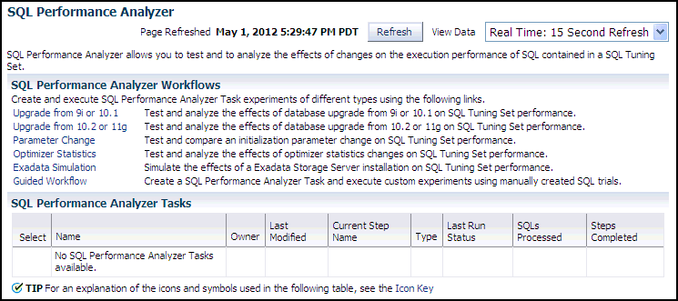
    [Description of the illustration spa.gif](img_text/spa.md)
2.  Under SQL Performance Analyzer Workflows, select the workflow for creating the desired type of analysis task:
    - Upgrade from 9i or 10.1

      Use the upgrade from 9i or 10.1 workflow to test a database upgrade from Oracle9i Database or Oracle Database 10g Release 1 to Oracle Database 10g Release 2 and newer releases, as described in "[Upgrading from Oracle9i Database and Oracle Database 10g Release 1](testing-a-database-upgrade.md)".

    - Upgrade from 10.2 or 11g

      Use the upgrade from 10.2 or 11g workflow to test a database upgrade from Oracle Database 10g Release 2 or Oracle Database 11g to a later release, as described in "[Upgrading from Oracle Database 10g Release 2 and Newer Releases](testing-a-database-upgrade.md)".

    - Parameter Change

      Use the parameter change workflow to determine how a database initialization parameter change will affect SQL performance, as described in "Using the Parameter Change Workflow".

    - Optimizer Statistics

      Use the optimizer statistics workflow to analyze how changes to optimizer statistics will affect SQL performance, as described in "Using the Optimizer Statistics Workflow".

    - Exadata Simulation

      Use the Exadata simulation workflow to simulate how using Oracle Exadata will affect SQL performance, as described in "Using the Exadata Simulation Workflow".

    - Guided workflow

      Use the guided workflow to compare SQL performance for all other types of system changes, as described in "Using the Guided Workflow".

#### Using the Parameter Change Workflow

The parameter change workflow enables you to test the performance effect on a SQL workload when you change the value of a single environment initialization parameter. For example, you can compare SQL performance by setting the `OPTIMIZER_FEATURES_ENABLE` initialization parameter to 10.2.0.4 and 12.1.0.1.

After you select a SQL tuning set and a comparison metric, SQL Performance Analyzer creates a task and performs a trial with the initialization parameter set to the original value. SQL Performance Analyzer then performs a second trial with the parameter set to the changed value by issuing an `ALTER SESSION` statement. The impact of the change is thus contained locally to the testing session. Any regression or change in performance is reported in a system-generated SQL Performance Analyzer report.

**Note:**

To create an analysis task for other types of system changes, use the guided workflow instead, as described in "Using the Guided Workflow".

##### To use the SQL Performance Analyzer parameter change workflow:

1.  On the SQL Performance Analyzer Home page, under SQL Performance Analyzer Workflows, click Parameter Change.

    The Parameter Change page appears.

    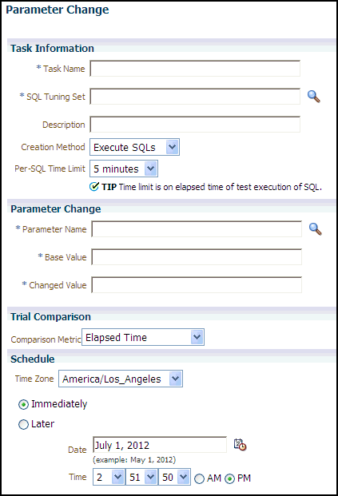
    [Description of the illustration spa_param_change.gif](img_text/spa_param_change.md)

2.  In the Task Name field, enter the name of the task.

3.  In the SQL Tuning Set field, enter the name of the SQL tuning set that contains the SQL workload to be analyzed.

    Alternatively, click the search icon to search for a SQL tuning set using the Search and Select: SQL Tuning Set window.

    The selected SQL tuning set now appears in the SQL Tuning Set field.

4.  In the Description field, optionally enter a description of the task.

5.  In the Creation Method list, determine how the SQL trial is created and what contents are generated by performing one of the following actions:

    - Select Execute SQLs.

      The SQL trial generates both execution plans and statistics for each SQL statement in the SQL tuning set by actually running the SQL statements.

    - Select Generate Plans.

      The SQL trial invokes the optimizer to create execution plans only without actually running the SQL statements.

6.  In the Per-SQL Time Limit list, determine the time limit for SQL execution during the trial by performing one of the following actions:

    - Select 5 minutes.

      The execution will run each SQL statement in the SQL tuning set up to 5 minutes and gather performance data.

    - Select Unlimited.

      The execution will run each SQL statement in the SQL tuning set to completion and gather performance data. Collecting execution statistics provides greater accuracy in the performance analysis but takes a longer time. Using this setting is not recommended because the task may be stalled by one SQL statement for a prolonged time period.

    - Select Customize and enter the specified number of seconds, minutes, or hours.

7.  In the Parameter Change section, complete the following steps:

    1.  In the Parameter Name field, enter the name of the initialization parameter whose value you want to modify, or click the Search icon to select an initialization parameter using the Search and Select: Initialization Parameters window.

    2.  In the Base Value field, enter the current value of the initialization parameter.

    3.  In the Changed Value field, enter the new value of the initialization parameter.

8.  In the Comparison Metric list, select the comparison metric to use for the analysis:

    - If you selected Generate Plans in Step 5, then select Optimizer Cost.

    - If you selected Execute SQLs in Step 5, then select one of the following options:

      - Elapsed Time

      - CPU Time

      - User I/O Time

      - Buffer Gets

      - Physical I/O

      - Optimizer Cost

      - I/O Interconnect Bytes

    To perform the comparison analysis by using more than one comparison metric, perform separate comparison analyses by repeating this procedure using different metrics.

9.  In the Schedule section:

    1.  In the Time Zone list, select your time zone code.

    2.  Select Immediately to start the task now, or Later to schedule the task to start at a time specified using the Date and Time fields.

10. Click Submit.

    The SQL Performance Analyzer Home page appears.

    In the SQL Performance Analyzer Tasks section, the status of this task is displayed. To refresh the status icon, click Refresh. After the task completes, the Status field changes to Completed.

    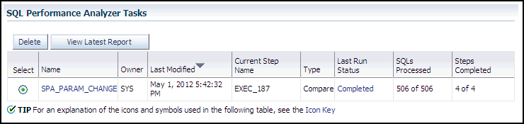
    [Description of the illustration spa_tasks_param_change.gif](img_text/spa_tasks_param_change.md)

11. In the SQL Performance Analyzer Tasks section, select the task and click the link in the Name column.

    The SQL Performance Analyzer Task page appears.

    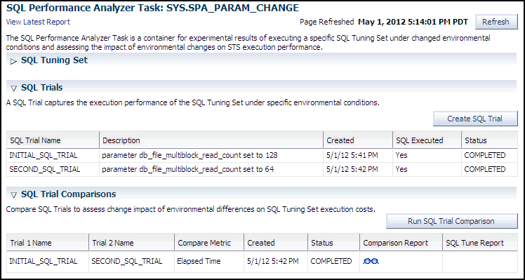
    [Description of the illustration spa_task_param_change.gif](img_text/spa_task_param_change.md)
    This page contains the following sections:

    - SQL Tuning Set

      This section summarizes information about the SQL tuning set, including its name, owner, description, and the number of SQL statements it contains.

    - SQL Trials

      This section includes a table that lists the SQL trials used in the SQL Performance Analyzer task.

    - SQL Trial Comparisons

      This section contains a table that lists the results of the SQL trial comparisons

12. Click the icon in the Comparison Report column.

    The SQL Performance Analyzer Task Result page appears.

13. Review the results of the performance analysis, as described in "[Reviewing the SQL Performance Analyzer Report Using Oracle Enterprise Manager](comparing-sql-trials.md)".

14. In cases when regression are identified, click the icon in the SQL Tune Report column to view a SQL tuning report.

#### Using the Optimizer Statistics Workflow

The optimizer statistics workflow enables you to analyze the effects of optimizer statistics changes on the performance of a SQL workload.

The

SQL Performance Analyzer tests the effect of new optimizer statistics by enabling pending optimizer statistics in the testing session. The first SQL trial measures the baseline SQL tuning set performance; the second SQL trial uses the pending optimizer statistics. You can then run a comparison report for the two SQL trials.

##### To use the optimizer statistics workflow:

1.  On the SQL Performance Analyzer Home page, under SQL Performance Analyzer Workflows, click Optimizer Statistics.

    The Optimizer Statistics page appears.

    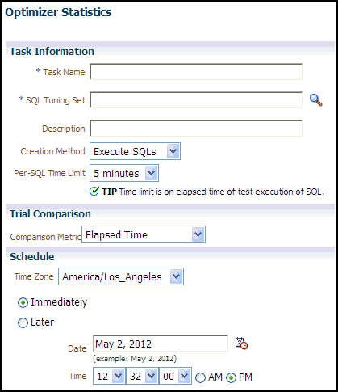
    [Description of the illustration spa_optimizer_stats.gif](img_text/spa_optimizer_stats.md)

2.  In the Task Name field, enter the name of the task.

3.  In the SQL Tuning Set field, enter the name of the SQL tuning set that contains the SQL workload to be analyzed.

    Alternatively, click the search icon to search for a SQL tuning set using the Search and Select: SQL Tuning Set window.

    The selected SQL tuning set now appears in the SQL Tuning Set field.

4.  In the Description field, optionally enter a description of the task.

5.  In the Creation Method list, determine how the SQL trial is created and what contents are generated by performing one of the following actions:

    - Select Execute SQLs.

      The SQL trial generates both execution plans and statistics for each SQL statement in the SQL tuning set by actually running the SQL statements.

    - Select Generate Plans.

      The SQL trial invokes the optimizer to create execution plans only without actually running the SQL statements.

6.  In the Per-SQL Time Limit list, determine the time limit for SQL execution during the trial by performing one of the following actions:

    - Select 5 minutes.

      The execution will run each SQL statement in the SQL tuning set up to 5 minutes and gather performance data.

    - Select Unlimited.

      The execution will run each SQL statement in the SQL tuning set to completion and gather performance data. Collecting execution statistics provides greater accuracy in the performance analysis but takes a longer time. Using this setting is not recommended because the task may be stalled by one SQL statement for a prolonged time period.

    - Select Customize and enter the specified number of seconds, minutes, or hours.

7.  In the Comparison Metric list, select the comparison metric to use for the comparison analysis:

    - Elapsed Time

    - CPU Time

    - User I/O Time

    - Buffer Gets

    - Physical I/O

    - Optimizer Cost

    - I/O Interconnect Bytes

    Optimizer Cost is the only comparison metric available if you chose to generate execution plans only in the SQL trials.

    To perform the comparison analysis by using more than one comparison metric, perform separate comparison analyses by repeating this procedure with different metrics.

8.  Ensure that pending optimizer statistics are collected, and select Pending optimizer statistics collected.

9.  In the Schedule section:

    1.  In the Time Zone list, select your time zone code.

    2.  Select Immediately to start the task now, or Later to schedule the task to start at a time specified using the Date and Time fields.

10. Click Submit.

    The SQL Performance Analyzer Home page appears.

    In the SQL Performance Analyzer Tasks section, the status of this task is displayed. To refresh the status icon, click Refresh. After the task completes, the Status field changes to Completed.

    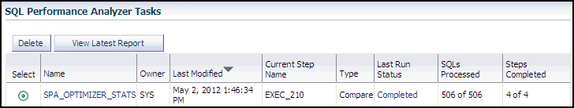
    [Description of the illustration spa_tasks_optimizer.gif](img_text/spa_tasks_optimizer.md)

11. In the SQL Performance Analyzer Tasks section, select the task and click the link in the Name column.

    The SQL Performance Analyzer Task page appears.

    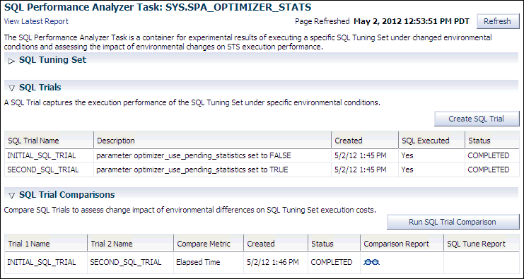
    [Description of the illustration spa_task_optimizer.gif](img_text/spa_task_optimizer.md)
    This page contains the following sections:

    - SQL Tuning Set

      This section summarizes information about the SQL tuning set, including its name, owner, description, and the number of SQL statements it contains.

    - SQL Trials

      This section includes a table that lists the SQL trials used in the SQL Performance Analyzer task.

    - SQL Trial Comparisons

      This section contains a table that lists the results of the SQL trial comparisons

12. Click the icon in the Comparison Report column.

    The SQL Performance Analyzer Task Result page appears.

13. Review the results of the performance analysis, as described in "[Reviewing the SQL Performance Analyzer Report Using Oracle Enterprise Manager](comparing-sql-trials.md)".

    Any regressions found in performance can be fixed using SQL plan baselines and the SQL Tuning Advisor. If the pending optimizer statistics produce satisfactory performance, you can publish for use.

#### Using the Exadata Simulation Workflow

The Exadata simulation workflow enables you to simulate the effects of an Exadata Storage Server installation on the performance of a SQL workload.

Oracle Exadata provides extremely large I/O bandwidth coupled with a capability to offload SQL processing from the database to storage. This allows Oracle Database to significantly reduce the volume of data sent through the I/O interconnect, while at the same time offloading CPU resources to the Exadata storage cells.

SQL Performance Analyzer can analyze the effectiveness of Exadata SQL offload processing by simulating an Exadata Storage Server installation and measuring the reduction in I/O interconnect usage for the SQL workload.

Running the Exadata simulation does not require any hardware or configuration changes to your system. After you select a SQL tuning set, SQL Performance Analyzer creates a task and performs an initial trial with the Exadata Storage Server simulation disabled. SQL Performance Analyzer then performs a second trial with the Exadata Storage Server simulation enabled. SQL Performance Analyzer then compares the two trials using the I/O Interconnect Bytes comparison metric and generates a SQL Performance Analyzer report, which estimates the amount of data that would not need to be sent from the Exadata storage cells to the database if Oracle Exadata is being used. In both SQL trials, the SQL statements are executed to completion and I/O interconnect bytes measurements are taken as the actual and simulated Exadata values for the first and second trials, respectively. The measured change in I/O interconnect bytes provides a good estimate of how much filtering can be performed in the Exadata storage cells and, in turn, the amount of CPU that normally would be used to process this data, but now can be offloaded from the database.

**Note:**

Using the Exadata simulation will not result in any plan changes. Execution plans do not change in an Exadata Storage Server installation because the simulation focuses on measuring the improvement in I/O interconnect usage. Moreover, I/O interconnect bytes will not increase, except when data compression is used (see next note), because Oracle Exadata will only decrease the amount of data sent to the database.

**Note:**

Because I/O interconnect bytes is the only metric used to measure the performance change impact of using an Exadata Storage Server installation, it will not work properly if Oracle Exadata is used with data compression. Since Exadata storage cells also decompress data, the I/O interconnect bytes with Oracle Exadata (or the second SQL trial) of a SQL statement may be greater than the I/O interconnect bytes without Oracle Exadata (or the first SQL trial) where the data is compressed. This comparison will be misleading because the SQL statement will be reported as a regression; when in fact, it is not.

**Note:**

The Exadata simulation workflow is used to simulate an Exadata Storage Server installation on non-Exadata hardware. To test changes on Exadata hardware, use the standard SQL Performance Analyzer workflows.

**Note:**

The Exadata simulation is supported for DSS and data warehouse workloads only.

##### To use the SQL Performance Analyzer Exadata simulation workflow:

1.  On the SQL Performance Analyzer Home page, under SQL Performance Analyzer Workflows, click Exadata Simulation.

    The Exadata Simulation page appears.

    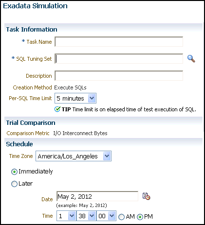
    [Description of the illustration spa_exadata_sim.gif](img_text/spa_exadata_sim.md)

2.  In the Task Name field, enter the name of the task.

3.  In the SQL Tuning Set field, enter the name of the SQL tuning set that contains the SQL workload to be analyzed.

    Alternatively, click the search icon to search for a SQL tuning set using the Search and Select: SQL Tuning Set window.

    The selected SQL tuning set now appears in the SQL Tuning Set field.

4.  In the Description field, optionally enter a description of the task.

5.  In the Per-SQL Time Limit list, determine the time limit for SQL execution during the trial by performing one of the following actions:

    - Select 5 minutes.

      The execution will run each SQL statement in the SQL tuning set up to 5 minutes and gather performance data.

    - Select Unlimited.

      The execution will run each SQL statement in the SQL tuning set to completion and gather performance data. Collecting execution statistics provides greater accuracy in the performance analysis but takes a longer time. Using this setting is not recommended because the task may be stalled by one SQL statement for a prolonged time period.

    - Select Customize and enter the specified number of seconds, minutes, or hours.

6.  In the Schedule section:

    1.  In the Time Zone list, select your time zone code.

    2.  Select Immediately to start the task now, or Later to schedule the task to start at a time specified using the Date and Time fields.

7.  Click Submit.

    The SQL Performance Analyzer Home page appears.

    In the SQL Performance Analyzer Tasks section, the status of this task is displayed. To refresh the status icon, click Refresh. After the task completes, the Status field changes to Completed.

    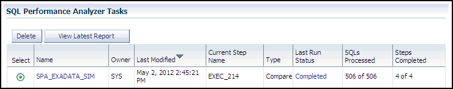
    [Description of the illustration spa_tasks_exadata.gif](img_text/spa_tasks_exadata.md)

8.  In the SQL Performance Analyzer Tasks section, select the task and click the link in the Name column.

    The SQL Performance Analyzer Task page appears.

    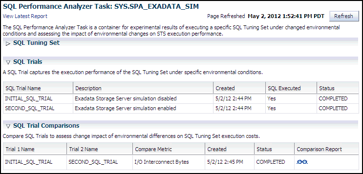
    [Description of the illustration spa_task_exadata_sim.gif](img_text/spa_task_exadata_sim.md)
    This page contains the following sections:

    - SQL Tuning Set

      This section summarizes information about the SQL tuning set, including its name, owner, description, and the number of SQL statements it contains.

    - SQL Trials

      This section includes a table that lists the SQL trials used in the SQL Performance Analyzer task.

    - SQL Trial Comparisons

      This section contains a table that lists the results of the SQL trial comparisons

9.  Click the icon in the Comparison Report column.

    The SQL Performance Analyzer Task Result page appears.

10. Review the results of the performance analysis, as described in "[Reviewing the SQL Performance Analyzer Report Using Oracle Enterprise Manager](comparing-sql-trials.md)".

    Any SQL performance improvement with the Exadata simulation between the first and second trials is captured in the report. In general, you can expect a greater impact if the SQL workload contains queries that scan a large number of rows or a small subset of table columns. Conversely, a SQL workload that queries indexed tables or tables with fewer rows will result in a lesser impact from the Exadata simulation.

#### Using the Guided Workflow

The guided workflow enables you to test the performance effect of any types of system changes on a SQL workload. See "[SQL Performance Analyzer](introduction-to-oracle-database-testing.md)" for a list of system changes that can impact SQL performance.

**Note:**

To create an analysis task to test database initialization parameter changes, use the simplified parameter change workflow instead, as described in "Using the Parameter Change Workflow".

##### To use the SQL Performance Analyzer task guided workflow:

1.  On the SQL Performance Analyzer Home page, under SQL Performance Analyzer Workflows, click Guided Workflow.
    The Guided Workflow page appears.

    The guided workflow enables you to test the performance effect on a SQL workload when you perform any type of system changes, as described in "[SQL Performance Analyzer](introduction-to-oracle-database-testing.md)".

    This page lists the required steps in the SQL Performance Analyzer task in sequential order. Each step must be completed in the order displayed before the next step can begin.

    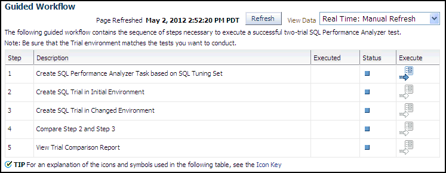
    [Description of the illustration spa_guided_workflow.gif](img_text/spa_guided_workflow.md)
2.  On the Guided Workflow page, click the Execute icon for the Step 1: Create SQL Performance Analyzer Task based on SQL Tuning Set.
    The Create SQL Performance Analyzer Task page appears.

    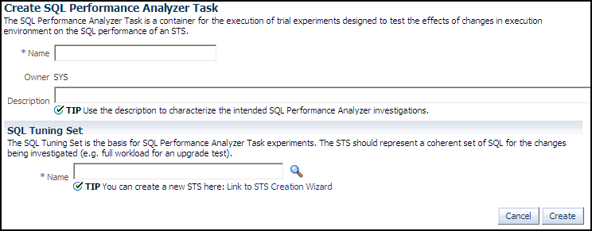
    [Description of the illustration spa_create_task.gif](img_text/spa_create_task.md)
3.  In the Name field, enter the name of the task.
4.  In the Description field, optionally enter a description of the task.
5.  Under SQL Tuning Set, in the Name field, enter the name the SQL tuning set that contains the SQL workload to be analyzed.
    Alternatively, click the search icon to select a SQL tuning set from the Search and Select: SQL Tuning Set window.
6.  Click Create.
    The Guided Workflow page appears.

    The Status icon of this step has changed to a check mark and the Execute icon for the next step is now enabled.
7.  Once the analysis task is created, you can build the pre-change performance data by executing the SQL statements stored in the SQL tuning set, as described in [Creating a Pre-Change SQL Trial](creating-a-pre-change-sql-trial.md).

### Creating an Analysis Task Using APIs

This section describes how to create a SQL Performance Analyzer task by using the `DBMS_SQLPA.CREATE_ANALYSIS_TASK` function. A task is a database container for SQL Performance Analyzer execution inputs and results.

Before proceeding, capture the SQL workload to be used in the performance analysis into a SQL tuning set on the production system, then transport it to the test system where the performance analysis will be performed, as described in "[Capturing the SQL Workload](introduction-to-sql-performance-analyzer.md)".

#### To create an analysis task:

- Call the `CREATE_ANALYSIS_TASK` function using the following parameters:

  - Set `task_name` to specify an optional name for the SQL Performance Analyzer task.

  - Set `sqlset_name` to the name of the SQL tuning set.

  - Set `sqlset_owner` to the owner of the SQL tuning set. The default is the current schema owner.

  - Set `basic_filter` to the SQL predicate used to filter the SQL from the SQL tuning set.

  - Set `order_by` to specify the order in which the SQL statements will be executed.

    You can use this parameter to ensure that the more important SQL statements will be processed and not skipped if the time limit is reached.

  - Set `top_sql` to consider only the top number of SQL statements after filtering and ranking.

  The following example illustrates a function call:

      VARIABLE t_name VARCHAR2(100);
      EXEC :t_name := DBMS_SQLPA.CREATE_ANALYSIS_TASK(sqlset_name => 'my_sts', -
             task_name => 'my_spa_task');

Once the analysis task is created, you can build the pre-change performance data by executing the SQL statements stored in the SQL tuning set, as described in [Creating a Pre-Change SQL Trial](creating-a-pre-change-sql-trial.md).

**See Also:**

- [Oracle Database PL/SQL Packages and Types Reference](../arpls/DBMS_SQLPA.md) to learn more about the `DBMS_SQLPA.CREATE_ANALYSIS_TASK` function

### Configuring an Analysis Task Using APIs

This section describes how to configure a SQL Performance Analyzer task once it has been created. You can configure an analysis task by setting its parameters using the `DBMS_SQLPA.SET_ANALYSIS_TASK_PARAMETER` procedure.

This section contains the following topics:

- Configuring the Execution Plan Comparison Method of an Analysis Task Using APIs

- Configuring an Analysis Task for Exadata Simulation Using APIs

- Remapping Multitenant Container Database Identifiers in an Analysis Task Using APIs

- Configuring Trigger Execution in an Analysis Task

- Configuring a Date to be Returned by Calls in an Analysis Task

- Configuring the Number of Rows to Fetch for an Analysis Task

- Configuring the Degree of Parallelism for an Analysis Task

- Validating SQL Result Sets Using SQL Performance Analyzer

#### Configuring the Execution Plan Comparison Method of an Analysis Task Using APIs

You can configure the comparison method that determines when a SQL Performance Analyzer task performs line-by-line comparison of execution plans. By default, a SQL Performance Analyzer task performs line-by-line comparison of execution plans only if the plan hash value is unknown.

##### To configure the execution plan comparison method of an analysis task:

- Use the `SET_ANALYSIS_TASK_PARAMETER` procedure to set the value of the `PLAN_LINES_COMPARISON` parameter.

  Table 3-1 lists the valid values for the `PLAN_LINES_COMPARISON` parameter.

Table 3-1 SQL Performance Analyzer Task Execution Plan Methods

| Method   | Description                                                                                                                                                                                        |
|:---------|:---------------------------------------------------------------------------------------------------------------------------------------------------------------------------------------------------|
| `ALWAYS` | The analysis task always performs a line-by-line comparison of execution plans.                                                                                                                    |
| `AUTO`   | The analysis task performs a line-by-line comparison of execution plans only if the computation of the plan hash value for the first SQL trial has changed or the second SQL trial is unavailable. |
| `NONE`   | The analysis task performs a line-by-line comparison of execution plans only if the plan hash value is unknown. This is the default value.                                                         |

The following example shows how to set the execution plan method for an analysis task to `AUTO`:

    EXEC DBMS_SQLPA.SET_ANALYSIS_TASK_PARAMETER(task_name => 'my_spa_task', -
           parameter => 'PLAN_LINES_COMPARISON', -
           value => 'AUTO');

**See Also:**

- [Oracle Database PL/SQL Packages and Types Reference](../arpls/DBMS_SQLPA.md) for information about the `DBMS_SQLPA.SET_ANALYSIS_TASK_PARAMETER` procedure

#### Configuring an Analysis Task for Exadata Simulation Using APIs

You can configure a SQL Performance Analyzer to run the Oracle Exadata simulation. For information about how SQL Performance Analyzer simulates the effects of an Exadata Storage Server installation on the performance of a SQL workload, see "Using the Exadata Simulation Workflow".

##### To enable Exadata simulation for an analysis task:

- Call the `SET_ANALYSIS_TASK_PARAMETER` procedure before creating the post-change SQL trial, as shown in the following example:

      EXEC DBMS_SQLPA.SET_ANALYSIS_TASK_PARAMETER(task_name => 'my_spa_task', -
             parameter => 'CELL_SIMULATION_ENABLED', -
             value => 'TRUE');

  This will enable Exadata simulation when you create the post-change SQL trial, which can then be compared to the pre-change SQL trial that was created with Exadata simulation disabled.

Alternatively, you can run the Exadata simulation using the `tcellsim.sql` script.

##### To run the Exadata simulation using tcellsim.sql:

1.  At the SQL prompt, enter:

        @$ORACLE_HOME/rdbms/admin/tcellsim.sql

2.  Enter the name and owner of the SQL tuning set to use:

        Enter value for sts_name: MY_STS
        Enter value for sts_owner: IMMCHAN

    The script then runs the following four steps automatically:

    - Creates a SQL Performance Analyzer task

    - Test executes SQL statements with Exadata simulation disabled

    - Test executes SQL statements with Exadata simulation enabled

    - Compares performance and generates analysis report

**See Also:**

- [Oracle Database PL/SQL Packages and Types Reference](../arpls/DBMS_SQLPA.md) for information about the `DBMS_SQLPA.SET_ANALYSIS_TASK_PARAMETER` procedure

#### Remapping Multitenant Container Database Identifiers in an Analysis Task Using APIs

You can store captured SQL statements in a SQL tuning set, and use it as an input source when creating a SQL Performance Analyzer task. SQL Performance Analyzer then uses the SQL tuning set as the source for test executing or generating execution plans for SQL trials.

If you use a SQL tuning set that was transported from a non-CDB to a multitenant container database (CDB) as the input source, the CDB identifiers of the SQL statements in the SQL tuning set must be remapped to make the STS usable in the CDB. Remapping CDB identifiers associates each SQL statement in the SQL tuning set with a CDB identifier that can be remapped to the corresponding pluggable databases (PDBs) within the CDB.

Typically, CDB identifiers should be remapped when the SQL tuning set is transported from a non-CDB to a CDB. In this case, you can simply use the SQL tuning set as an input source for SQL Performance Analyzer. However, if you are using a SQL tuning set whose CDB identifiers have not been remapped, you can specify the remapping as a SQL Performance Analyzer task property.

##### To remap CDB identifiers for an analysis task:

- Use the `SET_ANALYSIS_TASK_PARAMETER` procedure, as shown in the following example:

      EXEC DBMS_SQLPA.SET_ANALYSIS_TASK_PARAMETER(task_name => 'non_cdb_spa1', -
             parameter => 'CON_DBID_MAPPING', -
             value => '1234:5678,1357:2468');

  In this example, the CDB identifiers `1234` and `1357` are remapped to `5678` and `2468`, respectively.

After the CDB identifiers are remapped, SQL Performance Analyzer uses the new CDB identifier when it finds a match for the old CDB identifier, and executes the SQL statements in the appropriate PDB within the CDB.

**See Also:**

- [Oracle Database SQL Tuning Guide](../tgsql/managing-sql-tuning-sets.md) for information about transporting SQL tuning sets

- [Oracle Database PL/SQL Packages and Types Reference](../arpls/DBMS_SQLPA.md) for information about the `DBMS_SQLPA.SET_ANALYSIS_TASK_PARAMETER` procedure

#### Configuring Trigger Execution in an Analysis Task

You can configure whether or not triggers are executed in an analysis task. By default, triggers are executed by SQL Performance Analyzer.

##### To configure trigger execution in an analysis task:

- Use the `SET_ANALYSIS_TASK_PARAMETER` procedure to set the value of the `EXECUTE_TRIGGERS` parameter.

  Table 3-2 lists the valid values for the `EXECUTE_TRIGGERS` parameter.

Table 3-2 Valid Values for the EXECUTE_TRIGGERS Parameter

| Value   | Description                                                                                                                         |
|:--------|:------------------------------------------------------------------------------------------------------------------------------------|
| `FALSE` | Triggers are not executed by SQL Performance Analyzer, even in the EXECUTE_FULLDML mode of TEST EXECUTE. This is the default value. |
| `TRUE`  | All triggers are executed by SQL Performance Analyzer.                                                                              |

The following example shows how to set the value of the `EXECUTE_TRIGGERS` parameter to `FALSE`, ensuring that triggers are not executed by SQL Performance Analyzer:

    EXEC DBMS_SQLPA.SET_ANALYSIS_TASK_PARAMETER(task_name => 'my_spa_task', -
           parameter => 'EXECUTE_TRIGGERS', -
           value => 'FALSE');

**See Also:**

- [Oracle Database PL/SQL Packages and Types Reference](../arpls/DBMS_SQLPA.md) for information about the `DBMS_SQLPA.SET_ANALYSIS_TASK_PARAMETER` procedure

#### Configuring a Date to be Returned by Calls in an Analysis Task

You can configure how SQL statements that refer to SYSDATE in an analysis task are handled.

##### To configure the date to be returned by calls to SYSDATE in an analysis task:

When you set the `REPLACE_SYSDATE_WITH` parameter, all calls to SYSDATE within the task execution return a date specified by the parameter. This can be used when the input to a SPA task is a SQL tuning set (STS).

- Use the `SET_ANALYSIS_TASK_PARAMETER` procedure to set the value of the `REPLACE_SYSDATE_WITH` parameter.

Table 3-3 lists the valid values for the `REPLACE_SYSDATE_WITH` parameter.

Table 3-3 Valid Values for the REPLACE_SYSDATE_WITH Parameter

| Value           | Description                                                                                                                                                                                                      |
|:----------------|:-----------------------------------------------------------------------------------------------------------------------------------------------------------------------------------------------------------------|
| CURRENT_SYSDATE | All calls to SYSDATE within the task execution return the current SYSDATE. This is the default.                                                                                                                  |
| SQLSET_SYSDATE  | For every SQL statement that has a SYSDATE call, SQL Performance Analyzer will replace its value with the value in the `LAST_EXEC_START_TIME` column of the `DBA_SQLSET_STATEMENTS` view for that SQL statement. |

**Note:**

The setting for this parameter does not affect calls to SYSDATE outside of the SQL Performance Analyzer task execution.

The following example shows how to set the value of the `REPLACE_SYSDATE_WITH` parameter to `SQLSET_SYSDATE`, ensuring that calls to SYDATE within the task execution return the SYSDATE in the SQL tuning set.

    EXEC DBMS_SQLPA.SET_ANALYSIS_TASK_PARAMETER(task_name => 'my_spa_task', -
           parameter => 'REPLACE_SYSDATE_WITH', -
           value => 'SQLSET_SYSDATE');

**See Also:**

- [Oracle Database PL/SQL Packages and Types Reference](../arpls/DBMS_SQLPA.md) for information about the `DBMS_SQLPA.SET_ANALYSIS_TASK_PARAMETER` procedure

- [Oracle Database Reference](../refrn/DBA_SQLSET_STATEMENTS.md) for more information about the `DBA_SQLSET_STATEMENTS` view.

#### Configuring the Number of Rows to Fetch for an Analysis Task

You can configure how many rows are fetched for the SQL statements in an analysis task.

##### To configure the number of rows to fetch in an analysis task:

- Use the `SET_ANALYSIS_TASK_PARAMETER` procedure to set the value of the `NUM_ROWS_TO_FETCH` parameter.

  Table 3-4 lists the valid values for the `NUM_ROWS_TO_FETCH` parameter.

Table 3-4 Valid Values for the NUM_ROWS_TO_FETCH Parameter

| Value          | Description                                                                                                                                                                                                                                                                                                                                    |
|:---------------|:-----------------------------------------------------------------------------------------------------------------------------------------------------------------------------------------------------------------------------------------------------------------------------------------------------------------------------------------------|
| ALL_ROWS       | Fetches all the rows for the SQL. This is the default value.                                                                                                                                                                                                                                                                                   |
| AUTO           | The number of result rows is determined using the value of the `OPTIMIZER_MODE` parameter in the optimizer environment captured in the SQL tuning set. If the value of `OPTIMIZER_MODE` was `ALL_ROWS`, then all result rows will be fetched. If its value was `FIRST_ROWS_`n, then n result rows will be fetched by SQL Performance Analyzer. |
| AVERAGE        | The number of result rows is calculated as the ratio of total rows processed and total executions for each SQL in the SQL tuning set.                                                                                                                                                                                                          |
| A valid number | The number of result rows will be equal to the specified value, or fewer, if there were fewer rows to fetch.                                                                                                                                                                                                                                   |

The following example shows how to set the value of the `NUM_ROWS_TO_FETCH` parameter to `ALL_ROWS`, so that all the rows for the SQL are fetched.

    EXEC DBMS_SQLPA.SET_ANALYSIS_TASK_PARAMETER(task_name => 'my_spa_task', -
           parameter => 'NUM_ROWS_TO_FETCH', -
           value => 'ALL_ROWS');

**See Also:**

- [Oracle Database PL/SQL Packages and Types Reference](../arpls/DBMS_SQLPA.md) for information about the `DBMS_SQLPA.SET_ANALYSIS_TASK_PARAMETER` procedure

- [Oracle Database Reference](../refrn/OPTIMIZER_MODE.md) for more information about the `OPTIMIZER_MODE` database initialization parameter

#### Configuring the Degree of Parallelism for an Analysis Task

You can set the degree of parallelism and enable concurrent SQL execution.

##### To configure degree of parallelism for an analysis task:

- Use the `SET_ANALYSIS_TASK_PARAMETER` procedure to set the value of the `TEST_EXECUTE_DOP` parameter.

The following table lists the valid values for the `TEST_EXECUTE_DOP` parameter.

Table 3-5 Valid Values for the TEST_EXECUTE_DOP parameter

| Value                        | Description                                               |
|:-----------------------------|:----------------------------------------------------------|
| `0`                          | This is the default value. The task is executed serially. |
| Greater than or equal to `2` | Concurrent execution is enabled.                          |

The following example shows how to set the value of the `TEST_EXECUTE_DOP` parameter to `4` and enable concurrent execution:

    EXEC DBMS_SQLPA.SET_ANALYSIS_TASK_PARAMETER(task_name => 'my_spa_task', -
           parameter => 'TEST_EXECUTE_DOP', -
           value => 4);

**Note:**

A concurrent execution is supported only by the `EXPLAIN PLAN` and `TEST EXECUTE` execution types.

**See Also:**

[Oracle Database PL/SQL Packages and Types Reference](../arpls/DBMS_SQLPA.md) for information about the `DBMS_SQLPA.SET_ANALYSIS_TASK_PARAMETER` procedure

#### Validating SQL Result Sets Using SQL Performance Analyzer

Comparison of SQL result sets is now supported when running two “test-execute” SQL Performance Analyzer (SPA) trials.

The SQL result sets are validated and if the number of rows or values do not match, it is recorded in the SQL Performance Analyzer report. The SQL result set validation is controlled by the `COMPARE_RESULTSET` parameter.

The `SET_ANALYSIS_TASK_PARAMETER` procedure is used to set the value of the `COMPARE_RESULTSET` parameter.

The following table lists the valid values for the `COMPARE_RESULTSET` parameter.

Table 3-6 Valid Values for the COMPARE_RESULTSET Parameter

| Value   | Description                                 |
|:--------|:--------------------------------------------|
| `TRUE`  | SQL result set comparison is performed.     |
| `FALSE` | SQL result set comparison is not performed. |

The following example shows how to set the value of `COMPARE_RESULTSET` parameter to `TRUE`.

    EXEC DBMS_SQLPA.SET_ANALYSIS_TASK_PARAMETER(task_name => 'my_spa_task', -
           parameter => 'COMPARE_RESULTSET', -
           value => 'TRUE');

**See Also:**

[Oracle Database PL/SQL Packages and Types Reference](../arpls/DBMS_SQLPA.md) for information about the `DBMS_SQLPA.SET_ANALYSIS_TASK_PARAMETER` procedure
