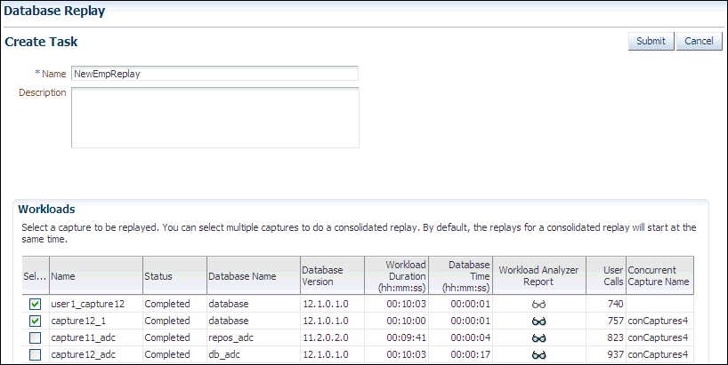
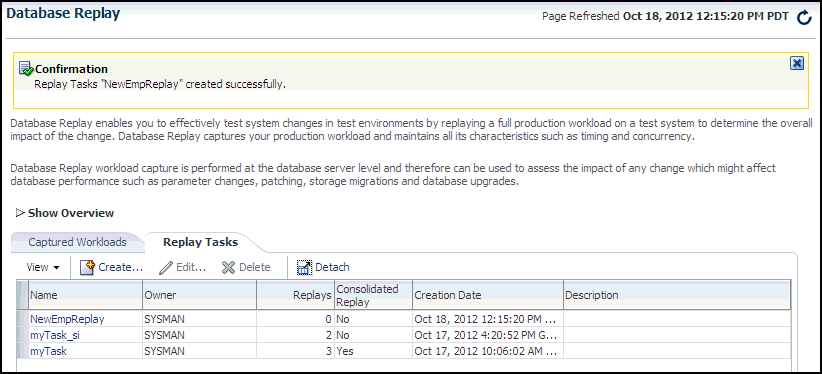
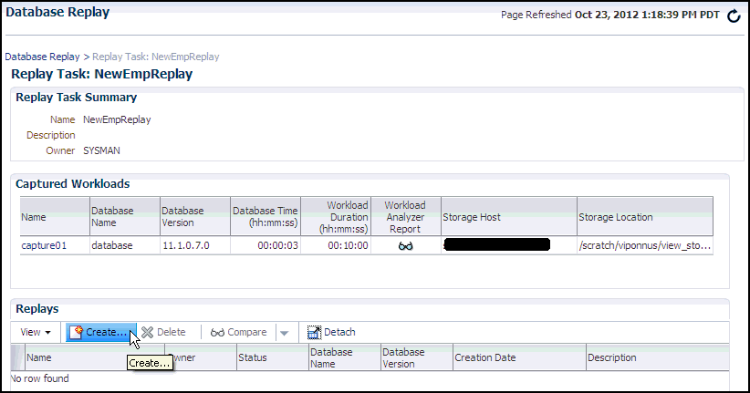
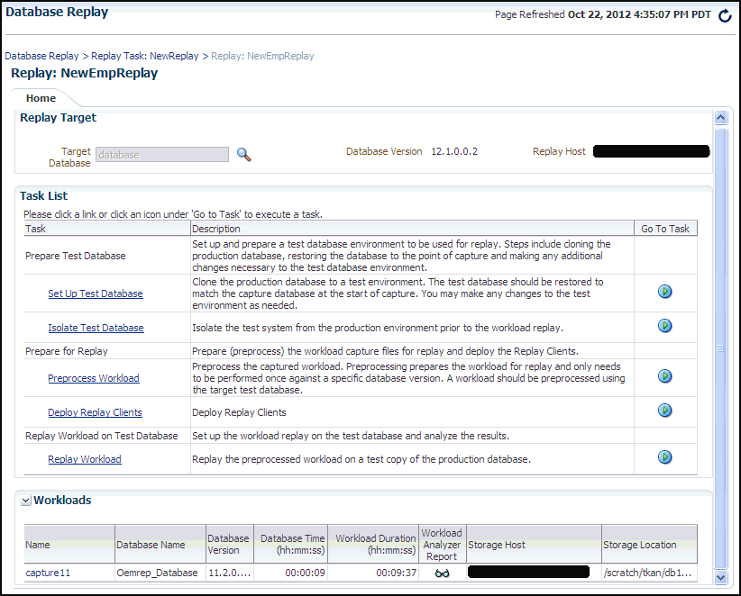
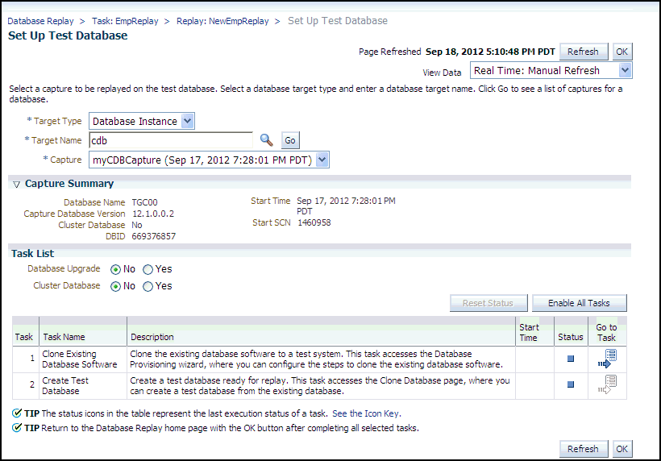
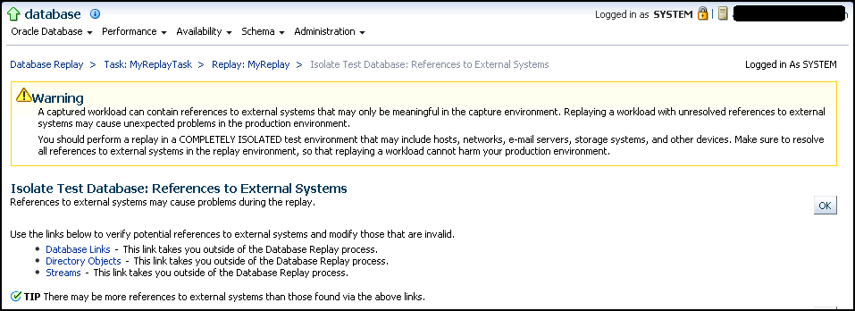
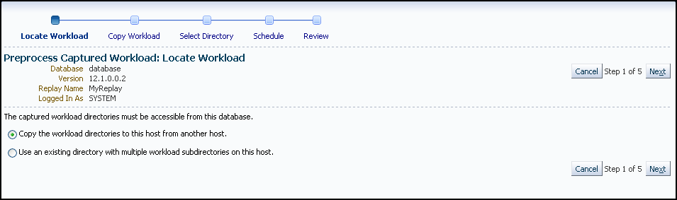
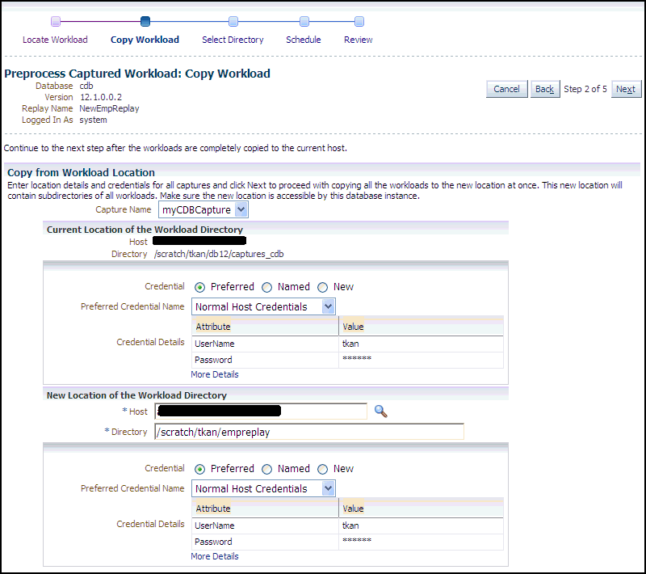
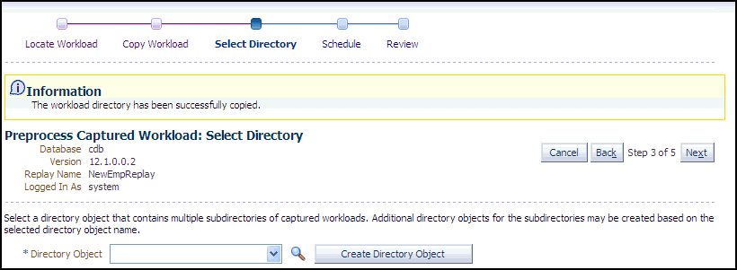
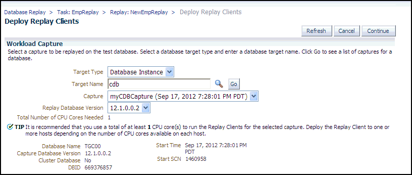

After a workload is captured and setup of the test system is complete, the captured data must be preprocessed. Preprocessing a captured workload creates all necessary metadata for replaying the workload. This must be done once for every captured workload before they can be replayed. After the captured workload is preprocessed, it can be replayed repeatedly on a replay system.

To preprocess a captured workload, you will first need to move all captured data files from the directory where they are stored on the capture system to a directory on the instance where the preprocessing will be performed. Preprocessing is resource intensive and should be performed on a system that is:

- Separate from the production system

- Running the same version of Oracle Database as the replay system

For Oracle Real Application Clusters (Oracle RAC), select one database instance of the replay system for the preprocessing. This instance must have access to the captured data files that require preprocessing, which can be stored on a local or shared file system. If the capture directory path on the capture system resolves to separate physical directories in each instance, you will need to merge them into a single capture directory where the preprocessing will be performed. All directories must have the same directory tree and all files contained in each of these directories must be moved into a directory that has the same relative path to the capture directory.

Typically, you will preprocess the captured workload on the replay system. If you plan to preprocess the captured workload on a system that is separate from the replay system, you will also need to move all preprocessed data files from the directory where they are stored on the preprocessing system to a directory on the replay system after preprocessing is complete.

This chapter contains the following sections:

- Preparing a Single Database Workload Using Enterprise Manager

- Preprocessing a Database Workload Using APIs

### Preparing a Single Database Workload Using Enterprise Manager

Several tasks are involved in preparing a single workload. For example:

- Creating a database replay task

- Creating a replay from a replay task

- Preparing the test database

- Preprocessing the workload and deploying the replay clients

Before you can preprocess a captured workload, you must first capture the workload on the production system, as described in [Capturing a Database Workload](capturing-a-database-workload.md).

**Note:**

Preparing the test database is only required if you have not done so already.

The following sections provide procedures for these tasks.

#### Creating a Database Replay Task

Before creating a database replay task, make sure that the capture that you want to replay has some captured user calls.

##### To create a database replay task:

1.  From the Database Replay page, click the Replay Tasks tab, then click Create in the toolbar.

    The Create Task page appears.

    
    [Description of the illustration dbr_replay_create_task.gif](img_text/dbr_replay_create_task.md)

2.  Provide a Name for the task, select a capture to be replayed, then click Submit. For consolidated replays, select two or more captures.

    The Database Replay page reappears, and displays your newly created replay task in the table under the Replay Task tab.

    
    [Description of the illustration dbr_replay_create_tsk_comp.gif](img_text/dbr_replay_create_tsk_comp.md)

#### Creating a Replay from a Replay Task

This topic describes how to create a replay from a replay task.

##### To create the replay:

1.  From the Database Replay page, click the Replay Tasks tab.

2.  Click the link for the desired replay task in the table.

    The Replay Task page for the capture appears.

    
    [Description of the illustration dbr_replay_create_replay.gif](img_text/dbr_replay_create_replay.md)

3.  Click Create in the Replays section.

    The Create Replay pop-up appears.

4.  Provide a required Name and optional description, then click the Target Database icon.

    The Search and Select: Targets pop-up appears.

5.  Choose the desired database, then click Select.

6.  Click OK in the Create Replay pop-up.

    The Database Replay page for your replay appears, which includes a Task List with links to perform the needed tasks.

    
    [Description of the illustration dbr_replay_create_rep_nm.gif](img_text/dbr_replay_create_rep_nm.md)

You can now proceed to the first task in the Task List, described in the next section.

#### Preparing the Test Database

This topic describes the tasks involved in preparing the test database. For example:

- Setting up the test database

- Isolating the test database

**Note:**

These tasks are optional. If you have already set up your test database, skip to "Preprocessing the Workload and Deploying the Replay Clients".

The following procedures explain how to perform each of these tasks, which you can do in any order.

##### To set up the test database:

1.  From the Replay page for your particular replay, click the link for the Set Up Test Database task.

    The Set Up Test Database page appears.

    
    [Description of the illustration dbr_process_setup_db.gif](img_text/dbr_process_setup_db.md)

2.  Choose whether you want to upgrade the database or not, and indicate whether this is a cluster database.

3.  Click the Go to Task icon for the Clone Existing Database Software sub-task, or click Enable All Tasks if you want to create the test database first.

4.  Follow the instructions provided in the online help for the wizards.

    When the tasks are complete, a checkmark appears in the Status column for each task.

5.  Click OK to return to the Database Replay page.

##### To isolate the test database:

1.  From the Replay page for your particular replay, click the link for the Isolate Test Database task.

    A page appears explaining that references to external systems can cause problems during the replay.

    
    [Description of the illustration dbr_process_isolate_db.gif](img_text/dbr_process_isolate_db.md)

2.  Use the links provided to verify potential references to external systems, modify those that are invalid, then click OK.

    The Replay Summary page reappears.

#### Preprocessing the Workload and Deploying the Replay Clients

The final preparation for the replay involves preprocessing the workload and deploying the replay clients. For example:

- Preprocessing the workload

  You need to preprocess each captured workload once for each version of the database against which the workload will be replayed. After you preprocess the workload once, you can use it for any subsequent replay tasks and replays without needing to preprocess again, as long as the test database is the same version as the database where the workload was preprocessed.For instance, for a replay task that contains two replays named "MyReplay1" and "MyReplay2," after you have preprocessed "MyReplay1", you can just directly reuse the directory object to replay "MyReplay2."

  The Workload Analyzer report is available after preprocessing.

- Deploying the replay clients

  You do not need to deploy the replay clients to other replay client hosts if these hosts can access the Oracle home of the test database you specified in the Database Target Name field.

The following procedures explain how to accomplish each of these tasks.

##### To preprocess the workload:

1.  From the Replay page for your particular replay, click the link for the Preprocess Workload task.

    The Preprocess Captured Workload: Locate Workload page appears.

    
    [Description of the illustration dbr_process_locate_wkload.gif](img_text/dbr_process_locate_wkload.md)

2.  Select the desired workload location option, then click Next.

    **Note:**

    You initially need to select the copy option.

    The Preprocess Captured Workload: Copy Workload page appears.

    
    [Description of the illustration dbr_process_copy_wkld.gif](img_text/dbr_process_copy_wkld.md)

3.  Provide the required credentials and the new location to which the workloads will be copied and preprocessed, then click Next.

    - For a consolidated replay, there are multiple source workloads, so multiple source credentials might be needed for the current location of the workload directory. For more information on consolidated replays, see "[Using Consolidated Database Replay with Enterprise Manager](using-consolidated-database-replay.md)."

    The system responds by displaying a progress bar graph during processing, then displays the Preprocess Captured Workload: Select Directory page after the copy operation concludes.

    
    [Description of the illustration dbr_process_select_dir.gif](img_text/dbr_process_select_dir.md)

4.  Specify the Directory Object, or create a new Directory Object that points to the location that contains the workload. If you chose to copy from the workload location to a new location in the previous step, make sure that the directory object points to the exact location you specified in the New Location of the Workload Directory section.

    The system responds by displaying a Capture Summary. You can now expand the Capture Details section to see the workload profile and workload filters. The Capture Summary does not appear for consolidated replays.

    Click Next to display the Preprocess Captured Workload: Schedule page.

5.  Provide input to schedule the preprocess job:

    1.  Provide your own required job name or accept the system-supplied name. The job system automatically names the job in uppercase.

    2.  Indicate whether you want the job to run as soon as you submit it, or whether you want it to run at a later time.

    3.  Provide the host credentials, which are used to run the preprocess job in the operating system.

    Click Next to display the Preprocess Captured Workload: Review page.

6.  Check to make sure that the settings are what you intend, then click Submit.

    The Database Replay page appears, and assuming that there were no errors in your input, a confirmation message at the top of the page states "Job JOBNAME to prepare the workload has been created successfully."

7.  Click the JOBNAME link to check the status of the job. The job must succeed before you can proceed to the Replay Workload task.

    **Note:**

    A message may appear in the Task List stating that you need to install an additional PL/SQL package in the test database to generate a compare period report after the trial. Click Install PL/SQL Package to resolve this issue before proceeding to the Replay Workload task.

    **Tip:**

    After preprocessing a captured workload, you can replay it on the test system, as described in [Replaying a Database Workload](replaying-a-database-workload.md).

##### To deploy the replay clients:

1.  From the Replay page for your particular replay, click the link for the Deploy Replay Clients task.

    The Deploy Replay Clients page appears.

    
    [Description of the illustration dbr_process_deploy_clients.gif](img_text/dbr_process_deploy_clients.md)

2.  Accept the default values defined for the associated workload capture, or override these values, then click Continue.

    The Provision Oracle Database Client wizard appears.

3.  Follow the instructions provided in the online help for each step of the wizard.

    After you click Submit in the Review step to run the deployment procedure according to the schedule you have set, the Replay Summary page reappears.

### Preprocessing a Database Workload Using APIs

This section describes how to preprocess a captured workload using the `DBMS_WORKLOAD_REPLAY` package. You can also use Oracle Enterprise Manager to preprocess a captured workload, as described in "Preparing a Single Database Workload Using Enterprise Manager".

Before you can preprocess a captured workload, you must first capture the workload on the production system, as described in [Capturing a Database Workload](capturing-a-database-workload.md).

#### To preprocess a captured workload:

- Use the `PROCESS_CAPTURE` procedure:

      BEGIN
        DBMS_WORKLOAD_REPLAY.PROCESS_CAPTURE (capture_dir => 'dec06',
                                   plsql_mode => 'extended');
      END;
      /

  In this example, the captured workload stored in the `dec06` directory will be preprocessed.

  The `PROCESS_CAPTURE` procedure in this example uses the `capture_dir` required parameter, which specifies the directory that contains the captured workload to be preprocessed.

  The optional `plsql_mode` parameter specifies the processing mode for PL/SQL.

  These two values can be set for the `plsql_mode` parameter:

  - `top_level`: Metadata is generated for top-level PL/SQL calls only; this will be the only option for replay. This is the default value.

  - `extended`: Metadata is generated for both top-level PL/SQL calls and the SQL called from PL/SQL. A new directory `ppe_X.X.X.X` (where X's represent the current Oracle version) is created under the capture root directory. Capture must have been done with this same value for the `plsql_mode` parameter. Replay can use either `'TOP_LEVEL'` or `'EXTENDED'`.

    The `extended` value can be set only for workloads that were captured with the `plsql_mode` parameter set to `extended`. If `extended` is specified, but the capture was not executed in `extended` mode, then you will receive an error message.

**Note:**

To run `PROCESS_CAPTURE` on an encrypted workload capture, you need to set the password using the identifier `oracle.rat.database_replay.encryption` (case-sensitive). The password is stored in a software keystore. You can find whether a workload capture is encrypted or not from `DBA_WORKLOAD_CAPTURES` view.

**Tip:**

After preprocessing a captured workload, you can replay it on the test system, as described in [Replaying a Database Workload](replaying-a-database-workload.md).

**See Also:**

- [Starting a Workload Capture](capturing-a-database-workload.md) for information about the `plsql_mode` parameter for the `START_CAPTURE` procedure for the `DBMS_WORKLOAD_CAPTURE` package

- [Oracle Database PL/SQL Packages and Types Reference](../arpls/DBMS_WORKLOAD_REPLAY.md) for additional information about the `DBMS_WORKLOAD_REPLAY.PROCESS_CAPTURE` procedure

#### Running the Workload Analyzer Command-Line Interface

The Workload Analyzer is a Java program that analyzes a workload capture directory and identifies parts of a captured workload that may not replay accurately due to insufficient data, errors that occurred during workload capture, or usage features that are not supported by Database Replay. The results of the workload analysis are saved to an HTML report named `wcr_cap_analysis.html` located in the capture directory that is being analyzed. If an error can be prevented, the workload analysis report displays available preventive actions that can be implemented before replay. If an error cannot be corrected, the workload analysis report provides a description of the error so it can be accounted for during replay. Running Workload Analyzer is the default option and is strongly recommended.

**Note:**

If you are preprocessing a workload capture using Oracle Enterprise Manager, then you do not need to run Workload Analyzer in the command-line interface. Oracle Enterprise Manager enables you to run Workload Analyzer as part of the workload preprocessing.

Workload Analyzer is composed of two JAR files, `dbranalyzer.jar` and `dbrparser.jar`, located in the `$ORACLE_HOME/rdbms/jlib/` directory of a system running Oracle Database Enterprise Edition Release 11.2.0.2 or higher. Workload Analyzer requires Java 1.5 or higher and the `ojdbc6.jar` file located in the `$ORACLE_HOME/jdbc/lib/` directory.

##### To run Workload Analyzer:

1.  In the command-line interface, run the following `java` command on a single line:

        java -classpath
        $ORACLE_HOME/jdbc/lib/ojdbc6.jar:$ORACLE_HOME/rdbms/jlib/dbrparser.jar:
        $ORACLE_HOME/rdbms/jlib/dbranalyzer.jar:
        oracle.dbreplay.workload.checker.CaptureChecker
        <capture_directory> <connection_string>

    For the `capture_directory` parameter, input the operating system path of the capture directory. This directory should also contain the exported AWR data for the workload capture. For the `connection_string` parameter, input the connection string of an Oracle database that is release 11.1 or higher.

    An example of this command may be:

        java -classpath
        $ORACLE_HOME/jdbc/lib/ojdbc6.jar:$ORACLE_HOME/rdbms/jlib/dbrparser.jar:
        $ORACLE_HOME/rdbms/jlib/dbranalyzer.jar:
        oracle.dbreplay.workload.checker.CaptureChecker /scratch/capture
        jdbc:oracle:thin:@myhost.mycompany.com:1521:orcl

2.  When prompted, input the username and password of a database user with `EXECUTE` privileges for the `DBMS_WORKLOAD_CAPTURE` package and the `SELECT_CATALOG` role on the target database.
