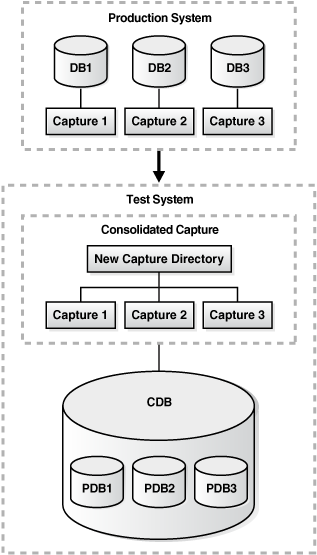
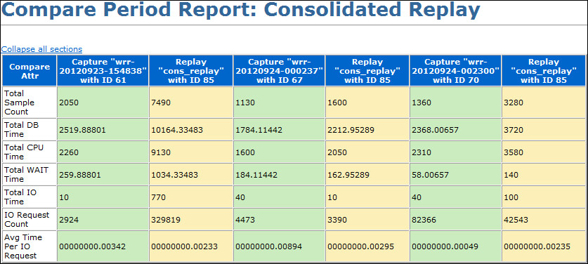
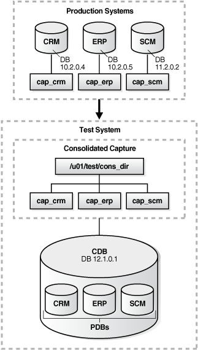

Database Replay enables you to capture a workload on the production system and replay it on a test system. This can be very useful when evaluating or adopting new database technologies because these changes can be tested on a test system without affecting the production system. However, if the new system being tested offers significantly better performance than the existing system, then Database Replay may not accurately predict how much additional workload can be handled by the new system.

For example, if you are consolidating multiple production systems into a single Oracle Exadata Machine, replaying a workload captured from one of the existing systems on Oracle Exadata Machine may result in much lower resource usage (such as host CPU and I/O) during replay because the new system is much more powerful. In this case, it is more useful to assess how the new system will handle the combined workloads from all existing systems, rather than that of a single workload from one system.

Consolidated Database Replay enables you to consolidate multiple workloads captured from one or multiple systems and replay them concurrently on a single test system. In this example, using Consolidated Database Replay will help you to assess how the database consolidation will affect the production system and if a single Oracle Exadata Machine can handle the combined workloads from the consolidated databases.

This chapter describes how to use Consolidated Database Replay and contains the following sections:

- Use Cases for Consolidated Database Replay

- Steps for Using Consolidated Database Replay

- Using Consolidated Database Replay with Enterprise Manager

- Using Consolidated Database Replay with APIs

- About Query-Only Database Replay

- Example: Replaying a Consolidated Workload with APIs

### Use Cases for Consolidated Database Replay

Consolidated Database Replay enables you to replay multiple workloads captured from one or multiple systems concurrently. During the replay, every workload capture that is consolidated will start to replay when the consolidated replay begins.

Some typical use cases for Consolidated Database Replay include:

- Database Consolidation Using Pluggable Databases

- Stress Testing

- Scale-Up Testing

Each of these use cases can be performed using the procedures described in this chapter. In addition, you can employ various workload scale-up techniques when using Consolidated Database Replay, as described in [Using Workload Scale-Up](using-workload-scale-up.md).

#### Database Consolidation Using Pluggable Databases

One use for Consolidated Database Replay is to assess if the system can handle the combined workload from a database consolidation.

For example, assume that you want to consolidate the databases for the CRM, ERP, and SCM applications by migrating them to pluggable databases (PDBs). You can use Consolidated Database Replay to combine the captured workloads from the three applications and replay them concurrently on PDBs.

**See Also:**

"Example: Replaying a Consolidated Workload with APIs" for an example of this use case

#### Stress Testing

Another use for Consolidated Database Replay is for stress testing or capacity planning.

For example, assume that you are expecting the workload for the Sales application to double during the holiday season. You can use Consolidated Database Replay to test the added stress on the system by doubling the workload and replaying the combined workload.

**See Also:**

"[Using Time Shifting](using-workload-scale-up.md)" for an example of this use case

#### Scale-Up Testing

A third use for Consolidated Database Replay is for scale-up testing.

For example, assume that you want to test if your system can handle captured workloads from the Financials application and the Orders application concurrently. You can use Consolidated Database Replay to test the effects of the scaled-up workload on your system by combining the workloads and replaying them simultaneously.

**See Also:**

- "[Using Schema Remapping](using-workload-scale-up.md)"

- "[Using Workload Folding](using-workload-scale-up.md)"

### Steps for Using Consolidated Database Replay

This section describes the steps involved when using Consolidated Workload Replay. It contains the following topics:

- Capturing Database Workloads for Consolidated Database Replay

- Setting Up the Test System for Consolidated Database Replay

- Preprocessing Database Workloads for Consolidated Database Replay

- Replaying Database Workloads for Consolidated Database Replay

- Reporting and Analysis for Consolidated Database Replay

#### Capturing Database Workloads for Consolidated Database Replay

Consolidated Database Replay does not require any special steps for capturing database workloads. The steps for capturing database workloads are exactly the same as for capturing a single workload for Database Replay, as described in [Capturing a Database Workload](capturing-a-database-workload.md).

This section contains the following topics for workload captures that are specific to Consolidated Database Replay:

- Supported Types of Workload Captures

- Capture Subsets

##### Supported Types of Workload Captures

Consolidated Database Replay supports multiple workloads captured from one or multiple systems running Oracle Database 9i Release 2 (release 9.2.0.8.0) or higher on one or multiple operating systems. For example, you can use workloads captured from one system running Oracle Database 9i Release 2 (release 9.2.0.8.0) on HP-UX and another system running Oracle Database 10g Release 2 (release 10.2.0.4.0) on AIX.

**Note:**

Consolidated Database Replay is only available on Oracle Database 11g Release 2 (release 11.2.0.2.0) and higher.

##### Capture Subsets

Consolidated Database Replay enables you to transform existing workload captures into new, smaller pieces of capture subsets. You can then generate new workload captures from the capture subsets that can be used in different use cases, as described in "Use Cases for Consolidated Database Replay".

A capture subset is a piece of a workload capture that is defined from an existing workload capture by applying a time range. The time range is specified as an offset from the start of the workload capture. All user workloads captured within the specified time range are included in the defined capture subset.

For example, assume that a workload was captured from 2 a.m. to 8 p.m. and the peak workload is identified to be from 10 a.m. to 4 p.m. You can define a capture subset to represent the peak workload by applying a time range that starts at 8 hours after the start of the workload (or 10 a.m.) and ends at 14 hours after the start of the workload (or 4 p.m.).

However, if a capture subset only contains recorded user workloads that satisfy the specified time range, user logins that occurred before the specified time range are not recorded. If these user logins are required for replay, then the capture subset may not be replayable. For example, if a user session starts at 9:30 a.m. and ends at 10:30 a.m. and the specified time range for the capture subset is 10:00 a.m. to 4:00 p.m., the replay may fail if the user login at 9:30 a.m. is not included in the workload. Similarly, the specified time range may also include incomplete user calls that are only partially recorded if a user sessions starts at 3:30 p.m. but does not complete until 4:30 p.m.

Consolidated Database Replay addresses this problem by including only incomplete user calls caused by the start time of the specified time range. To avoid including the same incomplete user calls twice if the workload capture is folded, incomplete user calls caused by the end time are not included by default. Therefore, a capture subset is essentially the minimal number of recorded user calls during a specified time range that are required for proper replay, including the necessary user logins, alter session statements, and incomplete user calls caused by the start time.

**See Also:**

"Generating Capture Subsets Using APIs"

#### Setting Up the Test System for Consolidated Database Replay

Setting up the test system for Consolidated Database Replay is similar to setting up a test system for Database Replay. However, there are some additional considerations when setting up a replay database for Consolidated Database Replay. See "[Steps for Replaying a Database Workload](replaying-a-database-workload.md)" for more information about setting up a test system for Database Replay.

To minimize divergence during the replay, the test system should contain the same application data and the state of the application data should be logically equivalent to that of the capture system at the start time of each workload capture. However, because a consolidated capture may contain multiple workload captures from different production systems, the test system needs to be set up for all the captures. In this case, it is recommended that the multitenant architecture be used to consolidate multiple databases, so that each database will have equivalent data to its capture system at the capture start time.

For Consolidated Database Replay, all participating workload captures must be placed under a new capture directory on the test system. You can copy all the workload captures into the new capture directory, or create symbolic links pointing to the original workload captures. Before consolidating the workload captures, ensure that the new capture directory has enough disk space to store all participating captures.

Figure 15-1 illustrates how to set up the test system and new capture directory to consolidate three workload captures.

Figure 15-1 Setting Up the Test System for Consolidated Database Replay

[Description of "Figure 15-1 Setting Up the Test System for Consolidated Database Replay"](img_text/ratug004.md)

**See Also:**

- "Setting the Consolidated Replay Directory Using APIs"

- [Oracle Database Concepts](../multi/introduction-to-the-multitenant-architecture.md) for information about the multitenant architecture

#### Preprocessing Database Workloads for Consolidated Database Replay

Preprocessing a database workload for Consolidated Database Replay is similar to preprocessing a database workload for Database Replay. See "[Preprocessing a Database Workload](preprocessing-a-database-workload.md)" for information about preprocessing a database workload for Database Replay.

For Consolidated Database Replay, preprocess each captured workload into its own directory. Do not combine different workload captures into one directory for preprocessing. Preprocessing of captured workloads must be performed using a database running the same version of Oracle Database as that of the test system where the workloads will be replayed.

#### Replaying Database Workloads for Consolidated Database Replay

Replaying consolidated workloads using Consolidated Database Replay is quite different from replaying a single database workload using Database Replay.

This section contains the following topics for replaying workloads that are specific to Consolidated Database Replay:

- Defining Replay Schedules

- Remapping Connections for Consolidated Database Replay

- Remapping Users for Consolidated Database Replay

- Preparing for Consolidated Database Replay

- Replaying Individual Workloads

##### Defining Replay Schedules

A replay schedule adds one or multiple workload captures to a consolidated replay and specifies the order in which the captures will start during replay. A replay schedule must be created before a consolidated replay can be initialized. Multiple replay schedules can be defined for a consolidated replay. During replay initialization, you can select from any of the existing replay schedules.

Replay schedules perform two types of operation:

- Adding Workload Captures

- Adding Schedule Orders

**See Also:**

"Defining Replay Schedules Using APIs"

###### Adding Workload Captures

The first type of operation performed by a replay schedule is to add the participating workload captures to a replay.

When a workload capture is added to a replay schedule, a unique number is returned to identify the workload capture. A workload capture can be added to a replay schedule more than once, as it will be assigned a different capture number each time it is added. The replay schedule will point to the same capture directory each time to avoid a waste of disk space by copying the capture each time it is added.

**See Also:**

"Adding Workload Captures to Replay Schedules Using APIs"

###### Adding Schedule Orders

The second type of operation performed by a replay schedule is to add schedule orders that specify the order in which the participating workload captures will start during replay.

A schedule order defines an order between the start of two workload captures that have been added to the replay schedule. Multiple schedule orders can be added to a replay schedule. For example, assume that a replay schedule has three workload captures added. One schedule order can be added to specify that Capture 2 must wait for Capture 1 to complete before starting. Another schedule order can be added to specify that Capture 3 must wait for Capture 1 to complete before starting. In this case, both Capture 2 and Capture 3 must wait for Capture 1 to complete before starting.

It is possible for a replay schedule to not contain any schedule orders. In this case, all participating workload captures in the replay schedule will start to replay simultaneously when the consolidated replay begins.

**See Also:**

"Adding Schedule Orders to Replay Schedules Using APIs"

##### Remapping Connections for Consolidated Database Replay

As in the case with replaying a single database workload using Database Replay, captured connection strings used to connect to the production system need to be remapped to the replay system. See "[Connection Remapping](replaying-a-database-workload.md)" for more information.

For Consolidated Database Replay, you need to remap captured connection strings from multiple workload captures to different connection strings during replay.

**See Also:**

"Remapping Connection Using APIs"

##### Remapping Users for Consolidated Database Replay

As in the case with replaying a single database workload using Database Replay, usernames of database users and schemas used to connect to the production system can be remapped during replay. See "[User Remapping](replaying-a-database-workload.md)" for more information.

For Consolidated Database Replay, you can choose to remap the captured users from multiple workload captures to different users or schemas during replay.

**See Also:**

"Remapping Users Using APIs"

##### Preparing for Consolidated Database Replay

As is the case with replaying a single database workload using Database Replay, replay options are defined during preparation of a replay. See "[Specifying Replay Options](replaying-a-database-workload.md)" for more information.

For Consolidated Database Replay, all participating workload captures in a consolidated replay use the same replay options during replay that are defined during replay preparation.

**See Also:**

"Preparing for Consolidated Database Replay Using APIs"

##### Replaying Individual Workloads

It is recommended that each of the participating workloads be replayed individually before replaying the consolidated workload. See "[Replaying a Database Workload](replaying-a-database-workload.md)" for more information.

The individual replays can establish a baseline performance for each workload capture and be used to analyze the performance of the consolidated replay.

#### Reporting and Analysis for Consolidated Database Replay

Reporting and analysis for Consolidated Database Replay is performed using the replay compare period report. See "[Using Replay Compare Period Reports](analyzing-captured-and-replayed-workloads.md)" for more information.

The replay compare period report for Consolidated Database Replay identifies the Active Session History (ASH) data for each individual workload capture and compares the ASH data from the workload capture to the filtered ASH data from the consolidated replay. Use this report to compare replays of the same consolidated workload capture.

The replay compare period report for Consolidated Database Replay treats the consolidated replay as multiple Capture vs. Replay comparisons. The summary section of the report contains a table that summarizes all individual Capture vs. Replay comparisons. Review the information in this section to gain a general understanding of how the consolidated replay ran.

Figure 15-2 shows the summary section of a sample replay compare period report for Consolidated Database Replay.

Figure 15-2 Compare Period Report: Consolidated Replay

[Description of "Figure 15-2 Compare Period Report: Consolidated Replay"](img_text/dbr_rep_cons_replay.md)

The rest of the sections in the report resemble the ASH Data Comparison section of the replay compare period report and are formed by joining all Capture vs. Replay reports in the consolidated replay. For a description of this section, see "[ASH Data Comparison](analyzing-captured-and-replayed-workloads.md)".

### Using Consolidated Database Replay with Enterprise Manager

This section describes how to use Consolidated Database Replay with Enterprise Manager.

The primary tool for replaying consolidated database workloads is Oracle Enterprise Manager. If Oracle Enterprise Manager is unavailable, you can also replay consolidated database workloads using APIs, as described in "Using Consolidated Database Replay with APIs".

The process for replaying a consolidated database workload is nearly identical to that of replaying a single database workload. The differences are documented in the procedures for single replays in the following sections:

- "[Creating a Database Replay Task](preprocessing-a-database-workload.md)" in [Preprocessing a Database Workload](preprocessing-a-database-workload.md)

- "[Preprocessing the Workload and Deploying the Replay Clients](preprocessing-a-database-workload.md)" in [Preprocessing a Database Workload](preprocessing-a-database-workload.md)

- "[Replaying a Database Workload Using Enterprise Manager](replaying-a-database-workload.md)" in [Replaying a Database Workload](replaying-a-database-workload.md)

The following list provides a summary of the differences between replaying a consolidated database workload versus replaying a single database workload:

- When creating a replay task, you need to select two or more captured workloads from the Select Captures table in the Create Task page.

- The Preprocess Captured Workload: Copy Workload step of the wizard has more than one choice for the Capture Name drop-down, so you may need to enter multiple credentials for the current location of the workload directory.

- The Preprocess Captured Workload: Select Directory step of the wizard does not display a Capture Summary as it does for single replays.

- The Replay Workload: Copy Workload step of the wizard has more than one choice for the Capture Name drop-down, so you may need to enter multiple credentials for the current location of the workload directory.

- The Replay Workload: Select Directory step of the wizard does not display a Capture Summary as it does for single replays.

- The Replay Workload: Initialize Options step of the wizard does not display the Identify Source section.

- The Replay Workload: Customize Options step of the wizard has more than one choice for the Capture Name drop-down in the Connection Mappings tab, so you can remap connections for each captured workload. The option to use a single connect descriptor or net service name is not available.

### Using Consolidated Database Replay with APIs

This section describes how to create and replay consolidated workloads using the `DBMS_WORKLOAD_REPLAY` package. You can also create and replay consolidated workloads using Oracle Enterprise Manager, as described in "Using Consolidated Database Replay with Enterprise Manager".

Creating and replay a consolidated workload using APIs is a multi-step process that involves:

- Generating Capture Subsets Using APIs

- Setting the Consolidated Replay Directory Using APIs

- Defining Replay Schedules Using APIs

- Running Consolidated Database Replay Using APIs

**See Also:**

[Oracle Database PL/SQL Packages and Types Reference](../arpls/DBMS_WORKLOAD_REPLAY.md) for information about the `DBMS_WORKLOAD_REPLAY` package

#### Generating Capture Subsets Using APIs

This section describes how to generate capture subsets from existing workload captures using the `DBMS_WORKLOAD_REPLAY` package. For information about capture subsets, see "Capture Subsets".

##### To generate a capture subset from existing workload captures:

1.  Use the `GENERATE_CAPTURE_SUBSET` procedure:

        DBMS_WORKLOAD_REPLAY.GENERATE_CAPTURE_SUBSET (
           input_capture_dir        IN VARCHAR2,
           output_capture_dir       IN VARCHAR2,
           new_capture_name         IN VARCHAR2,
           begin_time               IN NUMBER,
           begin_include_incomplete IN BOOLEAN   DEFAULT TRUE,
           end_time                 IN NUMBER,
           end_include_incomplete   IN BOOLEAN   DEFAULT FALSE,
           parallel_level           IN NUMBER    DEFAULT NULL);

2.  Set the `input_capture_dir` parameter to the name of the directory object that points to an existing workload capture.

3.  Set the `output_capture_dir` parameter to the name of the directory object that points to an empty directory where the new workload capture will be stored.

4.  Set the `new_capture_name` parameter to the name of the new workload capture that is to be generated.

5.  Set the other parameters, which are optional, as appropriate.

    For information about these parameters, see [Oracle Database PL/SQL Packages and Types Reference](../arpls/DBMS_WORKLOAD_REPLAY.md).

This example shows how to create a capture subset named `peak_wkld` at directory object `peak_capdir` from an existing workload capture at directory object `rec_dir`. The capture subset includes workload from 2 hours after the start of the workload capture (or 7,200 seconds) to 3 hours after the start of the workload capture (or 10,800 seconds).

    EXEC DBMS_WORKLOAD_REPLAY.GENERATE_CAPTURE_SUBSET ('rec_dir', 'peak_capdir',
         'peak_wkld', 7200, TRUE, 10800, FALSE, 1);

**See Also:**

[Oracle Database PL/SQL Packages and Types Reference](../arpls/DBMS_WORKLOAD_REPLAY.md) for information about the `GENERATE_CAPTURE_SUBSET` procedure

#### Setting the Consolidated Replay Directory Using APIs

This section describes how to set the consolidated replay directory on the test system using the `DBMS_WORKLOAD_REPLAY` package. Set the consolidated replay directory to a directory on the test system that contains the workload captures to be consolidated and replayed. For information about setting up the test system, see "Setting Up the Test System for Consolidated Database Replay".

##### To set the replay directory:

1.  Use the `SET_CONSOLIDATED_DIRECTORY` procedure:

        DBMS_WORKLOAD_REPLAY.SET_CONSOLIDATED_DIRECTORY (
           replay_dir IN VARCHAR2);

2.  Set the `replay_dir` parameter to the name of the directory object that points to the operating system directory containing the workload captures to be used for workload consolidation.

**Tip:**

The `SET_REPLAY_DIRECTORY` procedure is deprecated and replaced by the `SET_CONSOLIDATED_DIRECTORY` procedure.

This example shows how to set the replay directory to a directory object named `rep_dir`.

    EXEC DBMS_WORKLOAD_REPLAY.SET_CONSOLIDATED_DIRECTORY ('rep_dir');

You can also use the `DBMS_WORKLOAD_REPLAY` package to view the current consolidated replay directory that has been set by the `SET_CONSOLIDATED_DIRECTORY` procedure.

##### To view the current consolidated replay directory that has been set:

- Use the `GET_REPLAY_DIRECTORY` function:

      DBMS_WORKLOAD_REPLAY.GET_REPLAY_DIRECTORY RETURN VARCHAR2;

  If no consolidated replay directory has been set, then the function returns `NULL`.

**See Also:**

- [Oracle Database PL/SQL Packages and Types Reference](../arpls/DBMS_WORKLOAD_REPLAY.md) for information about the `SET_REPLAY_DIRECTORY` procedure

- [Oracle Database PL/SQL Packages and Types Reference](../arpls/DBMS_WORKLOAD_REPLAY.md) for information about the `GET_REPLAY_DIRECTORY` function

#### Defining Replay Schedules Using APIs

This section describes how to define replay schedules using the `DBMS_WORKLOAD_REPLAY` package. For information about replay schedules, see "Defining Replay Schedules".

Before defining replay schedules, ensure that the following prerequisites are met:

- All workload captures are preprocessed using the `PROCESS_CAPTURE` procedure on a system running the same database version as the replay system, as described in [Preprocessing a Database Workload](preprocessing-a-database-workload.md).

- All capture directories are copied to the replay directory on the replay system

- Replay directory is set using the `SET_REPLAY_DIRECTORY` procedure, as described in "Setting the Consolidated Replay Directory Using APIs".

- Database state is not in replay mode

##### To define replay schedules:

1.  Create a new replay schedule, as described in "Creating Replay Schedules Using APIs".

2.  Add workload captures to the replay schedule, as described in "Adding Workload Captures to Replay Schedules Using APIs".

3.  Add schedule orders to the replay schedule, as described in "Adding Schedule Orders to Replay Schedules Using APIs".

4.  Save the replay schedule, as described in "Saving Replay Schedules Using APIs".

##### Creating Replay Schedules Using APIs

This section describes how to create replay schedules using the `DBMS_WORKLOAD_REPLAY` package. For information about replay schedules, see "Defining Replay Schedules".

##### To create a replay schedule:

1.  Use the `BEGIN_REPLAY_SCHEDULE` procedure:

        DBMS_WORKLOAD_REPLAY.BEGIN_REPLAY_SCHEDULE (
           schedule_name  IN VARCHAR2);

2.  Set the `schedule_name` parameter to the name of this replay schedule.

**Note:**

The `BEGIN_REPLAY_SCHEDULE` procedure initiates the creation of a reusable replay schedule. Only one replay schedule can be defined at a time. Calling this procedure again while a replay schedule is being defined will result in an error.

This example shows how to create a replay schedule named `peak_schedule`.

    EXEC DBMS_WORKLOAD_REPLAY.BEGIN_REPLAY_SCHEDULE ('peak_schedule');

**See Also:**

[Oracle Database PL/SQL Packages and Types Reference](../arpls/DBMS_WORKLOAD_REPLAY.md) for information about the `BEGIN_REPLAY_SCHEDULE` procedure

##### Adding Workload Captures to Replay Schedules Using APIs

This section describes how to add workload captures to and remove workload captures from replay schedules using the `DBMS_WORKLOAD_REPLAY` package. For information about adding workload captures to replay schedules, see "Adding Workload Captures".

Before adding workload captures to a replay schedule, ensure that the following prerequisite is met:

- A replay schedule to which the workload captures are to be added is created.

  For information about creating a replay schedule, see "Creating Replay Schedules Using APIs".

##### To add workload captures to a replay schedule:

1.  Use the `ADD_CAPTURE` function:

        DBMS_WORKLOAD_REPLAY.ADD_CAPTURE (
           capture_dir_name    IN VARCHAR2,
           start_delay_seconds IN NUMBER  DEFAULT 0,
           stop_replay         IN BOOLEAN DEFAULT FALSE,
           take_begin_snapshot IN BOOLEAN DEFAULT FALSE,
           take_end_snapshot   IN BOOLEAN DEFAULT FALSE,
           query_only          IN BOOLEAN DEFAULT FALSE)
        RETURN NUMBER;

        DBMS_WORKLOAD_REPLAY.ADD_CAPTURE (
           capture_dir_name    IN VARCHAR2,
           start_delay_seconds IN NUMBER,
           stop_replay         IN VARCHAR2,
           take_begin_snapshot IN VARCHAR2 DEFAULT 'N',
           take_end_snapshot   IN VARCHAR2 DEFAULT 'N',
           query_only          IN VARCHAR2 DEFAULT 'N')
        RETURN NUMBER;

    This function returns an unique identifier that identifies the workload capture in this replay schedule.

    **See:**

    "About Query-Only Database Replay" for information about query-only database replays.

    **Note:**

    Query-only database replays are meant to be used and executed in test environments only.

    - Do not use query-only database replays on production systems.

    - Divergence is expected during query-only database replays.

2.  Set the `capture_dir_name` parameter to the name of the directory object that points to the workload capture under the top-level replay directory.

    The directory must contain a valid workload capture that is preprocessed on a system running the same database version as the replay system.

3.  Set the other parameters, which are optional, as appropriate.

    For information about these parameters, see [Oracle Database PL/SQL Packages and Types Reference](../arpls/DBMS_WORKLOAD_REPLAY.md).

The following example shows how to add a workload capture named `peak_wkld` to a replay schedule by using the `ADD_CAPTURE` function in a `SELECT` statement.

    SELECT DBMS_WORKLOAD_REPLAY.ADD_CAPTURE ('peak_wkld')
      FROM dual;

You can also use the `DBMS_WORKLOAD_REPLAY` package to remove workload captures from a replay schedule.

##### To remove workload captures from a replay schedule:

1.  Use the `REMOVE_CAPTURE` procedure:

        DBMS_WORKLOAD_REPLAY.REMOVE_CAPTURE (
           schedule_capture_number IN NUMBER);

2.  Set the `schedule_capture_number` parameter to the unique identifier that identifies the workload capture in this replay schedule.

    The unique identifier is the same identifier that was returned by the `ADD_CAPTURE` function when the workload capture was added to the replay schedule.

**See Also:**

- [Oracle Database PL/SQL Packages and Types Reference](../arpls/DBMS_WORKLOAD_REPLAY.md) for information about the `ADD_CAPTURE` function

- [Oracle Database PL/SQL Packages and Types Reference](../arpls/DBMS_WORKLOAD_REPLAY.md) for information about the `REMOVE_CAPTURE` procedure

##### Adding Schedule Orders to Replay Schedules Using APIs

This section describes how to add schedule orders to and remove schedule orders from replay schedules using the `DBMS_WORKLOAD_REPLAY` package. For information about adding schedule orders to replay schedules, see "Adding Schedule Orders".

Before adding schedule orders to a replay schedule, ensure that the following prerequisites are met:

- A replay schedule to which the schedule orders are to be added is created.

  For information about creating a replay schedule, see "Creating Replay Schedules Using APIs".

- All workload captures participating in the schedule order are added to the replay schedule.

  For information about adding workload captures to a replay schedule, see "Adding Workload Captures to Replay Schedules Using APIs".

**Note:**

Adding schedule orders to a replay schedule is optional. If you do not add a schedule order to a replay schedule, then all workload captures added to the replay schedule will start to replay simultaneously when the consolidated replay begins.

##### To add schedule orders to a replay schedule:

1.  Use the `ADD_SCHEDULE_ORDERING` function:

        DBMS_WORKLOAD_REPLAY.ADD_SCHEDULE_ORDERING (
           schedule_capture_id IN NUMBER,
           waitfor_capture_id IN NUMBER)
        RETURN NUMBER;

    This function adds a schedule order between two workload captures that have been added to the replay schedule. If a schedule order cannot be added, it returns a nonzero error code.

2.  Set the `schedule_capture_id` parameter to the workload capture that you want to wait in this schedule order.

3.  Set the `wait_for_capture_id` parameter to the workload capture that you want to be completed before the other workload capture can start in this schedule order.

You can also use the `DBMS_WORKLOAD_REPLAY` package to remove schedule orders from a replay schedule.

##### To remove schedule orders from a replay schedule:

1.  Use the `REMOVE_SCHEDULE_ORDERING` procedure:

        DBMS_WORKLOAD_REPLAY.REMOVE_SCHEDULE ORDERING (
           schedule_capture_id IN VARCHAR2,
           wait_for_capture_id IN VARCHAR2);

2.  Set the `schedule_capture_id` parameter to the workload capture waiting in this schedule order.

3.  Set the `wait_for_capture_id` parameter to the workload capture that needs to be completed before the other workload capture can start in this schedule order.

##### To view schedule orders:

- Use the `DBA_WORKLOAD_SCHEDULE_ORDERING` view.

**See Also:**

- [Oracle Database PL/SQL Packages and Types Reference](../arpls/DBMS_WORKLOAD_REPLAY.md) for information about the `ADD_SCHEDULE_ORDERING` function

- [Oracle Database PL/SQL Packages and Types Reference](../arpls/DBMS_WORKLOAD_REPLAY.md) for information about the `REMOVE_SCHEDULE_ORDERING` procedure

- [Oracle Database Reference](../refrn/DBA_WORKLOAD_SCHEDULE_ORDERING.md) for information about the `DBA_WORKLOAD_SCHEDULE_ORDERING` view

##### Saving Replay Schedules Using APIs

This section describes how to save replay schedules that been defined using the `DBMS_WORKLOAD_REPLAY` package.

Before saving a replay schedule, ensure that the following prerequisites are met:

- A replay schedule that will be saved is created.

  For information about creating a replay schedule, see "Creating Replay Schedules Using APIs".

- All workload captures participating in the schedule order are added to the replay schedule.

  For information about adding workload captures to a replay schedule, see "Adding Workload Captures to Replay Schedules Using APIs".

- Any schedule orders that you want to use are added to the replay schedule (this step is optional).

  For information about adding schedule orders to a replay schedule, see "Adding Schedule Orders to Replay Schedules Using APIs".

##### To save a replay schedule:

- Use the `END_REPLAY_SCHEDULE` procedure:

      DBMS_WORKLOAD_REPLAY.END_REPLAY_SCHEDULE;

  This procedure completes the creation of a replay schedule. The replay schedule is saved and associated with the replay directory. Once a replay schedule is saved, you can use it for a consolidated replay.

##### To view replay schedules:

- Use the `DBA_WORKLOAD_REPLAY_SCHEDULES` view.

**See Also:**

- [Oracle Database PL/SQL Packages and Types Reference](../arpls/DBMS_WORKLOAD_REPLAY.md) for information about the `END_REPLAY_SCHEDULE` procedure

- [Oracle Database Reference](../refrn/DBA_WORKLOAD_REPLAY_SCHEDULES.md) for information about the `DBA_WORKLOAD_REPLAY_SCHEDULES` view

#### Running Consolidated Database Replay Using APIs

This section describes how to run Consolidated Database Replay using the `DBMS_WORKLOAD_REPLAY` package. For information about consolidated replay, see "Replaying Database Workloads for Consolidated Database Replay".

Before running Consolidated Database Replay, ensure that the following prerequisites are met:

- All workload captures are preprocessed using the `PROCESS_CAPTURE` procedure on a system running the same database version as the replay system, as described in [Preprocessing a Database Workload](preprocessing-a-database-workload.md).

- All capture directories are copied to the replay directory on the replay system

- Replay directory is set using the `SET_REPLAY_DIRECTORY` procedure, as described in "Setting the Consolidated Replay Directory Using APIs".

- Database is logically restored to the same application state as that of all the capture systems at the start time of all workload captures.

##### To run Consolidated Database Replay:

1.  Initialize the replay data, as described in "Initializing Consolidated Database Replay Using APIs".

2.  Remap connections strings, as described in "Remapping Connection Using APIs".

3.  Remap users, as described in "Remapping Users Using APIs".

    Remapping users is optional.

4.  Prepare the consolidated replay, as described in "Preparing for Consolidated Database Replay Using APIs".

5.  Set up and start the replay clients, as described in "[Setting Up Replay Clients](replaying-a-database-workload.md)".

6.  Start the consolidated replay, as described in "Starting Consolidated Database Replay Using APIs".

7.  Generate reports and perform analysis, as described in "Reporting and Analysis for Consolidated Database Replay".

##### Initializing Consolidated Database Replay Using APIs

This section describes how to initialize the replay data for a consolidated replay using the `DBMS_WORKLOAD_REPLAY` package.

Initializing the replay data performs the following operations:

- Puts the database state in initialized mode for the replay of a consolidated workload.

- Points to the replay directory that contains all workload captures participating in the replay schedule.

- Loads the necessary metadata into tables required for replay.

  For example, captured connection strings are loaded into a table where they can be remapped for replay.

##### To initialize Consolidated Database Replay:

1.  Use the `INITIALIZE_CONSOLIDATED_REPLAY` procedure:

        DBMS_WORKLOAD_REPLAY.INITIALIZE_CONSOLIDATED_REPLAY (
           replay_name    IN VARCHAR2,
           schedule_name  IN VARCHAR2,
           plsql_mode     IN VARCHAR2 DEFAULT 'TOP_LEVEL');

2.  Set the `replay_name` parameter to the name of the consolidated replay.

3.  Set the `schedule_name` parameter to the name of the replay schedule to use.

    The `schedule_name` parameter is the name of the replay schedule used during its creation, as described in "Creating Replay Schedules Using APIs".

The optional `plsql_mode` parameter specifies the PL/SQL replay mode.

These two values can be set for the `plsql_mode` parameter:

- `top_level`: Only top-level PL/SQL calls. This is the default value.

- `extended`: SQL executed inside PL/SQL or top-level PL/SQL if there is no SQL recorded inside. All captures must have been done in the `‘extended’` PL/SQL mode. Non-PL/SQL calls will be replayed in the usual manner.

The following example shows how to initialize a consolidated replay named `peak_replay` using the replay schedule named `peak_schedule`.

    EXEC DBMS_WORKLOAD_REPLAY.INITIALIZE_CONSOLIDATED_REPLAY ('peak_replay',
         'peak_schedule');

**See Also:**

[Oracle Database PL/SQL Packages and Types Reference](../arpls/DBMS_WORKLOAD_REPLAY.md) for information about the `INITIALIZE_CONSOLIDATED_REPLAY` procedure

##### Remapping Connection Using APIs

This section describes how to remap connection strings for a consolidated replay using the `DBMS_WORKLOAD_REPLAY` package. For information about connection remapping, see "Remapping Connections for Consolidated Database Replay".

##### To remap connection strings:

1.  Use the `REMAP_CONNECTION` procedure:

        DBMS_WORKLOAD_REPLAY.REMAP_CONNECTION (
           schedule_cap_id   IN NUMBER,
           connection_id     IN NUMBER,
           replay_connection IN VARCHAR2);

    This procedure remaps the captured connection to a new connection string for all participating workload captures in the replay schedule.

2.  Set the `schedule_capture_id` parameter to a participating workload capture in the current replay schedule.

    The `schedule_capture_id` parameter is the unique identifier returned when adding the workload capture to the replay schedule, as described in "Adding Workload Captures to Replay Schedules Using APIs".

3.  Set the `connection_id` parameter to the connection to be remapped.

    The `connection_id` parameter is generated when replay data is initialized and corresponds to a connection from the workload capture.

4.  Set the `replay_connection` parameter to the new connection string that will be used during replay.

**See Also:**

[Oracle Database PL/SQL Packages and Types Reference](../arpls/DBMS_WORKLOAD_REPLAY.md) for information about the `REMAP_CONNECTION` procedure

##### Remapping Users Using APIs

This section describes how to remap users for a consolidated replay using the `DBMS_WORKLOAD_REPLAY` package. For information about remapping users, see "Remapping Users for Consolidated Database Replay".

Before remapping users, ensure that the following prerequisites are met:

- Replay data is initialized, as described in "Initializing Consolidated Database Replay Using APIs".

- The database state is not in replay mode.

##### To remap users:

1.  Use the `SET_USER_MAPPING` procedure:

        DBMS_WORKLOAD_REPLAY.SET_USER_MAPPING (
           schedule_cap_id IN NUMBER,
           capture_user    IN VARCHAR2,
           replay_user     IN VARCHAR2);

2.  Set the `schedule_capture_id` parameter to a participating workload capture in the current replay schedule.

    The `schedule_capture_id` parameter is the unique identifier returned when adding the workload capture to the replay schedule, as described in "Adding Workload Captures to Replay Schedules Using APIs".

3.  Set the `capture_user` parameter to the username of the user or schema captured during the time of the workload capture.

4.  Set the `replay_user` parameter to the username of a new user or schema to which the captured user is remapped during replay.

    If this parameter is set to `NULL`, then the mapping is disabled.

This example shows how to remap the `PROD` user used during capture to the `TEST` user during replay for the workload capture identified as `1001`.

    EXEC DBMS_WORKLOAD_REPLAY.SET_USER_MAPPING (1001, 'PROD', 'TEST');

**See Also:**

[Oracle Database PL/SQL Packages and Types Reference](../arpls/DBMS_WORKLOAD_REPLAY.md) for information about the `SET_USER_MAPPING` procedure

##### Preparing for Consolidated Database Replay Using APIs

This section describes how to prepare a consolidated replay using the `DBMS_WORKLOAD_REPLAY` package. For information about preparing consolidated replays, see "Preparing for Consolidated Database Replay".

Before preparing a consolidated replay, ensure that the following prerequisites are met:

- Replay data is initialized, as described in "Initializing Consolidated Database Replay Using APIs".

- Captured connections are remapped, as described in "Remapping Connection Using APIs".

- Users are mapped, as described in "Remapping Users Using APIs".

  Remapping users is optional. However, if you are planning to remap users during replay, then it must be completed before preparing the consolidated replay.

Preparing a consolidated replay performs the following operations:

- Specifies the replay options, such as synchronization mode, session connection rate, and session request rate.

- Puts the database state in replay mode.

- Enables the start of replay clients.

##### To prepare a consolidated replay:

- Use the `PREPARE_CONSOLIDATED_REPLAY` procedure:

      DBMS_WORKLOAD_REPLAY.PREPARE_CONSOLIDATED_REPLAY (
         synchronization         IN VARCHAR2 DEFAULT 'SCN',
         connect_time_scale      IN NUMBER   DEFAULT 100,
         think_time_scale        IN NUMBER   DEFAULT 100,
         think_time_auto_correct IN BOOLEAN  DEFAULT TRUE,
         capture_sts             IN BOOLEAN  DEFAULT FALSE,
         sts_cap_interval        IN NUMBER   DEFAULT 300);

  For information about these parameters and how to set them, see "[Specifying Replay Options](replaying-a-database-workload.md)".

**See Also:**

[Oracle Database PL/SQL Packages and Types Reference](../arpls/DBMS_WORKLOAD_REPLAY.md) for information about the `PREPARE_CONSOLIDATED_REPLAY` procedure

##### Starting Consolidated Database Replay Using APIs

This section describes how to start a consolidated replay using the `DBMS_WORKLOAD_REPLAY` package.

Before starting a consolidated replay, ensure that the following prerequisites are met:

- The consolidated replay is prepared, as described in "Preparing for Consolidated Database Replay Using APIs".

- An adequate number of replay clients are started.

  For information about setting up and starting replay clients, see "[Setting Up Replay Clients](replaying-a-database-workload.md)".

##### To start a consolidated replay:

- Use the `START_CONSOLIDATED_REPLAY` procedure:

      DBMS_WORKLOAD_REPLAY.START_CONSOLIDATED_REPLAY;

**See Also:**

[Oracle Database PL/SQL Packages and Types Reference](../arpls/DBMS_WORKLOAD_REPLAY.md) for information about the `START_CONSOLIDATED_REPLAY` procedure

### About Query-Only Database Replay

In a query-only database replay, only the read-only queries of a workload capture are replayed. In other words, in a query-only replay, only `SELECT` statements are sent to the server at replay time. No DML statements are executed during a query-only replay, and the replay does not make any changes to user schemas or data.

**Note:**

A query-only database replay can be performed with Consolidated Database Replay only.

**Note:**

Query-only database replays are meant to be used and executed in test environments only.

- Do not use query-only database replays on production systems.

- Divergence is expected during query-only database replays.

#### Use Cases for Query-Only Database Replay

You can use query-only database replay to warm up the database buffer cache and to find regressions. For example:

- To warm up the database buffer cache

  In some cases, a workload is captured when the database buffer cache is warm (data blocks are already in the buffer cache). However, when you replay that workload on the test system, the buffer cache will not be warm, and the data blocks will need to be loaded from disk initially. This may make the replay duration longer than the capture duration, and increase the database time.

  To avoid having to warm up the buffer cache, you can perform a query-only replay and then perform the read/write replay without restarting the database and without flushing the buffer cache. Note that you do not have to restart the database after a query-only replay because a query-only replay is read-only.

- To find regressions

  A query-only replay is a good and easy way to find regressions from the read-only part of the workload with concurrency. The read-only part includes `SELECT` (not `SELECT...FOR UPDATE`) statements, PL/SQL without DMLs and DDLs, LOB reads, and so on. It is typically the main part of the workload capture.

#### Performing a Query-Only Database Replay

You can perform a query-only database replay.

To perform a query-only database replay, follow the instructions in "Using Consolidated Database Replay with APIs". When you use the `ADD_CAPTURE` function to add workload captures to the replay schedule as described in "Adding Workload Captures to Replay Schedules Using APIs", set the `query_only` parameter to `Y`.

### Example: Replaying a Consolidated Workload with APIs

This section assumes a scenario where workloads from three separate production systems running different versions of Oracle Database on various operating systems are being consolidated.

This scenario uses the following assumptions:

- The first workload to be consolidated is captured from the CRM system, which is running Oracle Database 10g Release 2 (release 10.2.0.4) on a Solaris server.

- The second workload to be consolidated is captured from the ERP system, which is running Oracle Database 10g Release 2 (release 10.2.0.5) on a Linux server.

- The third workload to be consolidated is captured from the SCM system, which is running Oracle Database 11g Release 2 (release 11.2.0.2) on a Solaris server.

- The test system is set up as a multitenant container database (CDB) running Oracle Database 12c Release 1 (release 12.1.0.1).

- The CDB contains three PDBs created from the CRM, ERP, and SCM systems.

- Each PDB contained within the CDB is restored to the same application data state as the CRM, ERP, and SCM systems at the capture start time.

Figure 15-3 illustrates this scenario.

Figure 15-3 Scenario for Consolidating Three Workloads

[Description of "Figure 15-3 Scenario for Consolidating Three Workloads"](img_text/ratug005.md)

#### To consolidate the workloads and replay the consolidated workload in this scenario:

1.  On the test system, preprocess the individual workload captures into separate directories:

    - For the CRM workload:

      1.  Create a directory object:

              CREATE OR REPLACE DIRECTORY crm AS '/u01/test/cap_crm';

      2.  Ensure that the captured workload from the CRM system is stored in this directory.

      3.  Preprocess the workload:

              EXEC DBMS_WORKLOAD_REPLAY.PROCESS_CAPTURE ('CRM');

    - For the ERP workload:

      1.  Create a directory object:

              CREATE OR REPLACE DIRECTORY erp AS '/u01/test/cap_erp';

      2.  Ensure that the captured workload from the ERP system is stored in this directory.

      3.  Preprocess the workload:

              EXEC DBMS_WORKLOAD_REPLAY.PROCESS_CAPTURE ('ERP');

    - For the SCM workload:

      1.  Create a directory object:

              CREATE OR REPLACE DIRECTORY scm AS '/u01/test/cap_scm';

      2.  Ensure that the captured workload from the SCM system is stored in this directory.

      3.  Preprocess the workload:

              EXEC DBMS_WORKLOAD_REPLAY.PROCESS_CAPTURE ('SCM');

2.  Create a root directory to store the preprocessed workloads:

        mkdir '/u01/test/cons_dir';
        CREATE OR REPLACE DIRECTORY cons_workload AS '/u01/test/cons_dir';

3.  Copy each preprocessed workload directory into the root directory:

        cp -r /u01/test/cap_crm /u01/test/cons_dir
        cp -r /u01/test/cap_erp /u01/test/cons_dir
        cp -r /u01/test/cap_scm /u01/test/cons_dir

4.  For each workload, create a directory object using the new operating system directory path:

        CREATE OR REPLACE DIRECTORY crm AS '/u01/test/cons_dir/cap_crm';
        CREATE OR REPLACE DIRECTORY erp AS '/u01/test/cons_dir/cap_erp';
        CREATE OR REPLACE DIRECTORY scm AS '/u01/test/cons_dir/cap_scm';

5.  Set the replay directory to the root directory previously created in Step 2:

        EXEC DBMS_WORKLOAD_REPLAY.SET_REPLAY_DIRECTORY ('CONS_WORKLOAD');

6.  Create a replay schedule and add the workload captures:

        EXEC DBMS_WORKLOAD_REPLAY.BEGIN_REPLAY_SCHEDULE ('CONS_SCHEDULE');
        SELECT DBMS_WORKLOAD_REPLAY.ADD_CAPTURE ('CRM') FROM dual;
        SELECT DBMS_WORKLOAD_REPLAY.ADD_CAPTURE ('ERP') FROM dual;
        SELECT DBMS_WORKLOAD_REPLAY.ADD_CAPTURE ('SCM') FROM dual;
        EXEC DBMS_WORKLOAD_REPLAY.END_REPLAY_SCHEDULE;

7.  Initialize the consolidated replay:

        EXEC DBMS_WORKLOAD_REPLAY.INITIALIZE_CONSOLIDATED_REPLAY ('CONS_REPLAY',
             'CONS_SCHEDULE');

8.  Remap connections:

    1.  Query the `DBA_WORKLOAD_CONNECTION_MAP` view for the connection mapping information:

            SELECT schedule_cap_id, conn_id, capture_conn, replay_conn
              FROM dba_workload_connection_map;

    2.  Remap the connections:

            EXEC DBMS_WORKLOAD_REPLAY.REMAP_CONNECTION (schedule_cap_id => 1,
                 conn_id => 1, replay_connection => 'CRM');
            EXEC DBMS_WORKLOAD_REPLAY.REMAP_CONNECTION (schedule_cap_id => 2,
                 conn_id => 1, replay_connection => 'ERP');
            EXEC DBMS_WORKLOAD_REPLAY.REMAP_CONNECTION (schedule_cap_id => 3,
                 conn_id => 1, replay_connection => 'SCM');

        The `replay_connection` parameter represents the services that are defined on the test system.

    3.  Verify the connection remappings:

            SELECT schedule_cap_id, conn_id, capture_conn, replay_conn
              FROM dba_workload_connection_map;

9.  Prepare the consolidated replay:

        EXEC DBMS_WORKLOAD_REPLAY.PREPARE_CONSOLIDATED_REPLAY (
             synchronization => 'OBJECT_ID');

10. Start replay clients:

    1.  Estimate the number of replay clients that are required:

            wrc mode=calibrate replaydir=/u01/test/cons_dir/cap_crm
            wrc mode=calibrate replaydir=/u01/test/cons_dir/cap_erp
            wrc mode=calibrate replaydir=/u01/test/cons_dir/cap_scm

    2.  Add the output to determine the number of replay clients required.

        You will need to start at least one replay client per workload capture contained in the consolidated workload.

    3.  Start the required number of replay clients by repeating this command:

            wrc username/password mode=replay replaydir=/u01/test/cons_dir

        The `replaydir` parameter is set to the root directory in which the workload captures are stored.

11. Start the consolidated replay:

        EXEC DBMS_WORKLOAD_REPLAY.START_CONSOLIDATED_REPLAY;

**See Also:**

- [Oracle Database Administrator’s Guide](../multi/creating-and-configuring-a-cdb.md) for information about configuring a CDB

- [Oracle Database Administrator’s Guide](../admin/index.md) for information about creating PDBs
