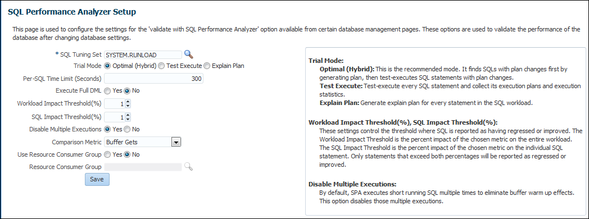
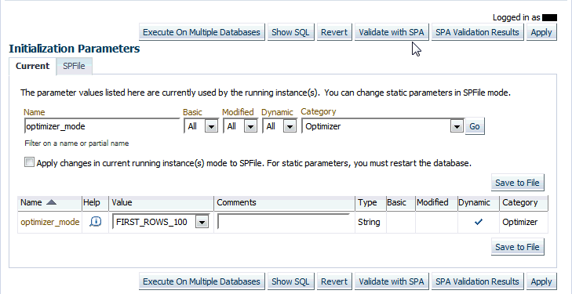
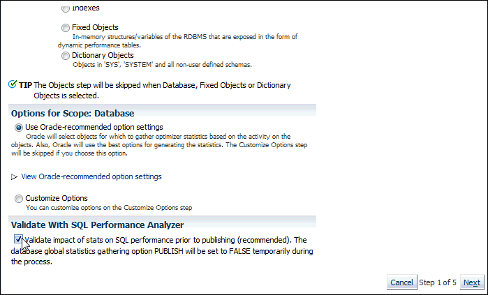
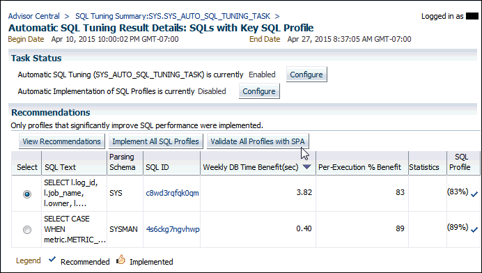

Oracle Enterprise Manager Cloud Control (Cloud Control) includes the SQL Performance Analyzer Quick Check (SPA Quick Check) feature. On some Cloud Control database management pages, SPA Quick Check can validate the impact of a system change to the database workload before you make the change.

You can use SPA Quick Check to validate what the impact to your database workload will be for the following changes:

- Changing the value of an initialization parameter

- Gathering pending optimizer statistics

- Implementing key SQL profiles

**Note:**

SPA Quick Check is available starting with Cloud Control Release 12.1.0.4 Bundle Patch 8 and later.

SPA Quick Check is supported for any database running Oracle Database 10g Release 2 (10.2) and later. However, not all the SPA Quick Check features are supported in Oracle Database 10g Release 2 (10.2).

For example, optimizer pending statistics and Automatic SQL Tuning Advisor features are available starting with Oracle Database 11g Release 1 (11.1), so SPA Quick Check workflows for these features are only supported for databases running Oracle Database 11g Release 1 (11.1) and later.

This chapter describes how to use SPA Quick Check and contains the following topics:

- "About Configuring SPA Quick Check"

- "Specifying Default Values for SPA Quick Check"

- "Validating the Impact of an Initialization Parameter Change"

- "Validating the Impact of Pending Optimizer Statistics"

- "Validating the Impact of Implementing Key SQL Profiles"

- "Validating Statistics Findings from Automatic SQL Tuning Advisor"

### About Configuring SPA Quick Check

Before you can use SPA Quick Check to validate the impact of an initialization parameter change or of gathering pending optimizer statistics, you must specify default settings for SPA Quick Check.

You will specify a default SQL tuning set for SPA Quick Check to use as one of the settings, and this SQL tuning set should include SQL statements used in the database application you are trying to tune.

**Note:**

It is not necessary to set default values for SPA Quick Check before using SPA Quick Check to validate the impact of implementing one or more key SQL profiles.

### Specifying Default Values for SPA Quick Check

You specify default settings for SPA Quick Check on the SQL Performance Analyzer Setup page in Cloud Control.

To specify default settings for SPA Quick Check:

1.  On the Database Home page in Cloud Control, from the Performance menu, select SQL, then SQL Performance Analyzer Setup. If the Database Login page appears, enter administrator privileges for the database, then click Login.
    The SQL Performance Analyzer Setup page appears.
    
    [Description of the illustration sqc_setup_page.png](img_text/sqc_setup_page.md)
2.  Configure the settings for the SPA Quick Check feature, which is available on some Cloud Control database management pages. The SQL tuning set that you specify should be representative of the workload for the application that you want to tune.
3.  Click Save to save the default SPA Quick Check settings you specified.

### Validating the Impact of an Initialization Parameter Change

Before you change the value of a session-modifiable initialization parameter, you can validate the impact of that change on your database workload by using SPA Quick Check. Session-modifiable parameters are initialization parameters whose values can be changed using the `ALTER SESSION` statement.

**Note:**

You can use SPA Quick Check to validate the impact of an initialization parameter change in databases running Oracle Database 10g Release 2 (10.2) and later.

To validate the impact of an initialization parameter change:

1.  On the Database Home page in Cloud Control, from the Administration menu, select Initialization Parameters.
    The Initialization Parameters page appears.
2.  Use the filter on the Initialization Parameters page to identify the session-modifiable initialization parameter whose value you want to change, and click Go to display that parameter in the table at the bottom of the page. Most of the parameters in the Optimizer category are session-modifiable.
3.  In the table, change the current value of the parameter to the new value whose impact you would like to validate using SPA Quick Check.
4.  Click Validate with SPA.
    
    [Description of the illustration sqc_init_param.gif](img_text/sqc_init_param.md)
    An Information message appears at the top of the page, and says that a SPA task for validating the impact of the initialization parameter change has been submitted.
5.  Click the link for the SPA task in the Information message.
    The SQL Performance Analyzer Home page appears.
6.  In the SQL Performance Analyzer Tasks section at the bottom of the page, select the task for the initialization parameter job, and click View Latest Report.
    The SQL Performance Analyzer Task Report page appears.
7.  View the table at the bottom of the page to see what the result of changing the initialization parameter's value would be on the most impactful SQL statements in the workload.

### Validating the Impact of Pending Optimizer Statistics

Before you gather pending optimizer statistics, you can validate the impact of gathering those statistics on your database workload by using SPA Quick Check.

**Note:**

You can use SPA Quick Check to validate the impact of gathering pending optimizer statistics in databases running Oracle Database 11g Release 1 (11.1) and later.

To validate the impact of gathering pending optimizer statistics:

1.  On the Database Home page in Cloud Control, from the Performance menu, select SQL, and then Optimizer Statistics.
    The Optimizer Statistics Console page appears.
2.  In the Operations section, click Gather.
    The Gather Optimize Statistics wizard appears.
3.  In the Validate with SQL Performance Analyzer section at the bottom of the Gather Optimizer Statistics: Scope page, enable the Validate impact of stats on SQL performance prior to publishing (recommended) option. The database global statistics gathering option PUBLISH will be set to FALSE temporarily during the process. Then click Next.
    
    [Description of the illustration sqc_gather_stats.gif](img_text/sqc_gather_stats.md)
4.  Continue through the wizard, and on the Gather Optimizer Statistics: Scope page, click Submit.
    Along with gathering pending statistics, this starts a job that creates a SQL Performance Analyzer task that validates the impact of gathering optimizer statistics for the database.
5.  When the job starts, a Confirmation message appears on the Manage Optimizer Statistics page that says that the Gather Optimizer Statistics job has been successfully submitted. Click the link in that message.
    The SQL Performance Analyzer Home page appears.
6.  In the SQL Performance Analyzer Tasks table at the bottom of the page, make sure that the statistics gathering job has completed. It may take several minutes for the job to complete. Then select the row for the Gather Optimizer Statistics job and click View Latest Report.
    The SQL Performance Analyzer Task Report page appears.
7.  View the table at the bottom of the page to see what the result of publishing the pending optimizer statistics would be on the most impactful SQL statements in the workload.

### Validating the Impact of Implementing Key SQL Profiles

Before you implement key SQL profiles for SQL statements, you can validate the impact of using those profiles by using SPA Quick Check. You can validate the impact of key SQL profiles on the Automatic SQL Tuning Result Summary page. Key SQL profiles are profiles verified to yield at least a 3 times performance improvement, and which would have been implemented automatically if auto-implementation had been enabled for Automatic SQL Tuning Advisor.

**Note:**

You can use SPA Quick Check to validate the impact of implementing key SQL profiles in databases running Oracle Database 11g Release 1 (11.1) and later.

To validate the impact of key SQL profiles:

1.  On the Database Home page in Cloud Control, from the Performance menu, select Advisors Home.
    The Advisor Central page appears.
2.  In the Advisors section, click SQL Advisors.
    The SQL Advisors page appears.
3.  In the SQL Tuning Advisor section, click Automatic SQL Tuning Results.
    The Automatic SQL Tuning Result Summary page appears.
4.  The Key SQL Profiles field in the Task Status section lists the number of key SQL profiles for the current automatic SQL tuning task. If a value of `0` appears in the field, there are no key SQL profiles to use (or validate). If a value greater than `0` appears in the Key SQL Profiles field, click the value to validate the impact of using the key SQL profile or profiles.
    The Automatic SQL Tuning Result Details: SQLs with Key SQL Profile page appears.
5.  The key SQL profiles appear in the Recommendations section. Click Validate All Profiles with SPA.
    
    [Description of the illustration sqc_key_sql_profiles.gif](img_text/sqc_key_sql_profiles.md)
    A Confirmation statement appears at the top of the page that indicates that a SPA task for validating the SQL profiles has been submitted.
6.  Click the link for the SPA task in the Confirmation statement.
    The SQL Performance Analyzer Home page appears, and the SPA task for validating the key SQL profiles appears in the SQL Performance Analyzer Tasks table at the bottom of the page.
7.  Select the task and click View Latest Report.
    The SQL Performance Analyzer Task Report page appears.
8.  View the table at the bottom of the page to see what the result would be of implementing the key SQL profiles recommended on the Automatic SQL Tuning Result Summary page on the most impactful SQL statements in the workload.

### Validating Statistics Findings from Automatic SQL Tuning Advisor

You can validate the impact of statistics findings from Automatic SQL Tuning Advisor using SPA Quick Check.

**Note:**

You can use SPA Quick Check to validate the impact of validating statistics findings from Automatic SQL Tuning Advisor in databases running Oracle Database 11g Release 1 (11.1) and later.

To validate the impact of statistics findings from Automatic SQL Tuning Advisor:

1.  On the Database Home page in Cloud Control, from the Performance menu, select Advisors Home.
    The Advisor Central page appears.
2.  In the Advisors section, click SQL Advisors.
    The SQL Advisors page appears.
3.  In the SQL Tuning Advisor section, click Automatic SQL Tuning Results.
    The Automatic SQL Tuning Result Summary page appears.
4.  If any statistics findings are available, they appear in the Statistics Finding Summary section near the bottom of the page. To validate the impact of statistics findings in user schemas, click Validate with SPA.
    A Confirmation statement appears at the top of the page that indicates a SPA task for validating the statistics findings has been submitted.
5.  Click the link for the SPA task in the Confirmation statement.
    The SQL Performance Analyzer Home page appears, and the SPA task for validating the statistics findings appears in the SQL Performance Analyzer Tasks table at the bottom of the page.
6.  After all the steps in the task have completed successfully, and Completed appears in the Last Run Status column of the table, select the task and click View Latest Report. It may take several minutes for all of the steps in the task to complete.
    The SQL Performance Analyzer Task Report page appears.
7.  View the table at the bottom of the page to see what the result would be of implementing the statistics on the Automatic SQL Tuning Result Summary page on the most impactful SQL statements in the workload.
