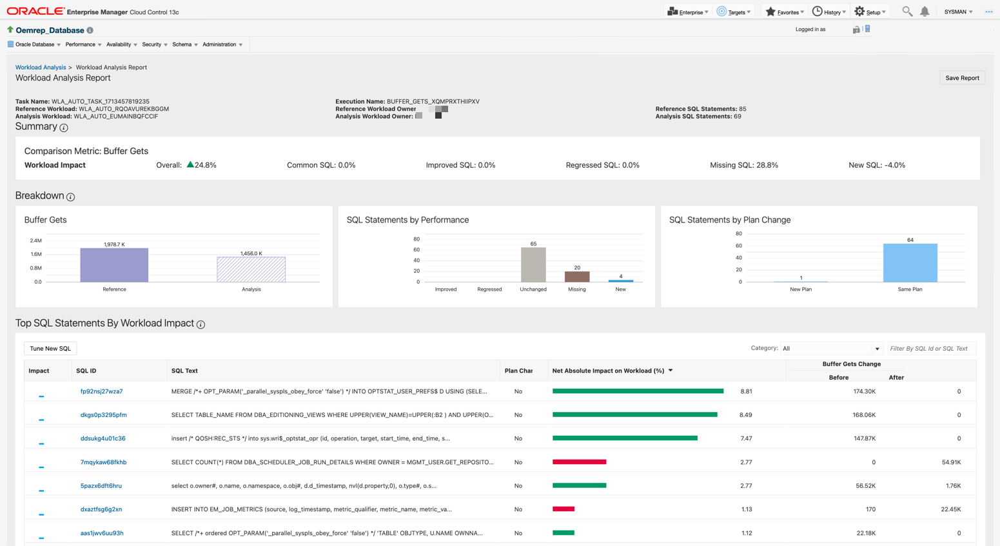
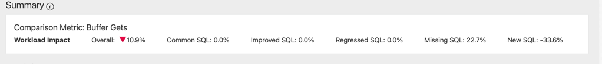
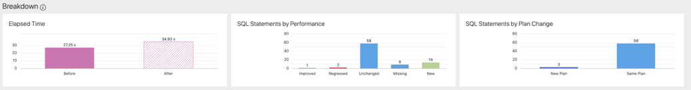
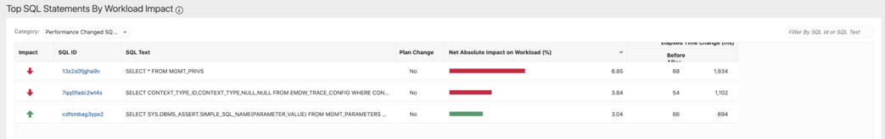
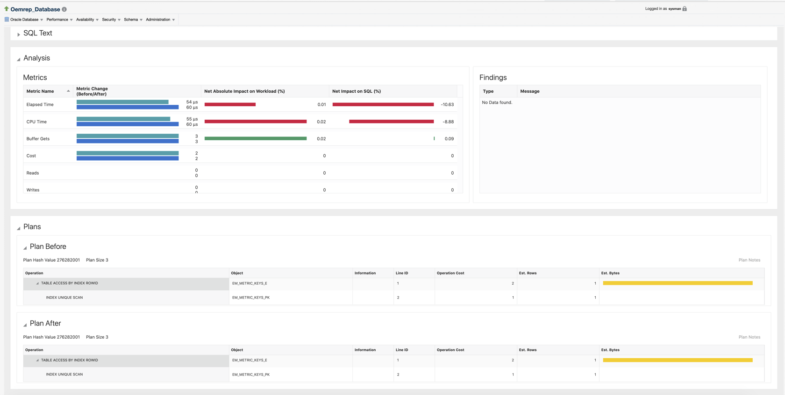
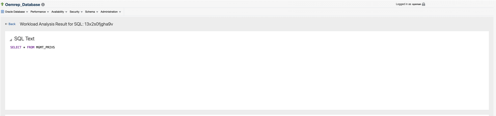
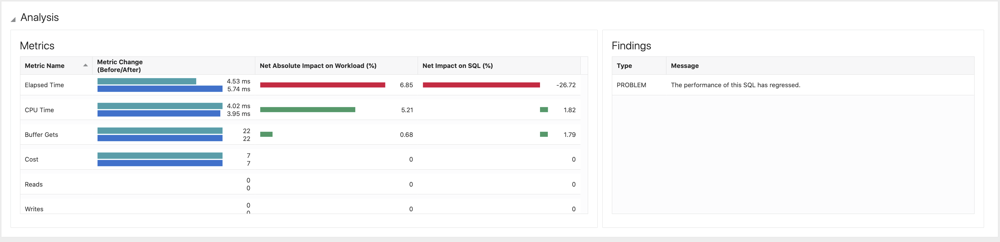
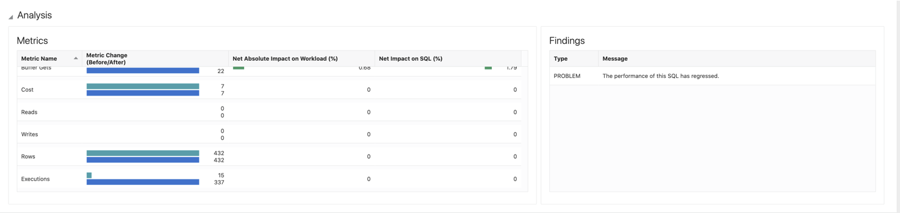
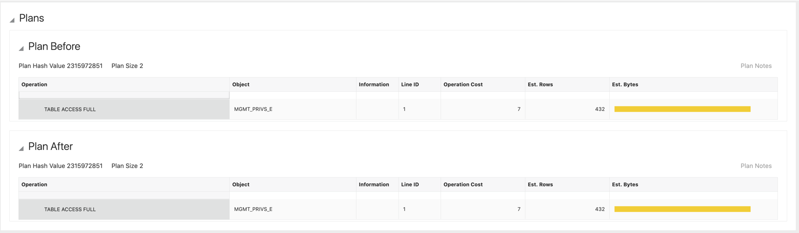

Workload Analysis helps you identify, quantify, and eliminate the reason for regression or improvements. This chapter contains the following topics:

-

A common reason for database performance regression is regressed SQL statements caused by query plan changes, increased data volumes or increased activity in the database.

Workload Analysis performs an analysis of top queries in the database from two different time points expected to be the same or similar. Regressed statements can then be tuned by using SQL Tuning Advisor or SQL Plan baselines.

### Accessing Workload Analysis in Enterprise Manager

You access Workload Analysis in Oracle Enterprise Manager Cloud Control using two methods.

Method 1:

1.  Click the Targets drop-down list.
2.  Select Databases.
3.  In the Name column, select your database name. For example, rep_database.
4.  From the Performance drop-down list, select Workload Analysis.
5.  In the Database Login screen, select a Named or New credential, and then click Login to access Workload Analysis.

Method 2:

1.  Click the Targets drop-down list.
2.  Expand Databases and click Database Instance.
3.  In the Target Name column, click the database name. For example, rep_database.
4.  From the Performance drop-down list, select Workload Analysis.
5.  In the Database Login screen, select a Named or New credential, and then click Login to access Workload Analysis.

### Oracle Database Support for Workload Analysis

Workload Analysis is supported on Oracle Database 19c and later.

- Workload Analysis is supported on single instance Oracle Database, Container Database (CDB), and Oracle RAC database.
- Workload Analysis is not supported on Autonomous Databases.
- For CDBs, Workload Analysis is not supported on `CDB$ROOT`.
- The Workload Analysis menu and the tile are not displayed on `CDB$ROOT`.
- Workload Analysis supports CDBs and pluggable databases (PDBs) but does not support `CDB$ROOT`.
- Workload Analysis is supported on Oracle RAC container and on the RAC PDBs. However, Workload Analysis is not supported on Oracle RAC instances.
- The Workload Analysis menu and the tile are not displayed on an Oracle RAC instance.

### Overview of Workload Analysis

Workload Analysis provides near real-time analysis of database top SQL statements to identify changed performance and reason for changed performance using historical execution statistics.

A workload is a set of SQL statements that you run in the database or PDB. It can be limited to a specific application or module in the application using filters or it can span the complete database or PDB. These statements with statistics and execution plans are stored in a SQL Tuning Set (STS).When collecting STS from Automatic Workload Repository (AWR) it is limited to the top N statements that can be modified with` dbms_workload_repository.modify_snapshot_settings(topnsql =>[number])`.

The Workload Analysis feature compares two SQL tuning sets from different time points in a production database as compared to the SQL Performance Analyzer which only analyzes one SQL tuning set in a test database before and after a change. You can compare the 2 SQL tuning sets either based on a certain criteria or based on the top statements for the database.

While the SQL Performance Analyzer helps to analyze performance data at the database level, Workload Analysis helps to analyze performance data at the application level.

If you are using a reference workload, then before you start analyzing performance data using Workload Analysis, create a SQL tuning set for your workload.

There are two types of Workload Analysis options currently available.

- Automated Analysis
- One-Time Analysis

Both automated analysis and one-time analysis have options to display the tasks on the Database Home Page in the Workload Analysis tile.

**Related Topics**

- [DBMS_WORKLOAD_REPOSITORY package](../arpls/DBMS_WORKLOAD_REPOSITORY.md)

### Using Automated Analysis

Automated Analysis generates reports that run automatically based on a schedule configured by the database administrator.

- About Automated Analysis

- Creating an Automated Analysis Task

- Reviewing the Results of Your Automated Analysis Tasks

- Listing Your Automated Analysis Tasks

- Reviewing Workload and Metric Summary

#### About Automated Analysis

You can use automated analysis to create a task that compares two SQL tuning sets. It runs automatically on a schedule such as hourly, daily, weekly, or monthly.

#### Creating an Automated Analysis Task

Create an Automated Analysis task by providing the Workload Capture details, Workload Comparison details, and Schedule the time and date of the task.

These are the automated analysis task options:

- Basic Automated Analysis task
- Advanced Automaed Analysis task.

##### Creating a Basic Automated Analysis Task

Create a Basic Automated Analysis Task by providing the Workload Capture details.

1.  Go to the database main page in Enterprise Manager.
2.  From the Performance drop-down list, select Workload Analysis.
3.  Select the Automated Analysis tab.
4.  Click Create Analysis Task to create an automated analysis task for your workload.
5.  In the Task Description, enter a Name and a brief Description for the automated analyis task. Select the Display on Home Page toggle if you want this task to be displayed on the Database home page tile.
6.  From the Select task creation type option, select Basic.
7.  In the Task Parameters section, schedule your task in the Workload capture interval (hours) drop-down list by selecting any number between 1 and 24.
8.  Click Submit. The basic analysis task is displayed on the Results tab after the workload analysis completes.

For example, if you select 4 hours from the Workload capture interval (hours) drop-down list, then the Workload Analysis task creates a SQL tuning set from the Automatic Workload Repository (AWR) snapshots created in the last 4 hours and compares this SQL tuning set with the SQL tuning set that is created for the previous 4 hours.

It compares the SQL tuning set for the 6am -10am time interval with the SQL tuning set that is created for the 2 am - 6 am time interval. The task runs every 4 hours, and creates an SQL tuning set for comparison.

##### Creating an Advanced Automated Analysis Task

Create an Advanced Automated Analysis Task by providing the Workload Capture details, Workload Comparison details, and Schedule the time and date of the task.

1.  Go to the database main page in Enterprise Manager.
2.  From the Performance drop-down list, select Workload Analysis.
3.  Select the Automated Analysis page.
4.  Click Create Analysis Task to create an automated analysis task for your workload.
5.  In the Task Description, enter a Name and a brief Description for the automated analyis task. Select the Display on Home Page toggle if you want this task to be displayed on the Database home page tile.
6.  From the Select task creation type option, select Advanced.
7.  Enter information for the following sections:

##### Workload Capture

In the Workload Capture section, enter information about the SQL tuning set and load SQL statements captured from the Automatic Workload Repository (AWR) snapshots.

- SQL Tuning Set Name Prefix: Specify a prefix before the SQL tuning set name.
- Load SQL Statements Using Automatic Workload Repository (AWR) Snapshots
  - Specify Custom Time Range: You can specify a time range to capture AWR snapshots that you can then use to load SQL statements when you create a new SQL tuning set.
    - Start Time: Specify the start time to capture AWR snapshots from the AWR.
    - End Time: Specify the end time to capture AWR snapshots from the AWR.
  - Quick Select From Snapshots Created in the Past: You can quickly select the AWR snapshots that are captured in the past from the drop down list by specifying the number of hours or days.
- Total Number of SQL Statements Captured: Top SQL statements that are available from the AWR.
  - Capture All: Select this option to capture all the SQL statements.
  - Capture Top N: Select this option to capture a specified number of SQL statements such as top ten or top twenty SQL statements.
  - Filter Option: You can add filters for Parsing Scheme Name, SQL Text, SQL ID, or Module using operators.

##### Workload Comparison

Workload comparison has the following options:

- Subsequent Comparisons
  - Compare using a rolling reference: You can compare workloads that are captured against the previously captured workloads on a rolling basis. Example: Today's workload against the previous day's workload.
  - Compare using a fixed reference: A fixed reference is a static SQL Tuning set captured at a specific time point. For example: From January 1st between time A and B when drawing comparisons, it always uses this reference SQL Tuning set to compare.

- Optional Initial Reference Workload

  Specify the SQL tuning set that you can use as an initial reference workload to compare other workloads. This value is optional.

  - Comparison Metric: Compares the performance metrics using Elapsed time. You can add multiple comparison metrics such as CPU time, Buffer Gets, Disk Reads, Physical I/O, Direct Writes, and Optimizer Cost.
  - Change Threshold: A minimum threshold is required here.
  - Consumer Reference Group: You can assign tasks to a particular resource group.
  - Retention policy (days)\*: You can retain the purged executions by selecting the preferred time range. Analysis results that are older than the retention policy will be deleted.

- Schedule

  You can schedule the time when you want to run a task by specifying a particular time range and time zone.

  - Start Date: Specify the start date to run a task.
    - Immediately: Select this option to run the task immediately.
    - Later: Select this option to run the task on a specified date.
  - End Date: Specify the end date to run a task.
    - None: Select this option if you do not want to end the task on a particular date.
    - Specified Date: Select this option to end the task on a specific date.
  - Repeat Every: Select this drop down option to repeat the schedules based on your time preference such as hourly, daily, weekly, or monthly.

  Click Submit. The advanced analysis task is displayed on the Results tab after the workload analysis completes.

#### Reviewing the Results of Your Automated Analysis Tasks

Use the Results tab to view the outcome and analyze the task that you created for your database workload.

Table 17-1 Results of Your Automated Analysis Tasks

| Item               | Description                                                                                                                                                                                                                                                                                             |
|:-------------------|:--------------------------------------------------------------------------------------------------------------------------------------------------------------------------------------------------------------------------------------------------------------------------------------------------------|
| Analysis           | Provides performance analysis and comparison reports of the SQL tuning sets. To view the comparison report, expand the analysis task for which you want the report and click Workload Analysis Report. Each time there is a regression or improvement in the automated workload, a report is generated. |
| Description        | The description of the workload captured in the SQL tuning sets.                                                                                                                                                                                                                                        |
| Reference workload | The workload of an existing or a previous SQL tuning set. Click on the reference workload to get more information about the SQL tuning set.                                                                                                                                                             |
| Analysis Workload  | Compare the performance of an existing SQL tuning set with another SQL tuning set. Click on the analysis workload to get more information about the SQL tuning set.                                                                                                                                     |
| Last Updated On    | Date on which the tasks was last updated.                                                                                                                                                                                                                                                               |
| Created By         | User who created the task. For example, SYS, SYSTEM, or SYMAN.                                                                                                                                                                                                                                          |
| Metric Comparisons | By default, Elapsed time performance metrics is used to compare other peformance metrics. Based on a comparison of performance metrics such as CPU time, Buffer Gets, Disk Reads, Physical I/O, Direct Writes, and Optimizer Cost, displays a status if the task has Regressed, Improved, or Unchanged. |
| Missing SQL        | Number of SQL statements that were part of the reference workload, but are no longer present in the compared workload.                                                                                                                                                                                  |
| New SQL            | Number of SQL statements that are run frequently during different reference periods and not during the current reference period.                                                                                                                                                                        |
| Previous Results   | Displays a report about the previous results of the task such as the name of the reference workload, the compared workload, and other metric comparisons.                                                                                                                                               |

#### Listing Your Automated Analysis Tasks

The Analysis Tasks tab contains the following columns and lists all the Automated Analysis Tasks that you created.

Table 17-2 Listing Your Analysis Tasks

| Item                | Description                                                                                                                                                                                |
|:--------------------|:-------------------------------------------------------------------------------------------------------------------------------------------------------------------------------------------|
| Task                | Name of the task.                                                                                                                                                                          |
| Description         | Description of the task.                                                                                                                                                                   |
| Created By          | User who created the task. For example, SYS, SYSTEM, or SYSMAN.                                                                                                                            |
| Last Run Date       | Date when the task was last run.                                                                                                                                                           |
| Next Run Date       | Date when the task is automated to run next.                                                                                                                                               |
| State               | Status of the task whether it is scheduled or not. Click on the status for more information about the automated job.                                                                       |
| Enabled             | If the task is enabled or not.                                                                                                                                                             |
| Previous Executions | Tasks that were executed previously. Click on the task number to get information about the task such as created by, start date, completion date, elapsed time, and current status.         |
| Vertical dots menu  | Click on the vertical dots menu to enable, disable, delete, or stop the execution of the task. Click Display on Home Page to display an automated analysis task on the database home page. |

#### Reviewing Workload and Metric Summary

Automated Analysis provides a series of panels that give you a brief summary of the workloads and metrics of the analysis tasks that you created.

- Changed Workloads: Number of workloads that have changed.
- Monitored Workloads: Number workloads that are being monitored.
- Regressed Metrics: The improved and regressed metrics is based on comparisons. One SQL tuning set can have several comparisons.
- Improved Metrics: Number of SQL tuning sets that have improved.
- Unchanged Metrics: Number of SQL tuning sets that are unchanged.

You can also select options from the View Data drop-down list in the top-right of the Workload Analysis page to view Workload Analysis data for any time or without any time limit.

### Using One-Time Analysis

Use the One-Time Analysis page to create a one-time analysis task that will help you compare the performance characteristics of two similar workloads. For example, to measure the performance of a SQL tuning set before and after a database upgrade or patch.

- About One-Time Analysis

- Creating a One-Time Analysis Task

- Reviewing the Results of Your One-Time Analysis Task

- Reviewing the Analysis and Metric Summary

#### About One-Time Analysis

One-Time analysis performs a comparison of two workloads. You can do this analysis to validate performance after a known change such as an application upgrade.

#### Creating a One-Time Analysis Task

Create an Analysis Task for one-time analysis of your workload by providing the workload definition and comparison details.

1.  Go to the database main page in Enterprise Manager.
2.  From the Performance drop-down list, select Workload Analysis.
3.  Select the One-Time Analysis page.
4.  Click Create One-Time Analysis Task to create a One-Time analysis task or to schedule an analysis task for your workload.
5.  In the Create One-time Analysis Task window, enter information for the following sections:

##### Workload

A workload is a SQL tuning set that is captured for a certain time period and includes a set of filtered SQL statements and Data Manipulation Language (DML) statements.

##### General Option

The options that are available for the various tasks that you can create for One-Time Analysis.

- Name: Enter a name for the scheduled task.
- Description: Enter a brief description for the scheduled task.

##### Workload Comparison

Enter information to compare the performance of various SQL tuning sets.

- Reference Workload: Search and enter the SQL tuning set to set as a reference point.
- Compared Workload: Search and enter a workload so you can compare the performance of an existing SQL tuning set with another SQL tuning set.
- Comparison Metric: Enter value/s to be used when generating comparison reports. When selecting multiple metrics each metric generates a compression report based on any of these metrics such as Elapsed time, CPU time, Buffer Gets, Disk Reads, Physical I/O, Direct Writes, and Optimizer Cost.
- Change Threshold: Enter threshold in % when a statement is considered to have regressed.

#### Reviewing the Results of Your One-Time Analysis Task

The One-Time Analysis page displays the results of all the one-time analysis workload tasks that you created. It lists the following information.

Table 17-3 Results of Your One-Time Analysis Tasks

| Item                | Description                                                                                                                                                                                                                                                                                                       |
|:--------------------|:------------------------------------------------------------------------------------------------------------------------------------------------------------------------------------------------------------------------------------------------------------------------------------------------------------------|
| Analysis            | Provides a one-time performance analysis and comparison reports of the SQL tuning sets. To view the comparison report, expand the analysis task for which you want the report and click Worload Analysis Report. Each time there is a regression or improvement in the scheduled workload, a report is generated. |
| Description         | The task description of the workload captured in the SQL tuning sets.                                                                                                                                                                                                                                             |
| Reference workloads | The workload of an existing or a previous SQL tuning set. Click on the reference workload to get more information about the SQL tuning set.                                                                                                                                                                       |
| Compared Workload   | Compare the performance of an existing SQL tuning set with another SQL tuning set. Click on the compared workload to get more information about the SQL tuning set.                                                                                                                                               |
| Last Updated On     | Date on which the tasks was last updated.                                                                                                                                                                                                                                                                         |
| Created By          | User who created the task. For example, SYS, SYSTEM, or SYMAN.                                                                                                                                                                                                                                                    |
| Delete              | Option to delete a one-time task.                                                                                                                                                                                                                                                                                 |
| Metric Comparisons  | Based on a comparison of performance metrics such as Elapsed time, CPU time, Buffer Gets, Disk Reads, Physical I/O, Direct Writes, and Optimizer Cost, displays a status if the task has Regressed, Improved, or Unchanged.                                                                                       |
| Missing SQL         | Number of SQL statements that were part of the reference workload, but are no longer present in the compared workload.                                                                                                                                                                                            |
| New SQL             | Number of SQL statements that appeared in the compared workload, but were not present in the reference workload.                                                                                                                                                                                                  |
| State               | Current status of the task which can be either completed or executing.                                                                                                                                                                                                                                            |

#### Reviewing the Analysis and Metric Summary

One-Time Analysis provides a series of panels that give you a brief analyses and metrics of the analysis tasks that you created.

- Analyses With Differences: Displays the number of one-time analyses task with differences.
- Total Analyses: Displays the total number of one-time analyses tasks.
- Regressed Metrics: The improved and regressed metrics is based on comparisons. An automated workload analysis task can have several comparisons.
- Improved Metrics: Number of SQL tuning sets that are improved.
- Unchanged Metrics: Number of SQL tuning sets that are unchanged.

You can also select options from the View Data drop-down list in the top-right of the database page to view Workload Analysis data for the last 24 hours, 1 week, 30 days, or a combination of all of these.

### Reviewing the Automated Workload Analysis Task on the Database Home Page

You can review only one automated workload analysis task on the database home page by selecting a specific workload analysis task on the workload analysis page.

#### Adding or Removing Tasks on the Home Page

You can add or remove an automated analysis task for your database Home Page using two methods.

Method 1:

1.  Go to the database main page in Enterprise Manager.
2.  From the Performance drop-down list, select Workload Analysis.
3.  Select the Automated Analysis tab.
4.  Click Create Analysis Task to create an automated analysis task for your workload.
5.  In the Task Definition section, enter a name and description for the automated analysis task.
6.  Use the Display on home page toggle bar to display an automated analysis task on the database home page. A home icon appears next to the task confirming that the task is displayed on the database home page.
7.  Click Submit to add the automated analysis task for your workload.

Method 2:

1.  In the Workload Analysis home page, select the Analysis Tasks tab.
2.  From the Analysis Tasks tab, select the task that you want to display on the database home page.
3.  From the Vertical dots menu, select Display on Home Page to display the selected task on the database home page. The task is displayed on the database home page.
4.  From the list of tasks, select the task that you want to remove from the database home page.
5.  From the Vertical dots menu, select Remove from Home Page to remove the selected task from the database home page.

**Note:**

The task takes some time to display on the Database home page.

Creating a Basic Automated Analysis Task

Creating an Advanced Automated Analysis Task

#### Accessing the Automated Workload Analysis Task

You can view the automated workload analysis tasks on the database home page.

1.  Go to the database home page.
2.  Click on the Workload Analysis tile to access the workload analysis task next to the Workload Analysis metric for which you want the report.

**Note:**

Do not map multiple EMs to the same database as this feature does not work correctly if you have multiple EMs managing the same Database.

#### Reviewing the Automated Workload Analysis Tasks

In the automated or one-time workload analysis, a performance analysis and Workload Analysis report of the SQL tuning sets is always generated.

Table 17-4 Automated Workload Analysis Tasks

| Item                          | Description                                                                                                                                                    |
|:------------------------------|:---------------------------------------------------------------------------------------------------------------------------------------------------------------|
| Task                          | Name of the task.                                                                                                                                              |
| Description                   | The description of the workload captured in the SQL tuning sets.                                                                                               |
| Reference Period              | It is a period between two time points where we capture a SQL tuning set. It is used to compare with an analysis period.                                       |
| Analysis Period               | The time interval when we capture a SQL tuning set.                                                                                                            |
| Summary                       | Displays the summary of the workload impact for the comparison metric that you choose in the analysis task in the Workload Analysis home page.                 |
| SQL Commonality               | Measure of similarity between the reference and analysis periods based on the SQL statements from both periods with a range of 0% to 100%.                     |
| Overall Performance Change    | Displays the total improvements or regression in percentage for the selected comparision metric.                                                               |
| Workload Impact               | Percentage of contribution from a category of SQL statements to overall perfornance regression.                                                                |
| Common SQL                    | Number of SQL statements that are common in both runs and displays the top common SQL statements by variance in average response time and total database time. |
| Improved SQL                  | Number of SQL statements whose performance has improved.                                                                                                       |
| Regressed SQL                 | Number of SQL statements whose performance has regressed.                                                                                                      |
| Missing SQL                   | Number of SQL statements that were part of the reference workload, but are no longer present in the compared workload.                                         |
| New SQL                       | Number of SQL statements that appeared in the compared workload, but were not present in the reference workload.                                               |
| Elapsed Time                  | Elapsed time is the total amount of seconds for all the executions of all the statements.                                                                      |
| SQL Statements by Performance | Number of SQL statements for each group that are common in both the referenced and analysis periods based on performance.                                      |
| SQL Statements by Plan Change | Number of SQL statements that are common in both the referenced and analysis periods based on plan change.                                                     |
| View All Results              | Displays all the results for the automated workload analysis in the database home page.                                                                        |

### Reviewing the Workload Analysis Report

In the automated or one-time workload analysis, a performance analysis and Workload Analysis report of the SQL tuning sets is always generated.

Review this report for data such as Workload Analysis metrics, performance breakdown of SQL statements, and top SQL statements impacted by the workload.

Also, review the information at the top of the page such as Task Name, Reference Workload, Compared Workload, Execution Name, Reference Workload Owner, Compared Workload Owner, Reference SQL Analyzed, and Compared SQL Analyzed.

- Accessing the Workload Analysis Report

- Reviewing the Summary Report

- Example: Workload Analysis Report

#### Accessing the Workload Analysis Report

You can view the Workload Analysis report for your workload analysis task.

1.   In the Workload Analysis home page, expand the analysis task for which you want the report.
2.  Click the Workload Analysis Report link next to the Workload Analysis metric for which you want the report.
3.  A Workload Analysis Report page is displayed with the Workload Analysis metrics.
4.  Click Save Report to download the Workload Analysis report.

#### Reviewing the Summary Report

The Summary panel displays a summary of the workload impact for the comparison metric that you choose in the analysis task in the Workload Analysis home page.

The UI displays Workload Analysis reports for the following metrics:

- Direct Writes: Direct Writes allow a session to queue an I/O write request and continue processing while the Operating System handles the I/O.
- Physical I/Os: The sum of Direct Writes and Disk Reads when you run a SQL statement.
- Disk Reads: The total amount of Physical Disk reads (disk reads is only done if the data is not available in the memory).
- Buffer Gets: Total number of buffer gets (number of times the database accessed a block) for this SQL statement.
- Optimizer Cost: The cost calculated by the optimizer for the execution plan.
- Elapsed Time: Number of seconds elapsed for an SQL statement.
- CPU Time: Sum of the CPU time for a SQL statement.

#### Example: Workload Analysis Report

The workload analysis report is a report that compares two SQL tuning sets where it highlights differences to make it possible to identify abnormalities between two execution periods.

- Overview of the Workload Analysis Report
- Summary Section
- Breakdown
- Top SQL Statements by Workload Impact
- SQL Details

##### Overview of the Workload Analysis Report

There will always be differences when capturing two different SQL tuning sets and it is up to you to interpret and understand if these differences are abnormal or not.

For example, let’s assume that the analyzed workload is expected to be same. You have captured a SQL tuning set last Monday between 9 a.m. and 10 a.m. and you compare it with a workload executed this Monday between 9 a.m. and 10 a.m. The workload is a SQL tuning set captured from Automatic Workload Repository (AWR), hence it will include only top N statements for each category. The statements that contribute to the performance metrics such as the elapsed time. However, it will not result in new statements to be the top contributor.

Figure 17-1 Overview of the WLA Report

[Description of "Figure 17-1 Overview of the WLA Report"](img_text/wla-overview.md)

The top section provides you with information of the name of the workloads compared and how many SQL statements are captured for each workload. In this example, there are 70 statements in the reference workload and 75 statements in the compared workload.

This indicates that we have more statements in AWR for the comparison period. This may imply that statements in different categories align more in the reference workload than in the compared workload, or there has been a change to include more statements in the AWR snapshot.

These are the criteria for the number of top SQL statements by workload impact:

- SQL ordered by Elapsed Time
- SQL ordered by CPU Time
- SQL ordered by User I/O Wait Time
- SQL ordered by Gets
- SQL ordered by Reads
- SQL ordered by Physical Reads (UnOptimized)
- SQL ordered by Executions
- SQL ordered by Parse Calls
- SQL ordered by Sharable Memory
- SQL ordered by Version Count

AWR keeps the top N SQL for each criteria. If none of these overlap, then there are 30 statements \* 10 criteria = 300 statements. So instead of 300, there may be around 150. But this may fluctuate, in the range of 170 to 130 and so on. So the delta may either increase or decrease and is dependent on the overlap.

##### Summary Section

In this example, the report is generated on the Elapsed Time comparison metric. You can see an overall regression of 22.3%.

Figure 17-2 Summary Section

[Description of "Figure 17-2 Summary Section"](img_text/summary-wla-report.md)

The regression is divided into different categories:

Common SQL: These statements are executed during both time periods.

Improved SQL: What are the total improvements on all statements with less total elapsed time than the reference workload.

Regressed: What is the total regression on all statements with more total elapsed time than the reference workload.

Missing SQL: This is the total improvements on all statements not captured in the compared workload. If there are no statistics collected, they will not contribute to the elapsed time. These statements can be replaced by other statements as top N statements in AWR or they can be replaced by statements due to application upgrades or similar activities.

New SQL: This is the total impact on all new statements captured in the compared workload but not in the reference workload. The reasons for new statements can be the same as it is for missing statements.

In this example, missing and new contributes to approximately 50% of the total workload.

##### Breakdown

You should always correlate the information from the breakdown section with the data in the summary section. If you have 10% increased elapsed time, then it is important to know other circumstances like the total amount of elapsed time.

Figure 17-3 Breakdown section

[Description of "Figure 17-3 Breakdown section"](img_text/breakdown.md)

In this example, the total elapsed time is approximately 24 seconds. Hence, there is no real value to perform a comparison if the workload is captured for an hour. But if the elapsed time is around 15000 seconds, then a 10% increase can have an impact on application performance.

Elapsed Time

The Elapsed Time tile provides the total amount of elapsed time for all executions of all captured statements within that time period. The label of this tile will change to reflect the comparison metric that you select.

SQL Statements by Performance

This tile provides the number of statements for each group. It is important to correlate this data with the data available in the summary section. In this example, the Missing statements is 12% of the total amount of statements but it contributes to almost 45% of the total elapsed time, and same for new statements which is 19% of all statements but it contributes to 54% of the elapsed time.

In this use case they are high contributors to the elapsed time and should not just disappear or appear without any explanation.

SQL Statements by Plan Changes

This is an important section where you must analyze the SQL details. If the new plan shows performance improvements, then you must determine if a single execution is faster or slower. If the execution is slower, then there is regression. However, there are less executions, which provides us with less elapsed time, and you should investigate this further. If it shows regression, then you must investigate if there is an increased elapsed time for a single execution. However, less elapsed time for a single execution does not require any further investigation.

##### Top SQL Statements by Workload Impact

In this tile you can add different filters to show only a certain category of SQL statements. By default, this tile will show Performance Changed SQL but it is also possible to show all, only regressed, and a few other categories.

Figure 17-4 Top SQL Statement by Workload

[Description of "Figure 17-4 Top SQL Statement by Workload"](img_text/top_sql_statements.md)

To change the category, select the category from the drop-down list. In the example, you can see 3 SQL statements with performance changes. Note that it is the predefined impact threshold because of which the SQL statements are listed as performance changed. The default threshold is 3% and it is applicable for either impact on workload or impact on SQL statement. Click on the SQL ID to see more details for each individual SQL statement.

##### SQL Details

SQL details are divided into three different tiles where the analysis and the plan tiles are the most important.

Figure 17-5 SQL Details

[Description of "Figure 17-5 SQL Details"](img_text/sql_details.md)

##### SQL Text

This tile is collapsed by default. Expand it to see the complete SQL text.

Figure 17-6 SQL Text

[Description of "Figure 17-6 SQL Text"](img_text/sql_text.md)

##### Analysis

Analysis is divided into two tiles: Metrics and Findings.

Figure 17-7 Analysis Metrics

[Description of "Figure 17-7 Analysis Metrics"](img_text/analysis_metrics.md)

Figure 17-8 Analysis Findings

[Description of "Figure 17-8 Analysis Findings"](img_text/analysis_finidngs.md)

The Metrics tile includes statistics for all important metrics and displays an overview of all the differences. In this example, the elapsed time has a small change and CPU time has decreased. Buffer Gets is the same, which implies that each execution does more or less the same work. But the major difference is that for Executions instead of 16 executions there are 337 executions. Hence, the load is much higher. This explains why the elapsed time is higher. If the load is higher, then it may have introduced waits. There are no I/Os, which indicates that the CPU is flooded.

Figure 17-9 Plan Changes

[Description of "Figure 17-9 Plan Changes"](img_text/plans.md)

Other reasons for performance changes are plan changes. The query has a new more efficient or less efficient plan. The workload analysis report provides you with a Plan Before and Plan After for all common statements.
