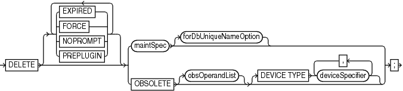
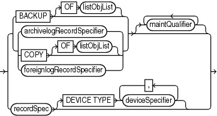
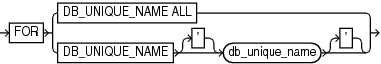

## 2.15 DELETE

### Purpose

Use the `DELETE` command to perform the following actions:

- Delete physical backups and copies.

- Delete obsolete backups of sparse databases.

- Update the repository records in the target control file to show that the files are deleted. For example, the record for a backup piece in `V$BACKUP_PIECE.STATUS` shows the value `D`.

- Remove the repository records for deleted files from the recovery catalog (if you use a catalog). For example, `RC_BACKUP_PIECE` no longer contains a row for a deleted backup piece.

**See Also:**

[`BACKUP`](BACKUP.md) to learn about the `BACKUP ... DELETE INPUT` command

### Prerequisites

RMAN must be connected to a target database, which must be mounted or open.

RMAN uses all configured channels to perform the deletion. If you use `DELETE` for files on devices that are not configured for automatic channels, then you must use [`ALLOCATE CHANNEL FOR MAINTENANCE`](ALLOCATE-CHANNEL-FOR-MAINTENANCE.md). For example, if you made a backup with an SBT channel, but only a disk channel is configured, then you must manually allocate an SBT channel for `DELETE`. An automatic or manually allocated maintenance channel is required when you use `DELETE` on a disk-only file.

For preplugin backups, the CDB must be open in read-write mode and you must connect as a common user with the `SYSDBA` or `SYSBACKUP` privilege.

### Usage Notes

The best practice is to run [`CROSSCHECK`](CROSSCHECK.md) to update the status of backups and copies in the repository and then run `DELETE` to remove the desired files. When running RMAN interactively, `DELETE` displays a list of files and prompts for confirmation before deleting any file in the list. If you confirm, then RMAN shows each item as it is deleted. When reading commands from a command file, RMAN does not prompt for confirmation.

You can view the status of backups and copies recorded in the RMAN repository through [`LIST`](LIST.md), `V$` views, or recovery catalog views (if you use a catalog). The repository record for a backup can fail to reflect its physical status. For example, a user deletes a disk backup with the Linux `rm` command. The backup record cannot be updated by `rm`, so the RMAN repository shows the file as available although it no longer exists.

Behavior of DELETE Command for Files of Different Status Values

Table 2-5 describes the behavior of `DELETE` when the `FORCE` option is not specified.

Table 2-5 Behavior of DELETE Command Without FORCE Option

| Repository Status | Physical Status    | Behavior of DELETE Command                                                                                                               |
|:------------------|:-------------------|:-----------------------------------------------------------------------------------------------------------------------------------------|
| `AVAILABLE`       | Not found on media | Does not delete the object and reports the list of mismatched objects at the end of the job. RMAN does not update the repository status. |
| `EXPIRED`         | Found on media     | Does not delete the object and reports the list of mismatched objects at the end of the job. RMAN does not update the repository status. |
| `UNAVAILABLE`     | Any                | Removes repository record and deletes object if it exists. All I/O errors are ignored.                                                   |

Backup Deletion in a Data Guard Environment

"[RMAN Backups in a Data Guard Environment](BACKUP.md)" explains the difference between the association and accessibility of a backup. In a Data Guard environment, the database that creates a backup or copy is associated with the file. You can use maintenance commands such as `CHANGE`, `DELETE`, and [`CROSSCHECK`](CROSSCHECK.md) for backups when connected to any database in the Data Guard environment if the backups are accessible. In general, RMAN considers tape backups created on any database as accessible to all databases in the environment, whereas disk backups are accessible only to the database that created them.

If a deletion is successful, then RMAN removes the metadata for the file, even if the file is associated with another database. If a deletion was not successful, and if the file is associated with another database in the Data Guard environment, then RMAN prompts you to perform the same `DELETE` command while connected as `TARGET` to the database associated with the file. You must use `DELETE ... FORCE` to delete the file metadata.

### Syntax

delete::=

[Description of the illustration delete.eps](img_text/delete.md)

([maintSpec::=](maintSpec.md), [obsOperandList::=](obsOperandList.md), [deviceSpecifier::=](deviceSpecifier.md))

maintSpec::=

[Description of the illustration maintspec.eps](img_text/maintspec.md)

([listObjList::=](listObjList.md), [archivelogRecordSpecifier::=](archivelogRecordSpecifier.md), [maintQualifier::=](maintQualifier.md), [deviceSpecifier::=](deviceSpecifier.md), [recordSpec::=](recordSpec.md))

forDbUniqueNameOption::=

[Description of the illustration fordbuniquenameoption.eps](img_text/fordbuniquenameoption.md)

### Semantics

| Syntax Element                                                | Description                                                                                                                                                                                                                                                                                                                                                                                                                                                                                                                                                                                                                                                                                                                                                                                                                                                                                                                                                                                                                                                                                                                                                                                                                                                                                                                                                                                                                                                                              |
|:--------------------------------------------------------------|:-----------------------------------------------------------------------------------------------------------------------------------------------------------------------------------------------------------------------------------------------------------------------------------------------------------------------------------------------------------------------------------------------------------------------------------------------------------------------------------------------------------------------------------------------------------------------------------------------------------------------------------------------------------------------------------------------------------------------------------------------------------------------------------------------------------------------------------------------------------------------------------------------------------------------------------------------------------------------------------------------------------------------------------------------------------------------------------------------------------------------------------------------------------------------------------------------------------------------------------------------------------------------------------------------------------------------------------------------------------------------------------------------------------------------------------------------------------------------------------------|
| `FORCE`                                                       | Deletes specified files—whether or not they exist on the media—and removes repository records (see Example 2-80). RMAN ignores any I/O errors for the deleted objects. RMAN also ignores any [`CONFIGURE`](CONFIGURE.md) [`ARCHIVELOG DELETION POLICY`](CONFIGURE.md) settings. RMAN displays the number of deleted objects at the end of the job.                                                                                                                                                                                                                                                                                                                                                                                                                                                                                                                                                                                                                                                                                                                                                                                                                                                                                                                                                                                                                                                                                                                                    |
| `NOPROMPT`                                                    | Deletes specified files without first listing the files or prompting for confirmation. The `DELETE NOPROMPT` command displays each item as it is deleted.                                                                                                                                                                                                                                                                                                                                                                                                                                                                                                                                                                                                                                                                                                                                                                                                                                                                                                                                                                                                                                                                                                                                                                                                                                                                                                                                |
| `PREPLUGIN`                                                   | Deletes preplugin backups and removes their repository records.                                                                                                                                                                                                                                                                                                                                                                                                                                                                                                                                                                                                                                                                                                                                                                                                                                                                                                                                                                                                                                                                                                                                                                                                                                                                                                                                                                                                                          |
| `EXPIRED`                                                     | Removes only files whose status in the repository is `EXPIRED` (see Example 2-77). RMAN marks backups and copies as expired when you run a `CROSSCHECK` command and the files are absent or inaccessible. To determine which files are expired, run a `LIST EXPIRED` command. If for some reason a backup marked `EXPIRED` exists when you run the `DELETE EXPIRED` command, then RMAN does not delete the physical file.                                                                                                                                                                                                                                                                                                                                                                                                                                                                                                                                                                                                                                                                                                                                                                                                                                                                                                                                                                                                                                                             |
| [`maintSpec`](maintSpec.md)                                   | Deletes backups and copies. You can set rules for the deletion with the [`maintQualifier`](maintQualifier.md) clause. For example, you can delete archived redo log files that are backed up to tape (see Example 2-79). When deleting backups of PDBs that were dropped, you identify the PDB using its GUID. Use the `GUID` clause with the `DELETE` command to delete backups of dropped PDBs. The `dba_pdb_history` view contains the GUID of dropped PDBs. Note: `DELETE ARCHIVELOG ALL` considers only the archived log deletion policy and does not consider the configured retention policy. Note: In CDBs, you must connect to the root as a user with the `SYSDBA` or `SYSBACKUP` privilege to delete archived redo logs. You cannot delete archived redo logs when connected to a PDB. See Also: [`maintSpec`](maintSpec.md) and [`maintQualifier`](maintQualifier.md)                                                                                                                                                                                                                                                                                                                                                                                                                                                                                                                                                                                         |
| [`forDbUniqueNameOption`](forDbUniqueNameOption.md)           | Deletes the backups and copies in [`maintSpec`](maintSpec.md) that are exclusively associated with the specified `DB_UNIQUE_NAME` in a Data Guard environment. Note: The `FOR DB_UNIQUE_NAME` option is not allowed with the `DELETE OBSOLETE` command. If RMAN successfully deletes tape backups associated with the specified `DB_UNIQUE_NAME`, then RMAN removes the metadata for these files from the recovery catalog. If RMAN could not delete these files because they are associated with a different database in the Data Guard environment, then RMAN prompts you to perform the same `DELETE` operation for these files at the database that is associated with them. Note: You cannot use `FORCE` to override the default behavior and specify that RMAN deletes files that are associated with a different database. In this way, RMAN protects you from accidental deletions caused by incorrect RMAN configurations for SBT. To remove the metadata for files that RMAN prevents you from deleting, use the [`CHANGE`](CHANGE.md) `RESET DB_UNIQUE_NAME` command. See Also: [`forDbUniqueNameOption`](forDbUniqueNameOption.md) for descriptions of the options in this clause                                                                                                                                                                                                                                                                                |
| `OBSOLETE`                                                    | Deletes data file backups and copies recorded in the RMAN repository that are obsolete, that is, no longer needed (see Example 2-78). RMAN also deletes obsolete archived redo log files and log backups. RMAN determines which backups and copies of data files are no longer needed, which in turn determines when logs (and backups of logs) are no longer needed. RMAN considers the creation of a data file as a backup when deciding which logs to keep. RMAN first uses the options specified with [`obsOperandList`](obsOperandList.md) to determine which files are obsolete. If you do not specify options in [`obsOperandList`](obsOperandList.md), then RMAN uses the options specified in `CONFIGURE` [`RETENTION POLICY`](CONFIGURE.md). Note: `DELETE OBSOLETE` considers only the backup retention policy and does not use the configured archived log deletion policy to determine which logs are obsolete. In contrast, `DELETE ARCHIVELOG ALL` considers only the configured archived log deletion policy. Note: If you make a backup with the `KEEP UNTIL TIME` clause, then this backup becomes obsolete after the specified `KEEP` time passes and is removed by `DELETE OBSOLETE`. RMAN does not consider the backup retention policy for archival backups whose `KEEP` time has expired. Note: The `DELETE...OBSOLETE` command cannot be used when backups are stored to Zero Data Loss Recovery Appliance, commonly known as Recovery Appliance. |
| `   `[`obsOperandList`](obsOperandList.md)                    | Specifies the criteria for determining which backups and copies are obsolete. See Also: [`obsOperandList`](obsOperandList.md)                                                                                                                                                                                                                                                                                                                                                                                                                                                                                                                                                                                                                                                                                                                                                                                                                                                                                                                                                                                                                                                                                                                                                                                                                                                                                                                                                         |
| `   DEVICE TYPE` `   `[`deviceSpecifier`](deviceSpecifier.md) | Restricts the deletion to obsolete backups and copies created on the specified device type only. See Also: [`deviceSpecifier`](deviceSpecifier.md)                                                                                                                                                                                                                                                                                                                                                                                                                                                                                                                                                                                                                                                                                                                                                                                                                                                                                                                                                                                                                                                                                                                                                                                                                                                                                                                                    |

### Examples

Example 2-77 Deleting Expired Backups

This example uses a configured `sbt` channel to check the media manager for expired backups of the tablespace `users` that are more than one month old and removes their recovery catalog records.

    CROSSCHECK BACKUPSET OF TABLESPACE users
      DEVICE TYPE sbt COMPLETED BEFORE 'SYSDATE-31';
    DELETE NOPROMPT EXPIRED BACKUPSET OF TABLESPACE users
      DEVICE TYPE sbt COMPLETED BEFORE 'SYSDATE-31';

Example 2-78 Deleting Obsolete Backups

This example deletes backups and copies that are not needed to recover the database to an arbitrary SCN within the last week. RMAN also deletes archived redo log files that are no longer needed.

    DELETE NOPROMPT OBSOLETE RECOVERY WINDOW OF 7 DAYS;

Example 2-79 Deleting Archived Redo Log Files That Are Backed Up

Assume that you have configured RMAN settings as follows:

    CONFIGURE DEFAULT DEVICE TYPE TO sbt;
    CONFIGURE ARCHIVELOG DELETION POLICY TO
      BACKED UP 2 TIMES
      TO DEVICE TYPE sbt;

The following `DELETE` command deletes all archived redo log files on disk if they are not needed to meet the configured deletion policy, which specifies that logs must be backed up twice to tape (sample output included):

    RMAN> DELETE ARCHIVELOG ALL;

    allocated channel: ORA_DISK_1
    channel ORA_DISK_1: SID=84 device type=DISK

    List of Archived Log Copies for database with db_unique_name PROD
    =====================================================================

    Key     Thrd Seq     S Low Time
    ------- ---- ------- - ---------
    107     1    4       A 12-FEB-13
            Name: /orcva/PROD/archivelog/2013_02_12/o1_mf_1_4_2x28bpcm_.arc
    108     1    5       A 12-FEB-13
            Name: /orcva/PROD/archivelog/2013_02_12/o1_mf_1_5_2x28g7s9_.arc
    109     1    6       A 12-FEB-13
            Name: /orcva/PROD/archivelog/2013_02_13/o1_mf_1_6_2x3bbqym_.arc
    157     1    7       A 13-FEB-13
            Name: /orcva/PROD/archivelog/2013_02_13/o1_mf_1_7_2x3w2cvs_.arc
    164     1    8       A 13-FEB-13
            Name: /orcva/PROD/archivelog/2013_02_13/o1_mf_1_8_2x3w40vr_.arc
    171     1    9       A 13-FEB-13
            Name: /orcva/PROD/archivelog/2013_02_13/o1_mf_1_9_2x3w8pf7_.arc
    318     1    10      A 13-FEB-13
            Name: /orcva/PROD/archivelog/2013_02_13/o1_mf_1_10_2x3zx6d9_.arc
    330     1    11      A 13-FEB-13
            Name: /orcva/PROD/archivelog/2013_02_13/o1_mf_1_11_2x403wco_.arc
    448     1    12      A 13-FEB-13
            Name: /orcva/PROD/archivelog/2013_02_13/o1_mf_1_12_2x40wn6x_.arc
    455     1    13      A 13-FEB-13
            Name: /orcva/PROD/archivelog/2013_02_13/o1_mf_1_13_2x412s3m_.arc
    583     1    14      A 13-FEB-13
            Name: /orcva/PROD/archivelog/2013_02_13/o1_mf_1_14_2x428p9d_.ar
    638     1    15      A 13-FEB-13
            Name: /orcva/PROD/archivelog/2013_02_13/o1_mf_1_15_2x42f0gj_.arc

    Do you really want to delete the above objects (enter YES or NO)?

Example 2-80 Forcing the Deletion of a Backup Set

The following example attempts to delete the backup set copy with tag `weekly_bkup`:

    RMAN> DELETE NOPROMPT BACKUPSET TAG weekly_bkup;

RMAN displays a warning because the repository shows the backup set as available, but the object is not actually available on the media:

    List of Backup Pieces
    BP Key  BS Key  Pc# Cp# Status      Device Type Piece Name
    ------- ------- --- --- ----------- ----------- ----------
    809     806     1   1   AVAILABLE   SBT_TAPE    0ri9uu08_1_1

    RMAN-06207: WARNING: 1 objects could not be deleted for SBT_TAPE channel(s) due
    RMAN-06208:          to mismatched status.  Use CROSSCHECK command to fix status
    RMAN-06210: List of Mismatched objects
    RMAN-06211: ==========================
    RMAN-06212:   Object Type   Filename/Handle
    RMAN-06213: --------------- ---------------------------------------------------
    RMAN-06214: Backup Piece    0ri9uu08_1_1

The following command forces RMAN to delete the backup set (sample output included):

    RMAN> DELETE FORCE NOPROMPT BACKUPSET TAG weekly_bkup;

    using channel ORA_SBT_TAPE_1
    using channel ORA_DISK_1

    List of Backup Pieces
    BP Key  BS Key  Pc# Cp# Status      Device Type Piece Name
    ------- ------- --- --- ----------- ----------- ----------
    809     806     1   1   AVAILABLE   SBT_TAPE    0ri9uu08_1_1
    deleted backup piece
    backup piece handle=0ri9uu08_1_1 RECID=26 STAMP=614430728
    Deleted 1 objects
