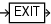

## 2.22 EXIT

### Purpose

Use the `EXIT` command to shut down the Recovery Manager utility. This command is functionally equivalent to the [QUIT](QUIT.md) command.

### Prerequisites

Execute only at the RMAN prompt.

### Syntax

exit::=

[Description of the illustration exit.eps](img_text/exit.md)

### Example

Example 2-99 Exiting RMAN

This example terminates RMAN:

    RMAN> EXIT
