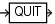

## 2.29 QUIT

### Purpose

Use the `QUIT` command to shut down the Recovery Manager utility. This command is functionally equivalent to the [`EXIT`](EXIT.md) command.

### Prerequisites

Execute only at the RMAN prompt.

### Syntax

quit::=

[Description of the illustration quit.eps](img_text/quit.md)

### Example

Example 2-117 Quitting RMAN

This example terminates RMAN (sample output included):

    RMAN> QUIT

    Recovery Manager complete.
