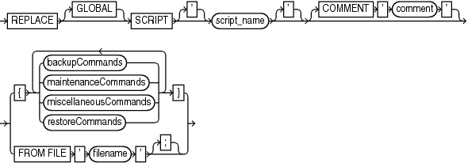

## 3.5 REPLACE SCRIPT

### Purpose

Use the `REPLACE SCRIPT` command to replace an existing script stored in the recovery catalog. If the script does not exist, then `REPLACE SCRIPT` creates it.

**See Also:**

[`CREATE SCRIPT`](CREATE-SCRIPT.md) to learn how to create stored scripts

### Prerequisites

Execute `REPLACE SCRIPT` only at the RMAN prompt. RMAN must be connected to a target database and a recovery catalog. The recovery catalog database must be open.

If you are replacing a local script, then you must be connected to the target database that you connected to when you created the script.

Substitution Variables in Stored Scripts

RMAN supports the use of substitution variables in a stored script. `&1` indicates where to place the first value, `&2` indicate where to place the second value, and so on. Special characters must be quoted.

The substitution variable syntax is `&``integer` followed by an optional period, for example, `&1.3`. The optional period is part of the variable and replaced with the value, thus enabling the substitution text to be immediately followed by another integer. For example, if you pass the value `mybackup` to a command file that contains the substitution variable `&1.3`, then the result of the substitution is `mybackup3`. To create the result `mybackup.3`, you use two periods in `&1..3`.

When you create a stored script with substitution variables, you must provide example values at create time. You can provide these values with the `USING` clause when starting RMAN (see [`RMAN`](RMAN.md)) or enter them when prompted (see [Example 2-74](CREATE-SCRIPT.md)).

### Syntax

replaceScript::=

[Description of the illustration replacescript.eps](img_text/replacescript.md)

([backupCommands::=](RUN.md), [maintenanceCommands::=](RUN.md), [miscellaneousCommands::=](RUN.md), [restoreCommands::=](RUN.md))

### Semantics

| Syntax Element                                                                            | Description                                                                                                                                                                                                                                                                                                                                                                                                                                                                   |
|:------------------------------------------------------------------------------------------|:------------------------------------------------------------------------------------------------------------------------------------------------------------------------------------------------------------------------------------------------------------------------------------------------------------------------------------------------------------------------------------------------------------------------------------------------------------------------------|
| `GLOBAL`                                                                                  | Identifies the script as global. Note: A virtual private catalog has read-only access to global scripts. Creating or updating global scripts must be done while RMAN is connected to the base recovery catalog. See Also: "[Usage Notes](CREATE-SCRIPT.md)" for an explanation of the difference between global and local scripts                                                                                                                                       |
| `SCRIPT`` script_name`                                                                    | Identifies the local or global script being replaced.                                                                                                                                                                                                                                                                                                                                                                                                                         |
| `   COMMENT` `'``comment``'`                                                              | Associates an explanatory comment with the stored script in the recovery catalog. The comment is shown in the output of [`LIST`](LIST.md) `SCRIPT NAMES`.                                                                                                                                                                                                                                                                                                                     |
| `backupCommands` `maintenanceCommands` `restoreCommands` `miscellaneousCommands` | Specifies commands to include in the stored script. The commands allowable within the brackets of the `REPLACE SCRIPT` `'``script_name ``'` `{...}` command are the same commands supported within a [`RUN`](RUN.md) block. Any command that is valid within a `RUN` command is permitted in the stored script. The following commands are not permitted within stored scripts: [`RUN`](RUN.md), [`@ (at sign)`](at-sign.md), and [`@@ (double at sign)`](double-at-sign.md). |
| `FROM FILE` `'``filename``'`                                                              | Reads the sequence of commands to define the script from the specified file. The file resembles the body of a valid stored script. The first line of the file must be a left brace (`{`) and the last line must contain a right brace (`}`). The RMAN commands in the file must be valid in a stored script.                                                                                                                                                               |

### Example

Example 3-19 Replacing a Recovery Catalog Script

Assume that you start the RMAN client and connect to database `prod` as `TARGET` and then connect to a recovery catalog. You use [`CREATE SCRIPT`](CREATE-SCRIPT.md) to create a global script named `backup_db` as follows:

    CREATE GLOBAL SCRIPT backup_db
    COMMENT "back up any database from the recovery catalog, with logs"
    {
        BACKUP DATABASE;
    }

You then use [`LIST`](LIST.md) `SCRIPT NAMES` to list all scripts known to the recovery catalog:

    RMAN> LIST SCRIPT NAMES;

    List of Stored Scripts in Recovery Catalog

        Global Scripts

           Script Name
           Description
           -----------------------------------------------------------------------
           backup_db
           back up any database from the recovery catalog, with logs

You then run the following `REPLACE SCRIPT` command with the intention of editing the `backup_db` global script:

    RMAN> REPLACE SCRIPT backup_db { BACKUP DATABASE PLUS ARCHIVELOG; }

    replaced script backup_db

Because you did not specify the `GLOBAL` keyword, RMAN creates a local script named `backup_db` in addition to the global script named `backup_db`. [`LIST`](LIST.md) `SCRIPT NAMES` shows both the global and local script recorded in the recovery catalog:

    RMAN> LIST SCRIPT NAMES;

    List of Stored Scripts in Recovery Catalog

        Scripts of Target Database PROD

           Script Name
           Description
           -----------------------------------------------------------------------
           backup_db

        Global Scripts

           Script Name
           Description
           -----------------------------------------------------------------------
           backup_db
           back up any database from the recovery catalog, with logs

You can then delete the local script named `backup_db` with [`DELETE SCRIPT`](DELETE-SCRIPT.md) and replace the global script as follows:

    RMAN> DELETE SCRIPT backup_db;

    deleted script: backup_db

    RMAN> REPLACE GLOBAL SCRIPT backup_db { BACKUP DATABASE PLUS ARCHIVELOG; }

    replaced global script backup_db

The `LIST SCRIPT NAMES` command now shows that only one script named `backup_db` exists in the catalog:

    RMAN> LIST SCRIPT NAMES;

    List of Stored Scripts in Recovery Catalog

        Global Scripts

           Script Name
           Description
           -----------------------------------------------------------------------
           backup_db

The [`PRINT SCRIPT`](PRINT-SCRIPT.md) command confirms the changes to the global script:

    RMAN> PRINT GLOBAL SCRIPT backup_db;

    printing stored global script: backup_db
     { BACKUP DATABASE PLUS ARCHIVELOG; }
