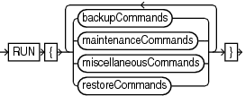
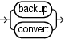
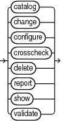
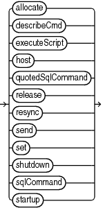
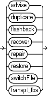

## 3.12 RUN

### Purpose

Use the `RUN` command to group a series RMAN commands into a block to be executed sequentially. On reading the closing brace of the `RUN` block, RMAN compiles the list of job commands into one or more job steps and then executes the steps immediately.

### Prerequisites

Execute this command only at the RMAN prompt. You must precede the list of job commands with an opening brace (`{`) and terminate it with a closing brace (`}`).

### Usage Notes

You can use `RUN` to create a scope within which a script can override default configurations. For example, you can override configured channels with the [`ALLOCATE CHANNEL`](ALLOCATE-CHANNEL.md) and [`RELEASE CHANNEL`](RELEASE-CHANNEL.md) commands and other parameters with the [`SET`](SET.md) command (as shown in Example 3-54). After executing the commands listed in the `RUN` block, the channels allocated within the `RUN` block are released and settings returned to their values.

As shown in Example 3-55, you must use the [`EXECUTE SCRIPT`](EXECUTE-SCRIPT.md) command within a `RUN` block.

### Syntax

run::=

[Description of the illustration run.eps](img_text/run.md)

(backupCommands::=, maintenanceCommands::=, miscellaneousCommands::=, restoreCommands::=)

backupCommands::=

[Description of the illustration backupcommands.eps](img_text/backupcommands.md)

maintenanceCommands::=

[Description of the illustration maintenancecommands.eps](img_text/maintenancecommands.md)

miscellaneousCommands::=

[Description of the illustration miscellaneouscommands.eps](img_text/miscellaneouscommands.md)

restoreCommands::=

[Description of the illustration restorecommands.eps](img_text/restorecommands.md)

### Semantics

Refer to individual command entries for information about commands that you can run from the RMAN prompt.

### Examples

Example 3-54 Overriding Configured Settings

Assume that your configured device configuration is as follows:

    RMAN> SHOW DEVICE TYPE;

    RMAN configuration parameters for database with db_unique_name PROD1 are:
    CONFIGURE DEVICE TYPE DISK PARALLELISM 1 BACKUP TYPE TO BACKUPSET; # default
    CONFIGURE DEVICE TYPE SBT_TAPE PARALLELISM 1 BACKUP TYPE TO BACKUPSET; # default

You want to make a backup to a nondefault directory. Instead of changing the configuration, you can override it in the job as follows:

    RUN
    {
      ALLOCATE CHANNEL c1 DEVICE TYPE DISK FORMAT "/disk2/%U";
      BACKUP DATABASE PLUS ARCHIVELOG;
    }

Example 3-55 Executing an RMAN Script

Assume that you use the [`CREATE SCRIPT`](CREATE-SCRIPT.md) command to create a backup script named `backup_db`. This example executes the stored script:

    RUN { EXECUTE SCRIPT backup_db; }
