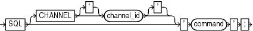

## 3.19 SQL (Quoted)

### Purpose

The `SQL` command executes a SQL statement or a PL/SQL stored procedure from within RMAN. This syntax is available for compatibility with Oracle Database Release 11.2 and earlier, but for ease of use, refer to [`SQL`](SQL.md).

**See Also:**

[Oracle Database SQL Language Reference](../sqlrf/SQL-Statements-ADMINISTER-KEY-MANAGEMENT-to-ALTER-JAVA.md)

### Prerequisites

None.

### Syntax

quotedsqlcommand::=

[Description of the illustration quotedsqlcommand.eps](img_text/quotedsqlcommand.md)

### Semantics

| Syntax Element         | Description                                                                                                                                                                                                                                                                                                                                                                                                                                                                                                                                                                                                                                                                                                                                                                                                                                                          |
|:-----------------------|:---------------------------------------------------------------------------------------------------------------------------------------------------------------------------------------------------------------------------------------------------------------------------------------------------------------------------------------------------------------------------------------------------------------------------------------------------------------------------------------------------------------------------------------------------------------------------------------------------------------------------------------------------------------------------------------------------------------------------------------------------------------------------------------------------------------------------------------------------------------------|
| `CHANNEL` `channel_id` | Specifies the case-sensitive name of a channel to use when executing an RMAN command within a [`RUN`](RUN.md) command. The channel must first be allocated by [`ALLOCATE CHANNEL`](ALLOCATE-CHANNEL.md) in this `RUN` command. If you do not set this parameter, then RMAN uses the default channel.                                                                                                                                                                                                                                                                                                                                                                                                                                                                                                                                                              |
| `'``command``'`        | Specifies a SQL statement for execution (see Example 3-71). `SELECT` statements are not permitted. You must use duplicate single quotes to insert a single quote into a quoted string when the quoted string uses the same style of quoting. For example, if the string that RMAN passes to SQL contains a file name, then the file name must be enclosed in duplicate single quotes and the entire string following the `SQL` keyword must be enclosed in double quotes (see Example 3-72). Note: Because `EXECUTE` is a SQL\*Plus command, you cannot execute a PL/SQL program unit by specifying `EXECUTE` within the RMAN `SQL` command. Instead, you must use the `BEGIN` and `END` keywords. For example, to execute the PL/SQL procedure `rman.rman_purge` with the `SQL` command, issue the following command: `SQL 'BEGIN rman.rman_purge; END;';` |

### Examples

Example 3-71 Archiving the Unarchived Online Logs

This example backs up a tablespace and then archives all unarchived online redo logs.

    BACKUP TABLESPACE users;
    sql 'ALTER SYSTEM ARCHIVE LOG CURRENT';

Example 3-72 Specifying a File Name Within a Quoted String

This example specifies a file name by using duplicate single quotes within a double-quoted string.

    sql 'ALTER TABLESPACE users ADD DATAFILE ''/disk1/oradata/users02.dbf''
      SIZE 100K AUTOEXTEND ON NEXT 10K MAXSIZE 100K';
