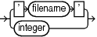

## 4.5 datafileSpec

### Purpose

Use the `datafileSpec` subclause to specify a data file by file name or absolute file number.

### Syntax

datafileSpec::=

[Description of the illustration datafilespec.eps](img_text/datafilespec.md)

### Semantics

| Syntax Element   | Description                                                                                                                                                                                                                                                                                                                                                                                                                                                                                                                                                                                          |
|:-----------------|:-----------------------------------------------------------------------------------------------------------------------------------------------------------------------------------------------------------------------------------------------------------------------------------------------------------------------------------------------------------------------------------------------------------------------------------------------------------------------------------------------------------------------------------------------------------------------------------------------------|
| `'``filename``'` | Specifies the data file by using either the full path or a relative file name. If you specify a relative file name, then the file name is qualified in a port-specific manner by the target database. You can use `?` to represent the Oracle home and `@` for the Oracle SID (see Example 4-14). Double and single quotes are both valid (although only single quotes are shown in the diagram). See Also: "[Quotes in RMAN Syntax](about-rman-commands.md)" to learn about the difference between single and double quotes, and the behavior of environment variables in RMAN quoted strings |
| `integer`        | Specifies the data file by using its absolute file number (see Example 4-13). Obtain the file number from the `V$DATAFILE`, `V$DATAFILE_COPY`, or `V$DATAFILE_HEADER` views or [`REPORT`](REPORT.md) `SCHEMA` command output.                                                                                                                                                                                                                                                                                                                                                                        |

### Examples

Example 4-13 Specifying a Data File by File Name

This example copies data file `/disk1/oradata/prod/users01.dbf` to disk, specifying it by file name:

    BACKUP AS COPY
      DATAFILE '/disk1/oradata/prod/users01.dbf'
      FORMAT '/disk2/users01.cpy';

Example 4-14 Specifying a Data File by Absolute File Number

This example copies data files `1` and `2` to disk, specifying them by file number:

    BACKUP AS COPY
      DATAFILE 1 FORMAT '/disk2/df1.cpy'
      DATAFILE 2 FORMAT '/disk2/df1.cpy';
