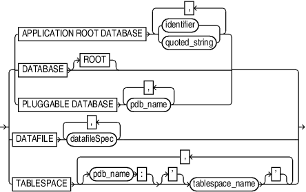

## 4.6 dbObject

### Purpose

Use the `dbObject` subclause to identify a database or a subset of a database.

### Syntax

dbObject::=

[Description of the illustration dbobject.eps](img_text/dbobject.md)

([datafileSpec::=](datafileSpec.md))

### Semantics

| Syntax Element                               | Description                                                                                                                                                                                                                                                                                                                                                         |
|:---------------------------------------------|:--------------------------------------------------------------------------------------------------------------------------------------------------------------------------------------------------------------------------------------------------------------------------------------------------------------------------------------------------------------------|
| `DATABASE`                                   | Specifies the entire database. In a multitenant container database (CDB), specifies the whole CDB.                                                                                                                                                                                                                                                                  |
| `DATABASE ROOT`                              | Specifies only the root in a CDB.                                                                                                                                                                                                                                                                                                                                   |
| `PLUGGABLE DATABASE` `pdb_name`              | Specifies one or more pluggable databases (PDBs) in a CDB. Use a comma-delimited list to specify multiple PDBs.                                                                                                                                                                                                                                                     |
| `DATAFILE` [`datafileSpec`](datafileSpec.md) | Specifies a list of one or more data files by either file name or absolute data file number. See Also: [`datafileSpec`](datafileSpec.md)                                                                                                                                                                                                                         |
| `TABLESPACE` `tablespace_name`               | Specifies one or more tablespaces.                                                                                                                                                                                                                                                                                                                                  |
| `TABLESPACE ``pdb_name``:``tablespace_name`  | Specifies the name of a tablespace in a PDB. Use a comma-delimited list to specify multiple tablespaces. Multiple PDBs can have tablespaces with the same name. A qualifier before the name uniquely identifies the tablespace. `pdb-name` is the name of the PDB that contains `tablespace_name`. If `pdb_name` is omitted, root is used as the default container. |
