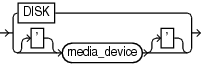

## 4.7 deviceSpecifier

### Purpose

Use the `deviceSpecifier` subclause to specify the type of storage for a backup.

### Syntax

deviceSpecifier::=

[Description of the illustration devicespecifier.eps](img_text/devicespecifier.md)

### Semantics

| Syntax Element | Description                                                                                                                                                                                                                                                                                                                                                                                                                                |
|:---------------|:-------------------------------------------------------------------------------------------------------------------------------------------------------------------------------------------------------------------------------------------------------------------------------------------------------------------------------------------------------------------------------------------------------------------------------------------|
| `DISK`         | Specifies a disk storage device (see Example 4-16).                                                                                                                                                                                                                                                                                                                                                                                        |
| `media_device` | Specifies a sequential I/O device or access method for storage (see Example 4-15). The `media_device` variable specifies a case-insensitive name for a media manager. The syntax and semantics of sequential I/O device types are platform-specific. The most common value is `sbt` or `sbt_tape` (which are synonymous values). Note: RMAN stores the value `sbt` in the recovery catalog as `sbt_tape` for backward compatibility. |

### Examples

Example 4-15 Allocating a Tape Channel

This example allocates a maintenance channel for a media management device:

    ALLOCATE CHANNEL FOR MAINTENANCE DEVICE TYPE sbt;
    CROSSCHECK BACKUP;
    RELEASE CHANNEL;

Example 4-16 Backing Up the Database to Disk

This example backs up the database to disk:

    BACKUP DEVICE TYPE DISK DATABASE;
