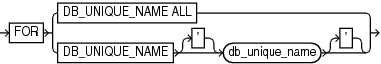

## 4.9 forDbUniqueNameOption

### Purpose

Use the `forDbUniqueNameOption` subclause to specify either all databases or a specific database in a Data Guard environment.

### Usage Notes

The DBID for a primary database is identical to the DBID of its associated physical standby databases. A database is uniquely identified in the recovery catalog by a DBID and the value of its `DB_UNIQUE_NAME` initialization parameter.

When you specify `forDbUniqueNameOption` for any command, RMAN restricts its operations to the objects that are associated exclusively with the database with the specified `DB_UNIQUE_NAME`. For example, if you use this option with the [`LIST`](LIST.md) command, then RMAN lists only the objects associated exclusively with the database with the specified `DB_UNIQUE_NAME`. Objects that are not associated with any database (`SITE_KEY` column in the recovery catalog view is `null`) are not listed.

### Syntax

forDbUniqueNameOption::=

[Description of the illustration fordbuniquenameoption.eps](img_text/fordbuniquenameoption.md)

### Semantics

| Syntax Element                        | Description                                                                                                                                                               |
|:--------------------------------------|:--------------------------------------------------------------------------------------------------------------------------------------------------------------------------|
| `FOR DB_UNIQUE_NAME ALL`              | Specifies all primary and standby databases in the recovery catalog that share the DBID of the target database (or DBID specified by the [`SET`](SET.md) `DBID` command). |
| `FOR DB_UNIQUE_NAME` `db_unique_name` | Specifies the primary or standby database in the recovery catalog with the specified `db_unique_name`.                                                                    |

### Examples

Example 4-19 Listing Expired Backups Associated with a Standby Database

This example connects to a recovery catalog and sets the DBID for the Data Guard environment. All primary and standby databases in this environment share the same DBID. The `LIST` command lists all expired backups associated with database `standby1`:

    RMAN> CONNECT CATALOG rco@catdb;

    recovery catalog database Password: password
    connected to recovery catalog database

    RMAN> SET DBID 3257174182;
    RMAN> LIST EXPIRED BACKUP FOR DB_UNIQUE_NAME standby1;
