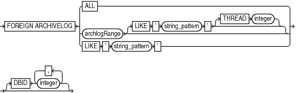
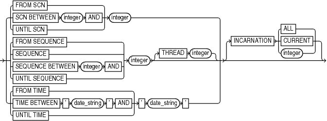

## 4.11 foreignlogRecordSpecifier

### Purpose

Use the foreignlogRecordSpecifier subclause to specify a set of foreign archived redo log files for use in RMAN operations.

### Usage Notes

Foreign archived redo log files are received by a logical standby database for a LogMiner session. Unlike normal archived logs, foreign archived logs have a different DBID. For this reason, they cannot be backed up or restored on a logical standby database.

A logical standby database creates foreign archived logs in the fast recovery area if the following conditions are met:

- A fast recovery area is configured on the logical standby database.

- a `LOG_ARCHIVE_DEST_``n` initialization parameters is set to `'LOCATION=USE_DB_RECOVERY_FILE_DEST'` with a proper `VALID_FOR` setting to receive foreign archived logs.

- The `COMPATIBLE` initialization parameter is set to a value greater than or equal to 11.0.0.

### Syntax

foreignlogRecordSpecifier::=

[Description of the illustration foreignlogrecordspecifier.eps](img_text/foreignlogrecordspecifier.md)

archlogRange::=

[Description of the illustration archlogrange.eps](img_text/archlogrange.md)

### Semantics

The semantics duplicate [`archivelogRecordSpecifier`](archivelogRecordSpecifier.md) except that the logs are foreign archived redo log files.

### Examples

Example 4-21 Crosschecking Foreign Archived Redo Log Files

This example crosschecks all foreign archived redo log files:

    RMAN> CROSSCHECK FOREIGN ARCHIVELOG ALL;
