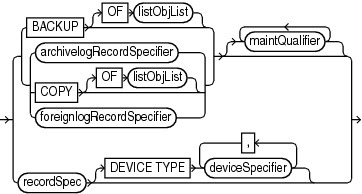

## 4.16 maintSpec

### Purpose

Use the `maintSpec` subclause to specify the backup files operated on by the [`CHANGE`](CHANGE.md), [`CROSSCHECK`](CROSSCHECK.md), and [`DELETE`](DELETE.md) commands.

### Syntax

maintSpec::=

[Description of the illustration maintspec.eps](img_text/maintspec.md)

([listObjList::=](listObjList.md), [maintQualifier::=](maintQualifier.md), [archivelogRecordSpecifier::=](archivelogRecordSpecifier.md), [recordSpec::=](recordSpec.md), [deviceSpecifier::=](deviceSpecifier.md))

### Semantics

maintSpec

| Syntax Element                                              | Description                                                                                                                                                                                                                                                                                                                                                                                                                                                                                                                                                                                                                                                                 |
|:------------------------------------------------------------|:----------------------------------------------------------------------------------------------------------------------------------------------------------------------------------------------------------------------------------------------------------------------------------------------------------------------------------------------------------------------------------------------------------------------------------------------------------------------------------------------------------------------------------------------------------------------------------------------------------------------------------------------------------------------------|
| `BACKUP`                                                    | Processes backup sets. For processing image copies, use the option `COPY`. If you do not use the `OF` clause with [`CHANGE`](CHANGE.md) `BACKUP`, then RMAN changes all backup sets recorded in the repository. If you do not use the `OF` clause with [`CROSSCHECK`](CROSSCHECK.md) `BACKUP`, then RMAN crosschecks backups of the whole database. If you do not use the `OF` clause with [`DELETE`](DELETE.md) `BACKUP`, then RMAN deletes backups of the whole database.                                                                                                                                                                                              |
| `   OF` [`listObjList`](listObjList.md)                     | Restricts the list of files operated on to the object type specified in the `listObjList` clause. See Also: [`listObjList`](listObjList.md)                                                                                                                                                                                                                                                                                                                                                                                                                                                                                                                              |
| [`archivelogRecordSpecifier`](archivelogRecordSpecifier.md) | Processes the specified archived redo log files. If you specify [`DELETE`](DELETE.md) `ARCHIVELOG` without the `BACKED UP` clause, then RMAN uses the configured settings to determine whether an archived log can be deleted ([`CONFIGURE`](CONFIGURE.md) `ARCHIVELOG DELETION POLICY TO BACKED UP`). If you specify `DELETE ARCHIVELOG` with the `BACKED UP` clause, then RMAN uses the `DELETE` settings to determine whether an archived log can be deleted. Use `FORCE` with `DELETE ARCHIVELOG` to override a configured deletion policy and any mismatches between media and repository. See Also: [`archivelogRecordSpecifier`](archivelogRecordSpecifier.md) |
| `COPY`                                                      | Processes data file copies, control file copies, and archived redo log files. If you do not specify an option for [`CHANGE`](CHANGE.md) `COPY`, then the command operates on all image copies recorded in the repository. If you are using [`CROSSCHECK`](CROSSCHECK.md) `COPY`, then by default the command checks all image copies of all files in the database with status `AVAILABLE` or `EXPIRED`. If you are using [`DELETE`](DELETE.md) `COPY`, then by default `COPY` removes copies of all files in the database. Specify the `EXPIRED` option to remove only copies that are marked `EXPIRED` in the repository.                                               |
| `   OF` [`listObjList`](listObjList.md)                     | Restricts the list of objects operated on to the object type specified in the `listObjList` clause. If you do not specify an object, then the command defaults to all copies. `CHANGE` `COPY` `OF` `DATABASE` includes data files but not control files. See Also: [`listObjList`](listObjList.md)                                                                                                                                                                                                                                                                                                                                                                       |
| [`foreignlogRecordSpecifier`](foreignlogRecordSpecifier.md) | Processes the specified foreign archived redo log files. See Also: [`foreignlogRecordSpecifier`](foreignlogRecordSpecifier.md)                                                                                                                                                                                                                                                                                                                                                                                                                                                                                                                                           |
| [`maintQualifier`](maintQualifier.md)                       | Restricts the command based on the specified options. See Also: [`maintQualifier`](maintQualifier.md)                                                                                                                                                                                                                                                                                                                                                                                                                                                                                                                                                                    |
| [`recordSpec`](recordSpec.md)                               | Specifies the file that you are performing maintenance on. If you use the `BACKUPSET` parameter in `recordSpec`, then the keys identify backup sets for use with the `CHANGE`, `CROSSCHECK` and `DELETE` commands. For more details, see "[LIST Command Output](LIST.md)" for an explanation of the column headings of the `LIST`output tables. Use the `KEY` column of the output to obtain the primary key usable in the `CHANGE` and `DELETE` commands. See Also: [`recordSpec`](recordSpec.md)                                                                                                                                                                    |
| `DEVICE TYPE` [`deviceSpecifier`](deviceSpecifier.md)       | Allocates automatic channels for the specified device type only. This option is valid only if you have configured automatic channels and have not manually allocated channels. For example, if you configure automatic disk and tape channels and run `CROSSCHECK...DEVICE TYPE DISK`, then RMAN allocates only disk channels. See Also: [`deviceSpecifier`](deviceSpecifier.md)                                                                                                                                                                                                                                                                                         |

### Examples

Example 4-32 Crosschecking Backups

The following command crosschecks backups of archived redo log files:

    RMAN> CROSSCHECK BACKUP OF ARCHIVELOG ALL;

    allocated channel: ORA_SBT_TAPE_1
    channel ORA_SBT_TAPE_1: SID=103 device type=SBT_TAPE
    channel ORA_SBT_TAPE_1: Oracle Secure Backup
    using channel ORA_DISK_1
    crosschecked backup piece: found to be 'AVAILABLE'
    backup piece handle=8cic4031_1_1 RECID=195 STAMP=616693857
    crosschecked backup piece: found to be 'AVAILABLE'
    backup piece handle=8oic41ad_1_1 RECID=198 STAMP=616695118
    crosschecked backup piece: found to be 'AVAILABLE'
    backup piece handle=8qic41c3_1_1 RECID=200 STAMP=616695171
    Crosschecked 3 objects
