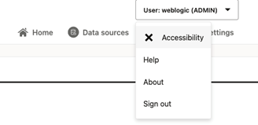
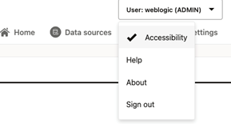
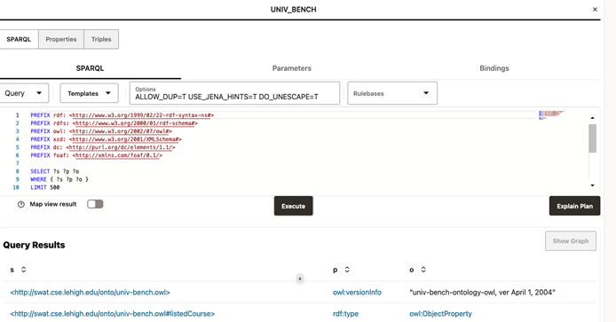

## 14.4 Accessibility

You can turned on or off the accessibility during the user session.

To disable accessibility, click on the username drop-down menu on the top right of the page, and turn off the Accessibility option.

Figure 14-77 Disabled Accessibility

[Description of "Figure 14-77 Disabled Accessibility"](img_text/accessibility_disabled.md)

To enable accessibility, click on the username drop-down menu on the top right of the page, and turn on the Accessibility option.

Figure 14-78 Enabled Accessibility

[Description of "Figure 14-78 Enabled Accessibility"](img_text/accessibility_enabled.md)

When accessibility is turned on, the graph view of SPARQL queries is disabled.

Figure 14-79 Disabled Graph View

[Description of "Figure 14-79 Disabled Graph View"](img_text/accessibility_graph_view.md)

**Parent topic:** [Oracle RDF Graph Query UI](oracle-rdf-graph-query-ui.md)
