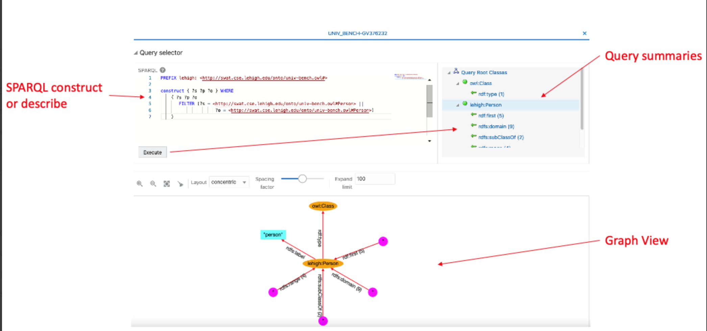
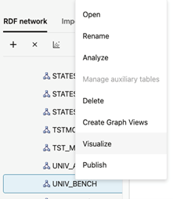

## 14.3.2.11 Advanced Graph View

The RDF Graph Query UI supports an advanced graph view feature that allows users to interact directly with the graph visualization. This is unlike the graph displayed on the RDF model editor or public component where the graph view is just an output of the SPARQL results on the paging table.

This section describes the advanced graph view component, starting from the execution of a SPARQL `CONSTRUCT` or SPARQL `DESCRIBE` query to advanced interaction with the graph visualization.

The main user interface (UI) elements of the advanced graph view component are as shown:

Figure 14-53 Advanced Graph View Components

[Description of "Figure 14-53 Advanced Graph View Components"](img_text/adv_graph_view_page.md)

The following describes the UI components seen in the preceding figure:

- SPARQL Query selector contains:
  - A text area with the SPARQL query (must be SPARQL `CONSTRUCT` or SPARQL `DESCRIBE`)
  - A tree with the root classes summaries (counts of incoming and outgoing predicates) resulting from the SPARQL query
- A graph view area that displays the graph with the RDF nodes and edges

To access the advanced graph view feature, right-click on the RDF model and select Visualize as shown:

Figure 14-54 Visualize Menu

[Description of "Figure 14-54 Visualize Menu"](img_text/adv_graph_view_visualize_menu.md)

- [Query Selector Panel](query-selector-panel.md)
- [Graph View](graph-view.md)

**Parent topic:** [RDF Data Page](rdf-data-page.md)
