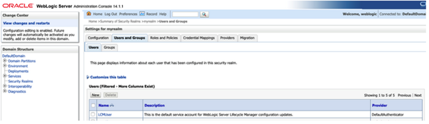
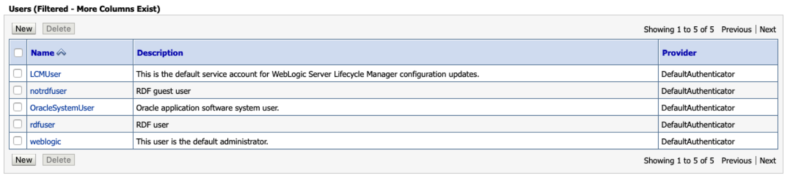
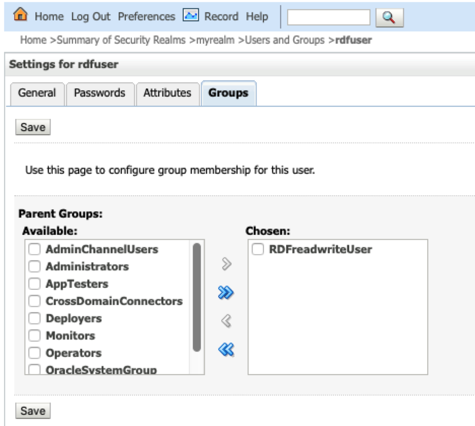
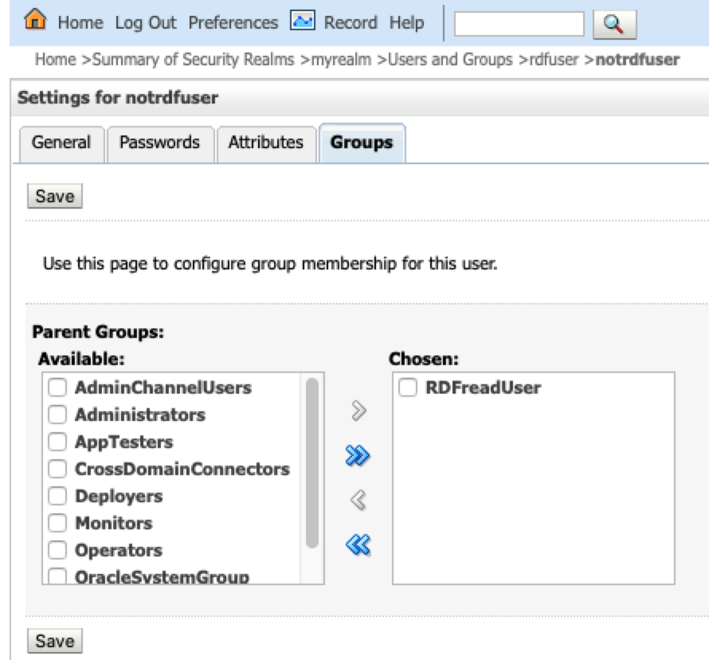

## 14.2.1.2 Creating RDF and Guest Users in WebLogic Server

In order to have RDF and guest users in the user groups you must first create the RDF and guest users and then assign them to their respective groups.

To create new RDF and guest users in WebLogic server:

Prerequisites: RDF and guest users groups must be available or they must be created. See [Creating User Groups in WebLogic Server](creating-users-and-groups-weblogic-server.md) for creating user groups.

1.  Select the security realm from the listed Realms as seen in [Figure 14-3](managing-groups-and-users-weblogic-server.md)

2.  Click Users and Groups tab and then Users.

3.  Click New to create the RDF and guest users.

    Figure 14-6 Create new users in WebLogic Server

    
    [Description of "Figure 14-6 Create new users in WebLogic Server"](img_text/user_tab.md)
    The following example creates two new users :

    - rdfuser: user to be assigned to group with read and write privileges.

    - nonrdfuser: guest user to be assigned to group with just read privileges.

    Figure 14-7 New RDF and Guest users

    
    [Description of "Figure 14-7 New RDF and Guest users"](img_text/new_created_users.md)

4.  Select a user name and click Groups to assign the user to a specific group.

5.  Assign rdfuser to RDFreadwriteUser group.

    Figure 14-8 RDF User

    
    [Description of "Figure 14-8 RDF User"](img_text/rdf_user.md)

6.  Assign nonrdfuser to RDFreadUser group.

    Figure 14-9 RDF Guest User

    
    [Description of "Figure 14-9 RDF Guest User"](img_text/rdf_guest_user.md)

**Parent topic:** [Managing Groups and Users in WebLogic Server](managing-groups-and-users-weblogic-server.md)
