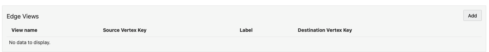
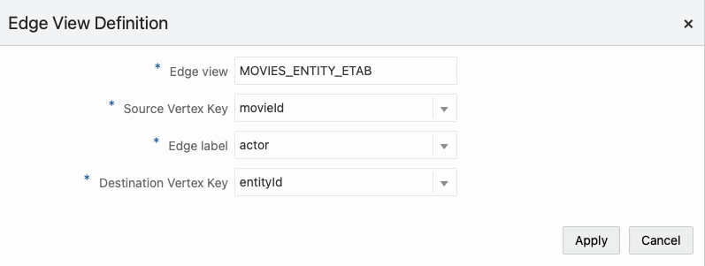

## 14.3.2.12.3 Creating an Edge View

An edge view can be defined using one or two vertex views.

To create an edge view:

1.  Click Add in the Edge Views panel shown in the following figure:
    Figure 14-70 Edge Views

    
    [Description of "Figure 14-70 Edge Views"](img_text/create_edge_view.md)
2.  Configure the Edge View Definition.
    Provide the following parameter values to define the edge view:
    - Edge view: Name of the edge view. This will be used for querying the edge.
    - Source Vertex key: Source vertex key attribute.
    - Edge label: Edge label value.
    - Destination Vertex key: Destination vertex key attribute.

    In the following figure, the edge links the `movie` and `actor` entities:

    Figure 14-71 Edge View Definition

    
    [Description of "Figure 14-71 Edge View Definition"](img_text/edge_view_def.md)

**Parent topic:** [Database Views from RDF Models](database-views-rdf-models.md)
