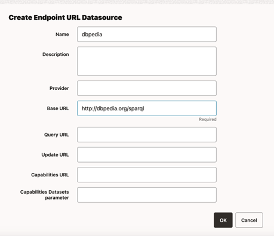
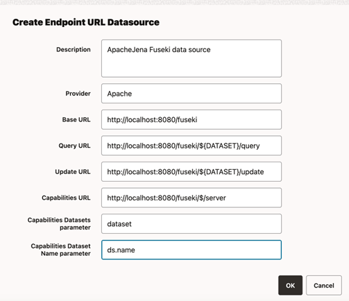

## 14.3.1.4 Creating an Endpoint URL Data Source

External data sources are connected to the RDF data store using the endpoint URL.

You can execute SPARQL queries and updates to the RDF data store using a base URL. In some cases, such as Apache Jena Fuseki, there are specific URLs based on the dataset name. For example:

- DBpedia Base URL: <http://dbpedia.org/sparql>

- Apache Jena Fuseki (assuming a dataset name `dset`):

  - Query URL: `http://localhost:8080/fuseki/dset/query`

  - Update URL: `http://localhost:8080/fuseki/dset/update`

The RDF web application issues SPARQL queries to RDF datasets. These datasets can be retrieved from provider if a get capabilities request is available. For DBpedia, there is a single base URL to be used, and therefore a default single dataset is handled in application. For Apache Jena Fuseki, there is a request that returns the available RDF datasets in server: `http://localhost:8080/fuseki/$/server`. Using this request, the list of available datasets can be retrieved for specific use in an application.

You can perform the following steps to create an external RDF data source:

1.  Click Endpoint in [Figure 14-11](data-sources-page.md).
    Create Endpoint URL Datasource dialog opens as shown. The following figure shows an example for creating a Dbpedia data source.

    Figure 14-21 DBpedia Data Source

    
    [Description of "Figure 14-21 DBpedia Data Source"](img_text/endpoint_datasource.md)
2.  Enter the Name of the data source.
3.  Optionally, enter Description.
4.  Optionally, enter the Provider name.
5.  Enter the Base URL to access the RDF service.
6.  Optionally, enter the Query URL to run SPARQL queries.
    Note that if the Query URL is not defined, then the Base URL is used.
7.  Optionally, enter the Update URL to run SPARQL updates.
    Note that if the Update URL is not defined, then the Base URL is used.
8.  Provide the Capabilities Datasets parameter properties to retrieve the dataset information from the RDF server.
9.  Enter the Get URL address that should return a JSON response with information about the dataset.
10. Enter the Datasets parameter property in JSON response that contains the dataset information.
11. Enter the Dataset name parameter property in datasets parameter that contains the dataset name.
    **Note:**

    For Jena Fuseki, the expression \${DATASET} will be replaced by the dataset name at runtime when SPARQL queries or SPARQL updates are being executed.
12. Click OK to create the data source.
    The following figure shows an example for creating an Apache Jena Fuseki data source.

    Figure 14-22 Apache Jena Fuseki Data Source

    
    [Description of "Figure 14-22 Apache Jena Fuseki Data Source"](img_text/endpoint_jena.md)

**Parent topic:** [Data Sources Page](data-sources-page.md)
