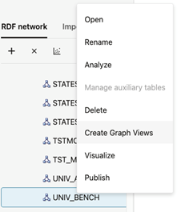
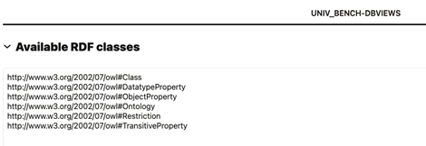
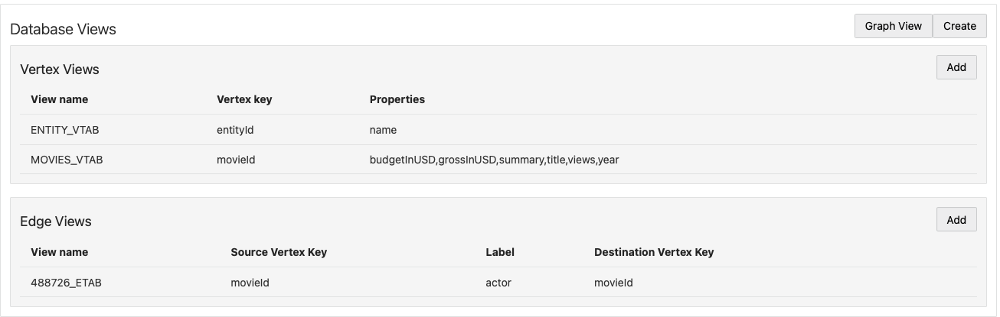
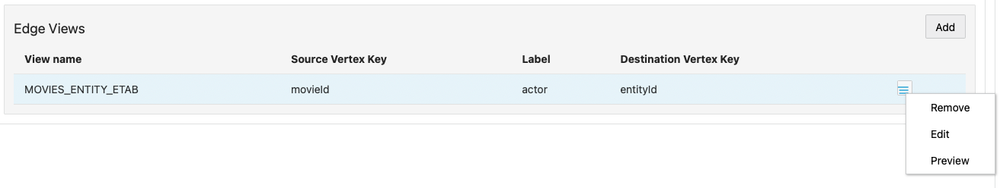
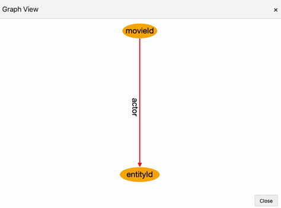
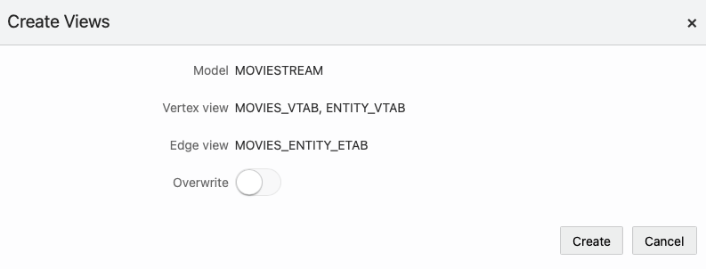
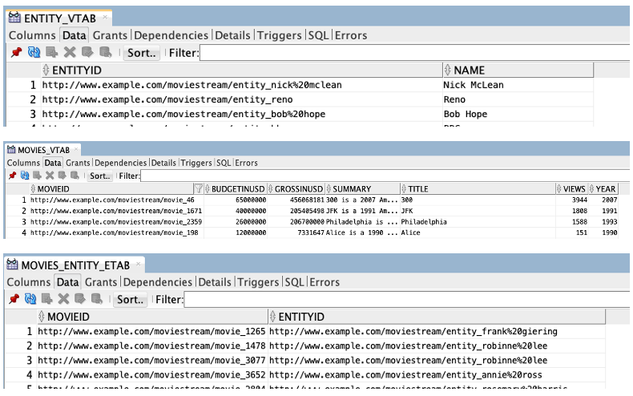

## 14.3.2.12.1 Creating a Graph View

Perform the following steps to create a database graph view:

1.  Right-click the RDF model to open the context menu as shown:
    Figure 14-61 Create Graph View Option

    
    [Description of "Figure 14-61 Create Graph View Option"](img_text/create_graph_view_option.md)
2.  Click Create Graph Views.
    The application opens an editor with the available RDF classes populated from a SPARQL query as shown:

    Figure 14-62 RDF Classes

    
    [Description of "Figure 14-62 RDF Classes"](img_text/rdf_classes.md)
    Note that the database graph views cannot be created if there are no RDF classes.
3.  Add Vertex Views as required.
    See [Creating a Vertex View](creating-vertex-view.md) for more information.
4.  Add Edge Views as required.
    See [Creating an Edge View](creating-edge-view.md) for more information.
5.  Review and verify the graph representation of the Database Views.
    The following figure shows a sample graph representation:
    Figure 14-63 Sample Graph Definition

    
    [Description of "Figure 14-63 Sample Graph Definition"](img_text/sample_graph_representation.md)
6.  Optionally, you can hover over a table row and click the action menu icon to Remove, Edit, or Preview a specific vertex or an edge view.
    Figure 14-64 Action Menu Options

    
    [Description of "Figure 14-64 Action Menu Options"](img_text/graphview_action_menu.md)
7.  Click Graph View to visualize the sample graph.
    Note that in a graph view, each node represents a vertex view and the link between nodes have an edge label. The following figure shows a sample graph visualization containing two vertex views with key attributes `movieId` and `entityId` which are linked by the `actor` edge label.

    Figure 14-65 Graph Visualization for RDF Database Views

    
    [Description of "Figure 14-65 Graph Visualization for RDF Database Views"](img_text/graph_view_viz.md)
8.  Click Create to create the RDF graph view in the database.
    The Create Views dialog opens as shown:

    Figure 14-66 Create Views

    
    [Description of "Figure 14-66 Create Views"](img_text/create_db_views.md)
    1.  Optionally, switch ON the Overwrite option to replace any existing view definition.
    2.  Click Create.

    The database graph view gets created.
    The following figure shows the views that are created in the database for the sample graph definition shown in step-5:

    Figure 14-67 RDF Database Graph Views

    
    [Description of "Figure 14-67 RDF Database Graph Views"](img_text/sqldev_dbviews.md)

**Parent topic:** [Database Views from RDF Models](database-views-rdf-models.md)
