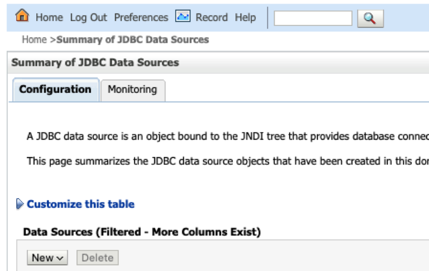
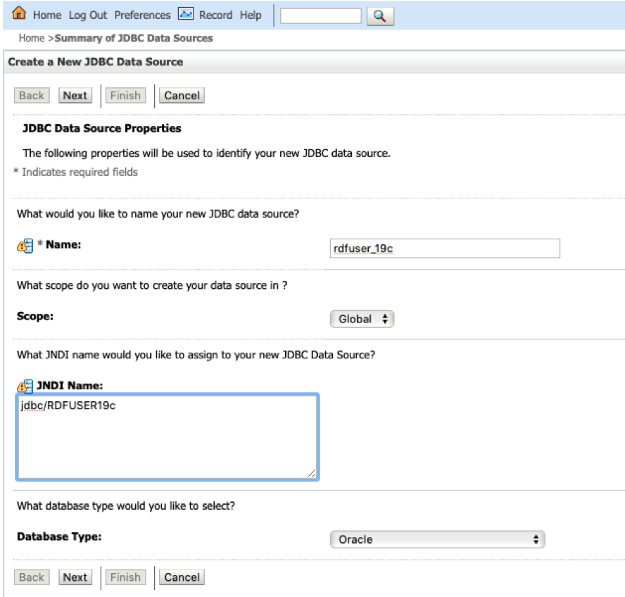
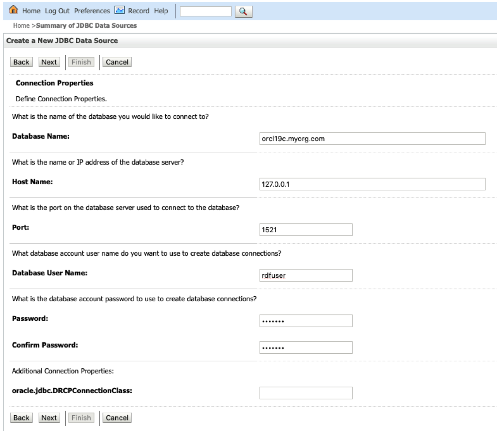
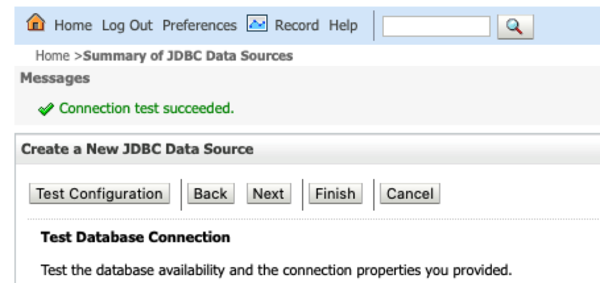
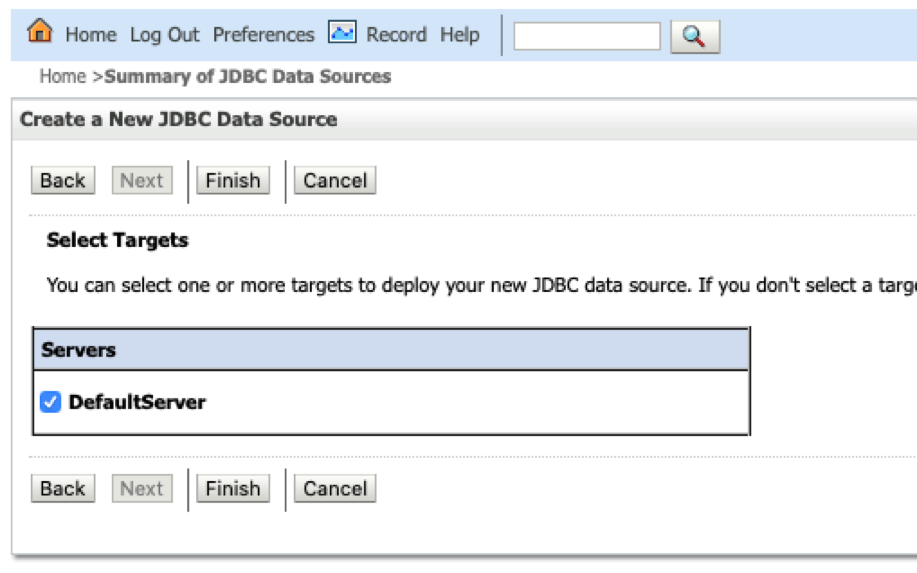

## 14.3.1.2.1 Creating a JDBC Data Source in WebLogic Server

To create a JDBC data source in WebLogic Server:

1.  Log in to the WebLogic administration console as an administrator: `http://localhost:7101/console`.

2.  Click Services, then JDBC Data sources.

3.  Click New and select the Generic data source menu option to create a JDBC data source.

    Figure 14-14 Generic Data Source

    
    [Description of "Figure 14-14 Generic Data Source"](img_text/oracle_container_generic_data_source.md)

4.  Enter the JDBC data source information (name and JNDI name), then click Next.

    Figure 14-15 JDBC Data Source and JNDI

    
    [Description of "Figure 14-15 JDBC Data Source and JNDI"](img_text/oracle_container_jndi.md)

5.  Accept the defaults on the next two pages.

6.  Enter the database connection information: service name, host, port, and user credentials.

    Figure 14-16 Create JDBC Data Source

    
    [Description of "Figure 14-16 Create JDBC Data Source"](img_text/oracle_container_jdbc_data_source.md)

7.  Click Next to continue.

8.  Click the Test Configuration button to validate the connection and click Next to continue.

    Figure 14-17 Validate connection

    
    [Description of "Figure 14-17 Validate connection"](img_text/oracle_container_test_configuration.md)

9.  Select the server target and click Finish.

    Figure 14-18 Create JDBC Data Source

    
    [Description of "Figure 14-18 Create JDBC Data Source"](img_text/oracle_container_server_target.md)

The JDBC data gets added to the data source table and the JNDI name is added to the combo box list in the create container dialog.

**Parent topic:** [Creating an Oracle Container Data Source](creating-oracle-container-data-source.md)
