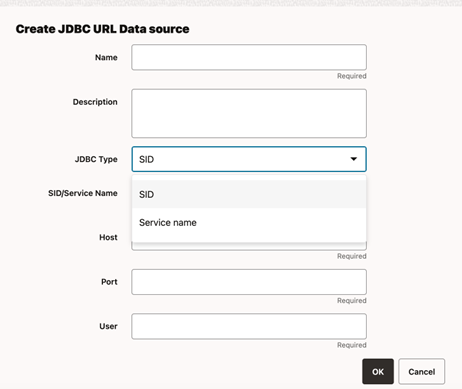

## 14.3.1.1 Creating a JDBC URL Data Source

Oracle JDBC URL is defined using the standard database parameters with user credentials.

You can perform the following steps to create a JDBC URL data source:

1.  Click JDBC URL in [Figure 14-11](data-sources-page.md).
    Create JDBC URL Data source dialog opens as shown:
    Figure 14-12 Creating a JDBC URL Data Source

    
    [Description of "Figure 14-12 Creating a JDBC URL Data Source"](img_text/jdbc_url_ds.md)
2.  Enter the Name of the data source.
3.  Optionally, enter Description.
4.  Select the JDBC Type.
5.  Enter SID/Service Name as appropriate.
6.  Enter the Host and Port details.
7.  Enter the User and Password credentials.
8.  Click OK to create the data source.

**Parent topic:** [Data Sources Page](data-sources-page.md)
