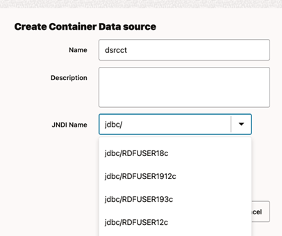

## 14.3.1.2 Creating an Oracle Container Data Source

As a prerequisite to create a container data source in the RDF Graph Server and Query UI application, the JDBC data source must exist in the application server. See [Creating a JDBC Data Source in WebLogic Server](creating-jdbc-data-source-weblogic-server.md) and [Creating a JDBC Data Source in Tomcat](creating-jdbc-data-source-tomcat.md) for more information.

You can then perform the following steps to create an Oracle Container data source:

1.  Click Container in [Figure 14-11](data-sources-page.md).
    Create Container Data source dialog opens as shown:
    Figure 14-13 Create Container Data Source

    
    [Description of "Figure 14-13 Create Container Data Source"](img_text/create_data_source_container.md)
2.  Enter the Name of the data source.
3.  Optionally, enter Description.
4.  Select the JNDI Name that exists on the application server.
5.  Click OK to create the data source.

- [Creating a JDBC Data Source in WebLogic Server](creating-jdbc-data-source-weblogic-server.md)
- [Creating a JDBC Data Source in Tomcat](creating-jdbc-data-source-tomcat.md)

**Parent topic:** [Data Sources Page](data-sources-page.md)
