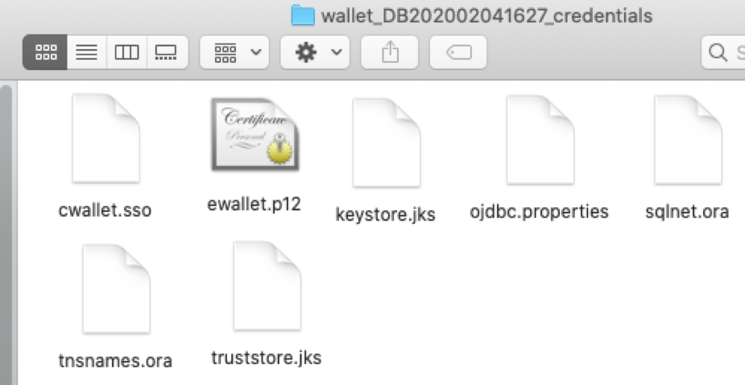
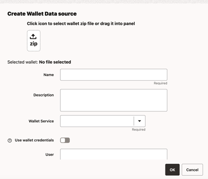

## 14.3.1.3 Creating an Oracle Wallet Data Source

To create a wallet data source in the Query UI application, you must have a wallet zip file. It can be a simple wallet zip file created with Oracle orapki utility, or a wallet downloaded from Oracle Autonomous Database.

In general, wallets are obtained from the Autonomous Database. See [Download Client Credentials (Wallets)](https://docs.oracle.com/pls/topic/lookup?ctx=en/cloud/paas/autonomous-database&id=GUID-B06202D2-0597-41AA-9481-3B174F75D4B1) for more information to download a wallet from Oracle Autonomous Database.

The following figure displays the contents of the wallet zip file:

Figure 14-19 Cloud Wallet

[Description of "Figure 14-19 Cloud Wallet"](img_text/cloud_wallet_dir.md)

Note that the tnsnames.ora file in the wallet zip file contains the wallet service alias names, and TCPS information. It does not contain the user credentials for each service.

Using this wallet zip file, you can define an RDF wallet data source in the Query UI web application by directly entering the user credentials. Optionally, you can also have the user credentials stored inside the wallet for each desired service. If you choose to store the user credentials in the wallet, then see [Storing User Credentials in a Wallet](storing-user-credentials-wallet.md) for more information.

The following describes the steps to create a wallet data source:

1.  Click Wallet in [Figure 14-11](data-sources-page.md).
    Create Wallet Data source dialog opens as shown:
    Figure 14-20 Wallet Data Source from cloud zip

    
    [Description of "Figure 14-20 Wallet Data Source from cloud zip"](img_text/wallet_data_source_cloud.md)
2.  Click the upload icon and select the wallet zip file.
    The zip file gets uploaded to the server.
3.  Enter the data source Name.
4.  Optionally, enter the Description.
5.  Select the required Wallet Service name.
6.  Provide the user credentials using one of the following options as it applies to you.
    - Enable Use wallet credentials if you have stored the user credentials in the wallet.
    - Otherwise, enter directly the User and Password credentials.
7.  Optionally, enter the proxy details.

- [Storing User Credentials in a Wallet](storing-user-credentials-wallet.md)

**Parent topic:** [Data Sources Page](data-sources-page.md)
