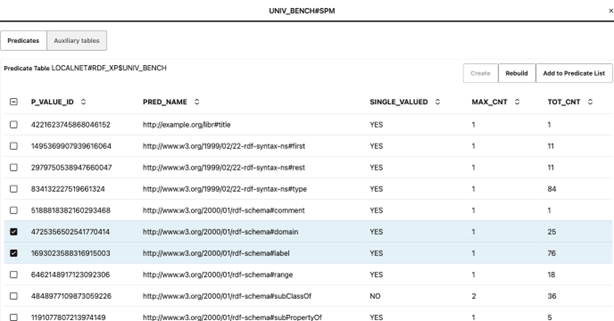
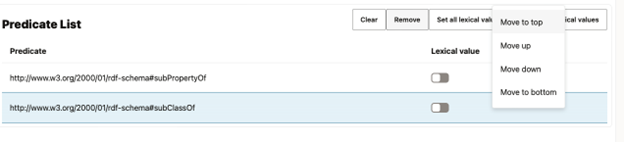
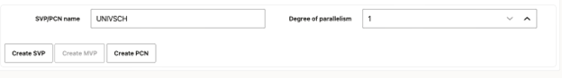

## 14.3.2.10.1 Creating Auxiliary Tables

You can create the SPM tables in the Predicates section of the UI by performing the following steps as shown:

- Create a Predicates table, if one does not exist, with the statistics of each distinct predicate.
  This table contains the single and multi-valued predicates and their occurrences. For example:
  Figure 14-45 Predicates Table

  
  [Description of "Figure 14-45 Predicates Table"](img_text/create_auxiliary_tables.md)
- Select the required predicates and click Add to Predicate List.
  This creates a selected list of predicates from which the different SPM tables can be created.
- Optionally, you can define the predicate lexical values to be stored in an SPM table, by setting the lexical value column on the selected predicates in the Predicate List table.
  For example, in the following figure, the predicate order on the table is used to define the sequence order for PCN tables:
  Figure 14-46 Predicate List

  
  [Description of "Figure 14-46 Predicate List"](img_text/predicate_order.md)
- Create one of the following types of auxiliary tables depending on your requirement:
  Figure 14-47 Creating an Auxiliary Table

  
  [Description of "Figure 14-47 Creating an Auxiliary Table"](img_text/svp_pcn_table_name.md)
  - Click Create SVP table after entering the SVP table name to create an SVP table.

  - Click Create MVP table to create an MVP table. Note that to create an MVP table, you must select only one predicate in the Predicate List.

  - Click Create PCN table after entering the PCN table name to create a PCN table. Note that to create a PCN table, you must select at least two predicates in the Predicate List.

**Parent topic:** [Support for Auxiliary Tables](support-result-tables.md)
