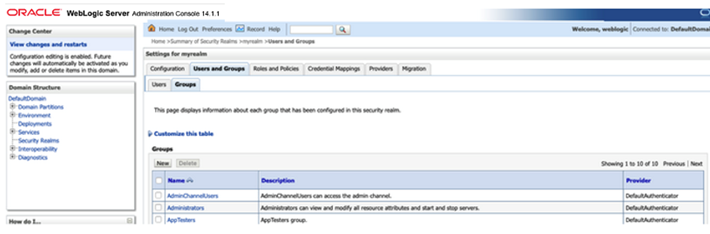
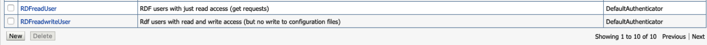

## 14.2.1.1 Creating User Groups in WebLogic Server

To create new user groups in WebLogic Server:

1.  Select the security realm from the listed Realms in [Figure 14-3](managing-groups-and-users-weblogic-server.md).

2.  Click Users and Groups and then Groups.

3.  Click New to create new RDF user groups in Weblogic as shown below:

    Figure 14-4 Creating new user groups in WebLogic Server

    
    [Description of "Figure 14-4 Creating new user groups in WebLogic Server"](img_text/groups_tab.md)

The following example creates the following two user groups:

- RDFreadUser: for guest users with just read access to application.

- RDFreadwriteUser: for users with read and write access to RDF objects.

Figure 14-5 Created User Groups in WebLogic Server

[Description of "Figure 14-5 Created User Groups in WebLogic Server"](img_text/create_groups.md)

**Parent topic:** [Managing Groups and Users in WebLogic Server](managing-groups-and-users-weblogic-server.md)
