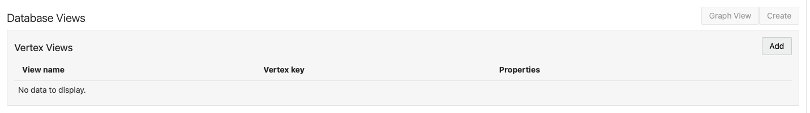
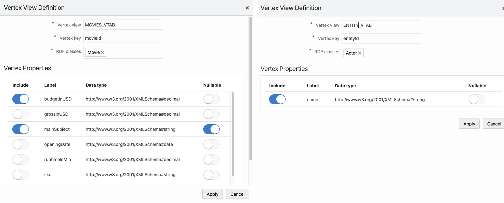

## 14.3.2.12.2 Creating a Vertex View

Perform the following steps to create a vertex view:

1.  Click Add in the Vertex Views panel shown in the following figure:
    Figure 14-68 Creating a Vertex View

    
    [Description of "Figure 14-68 Creating a Vertex View"](img_text/vertex_views_panel.md)
2.  Configure the Vertex View Definition.
    Provide the following parameter values to define the vertex view:
    - Vertex view: Name of the vertex view. This will be used for querying the vertex.
    - Vertex key: Vertex key attribute.
    - RDF classes: One or more RDF classes. When RDF classes are added, the application retrieves the available properties for the class and lists them in the dialog. You can choose the properties to be added to the view. The Vertex Properties table has the following columns:
      - Include: At least one property must be included
      - Label: Property label
      - Data type: Displays the property data type
      - Nullable: At least one `FALSE` property must be included
        - `TRUE`: Vertices with `NULL` (missing) values for the property will be included.
        - `FALSE`: Vertices with `NULL` (missing) values for the property will be excluded.

    The following figure shows two examples of vertex view definitions (`movie` and `actor` entities):

    Figure 14-69 Vertex View Definitions

    
    [Description of "Figure 14-69 Vertex View Definitions"](img_text/vertex_view_definitions.md)

**Parent topic:** [Database Views from RDF Models](database-views-rdf-models.md)
