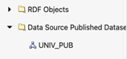

## 14.3.2.6 Data Source Published Datasets Navigator

If the selected RDF data source is public, a navigator node with the public datasets is displayed on the menu tree as shown in the following figure:

Figure 14-33 Data Source Published Datasets Navigator

[Description of "Figure 14-33 Data Source Published Datasets Navigator"](img_text/rdf_published_ds_navigator.md)

**Parent topic:** [RDF Data Page](rdf-data-page.md)
