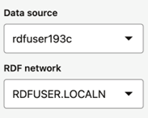

## 14.3.2.1 Data Source Selection

The data source can be selected from the list of available data sources present in [Figure 14-11](data-sources-page.md).

Figure 14-24 RDF Network

[Description of "Figure 14-24 RDF Network"](img_text/rdf_data_source_selection.md)

Select the desired Oracle RDF semantic network for the selected data source. Each network is identified by a network owner and network name.

**Parent topic:** [RDF Data Page](rdf-data-page.md)
