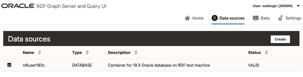

## 14.3.1 Data Sources Page

The Data Sources page allows you to create different types of data sources. Only administrator users can manage data sources. The RDF store can be linked to an Oracle Database or to an external RDF data provider. For Oracle data sources, there are three types of connections:

- JDBC data source defined with database parameters
- JDBC data source defined on an application server
- Oracle wallet connection defined in a zip file

These database connections must be available in order to link the RDF web application to the data source.

To create a data source, click Data Sources, then Create.

Figure 14-11 Data Sources Page

[Description of "Figure 14-11 Data Sources Page"](img_text/data_sources_page.md)

- [Creating a JDBC URL Data Source](creating-jdbc-url-data-source.md)
- [Creating an Oracle Container Data Source](creating-oracle-container-data-source.md)
- [Creating an Oracle Wallet Data Source](creating-oracle-wallet-data-source.md)
- [Creating an Endpoint URL Data Source](creating-endpoint-url-data-source.md)

**Parent topic:** [Getting Started with RDF Graph Query UI](gettting-started-rdf-graph-query-ui.md)
