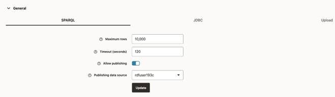
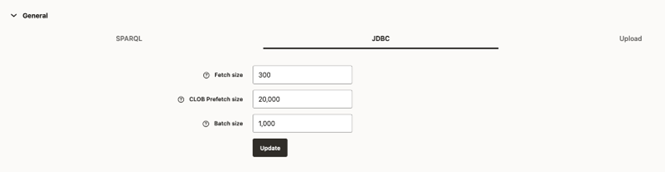
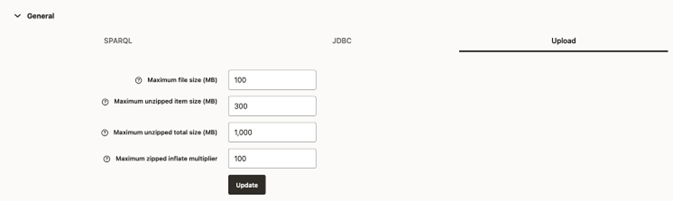

## 14.3.3.2 General JSON configuration file

The general JSON configuration file stores information related to SPARQL queries, JBDC parameters and upload parameters.

The JSON file includes the following parameters:

- Maximum SPARQL rows: Defines the limit of rows to be fetched for a SPARQL query. If a query returns more than this limit, the fetching process is stopped.
- SPARQL Query Timeout: Defines the time in seconds to wait for a query to complete.
- Allow publishing: Flag to enable public data source selection for using with SPARQL query endpoints.
- Publishing data source: The RDF data source to publish datasets.
- JDBC Fetch size: The fetch size parameter for JDBC queries.
- JDBC CLOB Prefetch size: Number of characters to be prefetched when retrieving large object values.
- JDBC Batch size: The batch parameter for JDBC updates.
- Maximum file size to upload: The maximum file size to be uploaded into server.
- Maximum unzipped item size: The maximum size for an item in a zip file.
- Maximum unzipped total size: The size limit for all entries in a zip file.
- Maximum zip inflate multiplier: Maximum allowed multiplier when inflating files.

These parameters can be updated as shown in the following figures

Figure 14-72 General SPARQL Parameters

[Description of "Figure 14-72 General SPARQL Parameters"](img_text/general_sparql_parameters.md)

Figure 14-73 General JDBC Parameters

[Description of "Figure 14-73 General JDBC Parameters"](img_text/general_jdbc_parameters.md)

Figure 14-74 General File Upload Parameters

[Description of "Figure 14-74 General File Upload Parameters"](img_text/general_json_config_file.md)

**Parent topic:** [Configuration Files for RDF Server and Client](configuration-files-rdf-server-and-client.md)
