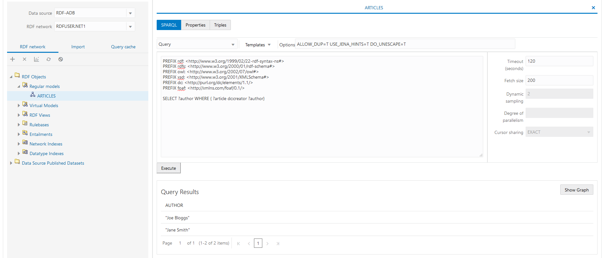

## 2.3.1 Getting Started with Semantic Data in Oracle Autonomous Database

This tutorial describes how you can quickly get started with RDF data in Autonomous Database.

You can run the SQL statements shown in the steps through one of the following options:

- Using any of the SQL based Oracle Database tools that is connected with your Autonomous Database. See [Connect to Autonomous Database Using Oracle Database Tools](https://docs.oracle.com/pls/topic/lookup?ctx=en/cloud/paas/autonomous-database&id=GUID-CF6C7E1B-D0D4-4641-BADA-5C57DEA7C73B) for more details.
- Using the built-in Database Actions which provides a web-based interface. See [Connect with Built-in Oracle Database Actions](https://docs.oracle.com/pls/topic/lookup?ctx=en/cloud/paas/autonomous-database/adbsa&id=GUID-102845D9-6855-4944-8937-5C688939610F) for more details.

1.  Connect to your autonomous database as a user with administrative privileges and create a network owner user.
        CREATE USER rdfuser
        IDENTIFIED BY <password-for-rdfuser>
        QUOTA 5G ON DATA;

    **Note:**

    If you are using Database Actions, you must REST Enable the user in order to enable the new user to access Database Actions. See [Create User](https://docs.oracle.com/pls/topic/lookup?ctx=en/database/oracle/sql-developer-web&id=GUID-856BBD92-DFEC-4C6E-A8EE-54368078F699) for more details.
2.  Grant the required privileges to the newly created network owner user.
    You must be connected as a user with administrative privileges to run the following statement:
        GRANT CONNECT, RESOURCE, CREATE VIEW TO rdfuser;

    **Note:**

    If you are using Database Actions to create the new user in the preceding step, the `CONNECT` and the `RESOURCE` privileges are provided by default. Hence, you must only grant the `CREATE VIEW` privilege to the new user.
3.  Connect as the network owner user.
        CONNECT rdfuser/<password-for-rdfuser>
4.  Create a semantic network by calling `SEM_APIS.CREATE_SEM_NETWORK`.
    You must create a semantic network as the intended owner of the schema-private network on the tablespace `DATA`.

    The following example creates a schema-private semantic network named `net1` owned by network owner user `rdfuser` using the `DATA` tablespace.

        EXECUTE SEM_APIS.CREATE_SEM_NETWORK('DATA', network_owner=>'rdfuser', network_name=>'net1');
5.  Create a model by calling `SEM_APIS.CREATE_SEM_MODEL`.
    The following example creates a model named `articles` in the `net1` schema-private network.
        EXECUTE SEM_APIS.CREATE_SEM_MODEL('articles', NULL, NULL, network_owner=>'rdfuser', network_name=>'net1');
6.  Insert triples into the model using one of the following options.
    - Use the SEM_APIS.UPDATE_MODEL procedure to insert data:

      **Note:**

      If you are using an Autonomous Database instance in a shared deployment, then the SEM_APIS.UPDATE_MODEL function requires Oracle JVM to be enabled. See [Use Oracle Java](https://docs.oracle.com/pls/topic/lookup?ctx=en/cloud/paas/autonomous-database&id=GUID-2516EE33-B38D-4270-BE52-30A4F9014E8B) to enable Oracle JVM on your Autonomous Database instance.
      You can insert triples into the model using SEM_APIS.UPDATE_MODEL as shown in the examples in [Semantic Data Examples (PL/SQL and Java)](rdf-semantic-graph-overview.md).

    - Use the SQL `INSERT` statement to insert data:

      For example:

          INSERT INTO rdfuser.net1#rdft_articles(triple) VALUES (
            SDO_RDF_TRIPLE_S ('articles','<http://nature.example.com/Article1>',
              '<http://purl.org/dc/elements/1.1/title>','"All about XYZ"',
              network_owner=>'RDFUSER', network_name=>'NET1'));

          INSERT INTO rdfuser.net1#rdft_articles(triple) VALUES (
            SDO_RDF_TRIPLE_S ('articles','<http://nature.example.com/Article1>',
              '<http://purl.org/dc/elements/1.1/creator>','"Jane Smith"',
              network_owner=>'RDFUSER', network_name=>'NET1'));

          INSERT INTO rdfuser.net1#rdft_articles(triple) VALUES (
            SDO_RDF_TRIPLE_S ('articles',
              '<http://nature.example.com/Article1>',
              '<http://purl.org/dc/terms/references>',
              '<http://nature.example.com/Article2>',
              network_owner=>'RDFUSER', network_name=>'NET1'));

          INSERT INTO rdfuser.net1#rdft_articles(triple) VALUES (
            SDO_RDF_TRIPLE_S ('articles','<http://nature.example.com/Article2>',
              '<http://purl.org/dc/elements/1.1/title>','"A review of ABC"',
              network_owner=>'RDFUSER', network_name=>'NET1'));

          INSERT INTO rdfuser.net1#rdft_articles(triple) VALUES (
            SDO_RDF_TRIPLE_S ('articles','<http://nature.example.com/Article2>',
              '<http://purl.org/dc/elements/1.1/creator>','"Joe Bloggs"',
              network_owner=>'RDFUSER', network_name=>'NET1'));

          INSERT INTO rdfuser.net1#rdft_articles(triple) VALUES (
            SDO_RDF_TRIPLE_S ('articles',
              '<http://nature.example.com/Article2>',
              '<http://purl.org/dc/terms/references>',
              '<http://nature.example.com/Article3>',
              network_owner=>'RDFUSER', network_name=>'NET1'));
7.  Execute SPARQL queries on the inserted data using one of the following options as applicable.
    - Query semantic data with SEM_MATCH table function:

      **Note:**

      If you are using an Autonomous Database instance in a shared deployment, then the SEM_MATCH table function requires Oracle JVM to be enabled. See [Use Oracle Java](https://docs.oracle.com/pls/topic/lookup?ctx=en/cloud/paas/autonomous-database&id=GUID-2516EE33-B38D-4270-BE52-30A4F9014E8B) to enable Oracle JVM on your Autonomous Database instance.
      You can query the inserted triples data using the SEM_MATCH table function as shown in the examples in [Semantic Data Examples (PL/SQL and Java)](rdf-semantic-graph-overview.md).

    - Query semantic data using RDF Graph Server and Query UI:

      See [Deploying RDF Graph Server and Query UI from Oracle Cloud Marketplace](deploying-rdf-graph-server-and-query-ui-oracle-cloud-marketplace.md) to launch the RDF Query UI application.

      You can query the inserted data by running SPARQL queries on the [SPARQL query page](performing-sparql-query-and-sparql-update-operations.md) in RDF Graph Query UI.

      Figure 2-1 Running SPARQL Query in RDF Graph Query UI

      

    - Query using SPARQL editor in SQL Developer:

      You can also run SPARQL queries using SPARQL editor in SQL Developer.

      **Note:**

      SQL Developer versions earlier than 21.2 on an Autonomous Database instance in a shared deployment requires Oracle JVM to be enabled. See [Use Oracle Java](https://docs.oracle.com/pls/topic/lookup?ctx=en/cloud/paas/autonomous-database&id=GUID-2516EE33-B38D-4270-BE52-30A4F9014E8B) to enable Oracle JVM on your Autonomous Database instance.
      See [Connect with Oracle SQL Developer](https://docs.oracle.com/pls/topic/lookup?ctx=en/cloud/paas/autonomous-database&id=GUID-14217939-3E8F-4782-BFF2-021199A908FD) for creating a connection to your autonomous database using Cloud Wallet.

**Parent topic:** [Quick Start for Using RDF Semantic Data in Oracle Autonomous Database](quick-start-using-rdf-data-oracle-autonomous-database.md)
