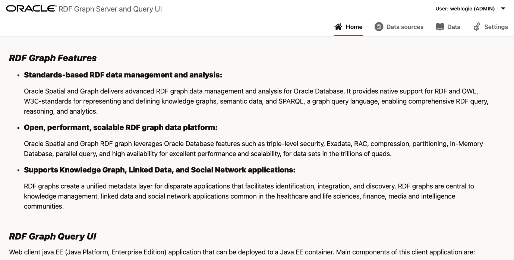

## 14.3 Getting Started with RDF Graph Query UI

The Oracle Graph Query UI contains a main page with RDF graph feature details and links to get started.

Figure 14-10 Query UI Main Page

[Description of "Figure 14-10 Query UI Main Page"](img_text/main_page.md)

The main page includes the following:

- Home: Get an overview of the Oracle RDF Graph features.

- Data sources: Manage your data sources.

- Data: Manage, query or update RDF objects.

- Settings: Set your configuration parameters.

<!-- -->

- [Data Sources Page](data-sources-page.md)
- [RDF Data Page](rdf-data-page.md)
- [Configuration Files for RDF Server and Client](configuration-files-rdf-server-and-client.md)

**Parent topic:** [Oracle RDF Graph Query UI](oracle-rdf-graph-query-ui.md)
