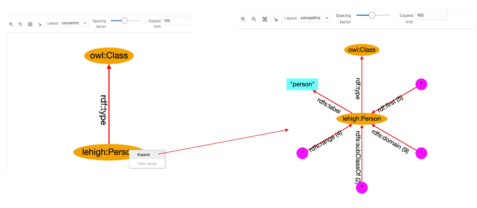
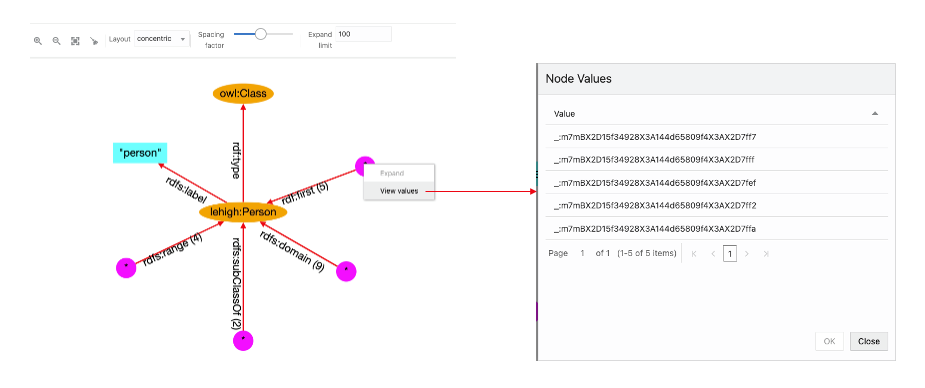
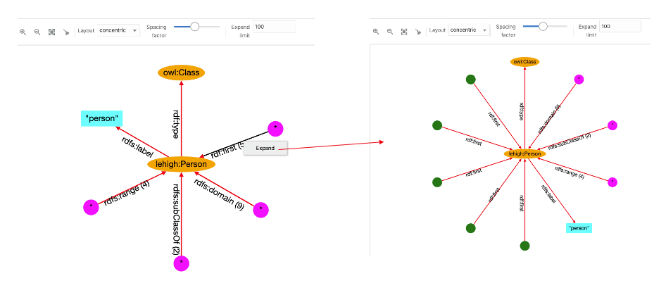
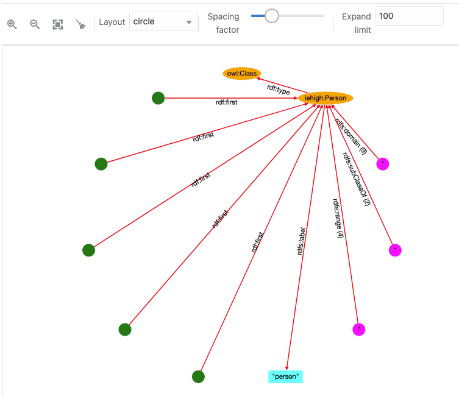

## 14.3.2.11.2 Graph View

The graph view panel, where the graph is displayed, consists of the following components:

- A toolbar with the following options:
  - Zoom Options: Includes zoom in, zoom out, fit all, and clear all actions. Additionally, zoom in and out actions can be achieved with the mouse wheel. Drag to pan graph is also available.
  - Layout: A few built-in layouts (such as random, grid, circle, concentric, breadth first, and cose).
  - Spacing factor: A slider to adjust the spacing between nodes (useful for lengthy edges).
  - Expand limit: The maximum number of node entries that can be expanded for an edge.
- A drawing area with the RDF nodes and edges.

You can interact with the edges and nodes of the graph displayed in the graph view area. Initially, the graph displayed is based on the root class summaries (counts), but you can always expand the elements.

To expand a node in the graph, click on the node and then select Expand. New node elements with new edges linked to the selected node gets added to the graph. For example, in the following figure, the node lehigh:Person is shown expanded:

Figure 14-57 Expanding a Node

[Description of "Figure 14-57 Expanding a Node"](img_text/adv_graph_view_components.md)

Star nodes (magenta color) contain the values associated with the edge predicate. To see these values, click on the node and select View Values:

Figure 14-58 Viewing Node Values

[Description of "Figure 14-58 Viewing Node Values"](img_text/adv_graph_view_values.md)

To expand the edge predicate summary, click on the edge and select Expand. Then the star node associated with it will be divided into new nodes and edges in the graph. However, if the expand limit value is lower than the summary count, then all the nodes will not be expanded. For example:

Figure 14-59 Expanding an Edge Predicate

[Description of "Figure 14-59 Expanding an Edge Predicate"](img_text/adv_graph_view_expand.md)

The following figure displays the output for a circular layout:

Figure 14-60 Circular Layout Graph

[Description of "Figure 14-60 Circular Layout Graph"](img_text/adv_graph_view_circle_layout.md)

The following basic conventions apply to the graph displayed in the graph view:

- URI nodes are displayed in orange color with labels inside the ellipse shape.
- Blank nodes are displayed in green color with circle shape. Mousing over the blank node shows its label value.
- Collapsed edges have the predicate with the count (if more than 1).
- Star nodes in magenta color and circle shape contain the values associated with the collapsed edge.
- Literal nodes are displayed with different colors depending on its type. A string literal is shown in cyan color with the label value. For long string values, the label length is reduced and mousing over literal node shows the full label value. Literals with datatype are displayed in different colors, and mousing over them shows the datatype name.

**Parent topic:** [Advanced Graph View](advanced-graph-view.md)
