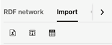

## 14.3.2.3 Importing Data

For Oracle semantic networks, the process of importing data into an RDF model is generally done by bulk loading the RDF triples that are available on the staging table.

Figure 14-26 RDF Import Data Actions

[Description of "Figure 14-26 RDF Import Data Actions"](img_text/rdf_import_data.md)

The available actions include:

- Upload one or more RDF files into a couple of Oracle RDF Graph staging tables. The staging table with suffix `_CLOB` will contain records with object values having length greater than 4k. These staging tables can be reused in other bulk load operations. Files with extensions `.nt` (N-triples), `.nq` (N-quads), `.ttl` (Turtle), `.trig` (TriG), and `.jsonld` (JsonLD) are supported for import. There is a limit of file size to be imported, which can be tuned by administrator.

  Also, zip files can be used to import multiple files at once. However, the zip file is validated first, and will be rejected if any of the following conditions occur:

  - Zip file contains directories
  - Zip entry name extension is not a known RDF format (.nt, .nq, .ttl, .trig, .jsonld)
  - Zip entry size or compressed size is undefined
  - Zip entry size does exceed maximum unzipped entry size
  - Inflate ratio between compressed size and file size is lower than minimum inflate ratio
  - Zip entries total size does exceed maximum unzipped total size

- Bulk load the staging table records into an Oracle RDF model.

- View the status of bulk load events.

**Parent topic:** [RDF Data Page](rdf-data-page.md)
